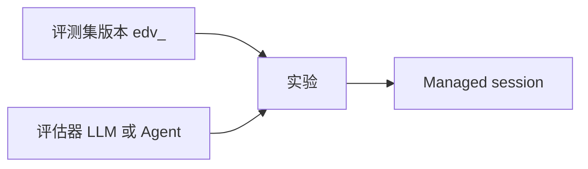

# QCA Evaluation 对齐计划

- 状态：M1 评测集、M2 自定义评估器和 M3 实验与 Compare 已实现。预置目录延后，可选。今日额度不在范围内。评估器只保存配置，不执行打分。实验会为每个 case 创建 Managed session，但不轮询 session 结束，也不会把实验标成 completed。
- 日期：2026-10-22
- 来源：qoder.com.cn 企业控制台，分析 → 评测（Beta）。下文只采用这次实测看到的信息架构和字段，不补写未出现的产品文案。
- 非目标：不改 Workbench Evaluate 的请求、表格或测试预期。不实现今日额度、额度计数或额度 UI。本切片不做预置目录，也不打分。

Workbench Evaluate 仍是 prompt revision 上的变量行 A/B。QCA 评测不是这个表格，也没有一等的 Runs、Outcome 或 Results 页面；那些路径在实测里是空壳。

## 当前实现（只依据仓库）

Workbench Evaluate 是 Console 路由，不在 `openapi/oma.en.json` / `openapi/oma.zh.json`。

| 层 | 位置 | 今天做什么 |
| --- | --- | --- |
| 路由 | `internal/workbench/workbench_handler.go`，挂在 `/api/organizations/{orgUuid}` | revision 下列表/创建 evaluation；按 evaluation 更新变量、golden answer、completion、rating；删除；流式生成 test case |
| 持久化 | `workbench_evaluations`，`internal/db/workbench_evaluation_mapper.go` | 一行 evaluation 属于一个 prompt revision。`00044` 之后查询用 `organization_uuid` + `revision_ref_uuid`。payload 是 JSON，不是独立 case/run 表 |
| 生成队列 | `workbench_generated_test_cases` | 组织级一次性队列。更新变量时 `TakeWorkbenchGeneratedTestCase` 取走匹配项，不是可复用数据集 |
| 前端 | `web/src/features/workbench/evaluate.tsx`、`model.ts`、`api.ts`、`WorkbenchPage.tsx` | 模式 `prompt \| evaluate`。表格列是变量、当前 revision 输出、可选对比 revision、可选 ideal output |
| 入口条件 | `canEvaluateRevision` | 至少一个 `{{var}}`，且 `tools.length === 0`。带工具的 prompt 不能进入 Evaluate |
| 导航 | `web/src/app/layout/navigation.ts` | `/workbench` 在 Build 组里，当前 `hidden: true` |

一条 evaluation 的 payload 字段是：`id`、`revision_id`、`test_case_id`、`variable_values`、`golden_answer`、`completion`、`completion_text`、`rating`、`created_at`。`test_case_id` 默认等于 evaluation id，没有跨 revision 的 case 身份。

运行行为：

- 「Run」对当前 prompt revision 做变量替换，再调用已有的 `POST .../workbench/completions`。主列输出会 `save_completion`。
- Add Comparison 只在浏览器状态里保存另一份 prompt revision 的输出，不写库，刷新即丢失。
- `rating` 路由和行模型存在，`EvaluateView` 没有评分控件，Console client 也没有 `update_rating` 调用。
- CSV 导入/导出在浏览器完成，列是 `{{variable}}` 和 `ideal_output`，然后逐行 `evaluations/create`。导入会替换当前表格，不保留数据集版本。
- 未保存的 prompt 修改会使表格只读，提示先存成新 revision。

OMA 里已经存在、但实测评测页没有当成一等对象的能力：

- Agent 版本：`agents.current_version` 与 `agent_versions`。Session 创建时钉住 `agent_version` 和 `agent_snapshot`。
- 任务状态与轨迹：`session_events` 已分类 `session.status_*`、`agent.tool_use` / `agent.tool_result`、`span.model_request_start` / `span.model_request_end`。
- Deployment outcome：`user.define_outcome` 与 `span.outcome_evaluation_*` 服务单次 session。实测评测的打分入口是评估器，不是这套 outcome 页。
- Trace 查询：`observability.enabled` 时才注册 observability traces。
- Memory：`memory_stores` 可挂到 session。实测评测信息架构没有 memory pin。

## 实测信息架构

评测在「分析 → 评测」下，三个页签加今日额度：

| 页签 | 控制台路径 | 实测内容 |
| --- | --- | --- |
| 评测集 | `/cloud/evaluation`、`/evaluation/datasets` | 自定义集可空。另有已发布预置集，带版本（`edv_`）、case 数、状态 可用 / 已归档 |
| 评估器 | `/evaluators` | 自定义可空。另有预置评估器，类型为 Agent。创建支持 LLM 与 Agent |
| 实验 | `/experiments`、`/experiments/new`、`/experiments/compare` | 绑定数据集版本、Agent 与多个评估器。Compare 固定数据集版本和评估器，更换 Agent 版本 |

没有一等的 Runs、Outcome 或 Results 页面。

评测集：

- 创建时填写 name、desc。上传 JSONL 或 ZIP（不超过 100MB、不超过 1000 条），或复用已发布版本里的 case。
- Case 字段：`name` 必填，`turns` 为必填的字符串数组，另有 `desc`、`checkpoints`、`input_files`、`reference_files`。`reference_files` 只给评估器使用。
- 预置集详情是版本列表、case 列表和 case JSON 快照，只读。

评估器：

- LLM：单个模型打分。
- Agent：在打分 Agent 的 sandbox session 里读 `/data/session/result.json` 和 artifacts，写出 `/output/score.json`，形状为 `{score, explanation, details}`。
- 变量：`input`、`output`、`checkpoints`、`agent_trajectory`、`invocation_result`。
- 今日额度：实测里预置 100，自定义 LLM 100，按 Asia/Shanghai 零点重置。Agent 评估器不在额度弹层里。OMA 不实现这项，也不做计数器或额度 UI。

实验：

- 绑定数据集版本、Agent（加 Environment、timeout、可选 env/resources）和多个评估器。评估器在实验上冻结。
- 每个 case 创建一个 Managed session。
- Compare 固定数据集版本和评估器，变化的是 Agent 及其版本。
- 名称在同一个 space 内还要按模式唯一：Managed Agents 与 Forward Mode 分开。

## 能力矩阵

| QCA feature | OMA today | gap | proposed approach | priority |
| --- | --- | --- | --- | --- |
| 评测集：创建、导入、列出，带版本和 case | Evaluate 行挂在单个 prompt revision 上。CSV 只覆盖变量和 ideal output | 没有 workspace 级评测集、版本和 turns case | M1：`evaluation_datasets`、`evaluation_dataset_versions`、`evaluation_cases`。创建集时写入版本 1。JSONL/ZIP 导入。不迁移 `workbench_evaluations`，不预置官方数据集 | P0，本切片 |
| 评估器 | M2 可创建、列出、读取自定义评估器。LLM 保存单个 model 和 prompt。Agent 保存打分 Agent id。不执行打分 | 预置评估器延后。今日额度不实现。实验里的打分 sandbox 仍未做 | M2：`evaluation_evaluators` 与版本 1。变量只用 `input`、`output`、`checkpoints`、`agent_trajectory`、`invocation_result`。Agent 的 `/data/session/result.json` 与 `/output/score.json` 留到后续执行，不跟额度绑定 | P0，本切片 |
| 实验 | M3 可创建、列出、读取实验。创建时冻结数据集版本、Agent 版本、环境和评估器版本，并为每个 case 调用已有 Session 创建 | 不轮询 session 完成，不打分，timeout 与 env 只落库 | M3：`evaluation_experiments` 与 case item。Session id 记在 item 上。状态停在 running 或 failed，completed 留给后续执行 | P0，本切片 |
| Compare | M3 按数据集版本和冻结评估器版本列出 status 为 completed 的实验 | 本切片没有路径把实验标成 completed，所以 Compare 在只有新建实验时是空列表 | 固定数据集版本和评估器，变化的是 Agent 版本。名称在组织和工作区下唯一 | P0，本切片 |
| 预置评测集 / 预置评估器 | 无 | 没有只读的已发布目录 | 目录与「复用已发布版本」延后，可选。本变更不建目录 | 延后 |
| 今日额度 | 无评测额度 | QCA 有预置 100、自定义 LLM 100、上海时区零点和 Agent 评估器不计入 | 不实现。不记账，不做额度 UI 或计数器，也不放进后续里程碑 | 不做 |
| Session trace | Session 事件和详情已覆盖模型、工具和任务状态 | 实验不另存 trace | M3 的 item 保存 session id，详情链到现有 Session 页。不新写 trace 存储 | P1 |
| Memory pin | Memory 版本存在 | 实测评测页没有这项 | 不纳入当前里程碑 | 不做 |

## 为什么不改现有 Evaluate 表格

Workbench Evaluate 继续做 prompt 变量实验。评测集的 case 是 `turns`，不是 `{{var}}` 行。入口还拒绝 tools。因此保留 `web/src/features/workbench/` 与 `internal/workbench/`。评测集、评估器和实验放在 Managed Agents，不放进隐藏的 `/workbench`。

## 数据模型

`00095_evaluation_datasets.sql` 在写入前已按实测字段校正，不另起已应用 migration。不改 `internal/db/schema.go`，不建外键。租户条件同时带 `organization_uuid` 和 `workspace_uuid`。

`evaluation_datasets`

- `external_id` 前缀 `evalds_`
- `name` 1–255 字符，`description` 最长 1024，API 字段名是 `desc`
- `archived_at` 为空时状态为 `available`，否则为 `archived`。M1 不提供归档接口，列先留着
- 列表不返回已归档行

`evaluation_dataset_versions`

- `external_id` 前缀 `edv_`
- `dataset_uuid` 加 `version` 唯一，`version` 从 1 开始
- M1 创建评测集时在同一事务写入版本 1。不提供另存新版本或复用预置版本的接口

`evaluation_cases`

- `external_id` 前缀 `evalcase_`
- 属于 `dataset_uuid` 和 `version_uuid`。`(version_uuid, position)` 唯一
- `name` 必填。`description` 对应 API 的 `desc`
- `turns` jsonb，必须是数组，且至少一条非空字符串
- `checkpoints` 可空，只接受 JSON 数组或对象，不解释内部字段
- `input_files`、`reference_files` 可空，只接受 JSON 数组，不解释元素。`reference_files` 留到评估器使用

`00096_evaluation_evaluators.sql` 增加自定义评估器。不建实验表或 memory pin 表。不写入预置评估器。

`evaluation_evaluators`

- `external_id` 前缀 `evalev_`
- `name` 1–255 字符，`description` 最长 1024，API 字段名是 `desc`
- `archived_at` 为空时状态为 `available`，否则为 `archived`。M2 不提供归档接口
- 列表不返回已归档行

`evaluation_evaluator_versions`

- `external_id` 前缀 `eev_`
- `evaluator_uuid` 加 `version` 唯一，`version` 从 1 开始
- M2 创建评估器时在同一事务写入版本 1。实验以后冻结的是这个版本，本切片不另存新版本
- `evaluator_type` 为 `llm` 或 `agent`
- LLM：`model` 必填，最长 255；`prompt_template` 必填，最长 16000。`agent_id` 必须为空
- Agent：`agent_id` 必填，最长 255。`model` 与 `prompt_template` 必须为空。M2 只保存 id，不检查 Agent 是否存在，也不创建 sandbox session
- `variables` 是 JSON 数组，元素只能是 `input`、`output`、`checkpoints`、`agent_trajectory`、`invocation_result`。LLM 至少选一个。prompt 里的 `{{name}}` 必须落在已选变量里
- Agent 响应带固定契约：读 `/data/session/result.json` 和 artifacts，写 `/output/score.json`，字段为 `score`、`explanation`、`details`。这些路径不入库

`00097_evaluation_experiments.sql` 增加实验。不建外键，不写入预置数据，不记账。

`evaluation_experiments`

- `external_id` 前缀 `evalexp_`
- `name` 在 `(organization_uuid, workspace_uuid)` 下唯一。QCA 还按 Managed Agents / Forward Mode 分开；OMA 没有这第二种模式，所以不另加 mode 列
- 绑定 `version_external_id`、`agent_external_id`、`agent_version`、`environment_external_id`
- `timeout_seconds` 为 1–86400。`env` 可空，必须是 JSON 对象。`resources` 可空，必须是 JSON 数组
- `evaluator_set_key` 是冻结评估器版本 id 排序后用 `|` 连接。Compare 用它和数据集版本定位同一组实验
- `status` 为 `pending`、`running`、`completed`、`failed`、`cancelled`。本切片创建后是 pending；Session 创建成功变为 running，失败变为 failed。没有把实验标成 completed 或 cancelled 的接口

`evaluation_experiment_evaluators`

- `external_id` 前缀 `evalbind_`
- 创建时复制评估器当前版本。一次实验最多 20 个，且不能重复
- `(experiment_uuid, position)` 与 `(experiment_uuid, evaluator_uuid)` 唯一

`evaluation_experiment_items`

- `external_id` 前缀 `evalitem_`
- 每个 case 一行，`session_external_id` 在 Session 创建成功后写入
- 状态与实验相同。`error_message` 最长 1024。case 的 `turns` 超过 Session `initial_events` 的 50 条上限时，这一行失败，不另写执行引擎

执行缺口：timeout 和 env 只保存在实验上，不传给 Session 或 sandbox。resources 会交给已有 Session 创建。本切片不轮询 session 状态，不读 `/output/score.json`，因此 Compare 只在已有 `completed` 实验时返回行，新建实验不会出现在 Compare 里。

## API

Console cookie + CSRF 组，与 MCP servers 相同。错误体是 `{error, message}`。成功响应状态码 200。

M1：

- `GET/POST /api/console/organizations/{orgUuid}/workspaces/{workspaceId}/evaluation-datasets`
- `GET .../evaluation-datasets/{datasetId}`
- `GET/POST .../evaluation-datasets/{datasetId}/cases`
- `POST .../evaluation-datasets/{datasetId}/cases:import`

路径里的 workspace 可以是 `default`、workspace UUID 或 external id。查询和写入使用 principal 的组织与 workspace UUID。另一 workspace 的 id 返回 404，且不读库。

创建评测集的 body 是 `{name, desc}`。响应带 `status` 和 `version: {id, version, case_count}`。

单条 case 与 JSONL 每行的字段是 `name`、`turns`、`desc`、`checkpoints`、`input_files`、`reference_files`。未知字段拒绝。导入是 JSONL（`application/x-ndjson` 或 `application/jsonl`），或只含一个 `.jsonl` 成员的 ZIP。超过 1000 条或 100MB 返回 400，校验通过前不写入。这与 Workbench 的 `{{var}},ideal_output` CSV 不是同一格式。

M2：

- `GET/POST /api/console/organizations/{orgUuid}/workspaces/{workspaceId}/evaluation-evaluators`
- `GET .../evaluation-evaluators/{evaluatorId}`

创建评估器的 body 是 `{name, desc, evaluator_type, model, agent_id, prompt_template, variables}`。`evaluator_type` 为 `llm` 或 `agent`。响应带 `status` 和 `version`。Agent 版本额外带 `agent_contract`。

M2 不做 PATCH、DELETE、归档、预置目录和 OpenAPI。不执行打分。不实现今日额度。

M3：

- `GET/POST /api/console/organizations/{orgUuid}/workspaces/{workspaceId}/evaluation-experiments`
- `GET .../evaluation-experiments/{experimentId}`
- `POST .../evaluation-experiments/{experimentId}:start`
- `POST .../evaluation-experiments:compare`

创建 body 是 `{name, desc, dataset_version_id, agent_id, agent_version, environment_id, timeout_seconds, env, resources, evaluator_ids}`。`agent_version`、`env`、`resources` 可省略。省略 `agent_version` 时使用 Agent 当前版本，并把它写进实验。Agent 或 Environment 不存在返回 404，已归档返回 400。数据集版本没有 case 时不创建实验。

列表不返回 item。读取返回冻结的评估器和每个 case 的 session id。`:start` 只重试仍为 pending 的 item。Compare 的 body 是 `{dataset_version_id, evaluator_ids}`，只返回 `completed`。没有完成实验时 `data` 为空数组，不是 404。

M3 不做取消、打分、预置目录和 OpenAPI。不实现今日额度。

## UI

Managed Agents 导航在 Sessions 与 Observability 之间增加 Datasets。OMA 没有「分析」分组，所以不把评测放进用量分析。

- `/workspaces/$workspaceId/evaluations`：评测集列表和创建（name、desc）
- `/workspaces/$workspaceId/evaluations/datasets/$datasetId`：当前版本、case 列表、单条 case、JSONL 导入
- `/workspaces/$workspaceId/evaluations/evaluators`：评估器列表和创建。类型在 LLM 与 Agent 之间切换。LLM 填写 model 和 prompt，变量芯片插入 `{{name}}`。Agent 填写 Agent id，并展示 score.json 契约

Managed Agents 导航在 Evaluators 旁增加 Experiments。

- `/workspaces/$workspaceId/evaluations/experiments`：实验列表
- `/workspaces/$workspaceId/evaluations/experiments/new`：绑定数据集版本、Agent、Environment、timeout 和评估器
- `/workspaces/$workspaceId/evaluations/experiments/compare`：固定数据集版本和评估器。没有 completed 实验时显示 “No completed experiments.” / “还没有已完成的实验。”
- `/workspaces/$workspaceId/evaluations/experiments/$experimentId`：item、session id，以及重试 pending item

Workbench 的 prompt/evaluate 开关保持原样。

## 里程碑

1. **M0**：差距说明。
2. **M1**：评测集、版本 1 和 case 的 migration、Yourbatis、创建 / 导入 / 列出，以及 Datasets 页面。无 session，不改 Workbench Evaluate。
3. **M2**：自定义评估器。LLM 与 Agent 两种类型，创建时写入版本 1。变量只用 `input`、`output`、`checkpoints`、`agent_trajectory`、`invocation_result`。不执行打分，不预置 11 个官方评估器。
4. **M3（本变更）**：实验与 Compare。绑定数据集版本、Agent、Environment、timeout 和冻结的评估器版本；每个 case 复用已有 Session 创建并记下 session id。Compare 固定数据集版本和评估器，只列出 completed。名称在组织和工作区下唯一。不轮询完成，不把 timeout/env 注入 sandbox。
5. **预置目录（延后，可选）**：只读的已发布评测集和评估器，以及从已发布版本复用 case。未排进本变更。

今日额度不在里程碑里。不实现每日 100 次、上海时区重置、Agent 评估器是否计入，也不做额度 UI 或计数器。

实验从 running 到 completed、打分，以及把 timeout/env 注入 sandbox，都还没做。它们不属于额度。

## 未排期

预置目录仍可选、延后。不把今日额度排进后续切片。不改 Workbench。

## 验收与未覆盖

同一 workspace 可以创建评测集（同时得到 `edv_` 版本 1）、用 JSONL 或单成员 ZIP 导入 case，并列出 case。空 name、空 turns、超过 1000 条、错误 ZIP 和另一 workspace 的 id 在写库前失败。归档行不出现在列表里。

同一 workspace 可以创建 LLM 评估器（model、prompt、已选变量，版本 `eev_`）和 Agent 评估器（agent id，响应带 score.json 契约），并列出、读取。错误类型、未选变量、Agent 带 prompt，以及另一 workspace 的 id，在写库前失败。

同一 workspace 可以创建实验：冻结 `edv_` 与评估器版本，item 先为 pending；接上 Session starter 后每个 case 得到 `sesn_`，实验变为 running。Starter 失败时 item 为 failed。列表不返回 item。Compare 在没有 completed 实验时返回空列表。空 name、重复评估器、非法 timeout、没有 case、已归档 Environment、重名和另一 workspace 的 id 会失败。

Postgres 迁移测试在设置 `TEST_MIGRATION_DATABASE_URL` 时覆盖到 `00097`。默认 `just test` 不连接外部数据库；未设置该变量时，不能把 `00097` 说成已经在真实 Postgres 上应用过。
