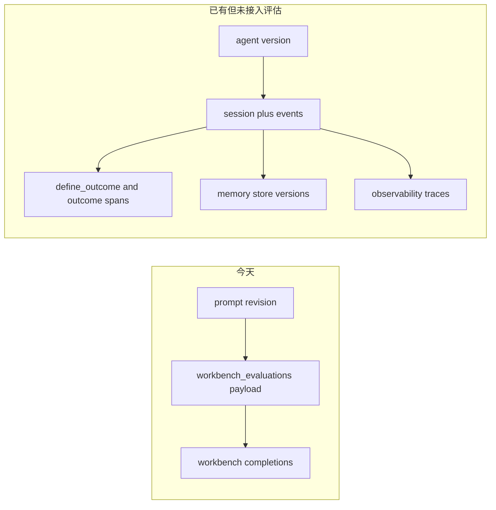
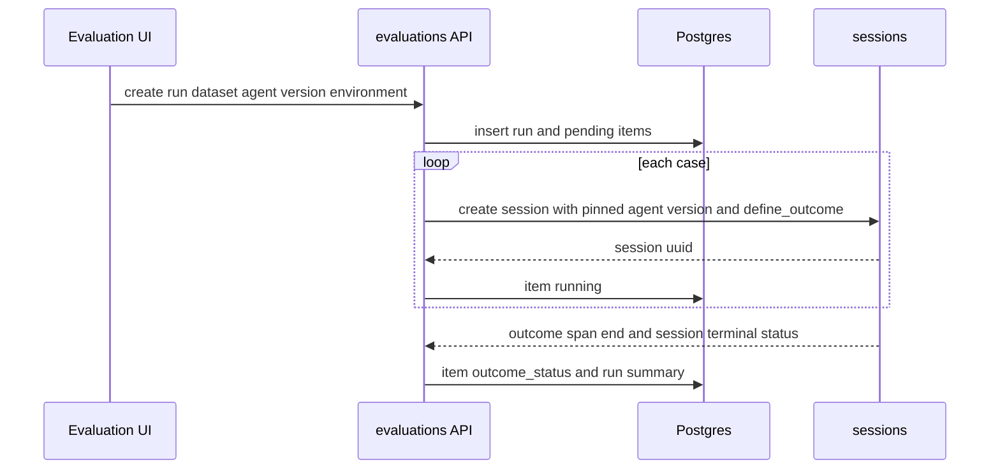

# QCA Evaluation 对齐计划

- 状态：计划。本文件只记录差距和下一切片，不改变运行时行为。
- 日期：2026-10-22
- 范围：把公开材料里的 Qoder Cloud Agents Evaluation（Beta）能力映射到当前 OMA 代码，并给出可实施的 P0 待办。
- 非目标：不复制 Qoder 界面文案。下文 Datasets / Runs / Compare / Outcome 只作为信息架构名称。不改 Workbench Evaluate 的请求、表格或测试预期。

假设已核对：OMA Workbench Evaluate 是 prompt revision 上的变量行 A/B，没有一等的 Dataset、Run、Outcome 对象。Agent 版本、Session 轨迹和 `user.define_outcome` 已存在，但没有被一次评估运行串起来。

## 当前实现（只依据仓库）

Workbench Evaluate 是 Console 路由，不在 `openapi/oma.en.json` / `openapi/oma.zh.json`。

| 层 | 位置 | 今天做什么 |
| --- | --- | --- |
| 路由 | `internal/workbench/workbench_handler.go`，挂在 `/api/organizations/{orgUuid}` | revision 下列表/创建 evaluation；按 evaluation 更新变量、golden answer、completion、rating；删除；流式生成 test case |
| 持久化 | `workbench_evaluations`，`internal/db/workbench_evaluation_mapper.go` | 一行 evaluation 属于一个 prompt revision。`00044` 之后查询用 `organization_uuid` + `revision_ref_uuid`。payload 是 JSON，不是独立 case/run 表 |
| 生成队列 | `workbench_generated_test_cases` | 组织级一次性队列。更新变量时 `TakeWorkbenchGeneratedTestCase` 取走匹配项，不是可复用数据集 |
| 前端 | `web/src/features/workbench/evaluate.tsx`、`model.ts`、`api.ts`、`WorkbenchPage.tsx` | 模式 `prompt \| evaluate`。表格列是变量、当前 revision 输出、可选对比 revision、可选 ideal output |
| 入口条件 | `canEvaluateRevision` | 至少一个 `{{var}}`，且 `tools.length === 0`。带工具的 prompt 不能进入 Evaluate |
| 导航 | `web/src/app/layout/navigation.ts` | `/workbench` 在 Build 组里，当前 `hidden: true` |

一条 evaluation 的 payload 字段是：`id`、`revision_id`、`test_case_id`、`variable_values`、`golden_answer`、`completion`、`completion_text`、`rating`、`created_at`。`test_case_id` 默认等于 evaluation id，没有跨 revision 的 case 身份。

运行行为：

- 「Run」对当前 prompt revision 做变量替换，再调用已有的 `POST .../workbench/completions`。主列输出会 `save_completion`。
- Add Comparison 只在浏览器状态里保存另一份 prompt revision 的输出，不写库，刷新即丢失。
- `rating` 路由和行模型存在，`EvaluateView` 没有评分控件，Console client 也没有 `update_rating` 调用。
- CSV 导入/导出在浏览器完成，列是 `{{variable}}` 和 `ideal_output`，然后逐行 `evaluations/create`。导入会替换当前表格，不保留数据集版本。
- 未保存的 prompt 修改会使表格只读，提示先存成新 revision。

旁边已经存在、但没有评估运行对象的能力：

- Agent 版本：`agents.current_version` 与 `agent_versions`。Session 创建时钉住 `agent_version` 和 `agent_snapshot`。
- 任务状态与轨迹：`session_events` 已分类 `session.status_*`、`agent.tool_use` / `agent.tool_result`、`span.model_request_start` / `span.model_request_end`。Session 详情用 `sessionTraceModel.ts` 渲染。
- Outcome：Deployment 初始事件接受 `user.define_outcome`，rubric 必须是 object，类型为 `text` 或 `file`。`span.outcome_evaluation_start|ongoing|end` 写入 session 事件；`sessions.outcome_evaluations` 是该 session 的 JSON 投影。Webhook `session.outcome_evaluation_ended` 只由 `span.outcome_evaluation_end` 触发。前端把 status 显示为 satisfied、needs revision、max iterations、failed、interrupted。
- Trace 查询：`observability.enabled` 时才注册 `GET /api/organizations/{orgUuid}/observability/traces`。关闭时 404。这是 OTLP/OpenObserve 查询，不是 evaluation run。
- Memory：`memory_stores` / `memories` / `memory_versions` 可挂到 session。评估代码不读取这些版本，也不把结果写回 memory。

## 能力矩阵

| QCA feature | OMA today | gap | proposed approach | priority |
| --- | --- | --- | --- | --- |
| Datasets：创建、导入、列出 cases | Evaluate 行挂在单个 prompt revision 上。CSV 只覆盖变量和 ideal output。生成结果进一次性队列 | 没有 workspace 级、可复用、与 prompt 解耦的 dataset/case。不能对同一组 case 重复跑不同 agent 版本 | 新表 `evaluation_datasets` 与 `evaluation_cases`。Console CRUD 加 JSON/CSV 导入。不迁移 `workbench_evaluations` | P0 |
| 对 agent/version 跑 evaluation | Evaluate 只跑无工具的 prompt completion。Agent 版本只在普通 session 上钉住 | 没有 run 对象，不能指定 agent、version、environment，也不能记录每个 case 的 session | `evaluation_runs` 钉 `agent_uuid` + `agent_version` + `environment_uuid`。每个 case 创建一个已有 Session，把 `session_uuid` 记到 `evaluation_run_items` | P0 |
| 版本对比 / 回归 | 浏览器里并排两份 prompt revision 的 completion 文本，不落库，无通过/失败差分 | 不能比较两个 agent 版本在同一 dataset 上的 outcome，也不能标出回退 | 同一 dataset 的两次已完成 run 做逐 case 比较。回归定义先用 outcome status 从 `satisfied` 变为其他，或 item 从成功变为失败。不做统计模型 | P1 |
| 模型调用、工具执行、任务状态 trace | Session 事件和 Session 详情已覆盖这三类。OTLP trace 另有开关 | 评估行只有一段 `completion_text`，没有 session、工具或 span 链接 | Run item 只存 session 引用。详情复用现有 Session trace。`observability.enabled` 时再按 session 时间窗链到 traces API。P0 不新写 trace 存储 | P1 |
| 按用户标准做 outcome / acceptance | `user.define_outcome`、rubric、outcome span 和 session JSON 投影已存在，且只服务单次 session / deployment | Dataset 上没有可复用标准。Run 不会汇总 satisfied / failed。Workbench `golden_answer` 与 `rating` 不是这套标准 | Dataset 保存与现有 text rubric 同形的 criteria。创建 session 时写入一条 `user.define_outcome`。`span.outcome_evaluation_end` 投影到 run item 的 `outcome_status` | P0 |
| Memory、eval、outcome 闭环 | Memory 版本和 outcome 各自存在 | Run 不记录开始时的 memory head，结果也不回写，无法解释「这次评估看到的记忆」 | Run 开始时记录所附 memory store 的当前 version id。UI 只展示钉住的版本和 session 期间的新版本。P0/P1 不自动把评估结果写入 memory | P2 |

## 为什么不改现有 Evaluate 表格

Workbench Evaluate 可以继续做 prompt 变量实验，但不能在原表格上长出 QCA 所需对象：

- 行的主键是 revision 下的 evaluation，换 agent 版本没有落点。
- 入口明确拒绝 tools。Agent 评估的主要信号是工具轨迹。
- 对比列是 React state。把 run、outcome、trace 塞进 `EvaluateTestCase` 会改 `WorkbenchPage` 的运行循环和现有测试。
- 导航里 Workbench 当前隐藏。Agent 评估应出现在 Managed Agents，靠近 Agents、Sessions、Observability、Memory stores。

因此保留 `web/src/features/workbench/` 与 `internal/workbench/` 的合同。新模块并列，不从 Evaluate 表格渐进改写。本文件的 UI 一节就是前端信息架构，不再单开一份重复的 `docs/design/fe` 说明。

## 目标数据模型

新表只通过 goose 增加，编号取当前最大 migration 的下一个（写本文时最大是 `00094`，实现时以分支当时的最大号为准）。不改 `internal/db/schema.go` 里的历史快照，不建外键。

租户条件始终同时带 `organization_uuid` 和 `workspace_uuid`。跨表引用用目标 UUID，不用 identity `id`。`external_id` 只给 Console/API 使用。

`evaluation_datasets`

- `uuid`，`external_id`（建议前缀 `evalds_`）
- `organization_uuid`，`workspace_uuid`
- `name`，可空 `description`
- `criteria` jsonb，可空。P0 只接受与 Deployment 相同的 text rubric：`type=text` 加有长度上限的 `content`，另加 `description` 与 `max_iterations`
- `created_by_user_uuid` 可空，`archived_at`，时间戳

`evaluation_cases`

- `uuid`，`external_id`（建议前缀 `evalcase_`）
- `organization_uuid`，`workspace_uuid`，`dataset_uuid`
- `position` 整数，用于稳定排序
- `title`
- `input` jsonb。P0 形状为 `{ "text": "..." }`，表示发给 session 的一条 user message。不在 P0 接受任意消息树
- `expected` jsonb 可空。只保存用户填写的参考文本，P0 不拿它做自动打分
- 时间戳

`evaluation_runs`

- `uuid`，`external_id`（建议前缀 `evalrun_`）
- `organization_uuid`，`workspace_uuid`，`dataset_uuid`
- `agent_uuid`，`agent_version`（正整数，必须是该 workspace 里已存在的版本）
- `environment_uuid`
- `status`：`queued`、`running`、`completed`、`failed`、`canceled`
- `summary` jsonb：计数，而不是原始事件。例如 total、completed、satisfied、failed
- `created_at`，`updated_at`，`finished_at`

`evaluation_run_items`

- `uuid`（不必单独 external_id，列表嵌在 run 下）
- `organization_uuid`，`workspace_uuid`，`run_uuid`，`case_uuid`
- `session_uuid` 可空，创建成功后写入
- `status`：`pending`、`running`、`succeeded`、`failed`、`canceled`
- `outcome_status` 可空，只接受 session trace 已有的状态词
- `error` 可空短文本，不存 prompt 或工具输出
- `started_at`，`finished_at`
- 唯一键：`(run_uuid, case_uuid)`

`evaluation_run_memory_pins`（P2 再加，P0 不建）

- `run_uuid`，`memory_store_uuid`，`memory_version_uuid`
- 记录开跑时的 head，供之后对照

写入规则靠近 run 状态机：

- 创建 run 时在同一事务插入全部 item，状态 `pending`，run 为 `queued`。Dataset 在此之后新增的 case 不进入这次 run。
- 每个 item 成功创建 session 后把 item 标为 `running` 并保存 `session_uuid`。Session 创建失败标 `failed`，不重试到另一 agent。
- Session 进入终态且 outcome span 已结束，或 session 失败/终止且不会再有 outcome 时，item 进入 `succeeded` 或 `failed`。全部 item 终态后 run 进入 `completed`；若创建阶段整体失败则为 `failed`。
- 取消只停止尚未创建 session 的 item。已经跑起来的 session 沿用现有 session 终止语义，不在本模块发明第二套终止。
- 重复投递 `span.outcome_evaluation_end` 时，同一 item 以最后一次非空 `outcome_status` 覆盖，不新开 item。

## API 触点

P0 使用 Console JSON API，不进 `/v1`，也不进 OpenAPI 的 Anthropic 面。等 run 合同稳定后再决定是否公开。

挂载在已有组织鉴权组下，路径带 workspace，与 Files、Memory 一样由服务端确认 workspace 属于该组织：

- `GET/POST /api/organizations/{orgUuid}/workspaces/{workspaceId}/evaluation-datasets`
- `GET/PATCH /api/organizations/{orgUuid}/workspaces/{workspaceId}/evaluation-datasets/{datasetId}`
- `POST .../evaluation-datasets/{datasetId}/archive`
- `GET/POST .../evaluation-datasets/{datasetId}/cases`
- `POST .../evaluation-datasets/{datasetId}/cases:import`
- `PATCH/DELETE .../evaluation-cases/{caseId}`，删除和修改都要带 dataset 所属 workspace
- `GET/POST /api/organizations/{orgUuid}/workspaces/{workspaceId}/evaluation-runs`
- `GET .../evaluation-runs/{runId}`，响应带 item 摘要
- `POST .../evaluation-runs/{runId}/cancel`

P1 再加 `GET .../evaluation-runs:compare?base={runId}&candidate={runId}`。两次 run 必须同一 workspace、同一 dataset。

包边界：

- 新包 `internal/evaluations`：handler、校验、状态机、`errors.go`。
- `internal/db` 按 Yourbatis 拆成 `evaluation_datasets.go`、`evaluation_dataset_mapper.go`、XML，以及 runs 的对应文件。不要把 Mapper 写进对上暴露的 DB 方法文件。
- `internal/api` 只挂路由。不在 `internal/workbench` 注册这些路径。
- Session 创建复用现有 session 服务。Outcome 事件到达时由 session 事件入口调用 evaluations 的投影函数，避免 evaluations 再扫一遍事件表。
- 列表和详情不返回模型原文、工具参数或 rubric 以外的大段 session payload。需要原文时打开已有 Session 页。

导入：

- JSON 数组：`[{ "title": "", "text": "", "expected": "" }]`
- CSV 表头固定为 `title,text,expected`。这与 Workbench 的 `{{var}},ideal_output` 不是同一格式，不尝试自动兼容。
- 单次导入设置明确条数上限。超限返回 400，不部分写入。
- 空 `text` 的行拒绝。

## UI 信息架构

新路由放在 Managed Agents，不放进 `/workbench`：

- `/workspaces/$workspaceId/evaluations`：Datasets 列表
- `/workspaces/$workspaceId/evaluations/datasets/$datasetId`：cases 与 criteria
- `/workspaces/$workspaceId/evaluations/runs/$runId`：这次 run 的 item 状态
- `/workspaces/$workspaceId/evaluations/compare`：选择两次 run

四个区的职责：

| 区 | 内容 | 不放什么 |
| --- | --- | --- |
| Datasets | 名称、case 列表、导入、text criteria | prompt revision、变量表格、模型参数 |
| Runs | 选择 dataset、已有 agent 版本、environment；进度和每个 case 的 status | 在此编辑 agent system prompt |
| Compare | 同一 dataset 的两次 run，列出 outcome 变化的 case | 并排粘贴两段 completion |
| Outcome | 展示 criteria 原文、item 的 `outcome_status`、跳到该 session 的现有 trace | 新的评分量表；P0 不编辑 `golden_answer` |

导航加在 Managed Agents 组，位于 Sessions 与 Observability 之间。`isManagedAgentsPath` 需要认识 `/evaluations`。Workbench 的 prompt/evaluate 开关、CSV 和 comparison 菜单保持原样。

前端切片建议：`web/src/features/evaluations/`，内含 dataset、run、compare 三个页面和各自的 API client。不要把类型加进 `web/src/features/workbench/model.ts`。

P0 的下一实现切片可以先不做页面。API 与表落地后，再做 Datasets 列表和 case 导入。Runs 页面等到 session 创建切片一起做，避免空按钮。

## 里程碑

1. **M0（本变更）**：本设计与 P0 待办。不改代码。
2. **M1 / P0**：Dataset 与 Case 的 migration、Yourbatis、Console CRUD 和导入。无 session，无 UI。测试覆盖校验、租户隔离条件、导入的全成或全败。
3. **M2 / P0**：Run 与 item。按 case 创建 session，钉 agent version 和 environment，写入 `user.define_outcome`。状态机测试覆盖创建失败、取消未开始 item、重复 outcome 事件。
4. **M3 / P0**：把 `span.outcome_evaluation_end` 投影到 item，并维护 run `summary`。不新造 outcome 词汇。
5. **M4 / P1**：Compare API 与页面。回归规则只看 status 变化。
6. **M5 / P1**：Run item 链到现有 Session trace。Observability trace 只在功能开启且能按 session 关联时显示入口。
7. **M6 / P2**：开跑时钉 memory version，并在 Outcome 区显示。仍不把评估结果写回 memory。

## 下一切片（M1）

只做数据集，避免一次改动同时碰到 session 创建和 Workbench。

建议文件：

- `internal/db/migrations/00095_evaluation_datasets.sql`（若已有更大编号则顺延）
- `internal/db/evaluation_datasets.go`
- `internal/db/evaluation_dataset_mapper.go`
- `internal/db/evaluation_dataset_mapper.xml`
- `internal/evaluations/errors.go`
- `internal/evaluations/datasets.go` 及 handler
- `internal/api` 里的挂载
- mapper SQL 单测，以及 handler 对空 text、越权 workspace、导入超限的失败用例，然后才是创建成功用例

明确不做：

- 不改 `workbench_evaluations`、Evaluate 页面和 `WorkbenchPage.test.tsx`
- 不加空路由或未引用类型。未使用的 Go 声明会撞死代码检查；挂在 workbench handler 上的空路由会把两个产品绑在一起
- 不在 M1 创建 session，不读 memory，不写 OpenAPI

M1 完成后的验收：同一 workspace 可创建 dataset、导入 cases、列出 cases；另一 workspace 的 id 不可读；Workbench prompt 评估行为不变。集成测试不在 M1 默认命令里，需要时再定向跑新包。

## 本变更没有脚手架的原因

Dataset 表一旦写入 migration 就会成为已应用 schema，后面的 mapper 必须同一批落地才有测试。单独的类型和空 handler 没有调用方，过不了不可达声明检查，也不能减少 M1 的工作。计划本身已经把 M1 的文件和状态机边界写死，下一 PR 可以直接从 migration 开始。
