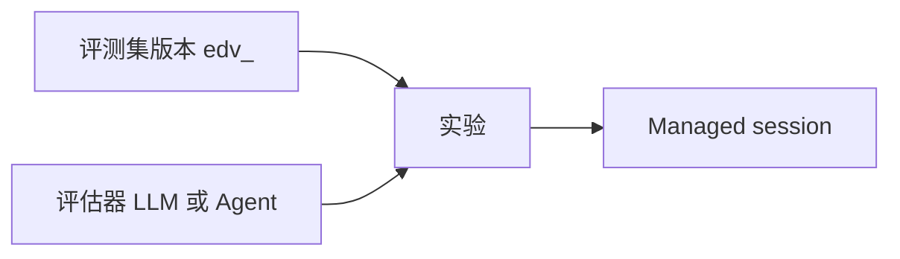

# QCA Evaluation 对齐计划

- 状态：M1 评测集、M2 自定义评估器、M3 实验与 Compare、Session 终态收口、LLM 打分、Agent 打分 Session、预置目录、timeout/env 注入、Compare 分数列、打分 Agent 版本冻结、打分 sandbox 的 `/data` 与 `/output` 契约路径、评测 OpenAPI，以及把 Console Session 回流成评测 case 已实现。单条和最多 50 条回流会把可用文件字节复制成 workspace Files。打分 sandbox 的真实 E2B 路径有可跳过的 e2e。今日额度不在范围内。
- 剩余缺口：`just test-e2e-agent-score-sandbox` 在有 `e2b.api_key` 时启动打分 sandbox，经 `/output/score.json` 把 score 行收成 completed；没有凭证时跳过，跳过不是通过。评测集预置仍是 OMA demo case。不自动发现线上异常，不从 Agent 输出生成 gold checkpoints，Session 列表没有多选。侧边栏是一条「评测」，不显示 Beta。技能挂在绑定的 Agent 上，评估器没有自己的 skills 字段。今日额度仍不做。
- 日期：2026-10-22
- 来源：qoder.com.cn 企业控制台，分析 → 评测（Beta）。下文只采用这次实测看到的信息架构和字段，不补写未出现的产品文案。评估器预置是 OMA 自写的维度包，覆盖同一类评分维度和路径/分数契约，不是 QCA 原文，也不使用 QCA 评估器 id。评测集预置仍是标明 OMA demo 的示例 case。
- 非目标：不改 Workbench Evaluate 的请求、表格或测试预期。不实现今日额度、额度计数或额度 UI。不复制 QCA 预置 case 或评估器正文。不自动发现线上异常，不从 Agent 输出生成 checkpoints，不在 Session 列表做多选。

Workbench Evaluate 仍是 prompt revision 上的变量行 A/B。QCA 评测不是这个表格，也没有一等的 Runs、Outcome 或 Results 页面；那些路径在实测里是空壳。

## 当前实现（只依据仓库）

Workbench Evaluate 是 Console 路由，不在 `openapi/oma.en.json` / `openapi/oma.zh.json`。

| 层 | 位置 | 今天做什么 |
| --- | --- | --- |
| 路由 | `internal/workbench/workbench_handler.go`，挂在 `/api/organizations/{orgUuid}` | revision 下列表/创建 evaluation；按 evaluation 更新变量、golden answer、completion、rating；删除；流式生成 test case |
| 持久化 | `workbench_evaluations`，`internal/db/workbench_evaluation_mapper.go` | 一行 evaluation 属于一个 prompt revision。`00044` 之后查询用 `organization_uuid` + `revision_ref_uuid`。payload 是 JSON，不是独立 case/run 表 |
| 生成队列 | `workbench_generated_test_cases` | 组织级一次性队列。更新变量时 `TakeWorkbenchGeneratedTestCase` 取走匹配项，不是可复用数据集 |
| 前端 | `web/src/features/workbench/evaluate.tsx`、`model.ts`、`api.ts`、`WorkbenchPage.tsx` | 模式 `prompt \| evaluate`。表格列是变量、当前 revision 输出、可选对比 revision、可选 ideal output |
| 入口条件 | `canEvaluateRevision` | 至少一个 `{{var}}`，且 `tools.length === 0`。带工具的 prompt 不能进入 Evaluate |
| 导航 | `web/src/app/layout/navigation.ts` | `/workbench` 在 Build 组里，当前 `hidden: true` |

一条 evaluation 的 payload 字段是：`id`、`revision_id`、`test_case_id`、`variable_values`、`golden_answer`、`completion`、`completion_text`、`rating`、`created_at`。`test_case_id` 默认等于 evaluation id，没有跨 revision 的 case 身份。

运行行为：

- 「Run」对当前 prompt revision 做变量替换，再调用已有的 `POST .../workbench/completions`。主列输出会 `save_completion`。
- Add Comparison 只在浏览器状态里保存另一份 prompt revision 的输出，不写库，刷新即丢失。
- `rating` 路由和行模型存在，`EvaluateView` 没有评分控件，Console client 也没有 `update_rating` 调用。
- CSV 导入/导出在浏览器完成，列是 `{{variable}}` 和 `ideal_output`，然后逐行 `evaluations/create`。导入会替换当前表格，不保留数据集版本。
- 未保存的 prompt 修改会使表格只读，提示先存成新 revision。

OMA 里已经存在、但实测评测页没有当成一等对象的能力：

- Agent 版本：`agents.current_version` 与 `agent_versions`。Session 创建时钉住 `agent_version` 和 `agent_snapshot`。
- 任务状态与轨迹：`session_events` 已分类 `session.status_*`、`agent.tool_use` / `agent.tool_result`、`span.model_request_start` / `span.model_request_end`。
- Deployment outcome：`user.define_outcome` 与 `span.outcome_evaluation_*` 服务单次 session。实测评测的打分入口是评估器，不是这套 outcome 页。
- Trace 查询：`observability.enabled` 时才注册 observability traces。
- Memory：`memory_stores` 可挂到 session。实测评测信息架构没有 memory pin。

## 实测信息架构

评测在「分析 → 评测」下，三个页签加今日额度：

| 页签 | 控制台路径 | 实测内容 |
| --- | --- | --- |
| 评测集 | `/cloud/evaluation`、`/evaluation/datasets` | 自定义集可空。另有已发布预置集，带版本（`edv_`）、case 数、状态 可用 / 已归档 |
| 评估器 | `/evaluators` | 自定义可空。另有预置评估器，类型为 Agent。创建支持 LLM 与 Agent |
| 实验 | `/experiments`、`/experiments/new`、`/experiments/compare` | 绑定数据集版本、Agent 与多个评估器。Compare 固定数据集版本和评估器，更换 Agent 版本 |

没有一等的 Runs、Outcome 或 Results 页面。

评测集：

- 创建时填写 name、desc。上传 JSONL 或 ZIP（不超过 100MB、不超过 1000 条），或复用已发布版本里的 case。
- Case 字段：`name` 必填，`turns` 为必填的字符串数组，另有 `desc`、`checkpoints`、`input_files`、`reference_files`。`reference_files` 只给评估器使用。
- 预置集详情是版本列表、case 列表和 case JSON 快照，只读。

评估器：

- LLM：单个模型打分。
- Agent：在打分 Agent 的 sandbox session 里读 `/data/session/result.json` 和 artifacts，写出 `/output/score.json`，形状为 `{score, explanation, details}`。
- 变量：`input`、`output`、`checkpoints`、`agent_trajectory`、`invocation_result`。
- 今日额度：实测里预置 100，自定义 LLM 100，按 Asia/Shanghai 零点重置。Agent 评估器不在额度弹层里。OMA 不实现这项，也不做计数器或额度 UI。

实验：

- 绑定数据集版本、Agent（加 Environment、timeout、可选 env/resources）和多个评估器。评估器在实验上冻结。
- 每个 case 创建一个 Managed session。
- Compare 固定数据集版本和评估器，变化的是 Agent 及其版本。
- 名称在同一个 space 内还要按模式唯一：Managed Agents 与 Forward Mode 分开。

## 能力矩阵

| QCA feature | OMA today | gap | proposed approach | priority |
| --- | --- | --- | --- | --- |
| 评测集：创建、导入、列出，带版本和 case | M1 可创建、导入、列出 workspace 评测集。创建时可以复用本 workspace 已有评测集的 case。预置评测集目录目前为空，`source_version_id` 对不上已发布版本时返回 404，不写库。可以把本 workspace 的 Console Session 追加成当前版本的 case，单条或最多 50 条。输入文件字节会复制成新的 workspace Files 对象 | 输出文件只有请求显式打开时才写入 `reference_files` | M1：`evaluation_datasets`、`evaluation_dataset_versions`、`evaluation_cases`。创建集时写入版本 1。JSONL/ZIP 导入。`cases:from-session` 与 `cases:from-sessions` 复用同一条追加路径。不迁移 `workbench_evaluations` | P0，本切片 |
| 评估器 | M2 可创建、列出、读取自定义评估器。LLM 保存单个 model 和 prompt。手写 Agent 保存打分 Agent id。从预置复制的 Agent 评估器同时保存预置 prompt 和请求里的真实 `agent_id`。全部 case 结束后，completed 的 item 才由 LLM 评估器打分并落库。Agent 评估器会另开打分 Session，读 score 文件后落库 | 今日额度不实现。目录里的评估器预置没有 `agent_id`，创建实验时可以直接选择，打分使用预置 prompt。打分 Agent 的版本在实验创建时冻结，不跟随后续当前版本 | M2：`evaluation_evaluators` 与版本 1。变量只用 `input`、`output`、`checkpoints`、`agent_trajectory`、`invocation_result`。LLM 打分复用已有 provider。Agent 打分复用已有 Session 创建和 Filestore | P0，本切片 |
| 实验 | M3 可创建、列出、读取实验。创建时冻结数据集版本、被测 Agent 版本、环境和评估器版本，并为每个 case 调用已有 Session 创建。Session 终态事件把 item 收成 completed 或 failed。全部 item 都结束后，才为 completed 的 item 写入 `evalscore_`。Agent 评估器的 score 在打分 Session 终态之后写入 | timeout 与 env 进入 case Session 和打分 Session，再由已有 sandbox 创建读取 | M3：`evaluation_experiments` 与 case item。Session id 记在 item 上。`publishSessionEvents` 上的观察者读取已持久化的 `session.status_idle` / `session.status_terminated`，再写 score | P0，本切片 |
| Compare | M3 按数据集版本和冻结评估器版本列出 status 为 completed 的实验，响应带 `scores`。对比页按评估器列出分数，失败显示错误，没有分数显示缺失 | 只有全部 item 都 completed 的实验会出现 | 固定数据集版本和评估器，变化的是 Agent 版本。名称在组织和工作区下唯一 | P0，本切片 |
| 预置评测集 / 预置评估器 | 只读目录目前都没有实例。评测集页和评估器页的预置入口仍在。`source_version_id` 和实验里的预置 id 对不上目录时返回 404，不写库 | 目录编译在服务里，不是按 workspace 存的行，也不能在 API 里改 | 不建新表。`evaluation-dataset-presets` 与 `evaluation-evaluator-presets` 返回目录。`source_version_id` 把已发布版本复制进 workspace 的自定义评测集或评估器 | P0，本切片 |
| 今日额度 | 无评测额度 | QCA 有预置 100、自定义 LLM 100、上海时区零点和 Agent 评估器不计入 | 不实现。不记账，不做额度 UI 或计数器，也不放进后续里程碑 | 不做 |
| Session trace | Session 事件和详情已覆盖模型、工具和任务状态 | 实验不另存 trace | M3 的 item 保存 session id，详情链到现有 Session 页。不新写 trace 存储 | P1 |
| Memory pin | Memory 版本存在 | 实测评测页没有这项 | 不纳入当前里程碑 | 不做 |

## 为什么不改现有 Evaluate 表格

Workbench Evaluate 继续做 prompt 变量实验。评测集的 case 是 `turns`，不是 `{{var}}` 行。入口还拒绝 tools。因此保留 `web/src/features/workbench/` 与 `internal/workbench/`。评测集、评估器和实验放在 Managed Agents，不放进隐藏的 `/workbench`。

## 数据模型

`00115_evaluation_datasets.sql` 接在 main 的 `00114_system_skill_administration.sql` 之后。不改 `internal/db/schema.go`，不建外键。租户条件同时带 `organization_uuid` 和 `workspace_uuid`。

`evaluation_datasets`

- `external_id` 前缀 `evalds_`
- `name` 1–255 字符，`description` 最长 1024，API 字段名是 `desc`
- `archived_at` 为空时状态为 `available`，否则为 `archived`。M1 不提供归档接口，列先留着
- 列表不返回已归档行

`evaluation_dataset_versions`

- `external_id` 前缀 `edv_`
- `dataset_uuid` 加 `version` 唯一，`version` 从 1 开始
- M1 创建评测集时在同一事务写入版本 1。带 `source_version_id` 时，同一事务把已发布预置版本的 case 复制进来，并生成新的 `evalcase_` id。`case_ids` 可以只复制其中一部分。`source_dataset_id` 从自定义评测集的当前版本按 `case_ids` 复制

`evaluation_cases`

- `external_id` 前缀 `evalcase_`
- 属于 `dataset_uuid` 和 `version_uuid`。`(version_uuid, position)` 唯一
- `name` 必填。`description` 对应 API 的 `desc`
- `turns` jsonb，必须是数组，且至少一条非空字符串
- `checkpoints` 可空，只接受 JSON 字符串数组。空字符串拒绝。这是给评估器核对的验收要求，不是发给被测 Agent 的指令
- `input_files`、`reference_files` 可空，只接受 JSON 数组，不解释元素。`reference_files` 留到评估器使用

`00116_evaluation_evaluators.sql` 增加自定义评估器。不建实验表或 memory pin 表。预置评估器不写进这张表。

`evaluation_evaluators`

- `external_id` 前缀 `evalev_`
- `name` 1–255 字符，`description` 最长 1024，API 字段名是 `desc`
- `archived_at` 为空时状态为 `available`，否则为 `archived`。M2 不提供归档接口
- 列表不返回已归档行

`evaluation_evaluator_versions`

- `external_id` 前缀 `eev_`
- `evaluator_uuid` 加 `version` 唯一，`version` 从 1 开始
- 创建评估器时在同一事务写入版本 1。`POST .../versions` 在锁住评估器后追加 `version + 1`。实验冻结的是创建时的 `eev_`，不会跟着最新版本变
- `evaluator_type` 为 `llm` 或 `agent`
- LLM：`model` 必填，最长 255；`prompt_template` 必填，最长 16000。`agent_id` 必须为空
- Agent：创建时 `agent_id` 必填，`prompt_template` 必填，至少一个变量，`model` 必须为空。`environment_id` 可空。`resources` 可空，是文件挂载数组，元素为 `{file_id, path}`，`path` 以 `/` 开头。保存时转成 Session 资源 `{type:file, file_id, mount_path}`。Agent 和环境在创建时必须存在且未归档。从预置复制只带预置 prompt 和 variables，不接收 `agent_id`
- `variables` 是 JSON 数组，元素只能是 `input`、`output`、`checkpoints`、`agent_trajectory`、`invocation_result`。LLM 至少选一个。prompt 里的 `{{name}}` 必须落在已选变量里
- Agent 响应带固定契约：读 `/data/session/result.json` 和 artifacts，写 `/output/score.json`，字段为 `score`、`explanation`、`details`。这些路径不入库

`00117_evaluation_experiments.sql` 增加实验。不建外键，不写入预置数据，不记账。

`evaluation_experiments`

- `external_id` 前缀 `evalexp_`
- `name` 在 `(organization_uuid, workspace_uuid)` 下唯一。QCA 还按 Managed Agents / Forward Mode 分开；OMA 没有这第二种模式，所以不另加 mode 列
- 绑定 `version_external_id`、`agent_external_id`、`agent_version`、`environment_external_id`
- `timeout_seconds` 为 1–86400。`env` 可空，必须是 JSON 对象。`resources` 可空，必须是 JSON 数组
- `evaluator_set_key` 是冻结评估器版本 id 排序后用 `|` 连接。Compare 用它和数据集版本定位同一组实验
- `status` 为 `pending`、`running`、`completed`、`failed`、`cancelled`。创建后是 pending；Session 创建成功变为 running，创建失败变为 failed。Session 终态事件再把仍为 running 的 item 收成 completed 或 failed。没有取消接口

`evaluation_experiment_evaluators`

- `external_id` 前缀 `evalbind_`
- 创建时复制评估器当前版本。一次实验最多 20 个，且不能重复
- `(experiment_uuid, position)` 与 `(experiment_uuid, evaluator_uuid)` 唯一

`evaluation_experiment_items`

- `external_id` 前缀 `evalitem_`
- 每个 case 一行，`session_external_id` 在 Session 创建成功后写入
- 状态与实验相同。`error_message` 最长 1024。case 的 `turns` 超过 Session `initial_events` 的 50 条上限时，这一行失败，不另写执行引擎

`00118_evaluation_experiment_item_session_idx.sql` 为 `(organization_uuid, workspace_uuid, session_external_id)` 加索引，供终态事件按 Session 找到仍在 running 的 item。

Session 完成：`sessions.Handler.publishSessionEvents` 在 SSE fanout 之后调用评估观察者。观察者只看已经写入的 Session 事件，收口 item，再按 item 汇总实验状态。整批 item 都离开 pending 和 running 之后，才把 completed 且有 session 的 item 插入 River 队列 `evaluation_score`，不在 Brain 的 `worker/events` 请求里打分。没有配置这条队列时仍在观察者里同步打分，单元测试走这条路径。

- `session.status_idle` 且 `stop_reason.type` 为 `end_turn`：item 变为 completed
- `session.status_idle` 且 `stop_reason.type` 为 `retries_exhausted`：item 变为 failed，错误文案为 `Session retries exhausted`
- `session.status_terminated` 与 `session.deleted`：item 变为 failed，错误文案为 `Session terminated`
- `requires_action` 和其他非终态事件保持 running
- 同一批事件里，failed 不会被后面的 end_turn 盖掉。item 离开 running 之后不再改写

实验汇总：还有 running 则为 running；否则还有 pending 则为 pending；否则有 failed 则为 failed；全部 completed 才是 completed。这个状态写在实验行上，标题读的是它，不跟评分步骤走。评分失败不把实验改成 failed。若用例已经收口但那次请求没写上实验行，下一次读取详情会按用例重写；每分钟补扫也会重写仍为 pending 或 running、且已经没有 pending 或 running 用例的实验。用例会话的 title 是 `评测 · ` 加用例名称，评分会话的 title 是 `评分 · ` 加同一条用例名称。评分会话仍出现在会话列表里。`00108` 给已经存在且 title 为空的用例会话补上用例名称，`00109` 再给两类会话加上前缀，并给 title 仍为空的评分会话补上名称。Compare 因此要等每个 case session 都以 `end_turn` 结束。

创建 Session 时 item 还没写成 running，所以创建当下的初始事件不会把实验提前收口。

`00119_evaluation_experiment_scores.sql` 增加 `evaluation_experiment_scores`（`evalscore_`）。一行对应一个 item 和一个冻结评估器版本，`(item_uuid, version_uuid)` 唯一。`status` 为 `completed` 或 `failed`。`completed` 必须有 `score`。`explanation` 最长 4000，`error_message` 最长 1024，`details` 可空或为 JSON 对象。

打分发生在这条实验的全部 item 都变成 completed、failed 或 cancelled 之后。只给 completed 且有 session 的 item 打分，每个 item 只跑这一次。生产环境由 `evaluation_score_item` 执行，不占用上报请求的 10 秒。任务跳过 `(item, 评估器版本)` 上已经存在的分数。每分钟扫描已完成但分数不齐、且同一实验已经没有 pending 或 running item 的记录，补进同一条任务。单个评估器调用超时后，失败行用脱离该超时的短写入落库。打分失败只把该 score 行标成 failed，不改 case item 的 completed，也不改实验的 completed。

- LLM：用冻结版本的 `model` 和 `prompt_template`。变量从 case 与已持久化的 Session 事件填充：`input` 用用户消息，没有则用 case turns；`output` 用 agent 消息；`checkpoints` 用 case JSON；`agent_trajectory` 按时间列出已保存的会话事件。每行是时间和事件类型，消息与工具带文字，模型请求带模型名和 token，`session.usage` 带 token、费用和 active_seconds，结束事件带 `stop_reason`。`output` 仍只有 agent 消息文字。`invocation_result` 用最后一条 `agent.tool_result` 文本，没有工具结果时用最后一次 idle 的 `stop_reason.type`。请求走现有 LLM provider 解析和 `/v1/messages` 或 `/v1/chat/completions`。模型需返回 `{score, explanation, details}`。
- Agent：整批 case 都离开 pending 和 running 之后，为这个 completed item 的冻结评估器版本启动一个打分 Session。打分 Agent 用评估器版本上的 `agent_id`。版本在实验创建时冻结：和被测 Agent 一样，当时解析该 Agent 的当前版本，写到 `evaluation_experiment_evaluators.agent_version`。之后打分 Session 用这个数字调用已有的 Agent 版本读取，不用后来的当前版本。Agent 在创建实验时不存在或已归档，实验创建失败，和被测 Agent 相同。LLM 绑定的这一列为空。`00105` 之前已创建、该列为空的实验，打分时仍读取当时的当前版本。打分 Session 的环境用评估器版本上的 `environment_id`；版本没填时用实验环境。timeout 和 env 仍用实验上的值。实验的 resources 只交给 case Session。评估器版本上的文件挂载交给打分 Session，不交给 case Session。打分 Session 的 metadata 带 `evaluation_role=agent_score`、`experiment_id`、`item_id`、`evaluator_version_id`，以及 `timeout_seconds` 和有值时的 `env`，所以它的终态不会被当成另一个 case item。
- 同一个 case `end_turn` 只启动一次。item 已经离开 running，或 `(item_uuid, version_uuid)` 已经有 score 行时，不再启动，也不再写第二行。
- case 结果写成 JSON：`session_id`、`input`、`output`、`checkpoints`、`agent_trajectory`、`invocation_result`，以及 `artifacts.input_files` 和 `artifacts.reference_files`。这份 JSON 放进打分 Session 的第一条用户消息。版本带 `prompt_template` 时，同一条消息在 JSON 前附上按变量渲染后的评分说明。预置复制出来的 Agent 评估器带这份说明。手写且没有 prompt 的 Agent 评估器仍只有路径说明和结果 JSON。Filestore 再把它写到 `/uploads/data/session/result.json`。五个固定根不变。打分 Session 的 metadata 含 `evaluation_role=agent_score` 时，Runner 在启动 rclone 前额外创建两条软链：`/data` → `/mnt/session/uploads/data`，`/output` → `/mnt/user-data/outputs`。因此容器里的 `/data/session/result.json` 就是该文件，`/output/score.json` 写进可写的 outputs 挂载。其他 Session 不创建这两条软链。软链冲突（普通文件、非空目录、指向别处的软链）会使打分 sandbox 启动失败，规则与 `/mnt/session/outputs` 别名相同。写文件失败只记日志，打分 Session 仍然启动，用户消息里仍有这份 JSON；此时 `/data` 软链在，但 `result.json` 可能还不存在。
- 打分 Session 以 `end_turn` 结束时，仍读取 Filestore `/outputs/score.json`。`/output/score.json`、`/mnt/session/outputs/score.json` 和 `/mnt/user-data/outputs/score.json` 在打分 sandbox 里是同一份文件，所以写到契约路径的分数会被这次读取拿到。服务端不把 `/output` 当成第六个 Filestore 根，也不另读一条路径。文件内容须是 `{score, explanation, details}`。解析成功则 score 行为 completed。`end_turn` 后若 Filestore 还没有 `/outputs/score.json`，且已配置打分队列，则排队再读。延迟约为 10 秒乘以重试次数（10 秒、20 秒、30 秒），连同这次最多 4 次，仍没有才记 `Evaluation score file is missing`。不在 `worker/events` 里等待。没有打分队列时，第一次缺失就记这条文案。内容无法解析时错误文案是 `Could not parse evaluator score`。打分 Session 被终止或 `retries_exhausted` 时，score 行用和 case 相同的终态文案标为 failed。
- 打分 Session 还没结束时，实验可以已经是 completed，但这条 Agent score 还不存在。score 行只在打分 Session 进入终态后写入。没有配置 sandbox 时，score 行仍是 failed，文案是 `Agent evaluator scoring is not executed`。生产组装会接上 sandbox。
- Agent 不存在时 score 行失败，文案是 `Agent not found`。已归档 Agent 的文案是 `agent must not be archived`。启动 Session 失败的文案是 `Could not score evaluation`。这些都只写 score 行。

列表、读取和 Compare 都返回 `scores`。读取仍带 item。打分失败时 item 的 `status` 仍是 completed。

timeout 和 env 从实验写进 case Session 和打分 Session 的 metadata。Session 创建把它们复制到 Environment Work metadata。已有 sandbox 创建读取这份 metadata：`timeout_seconds` 覆盖 E2B sandbox 的创建超时和后续续期，`env` 并入 sandbox 环境变量，同时写入 Managed Agent session config 的 `environment_variables`，由已有的 environment-manager 启动载荷合并。平台已经放进 resolution 的环境变量名不会被实验 env 覆盖。省略 env 时不写这个字段，Session 仍能创建。实验 resources 交给 case Session。打分 Session 只挂评估器版本上的文件。真实 E2B 打分路径由 `just test-e2e-agent-score-sandbox` 覆盖：它创建自定义评测集、Agent 评估器和实验，用 in-process runner 启动 case sandbox 与打分 sandbox，确认 `/data` → `/mnt/session/uploads/data`、`/output` → `/mnt/user-data/outputs`，把 `{score, explanation, details}` 写到 `/output/score.json`，等 Filestore `/outputs/score.json` 出现，再以打分 Session 的 `end_turn` 把 score 行收成 completed。case Session 的 `end_turn` 用 worker `result` 事件注入，用来启动打分 Session，不依赖模型自己写分数。配置里的 `environment_runner.agent_mode=brain` 在这个测试里改成空，以便 runner 在进程内创建 sandbox；生产 brain 模式仍走 `createEnvironmentSandbox`，同一处安装这两条软链。没有 `e2b.api_key` 或完整本地网关配置时测试跳过。这些都不属于今日额度。

## API

Console cookie + CSRF 组，与 MCP servers 相同。错误体是 `{error, message}`。成功响应状态码 200。

这些路由写在 `openapi/oma.en.json` 和 `openapi/oma.zh.json`，文档导航有评测分组。路径与 Console 路由相同。认证是会话 cookie `sessionKey`；POST 还要 `X-CSRF-Token`，不使用 `/v1` API key，也不要求 `anthropic-beta`。评测 handler 的 400、404、409 和 500 使用 `{error, message}`。会话缺失和 CSRF 失败沿用平台的 `ErrorResponse`。Workbench Evaluate 仍不在这两份 OpenAPI 里。没有今日额度端点。

M1：

- `GET/POST /api/console/organizations/{orgUuid}/workspaces/{workspaceId}/evaluation-datasets`
- `GET .../evaluation-datasets/{datasetId}`
- `GET/POST .../evaluation-datasets/{datasetId}/cases`
- `PATCH/DELETE .../evaluation-datasets/{datasetId}/cases/{caseId}`
- `POST .../evaluation-datasets/{datasetId}/cases:import`

路径里的 workspace 可以是 `default`、workspace UUID 或 external id。查询和写入使用 principal 的组织与 workspace UUID。另一 workspace 的 id 返回 404，且不读库。

创建评测集的 body 是 `{name, desc}`。也可以带 `source_version_id` 复制已发布预置版本的全部 case。`case_ids` 和 `source_version_id` 一起出现时，按请求顺序只复制这些 case；未知、重复或空 id 返回 400，不写库。`source_dataset_id` 复制自定义评测集当前版本里选中的 case，并且必须带非空 `case_ids`。已归档源返回 400，未知评测集返回 404，都不写库。`source_version_id` 和 `source_dataset_id` 不能同时出现。只带 `case_ids` 返回 400。省略这两个源字段时仍创建空评测集。响应带 `status` 和 `version: {id, version, case_count}`。已归档预置返回 400，未知预置版本返回 404，都不写库。

单条 case 与 JSONL 每行的字段是 `name`、`turns`、`desc`、`checkpoints`、`input_files`、`reference_files`。未知字段拒绝。导入是 JSONL（`application/x-ndjson` 或 `application/jsonl`），或 ZIP。ZIP 含一个 `.jsonl`，还可以带 `input_files/` 与 `reference_files/` 下的文件；一层公共根目录会剥掉。其他成员返回 400。超过 1000 条或 100MB 返回 400，校验通过前不写入。这与 Workbench 的 `{{var}},ideal_output` CSV 不是同一格式。

ZIP 里的伴随文件会写入 workspace Files。对象键是 `workspaces/{workspaceUUID}/files/{fileUUID}/{filename}`，记录带新的 `file_` id，和会话回流的副本一样走 workspace 容量检查。case 上保存 `{name, file_id}`。JSONL 里已经写了 `file_id`、且名称对不上 ZIP 成员的引用保持原样。名称能对上伴随文件时，用新的 `file_id`。没有任何 case 引用的伴随文件：路径第一段等于某条 case 的 name 时只挂到这些 case，否则挂到全部 case。没有接上文件复制器时，带伴随文件的 ZIP 返回 400，不写 case。纯 JSONL 不要求复制器。

编辑和删除都改当前最新版本上的 case 行，不新开评测集版本。`PATCH` 接受和创建相同的字段。`DELETE` 删掉该行；`case_count` 是当前版本的行数。case 不在最新版本上时返回 404。已创建实验的 item 仍指向原来的 case id；还没 start 的实验会在启动时按当时的 case 行读 turns。已经跑起来的 session 不会被改写。新实验读到编辑后的 case。

会话回流：`POST .../evaluation-datasets/{datasetId}/cases:from-session`，body 是 `{session_id, name?, desc?, checkpoints?, include_output_files?}`。`include_output_files` 默认 false。只写自定义评测集。预置 id 不在这张表里，返回 404。已归档评测集返回 400，不读 session。另一 workspace 返回 404。本 workspace 没有该 session 返回 404。`metadata.evaluation_role` 为 `agent_score` 的打分 Session 返回 400。没有用户消息返回 400。这些失败都不写 case。

批量回流：`POST .../evaluation-datasets/{datasetId}/cases:from-sessions`，body 是 `{session_ids, name_prefix?, desc?, checkpoints?, include_output_files?}`。`session_ids` 至少 1 个、最多 50 个，空列表或超过 50 返回 400，不写 case。已归档评测集、未知评测集和另一 workspace 仍让整次请求失败。其余规则按 session 执行。响应是 `{created, failed}`，`failed` 的元素是 `{session_id, error}`。一条 session 失败不会回滚已经写入的 case。`name_prefix` 加在默认名称前面，再按 255 个字符截断。

写入复用手工创建的 `CreateEvaluationCases`：追加到当前最新版本，不新开版本。`turns` 是按事件顺序的 `user.message` 文本，Agent 消息和工具结果不进入 turns。`name` 用请求里的 name；为空时用 session title；title 也为空时用截断后的第一条用户消息。批量请求没有单独的 name，只用前缀加这个默认名称。`desc` 只用请求值。`checkpoints` 只来自请求，不从 Agent 输出生成标准答案。

文件：类型为 file、能读出名称、并且路径不在 `/outputs/` 下的 resource 进入 `input_files`。路径在 `/outputs/` 下的 resource 只在 `include_output_files` 为 true 时进入 `reference_files`。元素仍是 `{name, file_id}`。服务组装了文件复制器时，会按源 `file_id` 读取 workspace Files 记录，在同一个对象存储里把字节复制到 `workspaces/{workspaceUUID}/files/{fileUUID}/{filename}`，再写入一条新的 Files 记录。case 上的 `file_id` 是这份副本，不是会话上的原 id。`name` 仍是会话里的路径或挂载名。复制失败、没有 `file_id`、文件不存在、对象不在 workspace 使用的 bucket、超过单文件上限或 workspace 容量不足时，跳过该文件并记一条 warn，原因放在 `reason`，不让整次回流失败。没有用户消息时仍整条拒绝。没有接上复制器时保留源 `file_id`，不复制字节；生产组装会接上。评测集没有单独的 Filestore 根，副本是 workspace Files 对象，不随 session 删除。目录和非 file resource 不进入这两个字段。

M2：

- `GET/POST /api/console/organizations/{orgUuid}/workspaces/{workspaceId}/evaluation-evaluators`
- `GET .../evaluation-evaluators/{evaluatorId}`
- `POST .../evaluation-evaluators/{evaluatorId}/versions`

创建评估器的 body 是 `{name, desc, evaluator_type, model, agent_id, environment_id, resources, prompt_template, variables}`。`evaluator_type` 为 `llm` 或 `agent`。Agent 保存 `agent_id`、`prompt_template` 和 variables，`model` 必须为空。`environment_id` 和 `resources` 可选，只属于 Agent。LLM 带上这两项返回 400。从预置复制时 body 是 `{name, desc, source_version_id}`：类型、prompt 和 variables 来自预置。带上 `agent_id` 返回 400，不写库。`source_version_id` 不能和 `evaluator_type`、`model`、`prompt_template`、`variables`、`environment_id` 或 `resources` 同时出现。响应带 `status` 和 `version`。Agent 版本额外带 `agent_contract`，有环境或文件时带 `environment_id` 和 `resources`。目录预置本身没有 `agent_id`，复制后可以直接创建实验。

评估器本身仍不归档、不删除。`POST .../versions` 在当前评估器上追加版本号，GET 读到的是最大版本。已创建实验绑定的是当时的 `eev_`，不会改成新版本。LLM 新版本要求 `model`、`prompt_template` 和至少一个变量，规则与创建相同。Agent 新版本要求 `agent_id`、`prompt_template` 和至少一个变量，可以改 `environment_id` 和 `resources`，`model` 必须为空。自定义评估器的打分在 case `end_turn` 之后执行。不实现今日额度。创建、列表、读取和新版本在 OpenAPI 里。

预置目录：

- `GET .../evaluation-dataset-presets`
- `GET .../evaluation-dataset-presets/{presetId}`
- `GET .../evaluation-dataset-presets/{presetId}/cases?version_id=`
- `GET .../evaluation-evaluator-presets`
- `GET .../evaluation-evaluator-presets/{presetId}`

目录不按 workspace 存行。请求仍要过 Console 的组织和 workspace 校验，另一 workspace 返回 404。列表一次返回全部，`next_page` 为 null。评测集预置响应类型是 `evaluation_dataset_preset`，带 `versions`。评估器预置响应类型是 `evaluation_evaluator_preset`。

种子编译在 `internal/evaluations/presets.go`，不是 migration，也不是 QCA 导出。评测集预置和评估器预置目录都是空的，列表 `data` 为 `[]`；未知 id 返回 404。页面上的预置评测集和预置评估器入口保留。

M3：

- `GET/POST /api/console/organizations/{orgUuid}/workspaces/{workspaceId}/evaluation-experiments`
- `GET .../evaluation-experiments/{experimentId}`
- `POST .../evaluation-experiments/{experimentId}:start`
- `POST .../evaluation-experiments:compare`

创建 body 是 `{name, desc, dataset_version_id, agent_id, agent_version, environment_id, timeout_seconds, env, resources, evaluator_ids}`。`agent_version`、`env`、`resources` 可省略。省略 `agent_version` 时使用 Agent 当前版本，并把它写进实验。Agent 或 Environment 不存在返回 404，已归档返回 400。数据集版本没有 case 时不创建实验。`evaluator_ids` 是工作区评估器。目录里没有的预置 id 返回 404，不创建实验。

列表不返回 item，但返回已有的 `scores`。读取返回冻结的评估器、每个 case 的 session id，以及 `scores`。`:start` 只重试仍为 pending 的 item。Compare 的 body 是 `{dataset_version_id, evaluator_ids}`，只返回 `completed`，并带上 `scores`。没有完成实验时 `data` 为空数组，不是 404。Session 以 `end_turn` 结束后，对应实验可以变成 `completed` 并出现在 Compare 里。

M3 不做取消。不实现今日额度。创建、列表、读取、start 和 compare 在 OpenAPI 里，响应包含 `scores`。LLM 或 Agent 打分失败都不把实验从 completed 改回 failed。

## UI

Managed Agents 侧边栏在 Sessions 与 Observability 之间只有一条「评测」/ Evaluation，不显示 Beta。它打开评测集页。页内用 EvaluationSectionNav 保留三个页签：评测集、评估器、实验。不再把这三项做成并列的侧边栏入口。OMA 没有「分析」分组，所以不把评测放进用量分析。

- `/workspaces/$workspaceId/evaluations`：Custom 与 Presets 两个页签。Custom 列出评测集，列有 ID、名称、描述、版本、状态、用例数、创建日期和「查看」。ID 可以复制。状态默认筛「可用」，空列表是居中空态，不是空表。新建评测集对话框只有两条路径：上传数据，或复用已有。上传页签要求 JSONL 或 ZIP（最大 100MB、1000 条），拖拽或选择文件；附件放在 ZIP 里。「下载模板」得到 ZIP，里面是 `cases.jsonl` 以及示例 `input_files/`、`reference_files/`。「如何创建评测集」说明字段。名称在对话框里最多 50 个字符，API 仍允许 255。复用页签选择源评测集和可用版本，左侧多选用例，右侧显示已选择的条数，创建时只复制这些 case。自定义源用 `source_dataset_id` 加 `case_ids`。预置源用 `source_version_id`，带 `case_ids` 时只复制选中的 case。Presets 行上是「查看明细」，打开和自定义评测集相同的详情页，地址带 `?preset=1`。详情只读：版本列表可以切换并查看对应用例，没有添加用例，也没有编辑版本。复用预置仍在新建评测集的「复用已有」里。评估器页的两个页签文案是自建评估器 / 预置评估器。预置目录目前没有实例，页签保留
- `/workspaces/$workspaceId/evaluations/datasets/$datasetId`：详情页是名称、自定义标记和评测集 id，然后是描述、用例数、创建时间，再是版本表和用例表。版本表只有当前版本：版本号、版本 id、状态、用例数、发布时间、查看和编辑。没有归档接口，所以不放归档。编辑打开当前版本的用例对话框，左侧选用例，右侧改名称、描述、每一轮一个输入框、检查点和输入附件名称。保存仍 `PATCH` 当前版本上的这条用例，不会新开评测集版本。删除要确认。查看打开右侧只读抽屉：名称、Case ID、输入、检查点、输入文件下载和完整 JSON。用例表列是名称、首轮输入预览、单轮或多轮、查看。搜索按名称、描述和轮次过滤。用例接口不带 `limit` 时默认只返回 20 条。详情页按 `next_page` 拉全后再分页，每页 20 条。用例表在卡片里滚动，页脚留在卡片底部：左侧是总条数，右侧是上一页、页码和下一页。超过 5 页时页码带省略。添加单条、导入 JSONL 或 ZIP、从会话导入、批量导入会话收在「添加用例」菜单里，一次只打开一个对话框。检查点输入是每行一条纯文本，提交时写成字符串数组；整段能解析成字符串 JSON 数组时按原样保存，对象或其他形状会提示改成每行一条或字符串数组。有 `file_id` 时仍可下载。ZIP 的伴随文件会变成 workspace Files。JSONL 里的 `input_files` / `reference_files` 可以是相对路径字符串；能对上 ZIP 成员时写成 `{name, file_id}`。从会话导入和批量导入都可以勾选是否把输出文件写入 reference files。批量输入用换行或逗号分隔 session id，提交后按条显示成功数和失败原因
- Session 详情：按钮「加入评测集」/ Add to evaluation dataset。选择未归档的自定义评测集，可选 name、desc、每行一条的检查点，以及是否包含输出文件。提交 `cases:from-session`。Session 列表没有多选，所以批量入口只在评测集 case 页
- `/workspaces/$workspaceId/evaluations/evaluators`：Custom 与 Presets 两个页签。Custom 仍在 LLM 与 Agent 之间切换，名称链到详情。Presets 页签保留，目录目前为空
- `/workspaces/$workspaceId/evaluations/evaluators/$evaluatorId`：先读后改。页头是自定义、类型和版本 id。基本信息、Prompt 和输出指标默认只读。点「编辑」后，LLM 改 model、prompt 和变量，保存为新版本；已经创建的实验仍用旧版本。Agent 改评分 Agent、可选环境、挂载文件、prompt 和变量，保存为新版本。输出指标是只读的 `{score, explanation, details}`，Agent 再标出 `result_path` 与 `score_path`。挂载技能是只读说明：技能在绑定的 Agent 上，评估器没有自己的 skills 字段；Agent 类型给出 Agent 详情链接，有环境或文件时一并显示。不把 QCA 技能原文写进预置。没有删除评估器的接口，所以不放删除按钮

- `/workspaces/$workspaceId/evaluations/experiments`：实验列表，页内有「实验列表 / 实验对比」两个子页签。列有 ID、名称、Agent、评估器数量、评测集版本和用例数、状态、创建日期。ID 可以复制。源列表为空时是居中空态。没有今日额度
- `/workspaces/$workspaceId/evaluations/experiments/new`：同一张表单分成三步：评测集、Agent、评估器。评测集版本、Agent、环境和评估器按名称选择，提交的仍是现有 id。Agent 版本、timeout、环境变量和资源挂载仍是文本。timeout 输入默认 1200 秒。`env` 用 `KEY=VALUE` 或字符串 JSON 对象。`resources` 用 Session 已接受的 JSON 数组。创建成功后进入这条实验的详情页。没有今日额度
- `/workspaces/$workspaceId/evaluations/experiments/compare`：同一对子页签。先选一条已完成实验作为基准。页面锁定它的评测集版本和评估器，并显示 Agent 与评测集。请求体仍是这条实验的 `dataset_version_id` 和评估器 id；列表不带绑定时再读实验详情。对比候选只来自这次返回、且与基准控制变量相同的其他已完成实验，最多再选 3 个，并可用「全部 Agent」过滤。没有候选时下拉是 “No experiments match these controls” / “暂无满足控制变量条件的实验”，按钮保持 “Choose experiments to compare” / “请选择对比实验”。选出后再对比。没有 completed 实验时显示 “No completed experiments.” / “无匹配的实验”。结果表每个评估器一列：完成显示分数，失败显示错误，没有分数显示 “Missing” / “缺失”
- `/workspaces/$workspaceId/evaluations/experiments/$experimentId`：标题下是状态徽章和可复制的实验 id。Start 只在 pending 时出现，用来重试仍为 pending 的 item。基本信息是一张三列定义卡：描述、状态、评测对象、评测集、创建时间、更新时间。下面三行进度：调用 Agent、评分、分析报告。调用 Agent 和评分在状态后面显示 `已结束 / 总数 (成功 ok)`，例如 `57 / 100 (57 ok)`。调用 Agent 的已结束是用例会话完成或失败的数量，成功只计完成。评分按分数行同样计算。分析报告不单独计数。页内四个页签：结果概览、分析报告、用例结果、配置。结果概览用现有 item 和 score 计算目标用例、调用成功率、平均分、评分完成、成功和失败用例、评估器数、会话数，并按评估器汇总成功、失败、平均分、最低分、最高分。全部 / 成功只过滤这些指标。分析报告分「主要问题」和「评估器结果」。主要问题只列失败或低于满分的评分，正文用 explanation 或错误文案。评估器结果给出有效评分、0 到 1 分数的百分比，以及每条用例的说明。`details` 里的模型轮次写成一句话（第几轮、模型、耗时、输入和输出），其余简单字段写成「名称：值」，不展示 JSON。不另做生成式报告。用例结果按用例列出各评估器分数，查看打开右侧抽屉「用例详情」：用例名称、描述、输入轮次和检查点；Agent 调用结果读取这条用例会话的状态、会话 id、起止时间差、agent 消息数、工具调用数、usage 里的输入和输出 token，以及最后一条 agent 消息；执行过程列出 user 和 agent 消息；评分结果给出状态、百分制分数、原因和 details 的一行摘要。没有 Credits，也不写平台名。配置列出冻结的 Agent、环境、超时、评测集版本和评估器；环境变量和资源挂载有值时才出现。实验接口没有调用耗时、Token、Credits，所以不放这些指标，也不另做一份生成报告。

Workbench 的 prompt/evaluate 开关保持原样。

## 里程碑

1. **M0**：差距说明。
2. **M1**：评测集、版本 1 和 case 的 migration、Yourbatis、创建 / 导入 / 列出，以及 Datasets 页面。无 session，不改 Workbench Evaluate。
3. **M2**：自定义评估器。LLM 与 Agent 两种类型，创建时写入版本 1。变量只用 `input`、`output`、`checkpoints`、`agent_trajectory`、`invocation_result`。
4. **M3**：实验与 Compare。绑定数据集版本、Agent、Environment、timeout 和冻结的评估器版本；每个 case 复用已有 Session 创建并记下 session id。已有 Session 终态事件把 item 收成 completed 或 failed，并汇总实验状态。全部 item 都结束后，才对 completed item 的冻结 LLM 评估器打分并写入 `evalscore_`。Compare 固定数据集版本和评估器，只列出 completed，并按评估器展示分数。名称在组织和工作区下唯一。timeout/env 经已有 Session metadata 和 sandbox 创建注入。
5. **预置目录**：只读的已发布评测集和评估器。两个入口都还在，目录里都没有实例。未知预置 id 不复制、不绑定实验。
6. **Agent 打分 sandbox**：全部 case 结束后，为 completed item 的 Agent 评估器启动打分 Session，把 case 结果交给打分 Agent，并在打分 Session 终态读取 `/outputs/score.json`。Filestore 里还没有文件时排队再读，最多 4 次，不在上报请求里等待。打分 sandbox 用软链暴露 `/data/session/result.json` 和 `/output/score.json`，不增加 Filestore 根。真实 E2B 由 `just test-e2e-agent-score-sandbox` 覆盖，没有凭证时跳过。
7. **会话回流评测集（本变更）**：把一条或最多 50 条 Console Session 追加成自定义评测集当前版本的 case。turns 来自用户消息。checkpoints 只来自请求。输入文件字节复制成新的 workspace Files 对象。输出文件只在请求打开时写入 `reference_files`。打分 Session、空用户消息、已归档评测集和错误 workspace 不写入。批量里单条失败记在 `failed`，不回滚其他 session。

今日额度不在里程碑里。不实现每日 100 次、上海时区重置、Agent 评估器是否计入，也不做额度 UI 或计数器。

评估器预置目录是空的，不能再选进实验，也不能再复制。带 `agent_id` 的旧 Agent 评估器仍在实验创建时冻结该 Agent 的当前版本。这些都不属于额度。

## 未排期

不把今日额度排进后续切片。不改 Workbench。预置目录已做只读浏览和复用，目前两个目录都没有实例。还没有目录编辑。会话回流会复制能找到 Files 记录的字节；复制不到的文件会跳过。回流不从 Agent 输出打标，也不在 Session 列表做多选。真实打分 sandbox 由可跳过的 E2E 覆盖，没有 `e2b.api_key` 时不运行。评估器没有 skills 字段。侧边栏不再拆成评测集、评估器、实验三项，也不显示 Beta。

## 验收与未覆盖

同一 workspace 可以创建评测集（同时得到 `edv_` 版本 1）、用 JSONL 或 ZIP 导入 case，并列出 case。ZIP 可以在一个 JSONL 之外包含 `input_files/` 与 `reference_files/`，以及一层公共根目录。接上文件复制器时，伴随字节写入 workspace Files，case 上是新的 `file_id`；已经带 `file_id` 且名称对不上的引用保持不变。没有复制器时这种 ZIP 失败。空 name、空 turns、超过 1000 条、错误 ZIP 和另一 workspace 的 id 在写库前失败。归档行不出现在列表里。`PATCH` 和 `DELETE` 改当前版本上的 case，不新开 `edv_`。不存在的 case 返回 404。

预置评测集和预置评估器列表都为空。用已删除的 `edv_oma_demo_*` 或 `eev_oma_*` 作为 `source_version_id` 返回 404，不写库。实验的 `evaluator_ids` 带上 `evalev_oma_*` 同样 404，不创建实验。从自定义评测集复制时，`source_dataset_id` 加 `case_ids` 按请求顺序写入新 case；已归档、未知评测集、未知 case、空 `case_ids`、重复 id，以及和 `source_version_id` 同时出现，都不写库。复制评估器时请求里带 `agent_id` 不写库。`source_version_id` 和 model 同时出现会失败。另一 workspace 读不到目录。

同一 workspace 可以创建 LLM 评估器（model、prompt、已选变量，版本 `eev_`）和 Agent 评估器（agent id，响应带 score.json 契约），并列出、读取。错误类型、未选变量、Agent 带 prompt，以及另一 workspace 的 id，在写库前失败。`POST .../versions` 追加版本。LLM 可以改 model、prompt 和变量。Agent 只能改 `agent_id`，prompt 从当前版本复制；提交 prompt 会失败。GET 返回新的最大版本，旧的 `eev_` 仍能按 id 读取。

同一 workspace 可以创建实验：冻结 `edv_` 与评估器版本，item 先为 pending；接上 Session starter 后每个 case 得到 `sesn_`，实验变为 running。创建 body 带 `timeout_seconds` 和 `env` 时，starter 收到这两个值；省略 `env` 时 Session 仍会创建。Agent 评估器在创建时把打分 Agent 的当前版本写进绑定。之后即使该 Agent 的当前版本变了，打分 Session 仍使用冻结版本。打分 Agent 不存在时实验创建失败，不写库。Starter 失败时 item 为 failed。`requires_action` 保持 running。`end_turn` 把 item 和实验收成 completed。LLM 评估器把模型返回的 `score`、`explanation`、`details` 记为 completed。Agent 评估器用冻结的 `agent_id` 启动打分 Session，并把 case 结果放进用户消息和 `/uploads/data/session/result.json`。版本带 prompt 时，渲染后的说明写在同一条用户消息里。打分 Session 启动时创建 `/data` → `/mnt/session/uploads/data` 与 `/output` → `/mnt/user-data/outputs`，所以 `/data/session/result.json` 与 `/output/score.json` 在该容器内可解析。普通 Session 不创建这两条软链。打分 Session 的 `end_turn` 读取 Filestore `/outputs/score.json`（与 `/output/score.json` 是同一文件），形状为 `{score, explanation, details}`，score 行为 completed。Filestore 尚未出现文件且打分队列已配置时排队再读，最多 4 次，仍缺失则 score 为 failed，文案是 `Evaluation score file is missing`。没有打分队列时第一次缺失就失败。无法解析时文案是 `Could not parse evaluator score`。没有配置 sandbox 时文案仍是 `Agent evaluator scoring is not executed`。这些失败都不改变 item 或实验的 completed。已经离开 running 的 item 不会被后到的终态改写，也不会再次打分；已有 score 行不会再写一行。`retries_exhausted` 或 `session.status_terminated` 把 case item 收成 failed，且不打分。打分 Session 自己的终止只让对应 score 行失败。列表不返回 item，但返回 scores。Compare 在没有 completed 实验时返回空列表。空 name、重复评估器、非法 timeout、没有 case、已归档 Environment、重名和另一 workspace 的 id 会失败。

会话回流在接上文件复制器时，把非输出文件复制成新的 workspace Files 对象并写入 `input_files`。找不到的文件被跳过，case 仍然写入。`include_output_files` 为 true 时，`/outputs/` 下的文件写入 `reference_files`。批量接口最多 50 条，空列表、超过 50 条和已归档评测集不写 case；缺会话、打分会话和没有用户消息只出现在 `failed`。

`just test-e2e-agent-score-sandbox` 在有 E2B 凭证时跑 `TestAgentScoreSandboxContract`。它确认打分 sandbox 的 `/data` 与 `/output` 软链、`/data/session/result.json`、实验 env，把分数写到 `/output/score.json`，并在 Filestore `/outputs/score.json` 可读之后把 score 行收成 completed。没有凭证或 `go test -short` 时跳过。默认 `just test` 不跑这个 e2e。

`TestEvaluationOpenAPIContract` 检查中英文 OpenAPI 都覆盖上述 Console 路径，创建请求含 `source_version_id`、`source_dataset_id` 和 `case_ids`，实验响应含 `scores`，并且这些操作使用 Console 会话而不是 `/v1` 的 beta 参数。Workbench Evaluate 和今日额度不在这两份文档里。

Postgres 迁移测试在设置 `TEST_MIGRATION_DATABASE_URL` 时覆盖到 `00106`。默认 `just test` 不连接外部数据库；未设置该变量时，不能把 `00102`、`00103`、`00104`、`00105` 或 `00106` 说成已经在真实 Postgres 上应用过。
