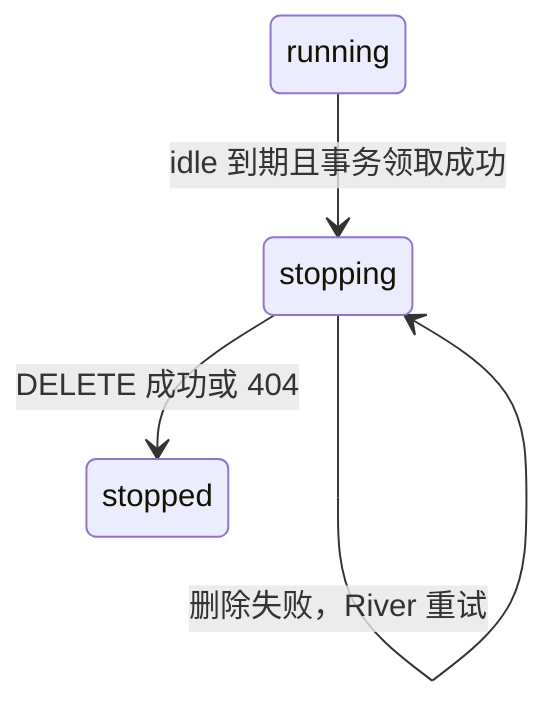
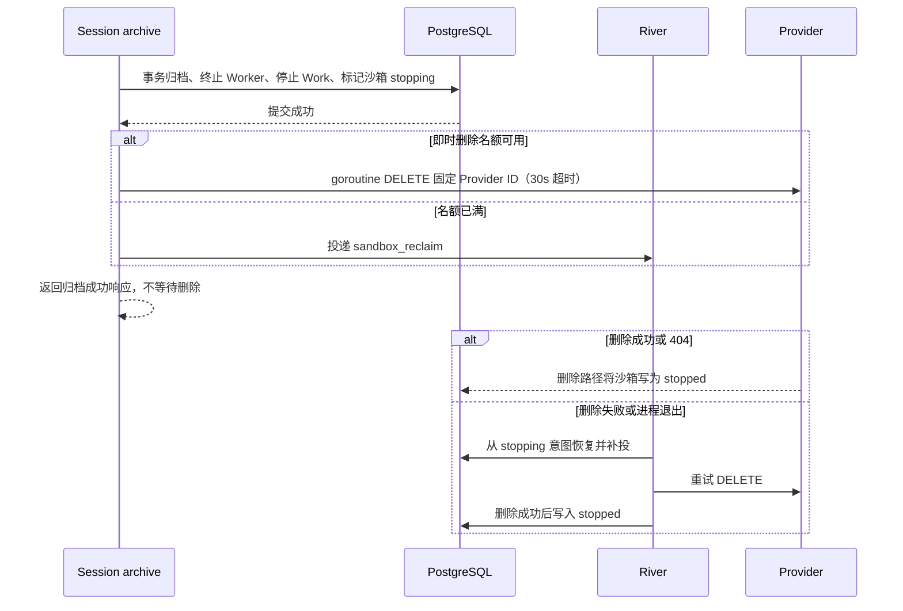
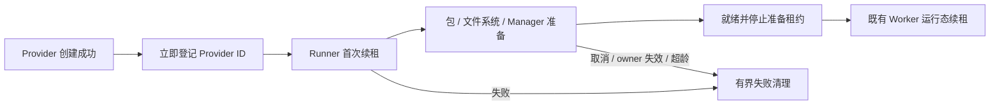

# 托管沙箱回收

## 范围与配置

回收长期 idle 的 cloud Session 沙箱，不改变公开 Session、Code Session 的状态或 ID。
短期空闲继续使用原有 E2B pause 策略；running、requires_action 和启动中的沙箱不回收。
JetStream 中已经存在的未处理输入不阻止 idle 回收；回收期间或之后到达的新输入负责触发恢复。
自托管 Environment、单独终止或删除 Session 的清理策略不属于本功能。
Cloud Session 归档使用下述归档清理协议。

允许丢失沙箱本地工作目录、进程状态、临时文件和未上传的写缓存，不做 checkpoint。
数据库事件、transcript 和已经提交的 Filestore 文件继续保留。

```yaml
sandbox_lifecycle:
  enabled: true
  dry_run: true
  idle_timeout: 24h
```

默认 dry-run 只输出候选。设为 `dry_run: false` 后执行真实删除。
`enabled: false` 停止领取新回收操作；已领取的删除仍会重试完成。
修改 YAML 后重启生效，多实例应使用一致配置。新消息所需的重建沿用 Environment Runner。
Worker 会把“是否允许新领取”作为显式条件传给事务；关闭或 dry-run 不再通过特殊时间值影响 SQL。

## 数据与回收协议

只保留两个新增字段，不新增独立的运行时状态机或消息 outbox：

| 表 | 字段 | 语义 |
| --- | --- | --- |
| code_sessions | idle_since | 连续 idle 起点；heartbeat 不刷新，重复 idle 保留，业务输入、非 idle 状态和凭证轮换清空 |
| environment_sandboxes | stop_reason | idle 回收使用 `idle_timeout`，Session 归档使用 `session_archived`，用于识别删除重试及已回收记录 |

复用已有的沙箱状态：



1. 扫描候选，仅作为提示，不授权删除。
2. 按 organization UUID、workspace UUID、sandbox UUID 定位不可变的沙箱记录。
3. 事务按 Session → Code Session → Work / Sandbox 锁定，复查 idle 时间、cloud 类型、
   活跃且未归档的父 Session和 Work 状态；不查询 JetStream backlog 或 PostgreSQL 事件表。
4. 条件领取成功后保留 `idle_since` 作为并发输入 fence，递增 worker epoch、撤销旧 lease 和 OAuth hash，
   沙箱改为 stopping。
5. 提交后执行 Provider DELETE，不在数据库事务中调用网络。
6. 删除成功或 404 后，在完成事务中标记 stopped。

回收逻辑直接依赖已有的 `E2BProvider`，不另定义删除接口。
Provider 直接调用 SDK 的 `e2b.Kill`，不再自行构造 API client 或 DELETE 请求；不调用 Connect，404 由 SDK 视为已删除。
`SandboxApiOpts.ApiUrl` 允许包级 Kill 直接使用 Provider 的 `e2b.api_url` 配置；配置为空时沿用 SDK 的环境变量及默认值。
API key、domain、超时仍按请求传参；配置的 access token 通过 SDK 的 Headers 传递，不写入进程环境。
Debug 模式仍执行同一个 DELETE，不会在数据库已推进到 stopped 时假装删除成功。
任务每次从数据库读取同一 sandbox UUID 对应的 Provider ID，不删除 replacement。
删除失败保持 stopping，River 重试；任务耗尽重试后，下一轮扫描仍可重新投递。
删除成功但落库前退出时，下次 DELETE 得到 404 并完成记录。关闭回收开关不遗弃已领取的删除。

## Session 归档清理

Cloud Session 的 archive 在同一个 Yourbatis 事务内归档 Session、终止对应 Code Session，
停止关联 Work，并将所有有 Provider ID 且未 stopped 的关联沙箱标记为
`stopping + session_archived`。事务失败时这些状态一起回滚；重复 archive 不重新打开已删除的沙箱。
归档保持 Session 历史、Transcript 和已持久化 Filestore 文件不变，不执行文件或对象清理。
沙箱本地临时文件和未上传缓存不保留。

archive 事务提交后，HTTP handler 清理 Worker 消费资源，并按 Session 和租户范围查询待删除沙箱。
每个服务实例最多启动 4 个即时删除 goroutine；名额使用非阻塞信号量获取，先取得名额再启动，
不创建等待名额的 goroutine。每个任务有独立的 30 秒超时，不随归档请求结束而取消。
任务在事务外执行 Provider DELETE，完成后将沙箱写为 stopped，并释放名额。
归档接口不等待 Provider DELETE；成功响应表示归档和持久化清理意图已提交，不保证沙箱已删除。
即时归档清理不受 `sandbox_lifecycle.enabled`、`dry_run` 或 idle 时间限制。

名额已满时不启动即时任务，直接投递去重的 `sandbox_reclaim`。即时删除失败时保持 stopping，
使用独立的 5 秒入队时限投递 River 重试，并记录结构化警告。删除超时不会取消重试入队。
投递失败、即时任务超时或进程退出不撤销归档，
每分钟 River sweep 仍从持久化清理意图补投。HTTP handler 对查询或投递失败记录错误，
但归档仍返回成功。重复 archive 可以再次尝试尚未删除的目标，已完成目标不重复删除。
并发归档与 River 重试可能同时删除同一固定 Provider ID；Provider DELETE 的幂等语义及 SDK
对 404 的成功处理使两者收敛。后台删除失败由 River 重试，任务耗尽后下一次 sweep 再次投递。
已停止的 Work 不阻碍发现待删除沙箱。完成后仅更新沙箱为 stopped，不调用消息恢复路径。

候选及删除目标按 Work 关联沙箱，Code Session 作为可选的最新 Worker 记录读取。因此 Worker
尚未创建或记录已删除时仍能清理。归档立即停止 queued/starting Work；已在 Provider 创建中的
Runner 后续写入沙箱状态时会重新检查归档标记，将迟到的 Provider ID 持久化为待删除状态，
不能把归档沙箱重新标记为 running，也不能用 Runner 的失败清理覆盖后台删除重试状态。
已完成归档清理的沙箱拒绝后续状态覆盖。自托管 Environment 不进入该归档清理协议。



升级前已经归档的 Session 不会自动补写 `session_archived`；再次调用 archive 可补记清理意图。
单个 Thread 归档不触发整个 Session 的沙箱删除。Agent 归档也不等同于 Session 归档；
只调用 Agent archive 的测试清理不会触发这条删除路径。

## 与现有消息流程衔接

接受可转发 public 输入的 Session 事务会清空 `idle_since`，随后在 Code Session 行锁内直接发布到
JetStream。这样输入若先于回收领取提交，候选会失效；直接发布与 Code Session termination 也不会
跨越行锁。回收不读取 JetStream pending，也不把 Redis 当作恢复依据。

回收后 Work 保持 active，沙箱为 stopped。没有新输入时不重排、不重建。

- 删除期间收到输入：Session 事件先清空 `idle_since`，再直接进入 JetStream。删除完成后通过既有
  `ScheduleRecoveryForCodeSession` 原子地重排 Work。
- 删除完成后收到输入：正常消息入口找不到 running 沙箱时调用同一恢复方法。空 Provider ID 只允许
  匹配 `stopped + idle_timeout` 且 `idle_since IS NULL` 的沙箱，不能恢复任意缺失目标。
- 恢复沿用现有路径：旧沙箱记录标为 failed，Work 改为 queued，Runner 复用 Code Session 并创建新沙箱。
- 启动失败清理必须按该次启动的 `worker_epoch` 原子终止 Code Session。恢复已轮转 epoch 时，旧启动清理不修改状态、凭据或 Worker 事件队列；只有匹配 epoch 的活动实例实际被终止后才清理队列。若清理先完成，恢复不能重新激活已终止的 Code Session。
  `stop_reason=idle_timeout` 保留原回收原因。旧记录被退役后不能再次重排新 Work。
- 对仍为 running 的沙箱，正常消息入口的 SetTimeout、worker lease 恢复和 Provider not-found 处理保持不变。

正常回收本身不会调用 Provider 唤醒。`idle_since IS NULL` 表示领取后发生过新输入，是重建所需的
竞态信号；已归档或终止的 Session 不重排。

## 迁移

已应用的 `00057_sandbox_lifecycle.sql` 保持不变；`00058_simplify_sandbox_reclamation.sql`
删除试验版的 runtime_state、runtime_wake_requested、runtime_pending 及专属索引，并重建 idle 索引。
存量 idle 起点仍由 00057 从迁移时间开始观察，不使用旧 updated_at 回推。
升级前停止旧版本进程，再迁移并启动新版本；旧版本不能与删除字段后的 schema 混用。
回滚 00058 只能恢复字段默认值，不能还原已删除的 wake 标志。

## River 与模块边界

`internal/riverjobs` 负责共享 River client、官方 migrator 和连接池复用。资源 worker 仍由 deployments、
environments 注册；启动组装一次性注册全部 worker 和队列。Deployment 使用持久化调度，详见
[Scheduled Deployment 执行](./deployments-api-contract.md#scheduled-deployment-执行)。

当前使用 `superduck-ai/river v0.46.0-oma-v0.0.1` fork 的 DurablePeriodicJob：

- 固定 schedule ID / kind 为 `sandbox_lifecycle_sweep`，UTC 五字段 cron `* * * * *`。
- 配置一致时启动不重新 upsert，保留数据库 next_run_at；River migrator 管理 river_periodic_job。
- 一个 sweep 按 UUID 游标分批读取，每批 100 条，避免 OFFSET 漂移和固定第一页阻塞后续记录。
- 仅注册 `sandbox_lifecycle_sweep` 和 `sandbox_reclaim`，使用 sandbox_lifecycle 队列，当前并发 4。
- 任务参数只携带稳定 UUID 和租户 scope，不持久化 token、路径、消息 body 或 Provider 返回内容。
- 同参数的未完成任务去重，completed 不参与去重，避免一次 no-op 阻止后续 idle 周期。
- Worker 每次执行重新读取策略和业务状态；周期调度、任务重试都不代表业务只会执行一次。

若此前运行过带后台唤醒的试验版本，升级前停止旧 worker，并通过 River 管理接口取消遗留的
`sandbox_wake` 未完成任务；当前版本不保留该 kind 的兼容 worker。

应用 SQL 全部经 Yourbatis Mapper。River 内部表由 River API 管理，应用不直接执行其 SQL，不创建额外连接池。
River client 使用 `riverdatabasesql.NewWithPgxListener(database.SQLDB(), database.ListenerPool())`，
启用 PostgreSQL LISTEN/NOTIFY，同时保留 River 默认轮询兜底；migrator 不需要监听，继续使用普通 SQL driver。
SQL 和事务仍经现有 `database/sql` 包装层，监听复用同一个 pgxpool 获取连接。River 会 hijack 一条专用监听连接，
它不再计入池的 MaxConns，因此每个运行实例通常比池上限额外占用一条连接。必须先停止 River，再关闭 DB；
仅关闭连接池不会关闭被 hijack 的连接。部署若使用 PgBouncer，当前共享数据库地址必须支持 session pooling
或直连 PostgreSQL，不能使用 transaction pooling 承载 LISTEN。
正常回收输出结构化 Info 日志，dry-run 输出候选；候选在锁定后失效、目标已消失或完成状态已由其他任务推进时输出 Debug 日志。
失败交给 River 重试记录，不输出消息或凭据。

## 验收

- 不安全候选、错误租户和领取前刚到达的新输入拒绝领取；已有 JetStream pending 不阻止回收。
- 领取后旧 worker 不能续租；Provider 删除失败保留 stopping；完成后重复执行不再删除。
- 删除期间的新输入不会连接旧沙箱，完成后只启动一次 replacement，保留 Code Session 身份。
- 没有输入时不会重排，stopping 或其他原因停止的沙箱不能被空 Provider ID 的恢复调用重排。
- dry-run 不删除；heartbeat 和重复 idle 上报不延长 idle_since。

真实 PostgreSQL 用例位于 `tests/sandbox_lifecycle_test.go`；Mapper 测试检查 SQL 和参数绑定。
`internal/runtime/e2bruntime/lifecycle_test.go` 验证 SDK 显式 API URL、鉴权透传、Debug 模式直接 DELETE、删除失败与 404 幂等。
回收与 River 集成测试也使用真实 `E2BProvider`，通过本地 HTTP 服务模拟 E2B 删除响应。
`tests/sandbox_lifecycle_river_test.go` 验证 durable schedule 的 sweep → reclaim 投递、LISTEN 连接及
重复启动不重置 next_run_at。每轮等待三个候选沙箱全部回收，测试队列轮询设为一小时，并用独立 sweep 队列避免同队列通知限流干扰。
验证初始化不重置调度后，移除本次登记的生产 cron，仅由专用的一次性调度驱动测试，避免跨整分钟时生产 sweep 与 reclaim 同队列的通知限流影响断言。生产仍保留默认轮询兜底。

sweep 对每页至多 100 个候选过滤策略后，通过 River `InsertMany` 在同一事务中入队，再统一通知消费者。逐条提交可能让消费者提前取完前几条，后续通知在限流窗口内被抑制，留下任务等待兜底轮询。批量提交保证本页任务在通知生效前全部可见，保留按 sandbox 参数和活跃状态去重的规则；空页或全部被策略过滤时不入队。
投递超时时记录目标 Session、Worker、Work、Sandbox 的状态及对应 reclaim job 状态，供定位失败使用；诊断不改变调度行为或验收期限。
原有 `tests/session_sandbox_recovery_test.go` 验证消息触发的 lease 恢复及缺失沙箱重建没有回归。

本地运行 `just test`、`just lint`、`just dead-code`、`just duplicates`、`just complexity`。
集成测试使用 `CONFIG_FILE` 指向隔离数据库配置，不修改开发数据库。

归档用例位于 `tests/session_archive_sandbox_test.go`，覆盖清理意图写入失败的事务回滚、跨 workspace
拒绝、自托管排除、Provider 删除失败和 404 重试、重复归档/删除、历史保留、禁止重建、
无 Worker 和归档后 Provider allocation 完成。`tests/sandbox_lifecycle_river_test.go` 同时验证 idle
和关闭 idle 回收/dry-run 下归档沙箱的真实 River 调度。Provider DELETE 使用本地 HTTP fixture，
不代表真实云端计费或资源释放验收。

归档即时删除测试使用生产 HTTP handler，阻塞 Provider 响应后确认归档仍返回成功；
四个任务占满名额时，第五次归档不启动即时删除并保存 River 任务。
解除阻塞后，即使原归档请求已经结束，即时删除仍将沙箱写为 stopped。
失败路径验证归档成功、stopping 状态保留、重试任务持久化及再次归档通过 Provider 404 完成删除。
并发测试强制即时删除与后台回收同时到达 Provider，以 204/404 返回检查双方收敛为 stopped。

## Sandbox 准备阶段的租约

Provider 的存活 TTL、Work 的 heartbeat 和 Code Session 的 Worker lease 是独立租约。准备包、文件系统与 Manager 时 Sandbox 仍为 `creating`，不能依赖仅选择 `running` Sandbox 的 Worker heartbeat 来保活；prewarm 也可能早于 Worker 启动。

Runner 成功创建 Provider Sandbox 后，立即保存 Provider ID，并为本次 Sandbox UUID 启动准备期租约。首次续租同步成功后才执行准备 I/O，后续间隔为原 Provider TTL 的三分之一，每次仍续原 TTL，不延长包准备、MCP readiness 或公开按需准备的 timeout。每次续租重新检查同一 Work、未终止/归档/删除的 Session、当前 pending Sandbox UUID 和 Provider ID，以及 `creating`/`running` 状态。网络调用在数据库事务外执行，保留已有多租户与 UUID 查询边界。

租约只归当前创建调用持有，不由扫描器或其他 Worker 为所有 `creating` 记录保活。完成准备后停止并等待 goroutine 退出，运行态续租仍由既有 Worker 策略负责；idle/requires_action 的保活策略不变。同步准备 I/O（包括包准备、文件写入和 readiness）使用有准备 deadline 的上下文。rclone 与 Manager 后台启动使用从调用方父上下文派生的独立运行上下文，在整个准备阶段通过取消回调关联准备上下文；准备失败、续租错误、owner 失效或 deadline 到期会终止尚在启动以及已提交的后台命令，并保留既有 Sandbox 失败清理。只有全部准备与 runtime metadata 发布成功后才解除该关联，随后停止准备续租不取消已启动命令，准备 deadline 也不再作用于它们。父上下文取消始终有效，不使用 `WithoutCancel` 脱离调用方生命周期。交接前已观察到准备取消时拒绝交接；失败退出取消运行上下文，成功退出保留到父上下文结束。 已发布的非恢复 Managed Code Session 在交接失败时先使用独立有界清理上下文终止，再执行一次 Sandbox/Work 失败清理；恢复启动保留原 Code Session 和 durable queue，仅清理本次 Sandbox 并沿用可恢复重排策略。请求取消、续租错误、owner 状态失效或 attempt 被替换会取消准备上下文。单次续租时限不超过一个续租周期，不重试至 Provider TTL 被静默耗尽。

准备 owner 还受 Sandbox 创建起既有三分钟 pending 年龄上限约束；按需入口已有的150秒上限更短时继续优先。进程退出会失去本地租约，Provider TTL 自然停止保活；以后请求发现超龄 pending attempt 时，通过既有失败清理/可恢复 Work 重排路径退役旧 attempt，而不是无限等待。取消后的失败落库使用独立有界清理上下文，不能因请求已经取消而遗留 `creating`；旧 attempt 的清理先对旧记录单独持久化 failed、原因与停止时间，再清理其独立 Provider；不能停止或重排已被新 attempt 接管的 Work，也不能删除 replacement 的 Provider ID。若两条记录共享 Provider ID，只退役旧记录，不删除该 Provider。旧记录落库失败时记录错误并停止本次清理，不先 Kill 制造仍为 creating 的孤儿记录。



replacement 回归明确构造旧行仍为 creating 的场景，不先将其标为 failed，并分别检查不同和共享 Provider ID。回归用隔离 PostgreSQL schema 驱动真实 Runner 准备路径，验证短 TTL 下超过 TTL 的准备过程实际续期；虚拟时间测试原30秒 TTL 下准备75秒、续租错误、取消、截止与 handoff。普通回归使用对 context 敏感的 Provider 覆盖 rclone 真实文件系统启动链和 Manager 后台启动合同：成功交接后停止续租并跨越准备 deadline 不终止后台命令，父取消仍终止；准备过程中父取消、续租失败和 deadline 到期打断阻塞启动；后续准备失败及已取消 owner 拒绝交接并终止已启动命令。CI Docker Provider 保留原 `CommandContext` 行为，不通过修改 fixture 隐藏失败。终止、归档、替换、取消清理和超龄 attempt 退役单独检查。受控准备测试不证明真实包源、pandas 安装或 import 成功，后者仍由新 SHA 的独立黑盒验收。
