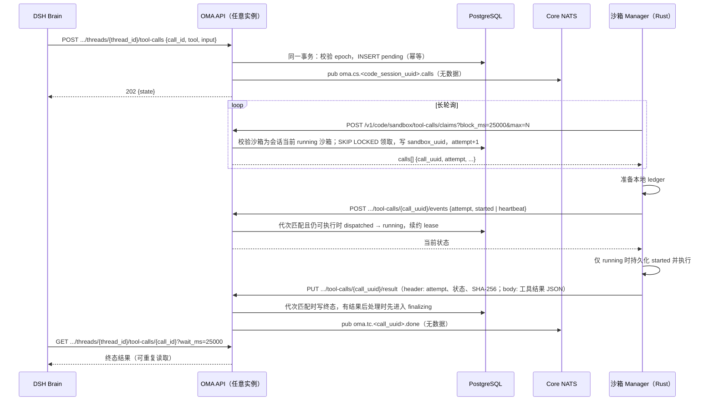
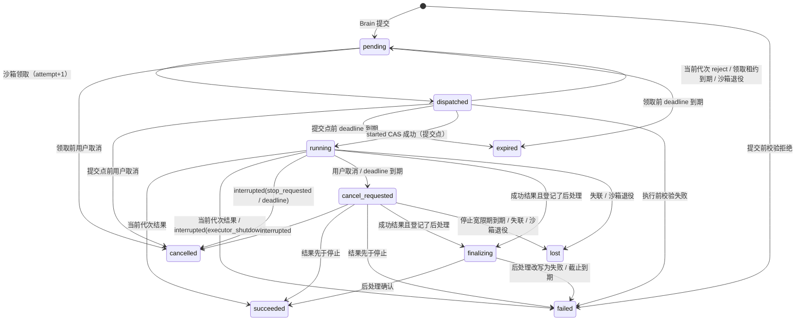

# 沙箱工具调用领取（替代同步 MCP 转发）

状态：已实现。运行时集成见 [沙箱外 Agent 与 CCRv2](brain-runtime.md#惰性沙箱)。

## 背景与问题

当前 Brain 内置工具（Bash、Read、Write、Edit、Grep、Glob）的执行链路为：DSH 发起 MCP `tools/call` → Go 沙箱 MCP 网关 `/v2/ccr-sessions/{id}/sandbox/mcp`（与外部 MCP 代理 `/v2/ccr-sessions/{id}/mcp` 是两个入口） → 经 Provider 端口域名同步转发到沙箱内 Rust Manager 的 `/mcp`。一次工具执行的完整生命周期绑定在同一条 HTTP 连接上，由此产生：

| 问题 | 现状 |
| --- | --- |
| 超时需逐层对齐 | 客户端 185 秒；Bash 为参数 timeout 加 65 秒；Bun `fetch` 需 `timeout: false`；服务端 `tools/call` 写超时 15 分钟 |
| 断连即结果未知 | 连接建立后任何中断都成为 `TOOL_OUTCOME_UNKNOWN`，只能依赖 `X-Oma-Sandbox-Not-Forwarded` 与 `httptrace` 区分是否到达沙箱 |
| 取消不可确认 | 中断只能关闭 HTTP 请求，本地 abort 不能证明远端已停止，也没有查询通道 |
| 调用状态不持久 | Go 实例或 DSH 重启后进行中的调用丢失，恢复时一律补错误结果 |
| 入站依赖 Provider 域名 | 网关需要 Provider 端口域名解析、host 缓存和续期节流 |

## 目标与非目标

目标：

- 工具调用的状态只有一个事实来源：PostgreSQL `sandbox_tool_calls` 行。
- 执行与连接解耦：DSH 断线或 owner 交接后，用原调用身份重新等待即可取得已落库的结果。
- 取消显式化：取消有持久请求和沙箱确认，结果为 `cancelled` 或“已先完成”。
- 沙箱主动通过 HTTP 长轮询领取调用，Go 不再连入沙箱。
- Core NATS 只用于唤醒，消息可丢失，正确性以 PostgreSQL 为准；不使用 JetStream，沙箱不接入 NATS。
- 服务端只在能证明调用未执行或已有实际结果时写入确定终态；无法确认副作用时记为 `lost`。

非目标：

- 不提供精确一次执行。结果落库前沙箱失联或被替换，调用记为 `lost`，不自动重放。
- 不改变工具审批、权限预检、公开 `agent.tool_use` / 工具结果事件和 DSH 原生日志格式。
- 不改变外部 MCP 的执行路径，理由见 [外部 MCP 不进入队列](#外部-mcp-不进入队列)。
- 不为内置工具提供执行中的增量输出或分片上传，理由见 [输入与输出大小](#输入与输出大小)。
- 不改变沙箱创建、准备期租约、idle 回收和归档清理协议，只增加与调用状态的衔接。

## 方案概述



连接方向由“Go 连入沙箱”改为“沙箱连出到 OMA”。沙箱已有 `role=sandbox` 的会话 ingress JWT 和到 OMA 的出站放行（见 [沙箱代理凭据](ccrv2/upstream-proxy-and-model-runtime.md#brain-与普通-http-出站)），新接口复用该凭据与校验链。

## 调用身份

调用由 `(code_session_uuid, thread_id, call_id)` 唯一确定：

- `call_id` 是 DSH 原生日志中的工具调用 ID。不同线程可能使用相同 `call_id`，因此 Brain 侧所有接口都在路径中携带 `thread_id`。
- 根线程使用固定标识 `root`，子 Agent 线程使用其线程 ID。提交、等待、取消和恢复使用同一套标识，空值不得作为根线程。
- `thread_id` 与 `call_id` 作为 URL 路径段传输时，服务端在路由边界还原一次 URL 编码，再进入身份查询；保留 ID 中的冒号、斜杠、百分号与 Unicode。不能把编码后的路径值直接用于数据库定位，也不能重复解码字面 `%2F`。
- `call_uuid` 由服务端生成，只在沙箱协议和 NATS subject 中使用。Brain 侧不依赖 `call_uuid`，即使首次 POST 的响应丢失，也能凭原身份查询。

## 数据模型

goose migration `00117_sandbox_tool_calls.sql` 新建表 `sandbox_tool_calls`，不建外键：

| 列 | 类型 | 含义 |
| --- | --- | --- |
| `id` | `bigint generated always as identity` | 内部主键，仅用于领取排序 |
| `uuid` | `uuid default gen_random_uuid()` | `call_uuid`，沙箱协议与 NATS subject 使用 |
| `external_id` | `text` | DSH 的 `call_id` |
| `organization_uuid` / `workspace_uuid` | `uuid` | 租户范围 |
| `code_session_uuid` | `uuid` | 所属 Code Session；`pending` 调用归属会话而非具体沙箱 |
| `thread_id` | `text` | 线程身份，根线程为 `root` |
| `worker_epoch` | `bigint` | 提交时的 owner epoch，仅用于诊断 |
| `sandbox_uuid` | `uuid null` | 领取时写入的具体沙箱记录，`pending` 时为空 |
| `attempt` | `integer not null default 0` | 领取代次，每次成功领取递增 |
| `tool_name` / `input` | `text` / `json` | 工具与已审批、已校验参数，支持 Write 内容中的转义 NUL |
| `state` | `text` | 见状态机 |
| `cancel_requested_at` | `timestamptz null` | 用户取消或 deadline 停止请求时间 |
| `cancel_reason` | `text null` | `user` 或 `deadline` |
| `deadline_at` | `timestamptz` | `pending` / `dispatched` 时为排队期限（提交后 15 分钟）；started 后改写为执行期限 |
| `timeout_ms` | `bigint null` | 提交时的执行预算，started 时据此计算执行期限；为空的历史调用保留提交时的期限 |
| `lease_expires_at` | `timestamptz null` | 沙箱执行租约，心跳续约 |
| `stop_grace_until` | `timestamptz null` | 停止请求后等待沙箱确认的截止 |
| `result` | `jsonb null` | 不超过 32 KiB 的结果正文 |
| `result_object_key` | `text null` | 超过 32 KiB 时的对象存储 key，租户作用域 |
| `result_bytes` / `result_sha256` | `bigint null` / `text null` | 结果正文字节数与 SHA-256，用于幂等判断与完整性校验 |
| `finalizer` | `text null` | 提交前校验登记的结果后处理名称，为空表示无后处理 |
| `finalizer_state` | `jsonb null` | 后处理自有的不透明状态，由后处理方定义 schema 并在边界解析，协议不读取其字段 |
| `finalize_timeout_ms` | `bigint` | 接入方登记的结果后处理时长 |
| `finalize_until` | `timestamptz null` | 进入 `finalizing` 后的截止 |
| `error_code` | `text null` | `lost`、`expired_unclaimed` 等 |
| `late_result` | `jsonb null` | `lost` 之后到达的实际结果，仅审计 |
| `created_at` / `updated_at` / `finished_at` | `timestamptz` | 时间戳 |

约束与索引：

- 唯一索引 `(code_session_uuid, thread_id, external_id)`。
- 领取索引 `(code_session_uuid, id) where state = 'pending'`。
- 扫描索引 `(lease_expires_at) where state in ('dispatched', 'running', 'cancel_requested')`、`(deadline_at) where state = 'pending'` 与 `(finalize_until) where state = 'finalizing'`。

输入幂等比较在 Go 序列化边界完成。结果对象登记到共用的 `event_payload_blobs`，与调用结果在同一事务关联。清理扫描保留活跃 Session 引用的对象，Session 归档或删除后按共用清理周期回收。上传后未被采用的对象按 [结果上报](#结果上报) 的规则清理。

## 状态机

所有转换在锁定 `sandbox_tool_calls` 行的事务内完成，规则集中在写入路径。



终态为 `succeeded`、`failed`、`cancelled`、`expired`、`lost`。`expired` 与提交点前的 `cancelled` 可以证明调用从未执行；`lost` 只表示执行者在越过提交点后失联，结果无法确认。`finalizing` 表示沙箱已提交结果、服务端结果后处理尚未完成，对 DSH 是非终态。

| 转换 | 条件与幂等 |
| --- | --- |
| 提交 | 与 epoch 校验同一事务（见下节）；同一身份再次提交返回已有行，工具或参数不一致返回冲突；提交前校验拒绝时直接写 `failed`，不进入 `pending` |
| 领取 | 请求沙箱必须是该 Code Session 当前 `running` 的沙箱记录；按 `code_session_uuid` 选择 `pending` 行，`FOR UPDATE SKIP LOCKED`，按 `id` 顺序；写入 `sandbox_uuid`、`attempt+1`、`lease_expires_at` 并返回 `attempt` |
| reject | 仅接受 `dispatched`、`sandbox_uuid` 与 `attempt` 都等于当前值的请求；回到 `pending` 并清空 `sandbox_uuid`。旧代次或已离开 `dispatched` 的重试返回成功但不改变状态 |
| started / heartbeat | 必须匹配当前 `sandbox_uuid` 与 `attempt`；started 只在 `dispatched` 且领取租约未到期时把调用推进为 `running`，是唯一的提交点；领取租约已到期时调用退回 `pending`，迟到的 started 返回冲突；重复上报幂等；续约 `lease_expires_at`；响应携带当前停止请求 |
| 结果 | 必须匹配当前 `sandbox_uuid` 与 `attempt`，状态为 `dispatched`、`running` 或 `cancel_requested`；结果状态只描述发生了什么（`succeeded`、`failed`、`interrupted`），`interrupted` 必须带原因，按下表映射，不依赖服务端此刻是否已进入 `cancel_requested`；成功结果且登记了 `finalizer` 时进入 `finalizing`，否则写终态；进入 `finalizing` 或终态后重复上报相同的 SHA-256 与字节数返回成功，不同结果拒绝；状态为 `lost` 时写入 `late_result` 并返回已终态 |
| 结果后处理 | 见 [扩展点](#扩展点)；用户取消对 `finalizing` 不生效 |
| 用户取消 | `pending` 与 `dispatched` 直接 `cancelled`；`running` 写 `cancel_requested`、`cancel_reason=user`、`stop_grace_until`；终态幂等返回终态 |
| deadline | `pending` 与 `dispatched` 的排队期限到期写 `expired`，此后不可领取；`running` 的执行期限到期写 `cancel_requested`、`cancel_reason=deadline`、`stop_grace_until`，不直接写 `failed` |
| lost | 见失联判定 |

| `interrupted` 原因 | 含义 | 映射 |
| --- | --- | --- |
| `stop_requested` | 按服务端停止请求中断 | `cancelled` |
| `deadline` | 执行端按 `deadline_at` 中断 | `cancelled`，`cancel_reason=deadline` |
| `executor_shutdown` | 执行端自身退出导致中断 | `failed`，`error_code=executor_interrupted`；已是 `cancel_requested` 时为 `cancelled` |

结果状态不再使用 `stopped`。`stopped` 表达的是“谁要求停”，执行端自身退出或按本地时钟判定 deadline 时没有对应状态；Manager 时钟快于服务端时，deadline 中断会在服务端仍为 `running` 时到达并被拒绝。现在服务端对当前执行者的事实上报在所有执行中状态下都有定义，唯一的拒绝理由是代次或沙箱不匹配。

### 提交点

started 是一次比较并交换：只有 `dispatched`、代次与沙箱都匹配且领取租约未到期时才成功。执行端必须在 started 返回 `running` 之后才启动任何有副作用的操作，这是协议不变量。由此，提交点之前的调用可以由服务端独立回收：

- 领取租约（10 秒）到期、沙箱退役或 replacement 时，`dispatched` 调用退回 `pending`，清空沙箱绑定，下次领取时代次加一；旧执行者迟到的 started 因沙箱或代次不匹配被拒绝，不会执行。
- 用户取消或 deadline 直接把 `dispatched` 写为 `cancelled` / `expired`；执行端随后的 started 收到终态，不启动命令。
- 显式 reject 只让调用更快回到队列，不再是正确性的必要条件。

此前“`dispatched` 未上报 started 时按失联处理”的规则依赖“执行端可能先执行再上报”的假设，已由该不变量取代。

### 失联判定

以下任一条件成立时，越过提交点的调用（`running`、`cancel_requested`）写为 `lost`，`error_code=executor_lost`。`dispatched` 按上节退回 `pending`；`finalizing` 已持有结果，不受沙箱失联或退役影响：

1. 绑定的沙箱记录进入 stopping、stopped、failed，或被 replacement 取代。该转换与沙箱状态推进在同一事务完成。
2. `lease_expires_at` 加宽限期已过，无论沙箱记录是否仍为 running。沙箱记录 running 但心跳中断时同样适用，扫描器不额外等待。
3. 状态为 `cancel_requested` 且 `stop_grace_until` 已过，沙箱未确认停止也未提交结果。

领取租约 10 秒，执行心跳周期 10 秒，执行租约 30 秒，宽限期 30 秒，停止宽限期 30 秒。

### 后台维护

每个 API 实例每 15 秒运行一次维护（`RunToolCallMaintenance`），不选主，实例之间通过行锁分工：

- 状态推进：每批在一个事务内以 `FOR UPDATE SKIP LOCKED` 领取最多 64 行到期调用，逐行调用与上报路径相同的 `expireSandboxToolCall` 并写回，一轮最多 16 批。被其他实例锁住的行直接跳过，因此多个实例不会重复处理同一行，也不会互相等待。候选条件只包含本轮确实会变化的行（例如 `cancel_requested` 只在租约加宽限期或停止宽限期到期时入选，执行期限已过不再使其反复入选），按各行实际到期时间排序。
- 结果后处理：以 `FOR UPDATE SKIP LOCKED` 领取 `finalize_until` 已过的 `finalizing` 行，并在同一事务把 `finalize_until` 推后 35 秒作为本实例的处理租约，提交后在事务外执行后处理的最终检查。其他实例在租约内不会再领取同一行。
- 时间统一取数据库：提交、领取、取消、上报、后处理落库与维护的事务都先读取数据库 `NOW()`，用它计算租约、期限并判断到期；候选查询也绑定同一时间。实例与数据库之间的时钟偏差不影响状态推进。

### 锁顺序

领取、沙箱退役和 replacement 都按 Session → Code Session → Work / Sandbox → 调用行的顺序加锁，与 [托管沙箱回收](sandbox-lifecycle.md#数据与回收协议) 一致：

- 领取事务依次以共享方式锁定 Session、Code Session、Work / Sandbox，并复查请求沙箱为当前 running 沙箱，再领取调用行。
- 沙箱退役或 replacement 事务在推进沙箱状态的同一事务中，把该沙箱名下执行中调用写为 `lost`；`pending` 调用不受影响，由 replacement 领取。
- 因此领取与退役串行化：退役提交后，旧沙箱的领取请求在复查时失败；领取提交后，退役会看到已领取的调用并写为 `lost`。

## 接口

### Brain 侧（worker JWT）

- `POST /v2/ccr-sessions/{code_session_id}/threads/{thread_id}/tool-calls`：提交调用，请求包含 `call_id`、`tool`、`input`、`timeout_ms`。服务端执行权限兜底与 [提交前校验](#扩展点)，按需创建或唤醒沙箱后入队，返回 `202`。权限拒绝返回 403，请求体超过 1 MiB 返回 413，两者都不建行。
  沙箱准备在同一进程内按 Code Session 合并为一次执行，使用脱离 HTTP 请求取消的 context，仍受 Runner 既有的 150 秒准备上限约束。提交请求超时或断开只结束本次等待，不取消准备；DSH 以同一调用身份重试时加入同一次准备，或在沙箱就绪后直接入队。其他实例的重试沿用 Work 锁与 pending 检查复用同一份创建结果。
- `GET /v2/ccr-sessions/{code_session_id}/threads/{thread_id}/tool-calls/{call_id}?wait_ms=25000`：长轮询等待终态，到达终态时返回状态与完整结果，超时返回当前非终态状态；不存在时返回 404。可在断线、重启后重复调用。
- `POST /v2/ccr-sessions/{code_session_id}/threads/{thread_id}/tool-calls/{call_id}/cancel`：请求用户取消，立即返回当前状态；终态通过等待接口取得。

领取前取消可以先写入同一调用身份的取消行，随后到达的提交返回 cancelled，覆盖提交仍在准备沙箱时用户已取消的顺序。

提交与取消要求请求 JWT 的 epoch 等于 `code_sessions` 当前 epoch。epoch 校验和写入在同一事务中执行，并以共享锁锁定 Code Session 行；owner 领取推进 epoch 时持有该行排他锁。因此 epoch 推进提交后，旧 owner 的写入被拒绝。等待接口只要求当前 epoch，可读取旧 owner 提交的调用。

### 沙箱侧（`role=sandbox` JWT，绑定 `sandbox_uuid`）

- `POST /v1/code/sandbox/tool-calls/claims?block_ms=25000&max=N`：领取最多 `N` 个调用，`N` 为沙箱空闲执行槽位，响应总字节不超过 8 MiB，超出时少返回调用。无可领取调用时阻塞到超时或收到唤醒。沙箱仍在创建时同样挂起，并在 `tool_call_ready_at` 为空时登记一次就绪；沙箱状态为 stopping、stopped、failed、沙箱记录缺失或 Code Session 不存在时返回 410，Manager 停止领取并进入排空；沙箱仍为 running 但 Work、会话等锁定条件暂时不满足时按创建中处理，挂起等待而不返回 410。停止请求只经 heartbeat 响应下发，不随领取返回。
- `POST /v1/code/sandbox/tool-calls/{call_uuid}/events`：请求带 `attempt`，事件为 `started`、`heartbeat`、`reject`。响应携带停止请求与原因。
- `PUT /v1/code/sandbox/tool-calls/{call_uuid}/result`：上报结果，可重复调用，格式见 [结果上报](#结果上报)。

每个请求都通过 Yourbatis 校验 Code Session active、公共 Session 未删除或终止、租户及父子 UUID 一致，以及指定沙箱有 Provider ID 且状态为 running。sandbox JWT 仅用于沙箱侧入口，Brain 侧入口要求 worker JWT。

### 结果上报

```http
PUT /v1/code/sandbox/tool-calls/{call_uuid}/result
Authorization: Bearer <sandbox JWT>
Oma-Tool-Call-Attempt: 3
Oma-Result-Status: succeeded | failed | interrupted
Oma-Result-Reason: stop_requested | deadline | executor_shutdown（仅 interrupted）
Oma-Result-Sha256: <body 的十六进制 SHA-256>
Content-Type: application/json
Content-Length: 1234

{"content": [...], "structuredContent": {...}, "isError": false}
```

- 控制信息放在 header，body 只承载工具结果，结构沿用现有内置工具结果（`content`、`structuredContent`、`isError`），DSH 的结果投影逻辑保持不变。
- 服务端读取 body 前先校验代次、状态与 `Content-Length`：代次或状态不符返回 409，超过 8 MiB 返回 413，均不读取正文。
- 不超过 32 KiB 且不含转义 NUL 的正文读入内存，校验 SHA-256 与 JSON 结构后写入 `result`。其余正文写入对象存储，超过 32 KiB 时边接收边上传并计算 SHA-256，写完后从对象存储流式读取完成结构校验，再在事务中写入对象引用与状态。
- 重试按 SHA-256 与字节数判断是否为相同结果，不做 JSON 规范化；Manager 重试时发送同一份字节。
- 事务因代次、状态或结果冲突未采用已上传的对象时，立即删除该对象；删除失败登记清理任务，复用现有对象清理机制。
- `interrupted` 表示命令被中断，body 携带中断前已产生的输出，按 Manager 的输出上限截断；`executor_shutdown` 时 Manager 在结果末尾追加“Sandbox manager shut down before the command finished; the output above may be partial.”。缺少原因、原因未知或非 `interrupted` 带原因均返回 400。

## 权限兜底

提交接口按会话与线程读取当前工具权限策略（现由 `currentRuntimeToolPolicies` 提供），工具未知或策略为 `deny` 时返回 403，不建行。DSH 侧审批流程不变，该校验只防止 Brain 绕过权限。它原由 Go 沙箱 MCP 网关（`internal/codesessions/sandbox_mcp.go`）在转发前执行，对所有内置工具成立，因此属于调用协议本身。

## 扩展点

调用协议不包含任何具体资源的业务规则。依赖工具目标路径或资源状态的规则，通过两个扩展点接入，并在各自资源的设计文档中描述：

| 扩展点 | 时机 | 能力 | 约束 |
| --- | --- | --- | --- |
| 提交前校验 | 提交事务内、入队前 | 拒绝调用并给出工具错误结果；或为调用登记一个结果后处理及其 `finalizer_state` | 只读取已校验的工具输入与会话上下文；拒绝的调用直接以 `failed` 落库，恢复时按普通 `failed` 处理 |
| 结果后处理 | 成功结果写入后 | 在 `finalize_until` 前确认结果，或将其改写为失败结果 | 不在结果上报请求内阻塞；只能以 `state = 'finalizing'` 为条件推进终态；失败结果不进入后处理 |

结果后处理的执行方式：

- 接收结果的实例写入 `finalizing` 与 `finalize_until` 后立即响应沙箱，再在进程内执行后处理。
- 接收实例在后处理期间退出时，后台维护领取 `finalize_until` 已过的 `finalizing` 行（见 [后台维护](#后台维护)），调用后处理的最终检查一次，确认则写 `succeeded`，否则写 `failed`。
- 进程内执行与扫描器都以 `state = 'finalizing'` 为条件更新，先完成者生效。
- 截止时长由后处理在登记时给出，协议只负责到期推进。

现有接入方：Memory 挂载的写入拦截与版本确认，见 [Memory 内置工具写入](memory-store.md#内置工具写入与工具调用扩展点)。移除沙箱 MCP 网关前，所有接入方必须已经通过扩展点生效。

## 输入与输出大小

| 项目 | 上限 | 超限处理 |
| --- | --- | --- |
| 提交请求体（含工具输入） | 1 MiB，与现有网关一致 | 413，DSH 转为工具错误，提示模型分段写入或改用 Bash |
| 单次领取响应 | 8 MiB | 少返回调用，剩余调用留待下次领取 |
| 结果请求体 | 8 MiB，与现有网关一致 | 413；Manager 应在本地截断，不应触达该上限 |
| 内联结果 | 32 KiB | 超过时写入对象存储 |

工具层已经限定了单次调用的规模：Bash `timeout` 最长 600 秒，更长的任务使用 `on_timeout=background` 立即返回 `output_file` 与 `pid`，之后由模型读取；领取协议以心跳续租和可重复等待承载长调用，执行时长不影响传输。给模型的结果也必须有界。因此新协议不提供增量输出或分片上传，执行中的实时进度以后如有需要作为独立的可观测功能实现。

上述约束依赖 Manager 对每个工具强制输出上限，不能只依赖工具描述引导模型：

- Bash：保留现有 stdout / stderr 截断与 `stdout_truncated`、`stderr_truncated` 标记。
- Read：未指定行范围时也有默认行数与字节上限，超出时截断并提示使用 `start_line` / `end_line` 分段读取；图片沿用现有图片大小限制，超限直接返回错误。
- Grep：`head_limit=0` 时仍有字节上限，超出时截断并提示缩小范围。
- Glob：结果条数与字节有上限，超出时截断并提示缩小范围。
- Write / Edit：只返回确认信息。

当前实现中 Bash 保留最后 30,000 字节；Read 默认最多 2,000 行，文本返回最多 50,000 字符；Grep 文本最多 20,000 字符；Glob 最多 100 项且最多 50,000 字符。图片编码前上限为 5 MiB。字符截断后的 JSON 转义与图片 base64 仍受 Manager 的 8 MiB 序列化结果兜底限制，超限返回工具错误。

## 外部 MCP 不进入队列

外部 MCP 由 Brain 经 `/v2/ccr-sessions/{id}/mcp`（`internal/codesessions/mcp_proxy.go`）调用用户配置的远端服务器，与本设计替换的沙箱 MCP 网关是两个入口。外部 MCP 继续使用该代理，不进入 `sandbox_tool_calls`：

- 领取协议依赖执行端主动领取、本地 ledger 去重、心跳和结果重报。远端 MCP 服务器是第三方实现，只支持标准 MCP over HTTP，没有这些能力。
- 若由 OMA 从队列取出后再调用远端，长连接只是从 Brain 到 OMA 移到 OMA 到远端，结果未知的窗口仍然存在；同时 Go 需要承担 MCP 会话、SSE 和每线程连接管理，这些目前由 DSH 负责。
- 私有网络工具经 MCP Tunnel 执行，Connector 已通过长轮询与 NATS WorkQueue 领取命令，见 [MCP Tunnels](mcp-tunnels.md)，不需要再叠加一层队列。
- 远端长时间工具需要可恢复性时，优先在 DSH 中支持 MCP 协议的 Tasks 能力，由代理透传，而不是把外部调用放进 OMA 队列。

## Core NATS 用途

| subject | 发布方 | 订阅方 | 作用 |
| --- | --- | --- | --- |
| `oma.cs.<code_session_uuid>.calls` | 调用写入或回到 `pending`：提交、reject、领取租约到期回收 | 持有该会话沙箱领取长轮询的实例 | 唤醒领取 |
| `oma.tc.<call_uuid>.done` | 终态写入成功后 | 等待该调用的实例 | 唤醒 Brain 等待 |

领取以 NATS 唤醒为主路径、长轮询超时为兜底：Manager 只要还有空闲槽位就以 25 秒长轮询领取，执行中的调用不会使领取改为短轮询。提交在沙箱 running 之后才写入调用并发布唤醒，因此同一次唤醒也覆盖“沙箱刚就绪”；沙箱退役时触发器回收的调用不发布唤醒，由替换沙箱的 Manager 启动后的首次领取取得。

等待方先订阅、再以 `FlushWithContext` 确认服务端已处理订阅，之后才查询 PostgreSQL，避免查询与开始等待之间发布的唤醒丢失。Flush 失败不报错，退化为长轮询兜底。消息不带数据，可丢失，醒来后总是重新查询 PostgreSQL。

subject 不包含 worker epoch。领取方是沙箱 Manager，沙箱凭据不携带 epoch，且 Brain owner 交接后排队中的调用仍由同一沙箱领取；把 epoch 编入 subject 会在交接时漏发唤醒，而隔离已经由 PostgreSQL 的 epoch fence 保证。停止请求只经 heartbeat 下发，最长延迟一个心跳周期，不发布 NATS 消息。

## 沙箱执行端（Rust Manager）

- Brain 模式 Manager 启动后运行一个领取循环，按空闲槽位领取，最多同时执行 4 个调用，复用现有 Bash 进程组 guard 与 grep/glob 取消逻辑。
- 收到调用后先上报 started。服务端校验状态、代次、deadline 与租约，返回 running 才允许启动。Manager 在启动前原子写入并同步 started 标记，执行结果通过临时文件、同步和 rename 保存到本地 ledger。重复交付重报保存的相同字节。服务端不会再次交付 running 调用，因此 Manager 启动领取循环前先扫描 ledger，按文件名中的调用 UUID 与 attempt 补报已保存但未确认的结果，确认或收到永久拒绝后删除结果文件；关闭打断的补报保留文件留待下次启动。
- 同一 `call_uuid` 的新 attempt 只会在当前代次 reject 之后出现；若 ledger 中同一 `call_uuid` 已有 started 记录且没有结果，Manager 拒绝再次执行，服务端按失联规则收敛。重复收到同一 `(call_uuid, attempt)` 时只重新上报 ledger 中的状态或结果。
- 执行中每 10 秒上报 heartbeat；结果上报失败按退避重试，直到成功或服务端返回已终态。
- 收到停止请求、本地 deadline 到期或 Manager 退出中止时终止进程组，以 `interrupted` 加对应原因上报，附带中断前已产生并截断的输出。如果命令已在中断前自然结束，上报实际结果。旧版本 ledger 中的 `stopped` 按 `interrupted` + `stop_requested` 补报。
- 未知工具与输入校验失败直接以 `failed` 上报，不发送 started。
- Manager 退出分为排空和中止两个信号：先关闭准入并放弃在途领取请求（由服务端在领取租约到期后回收）；尚未越过提交点的调用发送 reject；执行中的调用有 10 秒宽限期自然结束；宽限期后中止进程组并以 `interrupted` + `executor_shutdown` 写入 ledger 后上报；再给 5 秒上报预算，超时后停止重试，结果保留在 ledger 中由下次启动补报。Manager 的退出等待上限为排空、中止预算之和再加 5 秒。
- 工具 schema 契约测试通过领取协议下发调用并校验 Manager 返回的结果。

## DSH 侧

### 执行

- `oma-sandbox/client.ts` 改为“提交 + 重复等待”，删除 185 秒、Bash 65 秒余量、`timeout: false` 与 15 分钟写超时相关处理。
- 六个内置沙箱工具统一通过领取协议提交，原生日志沿用现有 `tool/call` 格式。
- `timeout_ms` 是执行预算，从 started 被接受时开始计算，与 35 秒 HTTP 请求超时独立。Bash 使用工具 timeout 加 30 秒，最大 630 秒，给启动、`on_timeout=background` 转交和退出确认留出时间；其他工具默认 180 秒。排队不消耗执行预算：提交时 `deadline_at` 只是 15 分钟的排队期限，用于在没有 Manager 领取时把调用收敛为 `expired`；started 把它改写为开始时间加 `timeout_ms`，并在 started 响应中返回。Manager 按 started 响应中的 `deadline_at` 本地强制截止，不使用领取响应中的排队期限。并行调用多于 Manager 的 4 个执行槽位时，排在后面的调用仍获得完整执行预算。
- 网络错误只重新等待，不重新提交新调用；提交本身响应丢失时以同一身份重新 POST，由幂等规则返回已有行。
- 只读工具不再使用 `callWithRetry` 的二次调用。新路径下断线已可重新等待，重试原本要解决的问题不再存在；`lost` 的只读调用作为失败结果返回模型，由模型决定是否发起新调用。

### 中断与交接

`ToolExecutionContext.signal` 的取消原因决定处理方式：

| 原因 | 服务端动作 | 原生日志 |
| --- | --- | --- |
| `kind: "user"` | 调用 cancel 接口，等待终态 | `cancelled` 写 `Tool call interrupted.`；先完成则写实际结果 |
| `isShutdownCancel` | 不调用 cancel | 结束本地等待，不写工具结果，只保留 `tool/call`，交由新 owner 恢复 |
| 其他 | 不调用 cancel | 按现有执行失败处理 |

shutdown 不能写入现有的“Brain worker shut down; its outcome is unknown”结果：新 owner 恢复时看到已有结果就不会再查询服务端，已落库的实际结果会被丢弃。

### 恢复

新 owner 对原生日志中已有 `tool/call` 但没有结果的内置沙箱工具，按原调用身份查询服务端：

| 服务端状态 | 处理 |
| --- | --- |
| 终态 `succeeded` / `failed` | 写入实际结果 |
| `cancelled` / `expired` | 写入对应失败结果，说明调用未完成 |
| `lost` | 按 `TOOL_OUTCOME_UNKNOWN` 写失败结果，提示模型先核实外部状态 |
| 非终态 | 继续等待；用户中断时调用 cancel，见 [恢复期间的用户中断](#恢复期间的用户中断) |
| 404 | 调用从未入队：epoch 已推进，旧 owner 的提交已不可能成功。写 `TOOL_NOT_STARTED` 失败结果 |

404 的判断依赖提交时 epoch 校验与 INSERT 的事务串行化，见 Brain 侧接口。

### 恢复期间的用户中断

新 owner 接手会话时，会在 SDK 恢复会话之前查询原生日志中未闭合的内置工具调用，并等待它们到达终态（`oma-brain-dsh/src/runtime/session.ts` 的 `recoverSandboxCalls`）。调用仍在执行时，等待最长为执行期限加停止宽限期。等待期间按以下规则处理入站事件：

- 服务端把 `control_request/interrupt` 投递到独立的回应通道，越过排队的任务；执行端入站消费也分为控制与任务两条链。
- `openWorkerSession` 在恢复首次遇到非终态调用时提前启动入站消费；没有需要等待的调用时，仍在打开完成后启动。领取失败计数在首次上报 worker 状态时归零，而不是在事件流连接时，因此提前连接不影响打开失败的计数。
- 打开完成前，任务通道的输入等待打开完成后再按原顺序处理；控制通道收到中断时立即触发恢复中断，同样等打开完成后再执行原有的控制处理与确认，因此确认发生在会话可以持久化之后，重复投递只补发确认。已被恢复消费的中断在打开后只确认，不再取消当时正在运行的回合，避免误中断恢复期间排队的新输入。
- 恢复等待同时响应 shutdown 与用户中断。shutdown 时直接退出，不取消、不写结果，交给下一个 owner。用户中断时先确认调用在服务端存在（不存在的调用记为 `TOOL_NOT_STARTED`，不写入取消行），再对未结束的调用并发发起 cancel，在 90 秒内等到终态，写入 `cancelled` 加部分输出或实际结果；取消无法确认时写入 `TOOL_OUTCOME_UNKNOWN`。不带线程的中断作用于根会话与所有子线程，带 `session_thread_id` 的中断只作用于对应线程。
- 根会话被中断时，旧回合以用户中断收尾（`idle/end_turn`），否则仍以“未重放”的恢复结果收尾；之后的新输入照常处理。

回归位于 `oma-brain-dsh/tests/worker-session.test.ts`：恢复期间中断会取消遗留调用并保留部分输出，旧回合以成功结果收尾；恢复期间的新输入在遗留调用结束、打开完成后才被处理；恢复期间 shutdown 不发出取消。

## 与沙箱生命周期衔接

- 提交时沿用现有懒加载、唤醒（`SetTimeout`）和 Provider 404 替换逻辑。
- Manager 首次领取登记 `environment_sandboxes.tool_call_ready_at`。只有沙箱为 `creating` 且该字段为空时才写入，沙箱 running 后的领取不写 `environment_sandboxes`。Runner 等待该字段后推进 running，完成准备期租约交接。
- 沙箱进入 stopping、stopped、failed 或被 replacement 取代时，在同一事务把其名下 `dispatched` 调用退回 `pending`，`running` 与 `cancel_requested` 调用写为 `lost`；`pending` 调用保持，由 replacement 领取。
- idle 回收把存在 `pending`、`dispatched`、`running`、`cancel_requested` 调用的沙箱视为非 idle。

迁移安装的沙箱状态触发器（`00117` 创建，`00118` 改为提交点前退回 `pending`）在状态写入的同一事务完成上述转换，覆盖归档、回收和 replacement。退役沙箱的迟到请求被生命周期鉴权拒绝，Manager 收到永久拒绝后停止重试。仍能通过鉴权的原沙箱可提交 lost 调用的审计结果。

### DSH 原生日志接入

当前 SDK 的工具批次会在取消时写入错误并闭合 step / turn。锁文件中的两个依赖补丁识别 shutdown 的 `deferToolResults` 标记，保留未完成调用与未闭合回合。恢复先查询服务端并追加原生工具结果，再调用 SDK resume。已收到的成功结果继续保存。Read 图片恢复为持久附件引用，Bash 沿用现有结果投影。

提交前校验在入队事务内执行。Memory 的只读查询通过事务范围的 context 复用该 Yourbatis executor，避免在事务占用连接时再获取连接。当前 Memory 版本确认窗口为 30 秒。

## 迁移

1. 切换前停止旧 DSH 接收新调用，使用旧版本完成在途调用及其日志收尾。只有切换后通过领取协议提交的调用才适用上节的 404 推断。
2. 应用 goose migration，部署包含 Mapper、领取接口和扫描器的 API，并更新沙箱模板。恢复流量前，替换仍会承接调用的旧 Manager。
3. 部署使用领取协议的 DSH，六个内置工具一起切换。确认权限兜底及 [扩展点](#扩展点) 的现有接入方已在新接口生效后，移除内置工具的 MCP 客户端、Go 沙箱 MCP 网关、Manager 的 `/mcp` 入口及其专属的转发头和超时处理。外部 MCP 工具沿用现有传输。
4. 实现落地时同步更新 [brain-runtime.md](brain-runtime.md)、[sandbox-lifecycle.md](sandbox-lifecycle.md)、[nats-messaging-foundation.md](nats-messaging-foundation.md)。

## 风险

- 小工具多一次 PostgreSQL 写入和一次唤醒，需与现有直连路径做延迟基线对比。若敏感，可在领取响应中合并下发，减少一次往返。
- 每个活跃沙箱持有一个长轮询连接，需评估 HTTP 连接数与 Core NATS 订阅数；订阅仅在长轮询期间存在。
- 本地 ledger 随沙箱替换丢失，进行中的调用只能 `lost`，与现有语义一致。
- `lost` 之后到达的实际结果只写入 `late_result` 供审计，不改变已交付给 DSH 的终态。

## 验收

端到端场景优先：

1. **结果已落库后 DSH 退出**：Bash 写入一个可观测的副作用并提交结果，DSH 收到响应前退出；新 epoch 接手后恢复原结果，副作用只出现一次。
2. **结果落库前沙箱失联**：Bash 已产生副作用但结果尚未提交时沙箱失联，最终返回 `lost`，不重放。
3. **迟到的 reject**：reject 已提交但响应丢失，同一沙箱再次领取并开始执行，旧 reject 重试按代次被忽略，调用保持 running。
4. **线程身份**：两个线程使用相同 `call_id`，查询与取消各自定位，互不影响。
5. **epoch fence**：epoch 推进后旧 owner 的迟到提交被拒绝；新 owner 查询返回 404，写入 `TOOL_NOT_STARTED`。
6. **deadline**：未领取调用到期为 `expired` 且不再可领取；执行中调用到期后沙箱确认停止为 `cancelled`，宽限期内无确认为 `lost`。
7. **shutdown 交接**：旧 owner shutdown 不写工具结果，新 owner 恢复后取得服务端实际结果。
8. **传输切换**：移除沙箱 MCP 网关后，六个内置工具均能通过领取协议返回结果；外部 MCP 调用仍能通过其原有客户端完成。
9. **权限兜底**：策略为 `deny` 或未知的工具提交返回 403，沙箱不会领取到该调用。
10. **扩展点**：使用测试接入方验证提交前校验拒绝后调用直接为 `failed` 且不被领取；结果后处理确认后为 `succeeded`、改写后为 `failed`、到期后为 `failed`；接收实例在后处理期间退出时由扫描器完成。具体接入方的场景在各自设计文档中验收。
11. **大小上限**：超过 1 MiB 的输入返回 413；超过 32 KiB 的结果经对象存储交付且内容一致；重复上报相同结果幂等，代次不符的上传对象被删除。
12. **停止输出**：执行中的 Bash 被用户取消后为 `cancelled`，DSH 结果包含停止前的部分输出。
13. **提交点回收**：领取后未 started 的调用在领取租约到期或沙箱退役后回到 `pending` 并被重新执行一次；旧执行者迟到的 started 被拒绝。
14. **Manager 退出**：排空时未开始的调用被 reject；宽限期内结束的调用上报实际结果；宽限期后被中止的调用为 `failed`，带部分输出与退出说明，不产生 `lost`。
15. **时钟偏差**：Manager 本地 deadline 先于服务端到期时，`interrupted` + `deadline` 被接受为 `cancelled`。

单测与集成测试：

- 状态机全部转换与非法转换、代次 fence、幂等提交与结果、取消与结果竞态、失联三条判定、`finalizing` 的进程内后处理与扫描器竞态、结果 header 校验先于读取正文、生成 SQL 与参数绑定。
- 真实 PostgreSQL 测试：`SKIP LOCKED` 并发领取、领取与沙箱退役并发时的锁顺序、提交与 epoch 推进的串行化、JSONB 结果、沙箱退役时批量写 `lost`。

### 真实 Linux Manager 验证入口

构建 Linux ARM64 `environment-manager` 后覆盖测试镜像的 `/opt/env-runner/environment-manager`，通过 `--worker-image` 显式选用新镜像。执行 `chat doctor brain` 后运行 `chat brain`、`chat brain-memory` 和 `chat roundtrip`。`chat brain-tools` 使用显式私有模型配置验证真实模型的六种工具、容器文件字节和持久调用结果。所有场景由 verify-be 管理隔离依赖、进程和容器，测试期间保持源码不变。
