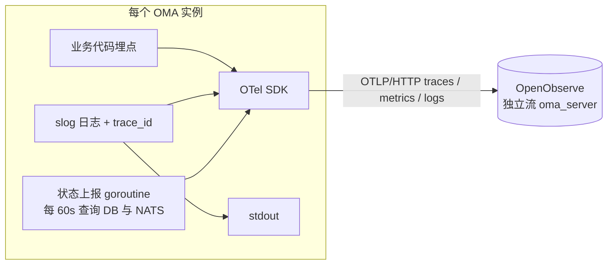
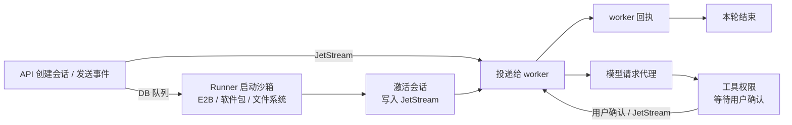
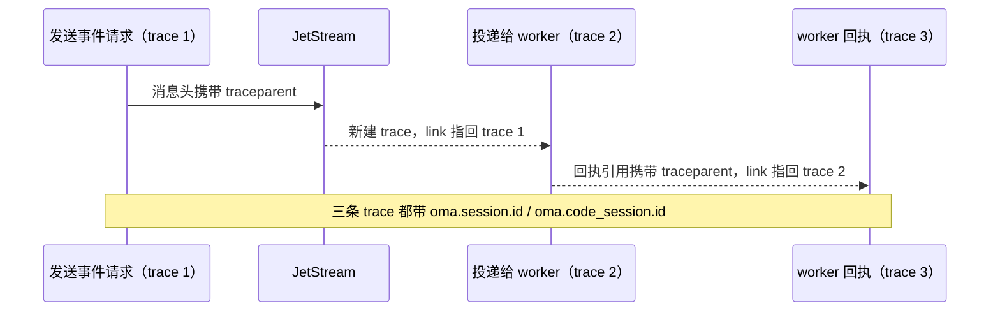

# OMA 服务端业务可观测性（评审版）

本文面向 maintainer，说明为什么要做服务端可观测性、核心设计、指标体系、OpenObserve 中最终呈现的
看板与排查方式，以及需要评审确认的取舍。代码设计与分步实施见
[服务端业务可观测性（详细设计）](server-observability.md)。

## 1. 背景：现在回答不了的问题

OMA 的一次会话要经过一条很长的异步链路：

> API 请求 → 写入 DB 队列 → Runner 领取并启动 E2B 沙箱 → 激活会话并把消息写入 JetStream →
> 沙箱内 worker 拉取消息 → 经 OMA 代理调用模型 → 工具调用需要用户二次确认 → 本轮结束

线上出问题时，常见的三类问题目前都很难回答：

| 问题 | 现在的困难 |
| --- | --- |
| 会话启动为什么慢？ | 不知道时间花在排队、E2B 创建、安装软件包、激活还是 worker 启动上 |
| 恢复为什么慢？ | 沙箱暂停或被回收后的唤醒、重建过程没有任何记录 |
| 消息为什么卡住？ | 无法区分没投递、投递了没处理、在等模型，还是在等用户确认 |

根本原因：

- **服务端没有遥测。** 只有 pprof 和逐行文本日志，没有 trace，也没有业务指标。
- **上下文在每个异步跳点都会丢失。** 这些跳点包括 DB 队列、JetStream、NATS 扇出、River 任务，
  以及 worker 的回调请求；它们还可能落在不同的 OMA 实例上。
- **日志无法关联。** 日志没有 trace_id，request_id 只出现在访问日志中。

## 2. 目标

| 目标 | 衡量方式 |
| --- | --- |
| 单会话诊断 | 输入一个 `session_id`，5 分钟内定位卡在哪一段：排队、E2B 创建、安装软件包、激活、worker 注册、消息投递与回执、模型请求、等待用户确认、本轮结束 |
| 全局健康 | 每一段的耗时分布、错误率、积压和各状态会话数都有看板 |
| 主动发现 | "卡住"和"失败"两类问题有告警，不依赖用户反馈 |
| 日志关联 | 任意 trace、日志、看板数据点之间可以互相跳转 |

## 3. 设计原则

| 原则 | 含义 |
| --- | --- |
| 不引入新服务 | 不部署 OTel Collector、Prometheus、Jaeger；OMA 进程内的 OTel SDK 直接以 OTLP/HTTP 写入现有 OpenObserve |
| 全量上报 | trace、指标、日志都不采样 |
| 只观测，不改行为 | 不改变 API、状态机、事务、重试和超时。唯一的例外是访问日志字段改为 snake_case 并调整级别 |
| 不泄露敏感数据 | 不记录消息内容、工具输入输出、请求体、凭据和 URL query；span 只记录错误分类，错误详情只在日志中 |
| 指标低基数 | 会话 ID 等标识只放在 trace 和日志中，指标标签只用有限枚举值 |
| 默认关闭 | `telemetry.enabled` 默认为 false，开启后才导出 |

## 4. 核心设计

### 4.1 架构



- 服务端数据写入独立的 `oma_server` 流，与 worker 已有的 `oma_claude_code` 流分开。
- 属性命名与 worker 遥测保持一致（`oma.session.id`、`oma.code_session.id`、`oma.workspace.uuid`），
  服务端 trace 和 Claude Code 自身的 trace 可以用同一个条件过滤。

### 4.2 链路阶段



| 阶段 | 记录内容 |
| --- | --- |
| 创建会话 / 发送事件 | 请求耗时、接受与拒绝的事件、提交后交接给 worker 是否失败 |
| DB 队列 | 启动任务排队时间、排队中任务数量、最老任务年龄 |
| Runner 启动 | 每个子阶段（领取、准备、E2B 创建、软件包、文件系统、标记运行、激活、启动 manager、发布运行时信息）的耗时与失败位置 |
| E2B | 每类调用（创建、续期、执行命令、写文件、删除）的耗时与结果 |
| 激活 | 历史消息写入 JetStream 的耗时 |
| worker 注册 / 心跳 | 从凭证签发到注册的延迟，心跳被拒的原因 |
| 消息入队 / 投递 / 回执 | 入队耗时、投递前排队时间、重投次数、从入队到处理完成的耗时、被忽略的回执 |
| 沙箱唤醒 | 唤醒结果（直接续期 / 需要重建）与耗时 |
| 模型代理 | 总耗时、首字节、首 token、token 用量、上游状态码 |
| 工具确认 | 权限决策分布、用户确认等待时间 |
| 状态变化 | running、idle（本轮结束或等待确认）的时间点 |

### 4.3 Trace 模型：分段 trace + span link + 会话 ID

一个会话可能持续数小时、跨越多个实例和多次异步跳转，不适合做成一条 trace。因此采用分段模型：

- 每个同步处理单元是一条独立 trace：一次 HTTP 请求、一次 Runner 启动、一次消息投递、
  一次 River 任务、一次 webhook 投递。
- 跨异步跳点时，生产方把 W3C `traceparent` 放进载体（JetStream 消息头、DB 队列行、Redis 回执引用、
  River 任务 metadata），消费方新建 trace，并用 span link 指回生产方。
- 所有关键 span 都带 `oma.session.id` 或 `oma.code_session.id`。按会话过滤，就能把分散的 trace
  拼成一条时间线。



不建 span、只记指标的请求：

- SSE 长连接和上游代理 WebSocket：最长持续 10 分钟。
- worker 心跳、worker 遥测转发、文件系统读写、tunnel 长轮询、健康检查：高频且噪音大。

### 4.4 日志

- 每条日志自动附带 `trace_id`、`span_id`、`request_id`，trace 和日志可以双向跳转。
- 启用后，日志同时写 stdout 和 OpenObserve；导出的日志级别可单独配置。
- 会话状态变化额外输出结构化日志 `session status event`，用于统计单轮耗时。
- 访问日志字段统一为 snake_case；4xx 记为 Warn，5xx 记为 Error（目前所有非 2xx 都记为 Error）。

## 5. 指标体系

### 5.1 核心 SLI

| SLI | 定义 | 组成指标 |
| --- | --- | --- |
| 会话启动耗时 | 从创建会话到 worker 可以接收消息 | 启动排队时间 + Runner 成功运行耗时 + worker 注册延迟 |
| 消息处理耗时 | 从消息写入 JetStream 到 worker 回执"已处理" | `oma.worker_event.processed.latency` |
| 恢复耗时 | 沙箱暂停或失效后，新消息到达到 worker 重新可用 | 沙箱唤醒耗时；需要重建时再加重建型 Runner 耗时 |
| 模型首 token | 模型请求开始到第一个内容增量 | `oma.model.time_to_first_token` |
| 卡住的会话数 | 长时间无进展的运行中会话 + 卡在 starting 的启动任务 | `oma.sessions.stale_running`、`oma.environment_work.stuck_starting` |
| 用户确认等待 | 工具权限请求到用户确认（单独统计，不计入系统延迟） | `oma.tool_permission.wait` |

SLO 目标值待采集一段时间、拿到基线后再定。

### 5.2 指标目录

耗时类指标单位为秒，使用直方图，可计算 p50/p95/p99。所有标签取值都是有限枚举。

**请求入口**

| 指标 | 类型 | 标签 | 回答的问题 |
| --- | --- | --- | --- |
| `http.server.request.duration` | 直方图 | 方法、路由模板、状态码 | 哪个接口慢、哪个接口在报 5xx |

**会话与消息**

| 指标 | 类型 | 标签 | 回答的问题 |
| --- | --- | --- | --- |
| `oma.session.created` | 计数 | 来源（API / 定时部署） | 会话创建量 |
| `oma.session.events.accepted` | 计数 | 事件类型 | 用户消息、中断、工具确认的流量 |
| `oma.session.events.rejected` | 计数 | 原因（非法 / 已归档 / 冲突） | 用户为什么被 409 或 400 |
| `oma.session.handoff.failures` | 计数 | 原因（JetStream 不可用 / 其他） | 消息已落库，但没能交给 worker |
| `oma.worker_event.publish.duration` | 直方图 | 通道（task / reply）、结果 | JetStream 写入是否变慢或失败 |
| `oma.worker_event.queue_wait` | 直方图 | 通道、是否重投 | 消息在队列里等了多久才被 worker 拉走 |
| `oma.worker_event.redeliveries` | 计数 | 通道 | 重投频率，判断是否有队头阻塞 |
| `oma.worker_event.processed.latency` | 直方图 | 通道 | 从入队到 worker 处理完成的耗时 |
| `oma.worker_event.updates` | 计数 | 回执状态、结果（已应用 / 被忽略 / 出错） | worker 回执是否丢失 |
| `oma.worker_event.expired` | 计数 | — | 有多少会话因消息过期被终止 |
| `oma.fanout.publish.failures` | 计数 | — | 跨实例事件广播失败次数 |
| `oma.fanout.lag` | 直方图 | — | 事件从产生到其他实例收到的延迟 |
| `oma.sse.streams` | 增减计数 | 类型（客户端 / worker） | 当前 SSE 连接数 |
| `oma.sse.stream.duration` | 直方图 | 类型 | 连接持续时长，是否被 10 分钟超时截断 |
| `oma.sse.subscribers.dropped` | 计数 | — | 慢客户端被踢掉的次数 |

**沙箱启动与恢复**

| 指标 | 类型 | 标签 | 回答的问题 |
| --- | --- | --- | --- |
| `oma.runner.queue_wait` | 直方图 | — | 启动任务排队多久才被领取 |
| `oma.runner.runs` | 计数 | 结果、是否为重建 | 启动成功率 |
| `oma.runner.run.duration` | 直方图 | 结果、是否为重建 | 一次完整启动的耗时 |
| `oma.runner.stage.duration` | 直方图 | 阶段、结果 | 启动慢在哪个子阶段、失败在哪个子阶段 |
| `oma.sandbox.provider.duration` | 直方图 | E2B 操作、结果（成功 / 不存在 / 失败 / 超时） | E2B 本身慢不慢、错不错 |
| `oma.code_session.activation.duration` | 直方图 | 结果 | 激活（历史消息写入 JetStream）的耗时 |
| `oma.sandbox.resume.duration` | 直方图 | 结果（续期 / 请求重建 / 已安排重建 / 无沙箱 / 失败） | 收到新消息时沙箱的状态分布和唤醒耗时 |
| `oma.worker.register` | 计数 | 结果 | worker 注册成功率 |
| `oma.worker.register.delay` | 直方图 | — | 沙箱里 worker 从启动到注册要多久 |
| `oma.worker.heartbeat.rejected` | 计数 | 原因（未注册 / 租约过期 / epoch 不符 / 续期失败） | worker 掉线的原因 |

**模型代理**

| 指标 | 类型 | 标签 | 回答的问题 |
| --- | --- | --- | --- |
| `gen_ai.client.operation.duration` | 直方图 | 模型、调用方（会话 / API key）、上游状态码、错误类型 | 模型调用耗时和错误分布 |
| `oma.model.time_to_first_byte` | 直方图 | 模型、调用方 | 上游多久开始响应 |
| `oma.model.time_to_first_token` | 直方图 | 模型 | 用户感知的首字延迟 |
| `gen_ai.client.token.usage` | 直方图 | 模型、token 类型（输入 / 输出 / 缓存读 / 缓存写） | token 用量分布 |

**工具确认**

| 指标 | 类型 | 标签 | 回答的问题 |
| --- | --- | --- | --- |
| `oma.tool_permission.decisions` | 计数 | 决策（允许 / 拒绝 / 需确认）、工具分类 | 多少工具调用需要人工确认 |
| `oma.tool_permission.responses` | 计数 | 结果、来源（自动 / 用户确认 / 子线程异常等） | 确认是如何结束的 |
| `oma.tool_permission.wait` | 直方图 | 来源 | 用户确认要等多久 |

**后台任务**

| 指标 | 类型 | 标签 | 回答的问题 |
| --- | --- | --- | --- |
| `oma.river.jobs` | 计数 | 任务类型、队列、结果（成功 / 重试 / 丢弃 / 取消 / 延后） | 后台任务是否在失败或被丢弃 |
| `oma.river.job.duration` | 直方图 | 任务类型、队列、结果 | 后台任务耗时 |
| `oma.river.job.queue_wait` | 直方图 | 任务类型、队列 | 后台任务排队时间 |
| `oma.webhook.deliveries` | 计数 | 结果（成功 / 重试 / 丢弃） | webhook 投递质量 |
| `oma.webhook.delivery.duration` | 直方图 | 结果 | 客户 webhook 端点的响应速度 |

**状态与积压（gauge，每 60 秒更新）**

| 指标 | 标签 | 回答的问题 |
| --- | --- | --- |
| `oma.sessions.live` | 状态（running / rescheduling） | 当前有多少会话在运行 |
| `oma.sessions.stale_running` | — | 运行中但超过 30 分钟没有任何更新的会话数 |
| `oma.code_sessions.active` | worker 状态（idle / running / requires_action）、连接状态 | 有多少会话在等用户确认、有多少 worker 处于断开状态 |
| `oma.environment_work.live` | 状态（queued / starting / active / stopping） | 启动任务各状态的数量 |
| `oma.environment_work.oldest_queued_age` | — | 排队最久的启动任务等了多久 |
| `oma.environment_work.stuck_starting` | — | 超过 10 分钟仍在 starting 的任务数 |
| `oma.environment_sandboxes.live` | 状态（creating / running / stopping） | 沙箱各状态数量 |
| `oma.nats.stream.messages` | 流名 | JetStream 各流的积压条数 |
| `oma.nats.stream.oldest_message_age` | 流名 | worker 入站流里最老的未处理消息有多旧 |
| `oma.nats.consumer.pending` / `ack_pending` / `redelivered` | consumer 名 | webhook 投递的积压与重投 |
| `oma.db.pool.connections` | 状态（已占用 / 空闲 / 总数 / 上限） | 数据库连接池是否耗尽 |
| `oma.state_metrics.collect.failures` | 来源（数据库 / NATS） | 状态统计本身是否失效 |

状态类 gauge 由每个实例各自上报，多副本时值相同。看板统一按 `max` 聚合，不能用 `sum`。
连接池指标按实例区分，可以求和。

## 6. OpenObserve 呈现

OpenObserve 中提供两个看板，配合 Traces 和 Logs 页面使用：

| 入口 | 用途 |
| --- | --- |
| 看板"OMA 服务健康" | 全局视角：发现问题、判断影响面、看趋势 |
| 看板"OMA 会话诊断" | 单会话视角：输入 session_id，查看完整时间线 |
| Traces 页面（`oma_server` 流） | 查看单条 trace 的瀑布图和 span link |
| Logs 页面（`oma_server` 流） | 按 trace_id 或 session_id 查看错误详情 |
| 告警 | 卡住与失败两类问题主动通知 |

### 6.1 看板"OMA 服务健康"

以下是示意图，展示布局与内容，不是最终视觉效果。

**Tab 1 总览**

```text
┌──────────────────────────────────────────────────────────────────────────────────────┐
│ 时间范围 [最近 6 小时 ▼]   实例 [全部 ▼]                                               │
├──────────────┬──────────────┬──────────────┬──────────────┬──────────────┬───────────┤
│ 运行中会话     │ 排队中启动任务  │ 最老排队年龄    │ 卡住的会话      │ 入站最老消息    │ API 5xx 率 │
│     128      │      3       │    42 s      │      0       │    1m 12s    │   0.08%   │
├──────────────┴──────────────┴──────────────┼──────────────┴──────────────┴───────────┤
│ 会话启动耗时 p50 / p95（折线）                │ 消息处理耗时 p95：task / reply（折线）     │
│  排队 ─ Runner ─ worker 注册 三条线             │                                         │
├────────────────────────────────────────────┼─────────────────────────────────────────┤
│ 模型首 token p95（按模型，折线）               │ 上游模型状态码分布（堆叠柱）2xx/429/5xx/529 │
├────────────────────────────────────────────┼─────────────────────────────────────────┤
│ 交接失败 / 回执被忽略 / 重投（柱）               │ 当前触发中的告警（表格）                    │
└────────────────────────────────────────────┴─────────────────────────────────────────┘
```

**Tab 2 启动与恢复**

```text
┌────────────────────────────────────────────┬─────────────────────────────────────────┐
│ Runner 各阶段耗时 p95（堆叠横条）               │ Runner 失败次数按失败阶段（柱）               │
│  e2b_create ███████                         │  packages     ██                         │
│  packages   ████████████████                │  e2b_create   █                          │
│  filestore  ██                              │  manager_start ▏                         │
│  code_session ▌                             │                                         │
├────────────────────────────────────────────┼─────────────────────────────────────────┤
│ E2B 调用耗时 p95 与错误率（按操作，表格）         │ 沙箱唤醒结果分布（饼图）                     │
│  create / set_timeout / run_command / kill  │  续期 / 请求重建 / 已安排重建 / 失败          │
├────────────────────────────────────────────┼─────────────────────────────────────────┤
│ worker 注册延迟 p50 / p95（折线）              │ 重建型 Runner 次数与耗时（折线）              │
└────────────────────────────────────────────┴─────────────────────────────────────────┘
```

**Tab 3 消息投递**

```text
┌────────────────────────────────────────────┬─────────────────────────────────────────┐
│ JetStream 入队耗时 p95 与失败数（折线 + 柱）     │ 投递前排队时间 p95（按通道）                  │
├────────────────────────────────────────────┼─────────────────────────────────────────┤
│ 重投次数（柱，按通道）                          │ 回执结果：已应用 / 被忽略 / 出错（堆叠柱）      │
├────────────────────────────────────────────┼─────────────────────────────────────────┤
│ worker 入站流积压条数与最老消息年龄（折线）        │ 心跳被拒原因（堆叠柱）                        │
├────────────────────────────────────────────┼─────────────────────────────────────────┤
│ SSE 连接数（客户端 / worker）与时长分布           │ 跨实例广播延迟 p95 与失败数                   │
└────────────────────────────────────────────┴─────────────────────────────────────────┘
```

**Tab 4 模型与工具确认**

```text
┌────────────────────────────────────────────┬─────────────────────────────────────────┐
│ 模型调用耗时 p50 / p95（按模型）                │ 首字节 / 首 token p95（按模型）              │
├────────────────────────────────────────────┼─────────────────────────────────────────┤
│ 错误类型分布（transport / http / stream …）     │ token 用量（输入 / 输出 / 缓存，按模型）        │
├────────────────────────────────────────────┼─────────────────────────────────────────┤
│ 工具权限决策：允许 / 拒绝 / 需确认（堆叠柱）        │ 用户确认等待 p50 / p95（折线）                │
└────────────────────────────────────────────┴─────────────────────────────────────────┘
```

**Tab 5 状态与积压**：会话、code session、启动任务、沙箱的各状态数量（堆叠面积图，按 `max` 聚合）；
等待用户确认的会话数（`requires_action`）；断开连接的 worker 数；JetStream 各流积压；
webhook consumer 待处理与重投；数据库连接池占用率。

**Tab 6 基础设施**：HTTP 各路由 p95 与 5xx（Top 20 表格）；River 各任务类型的结果与耗时；
webhook 投递成功率；状态统计采集失败次数。

### 6.2 看板"OMA 会话诊断"

```text
┌──────────────────────────────────────────────────────────────────────────────────────┐
│ session_id [ sesn_01H...          ]   code_session_id [cse_01H... ▼（自动带出）]        │
│ 时间范围 [最近 24 小时 ▼]                                                              │
├──────────────────────────────────────────────────────────────────────────────────────┤
│ 面板 1：时间线（表格，按时间升序；trace_id 可点击跳转 Traces）                              │
│ 时间          阶段                                   耗时      结果   关键属性        trace │
│ 10:00:00.0   POST /v1/sessions                       45ms     ok                    ↗    │
│ 10:00:00.3   oma.runner.run                          52.0s    ok     排队 0.3s       ↗    │
│ 10:00:00.3     ├ oma.runner.e2b_create                6.2s     ok                    ↗    │
│ 10:00:06.5     ├ oma.runner.packages                 38.0s     ok                    ↗    │
│ 10:00:44.5     ├ oma.runner.filestore                 1.1s     ok                    ↗    │
│ 10:00:45.6     ├ oma.code_session.activate            0.2s     ok                    ↗    │
│ 10:00:45.9     └ oma.runner.manager_start             0.4s     ok                    ↗    │
│ 10:00:52.1   POST …/worker/register                  12ms     ok     注册延迟 6.5s    ↗    │
│ 10:01:10.0   POST /v1/sessions/{id}/events           80ms     ok                    ↗    │
│ 10:01:10.0   oma.session.status                       —       running               ↗    │
│ 10:01:10.0   oma.worker_event.publish                 4ms     ok     task            ↗    │
│ 10:01:10.1   oma.worker_event.deliver                 —       —      排队 0.1s       ↗    │
│ 10:01:11.0   chat claude-…                           9.8s     ok     首 token 1.4s    ↗    │
│ 10:01:21.0   oma.tool_permission.request              —       ask    Bash            ↗    │
│ 10:01:21.0   oma.session.status                       —       idle(requires_action) ↗    │
│ 10:03:05.0   oma.tool_permission.respond              —       allow  等待 104s        ↗    │
│ 10:03:19.8   oma.worker_event.ack                     —       ok     处理 2m9s        ↗    │
│ 10:03:20.0   oma.session.status                       —       idle(end_turn)        ↗    │
├───────────────────────────────────────────┬──────────────────────────────────────────┤
│ 面板 2：各阶段耗时汇总（横条）                  │ 面板 3：失败的 span（表格）                   │
├───────────────────────────────────────────┴──────────────────────────────────────────┤
│ 面板 4：该会话的日志（level / component / message / error / trace_id）                    │
├──────────────────────────────────────────────────────────────────────────────────────┤
│ 面板 5：判读提示（文本，内容同第 7.2 节对照表）                                             │
└──────────────────────────────────────────────────────────────────────────────────────┘
```

时间线中的数值仅为示意。`code_session_id` 变量按 `session_id` 自动带出，用来补齐只带
code session 标识的 worker 回调类记录（注册、投递、回执、工具确认）。

### 6.3 Traces 页面

在 Traces 页面选择 `oma_server` 流，输入 `oma_session_id = 'sesn_…'`，可以得到这个会话相关的
trace 列表。点开任意一条，可以看到瀑布图，例如一次 Runner 启动：

```text
oma.runner.run  ────────────────────────────────────────────────  52.0s  ok
  oma.runner.claim        ▏                                         8ms
  oma.runner.prepare      ▏                                        120ms
  oma.runner.e2b_create   ██████                                    6.2s
    oma.e2b.create        ██████                                    6.1s
  oma.runner.packages           ████████████████████████████████   38.0s
    oma.e2b.run_command         ███████████████████████████████    37.8s
  oma.runner.filestore                                          █   1.1s
  oma.runner.code_session                                       ▏  0.3s
    oma.code_session.activate                                   ▏  0.2s
      oma.worker_event.publish ×3                               ▏
  oma.runner.manager_start                                      ▏  0.4s
  Links: ← POST /v1/sessions (trace 7f3a…)
```

span 详情中的 Links 指向生产方 trace，可以从 Runner 跳回创建会话的请求，也可以从投递跳回发送消息的请求。

### 6.4 告警

阈值为初始值，积累基线后再调整。

| 告警 | 条件 | 持续时间 | 首先查看 |
| --- | --- | --- | --- |
| 启动队列积压 | 最老排队年龄 > 120 s | 5 分钟 | 健康看板 Tab 2；Runner 是否存活、是否被长任务占满 |
| 启动任务卡住 | 卡在 starting 的任务 > 0 | 10 分钟 | Runner 失败日志；实例是否重启过 |
| worker 入站消息过旧 | 入站流最老消息 > 15 分钟 | 10 分钟 | Tab 3 积压与重投；对应会话的诊断看板 |
| 消息入队失败 | 入队失败率 > 1% | 5 分钟 | NATS / JetStream 健康状态 |
| 交接失败 | 交接失败数增加 | 立即 | 对应会话可能卡在 running |
| 运行无进展 | 无进展的运行中会话 > 0 | 15 分钟 | 会话诊断看板 |
| E2B 错误率高 | E2B 失败占比 > 5% | 10 分钟 | Tab 2 按操作的错误率 |
| 上游模型错误率高 | 5xx 或 529 占比 > 5% | 10 分钟 | Tab 4 状态码与错误类型 |
| 后台任务被丢弃 | River 丢弃数增加 | 立即 | Tab 6 按任务类型 |
| webhook 被丢弃 | webhook 丢弃数增加 | 立即 | Tab 6 |
| 连接池耗尽 | 某实例已占用连接数等于上限 | 5 分钟 | Tab 5；慢查询与锁等待 |
| 状态统计失效 | 采集失败次数增加 | 10 分钟 | 状态类看板数据不可信 |

## 7. 排查方式

### 7.1 通用路径：从全局到单会话


1. 在健康看板上判断是全局问题（多个会话同时变慢）还是个别会话问题，以及集中在哪个阶段。
2. 在会话诊断看板中输入一个受影响的 `session_id`，看时间线最后停在哪一段。
3. 点开对应的 trace 看瀑布图，确认是哪个子步骤耗时或失败。
4. 用 trace_id 到 Logs 页面查看错误详情。

### 7.2 "卡在哪一段"对照表

看会话诊断时间线的最后一条记录，以及本该紧接着出现却没有出现的记录：

| 最后出现 | 应该接着出现 | 判断与下一步 |
| --- | --- | --- |
| 创建会话请求 | `oma.runner.run` | 仍在排队：看最老排队年龄，以及 Runner 是否繁忙或存活 |
| `oma.runner.<阶段>` 失败 | — | 沙箱准备失败，失败阶段即根因位置；用 trace_id 查日志 |
| `oma.runner.run` 成功 | worker 注册 | worker 未启动或未注册：看注册延迟分布、沙箱是否存活、心跳被拒原因 |
| 发送事件 + 入队成功 | `oma.worker_event.deliver` | worker 没连上事件流，或前一条消息未回执造成队头阻塞：看入站流最老消息年龄 |
| `oma.worker_event.deliver` | `oma.worker_event.ack` | worker 收到但未回执：看回执被忽略次数；回执映射在 Redis 中保留 20 分钟 |
| `chat <model>` 耗时很长或出错 | — | 上游模型问题：看错误类型与上游状态码 |
| 工具权限请求（需确认） | 用户确认 | 在等用户，不是系统问题 |
| 状态 running | 状态 idle | 本轮仍在进行；如果长时间没有其他记录，就是"运行无进展"的会话 |
| 沙箱唤醒结果为"已安排重建" | 新的 `oma.runner.run`（重建） | 沙箱已失效、正在重建：按"仍在排队"一行排查 |

### 7.3 典型场景

**场景 A：用户反馈"新会话启动很慢"**

1. 健康看板 Tab 1：看会话启动耗时 p95 三条线中哪条在上升。
   - 排队时间上升：Runner 容量不足或被慢任务占满。看最老排队年龄、启动任务中 queued 的数量。
   - Runner 耗时上升：进入 Tab 2，看哪个阶段的 p95 上升，常见是安装软件包或 E2B 创建。
     如果是 E2B 创建，再看 E2B 调用的错误率。
   - worker 注册延迟上升：沙箱内 worker 启动变慢，看注册延迟分布和心跳被拒原因。
2. 取一个慢会话，在会话诊断看板中核对时间线，再到 Traces 查看 Runner 的瀑布图。

**场景 B：用户反馈"发了消息没有反应"**

1. 会话诊断看板输入 session_id，找到这次发送事件的请求。
2. 对照第 7.2 节：
   - 没有入队记录：查看交接失败数和该请求的日志，可能是 JetStream 不可用（用户会收到 503）。
   - 有入队、没有投递：worker 未连接，或被前一条未回执的消息阻塞；看投递前排队时间和重投次数。
   - 有投递、没有回执：worker 处理中或回执丢失。
   - 有模型请求但耗时很长：上游模型慢。
   - 停在工具权限请求：在等用户确认。

**场景 C：空闲会话再次发消息，恢复很慢**

1. 健康看板 Tab 2 的唤醒结果分布：
   - 续期为主、耗时高：E2B 恢复暂停沙箱慢，看 E2B 续期操作的耗时。
   - 已安排重建比例高：沙箱经常已失效（被回收或过期），恢复走完整重建流程。
     这时看重建型 Runner 的耗时，以及 idle 回收配置是否合理。
2. 单会话时间线中，唤醒记录之后应该出现重建型 Runner，然后是新的 worker 注册和消息投递。

**场景 D：告警"worker 入站消息过旧"**

1. Tab 3 看积压条数是否同时上升：如果只有少数消息很旧，通常是个别会话的 worker 已不在线。
2. Tab 5 看断开连接的 worker 数。
3. 从 Logs 中找到最老消息对应的 code_session，进入会话诊断看板确认该会话的状态。

**场景 E：模型变慢或报错**

1. Tab 4 按模型看耗时、首 token 和状态码分布，区分是单个模型还是全部模型、是 429/529 限流还是 5xx。
2. 首字节正常但首 token 慢：上游生成慢。首字节本身慢：网络或上游排队。
3. 错误类型为传输错误时，查看对应 trace 的日志确认是连接失败还是超时。

## 8. 现有缺陷的可见性

方案过程中发现了若干已有缺陷。本期不修复，但保证它们能被看见并触发告警：

| 缺陷 | 如何被看见 |
| --- | --- |
| 发送事件已落库，但交接给 worker 失败，会话卡在 running | 交接失败计数、运行无进展会话数 |
| 沙箱准备失败时不发出 `session.error` | Runner 失败次数及失败阶段 |
| Runner 中途崩溃，启动任务永久停在 starting | 卡在 starting 的任务数 |
| SSE 等流式连接被 10 分钟的写超时截断 | SSE 连接时长分布在 600 s 处堆积 |
| 消息投递失败时不主动 NAK，至少延迟 1 分钟才重投 | 重投次数、投递前排队时间 |
| 回执映射过期后，worker 的回执被静默忽略 | 回执结果中的"被忽略"计数 |
| 跨实例广播发布失败只打 Warn | 广播失败计数 |
| 消息过期时终止了 code session，但公开会话状态不变 | 过期计数 |

## 9. 影响与代价

| 方面 | 影响 |
| --- | --- |
| 依赖 | 新增 OpenTelemetry Go SDK 及 OTLP/HTTP 导出器，不新增部署组件 |
| 配置 | 新增 `telemetry` 配置段：OpenObserve 地址、组织、写入账号、流名、各信号开关、状态统计间隔与阈值；默认关闭 |
| 数据库 | `environment_work` 新增两列（入队时间、trace 上下文）；新增 4 个部分索引，供状态统计查询使用 |
| 运行开销 | 埋点为进程内批量异步导出；状态统计每 60 秒查询一次数据库和 NATS，每个实例各执行一次 |
| 数据量 | 全量上报，OpenObserve 存储会增加；通过排除高频路由和低基数指标控制规模，必要时在 OpenObserve 侧缩短保留期 |
| 兼容性 | 不改 API 与事件契约；访问日志字段改为 snake_case（如 `requestId` → `request_id`），4xx 改记 Warn |
| 关闭后行为 | 与现在一致，仅 stdout 日志多出 `request_id` 字段 |

## 10. 需要评审确认的点

1. **跨租户的运维统计查询。** 状态 gauge 需要按状态统计全局计数，不按组织或工作区过滤。
   这类查询只输出计数，不返回租户数据。是否接受把它作为"查询必须绑定租户"规则的明确例外？
2. **索引迁移。** 新增的 4 个部分索引在大表上创建时会短暂阻塞写入。是否需要改为
   `CREATE INDEX CONCURRENTLY` 并单独上线？
3. **访问日志字段改名。** 如果已有日志采集或告警依赖 `requestId`、`durationMs` 等字段，需要同步调整。
4. **全量上报的数据量。** 是否需要先评估 OpenObserve 的存储与保留策略？
5. **服务端遥测流的保留期与访问权限。** 是否与 worker 遥测流 `oma_claude_code` 保持一致？
6. **"运行无进展"和"卡在 starting"的阈值。** 初始值分别为 30 分钟和 10 分钟，是否合适？

## 11. 非目标

- 不修复第 8 节列出的缺陷，修复另行立项。
- 不改 worker（em-rs）。已预留 trace 传递点，后续可以把 worker 自身的 trace 接入同一条时间线。
- 不改前端与客户可见的 observability 功能；本期看板只面向内部。
- 不提供 Prometheus `/metrics` 端点，不做采样。
