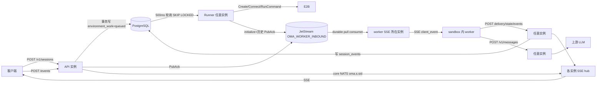
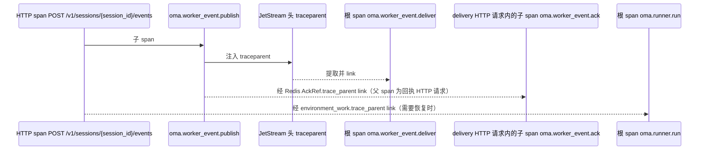
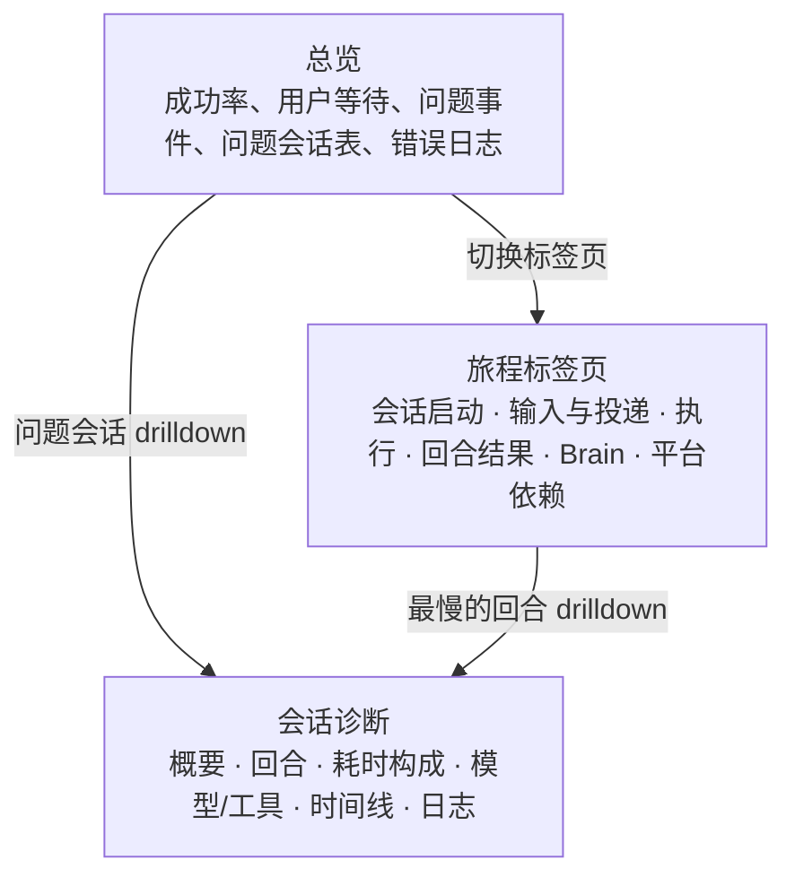
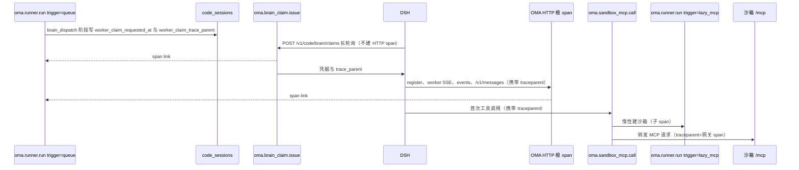
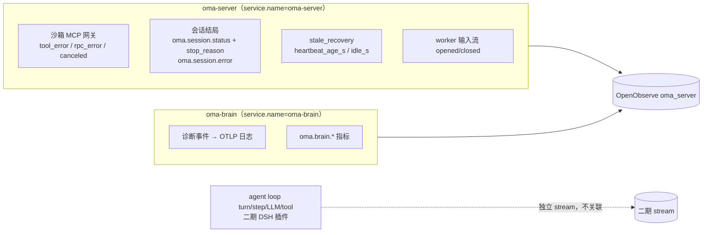

# OMA 服务端业务可观测性

本文记录 OMA 服务端 OpenTelemetry 的传播、指标、日志与 OpenObserve 查询契约。
第 1–7 节说明模型与配置，P0–P9 按功能给出职责、实现入口和验证边界；实现细节以代码为准。

## 0. 维护约束

- 保持 API、状态机、事务、重试与超时合同；遥测不得改变业务结果。
- 指标标签只使用有限枚举，ID 只放 span 与日志。未知外部枚举归为 `other`。
- 不记录请求/响应 body、消息内容、工具输入输出、凭据或完整 URL query。
  span 不调用 `RecordError`，仅记录有限的 `error.type`；日志同样遵守敏感字段限制。
- 质量门禁、数据库迁移与代码风格遵循根目录 `AGENTS.md`。普通检查与单测按改动范围执行；
  `verify-be` 仅在用户明确要求时运行，不能把跳过或环境失败写成通过。
- 修改指标名、标签、传播语义时同步维护本文和 OpenObserve JSON；不在文档复制实现代码。

## 1. 目标与非目标

### 1.1 已确认的决策

| 编号 | 决策 |
| --- | --- |
| D1 | 本期受众为内部 SRE / 研发，不进入客户控制台，不改 `internal/observability` 的客户仪表盘 |
| D2 | 以 OMA 服务端为主；手脑分离后执行端 DSH 透传 W3C `traceparent`（见 P8），并用私有 OTel provider 导出服务级日志与指标（见 P9.3）；沙箱内 em-rs 不改，其可观测由 dsh-plugin 承接 |
| D3 | 已发现的缺陷只做可观测，不修复 |
| D4 | 先采集基线，SLO 目标值待数据积累后再定 |
| D5 | 不做采样，也不提供采样率配置；但按数据价值决定是否采集：同一事实只保留一份记录（span 或日志择一）、例行状态播报与可预期的取消不以 Info/Error 记录，高频但有排查价值的请求保留并在查询层过滤（见 P9.6） |
| D6 | 状态 gauge 由每个副本定期查询数据库，看板用 `max` 聚合，不用 `sum` |
| D7 | 交付埋点、导出与 OpenObserve 看板 |

### 1.2 要回答的问题

- 单个会话：输入 `session_id`，几分钟内看出卡在哪一段——排队、E2B 创建、安装软件包、激活、
  worker 注册、消息投递与 ack、模型请求、等待用户确认、本轮结束。
- 全局健康：每段耗时分布、错误率、积压、各状态会话数，以及卡住的会话数。
- 日志与 trace 互跳：每条日志带 `trace_id`、`span_id`、`request_id`。

### 1.3 非目标

- **不引入任何新服务**，包括 OTel Collector、Prometheus、Jaeger 等。OMA 进程内的 OTel SDK 直接通过
  OTLP/HTTP 写入现有 OpenObserve。
- 不做采样：所有 span 都记录并导出（`AlwaysSample`），不提供采样率配置。控制数据量只靠第 4.3 节
  的"不建 span 路由"清单，以及指标属性的枚举约束。
- 不改沙箱 worker（em-rs）、前端或客户可见的 observability API；DSH 服务级遥测见 P9.3。
- 不新增 Prometheus `/metrics` 端点；指标通过 OTLP 推送。

## 2. 接入前基线与链路

### 2.1 接入前的能力

- 没有 OpenTelemetry SDK。`go.sum` 中已有间接依赖 `go.opentelemetry.io/otel v1.43.0`，
  `go.mod` 直接依赖只有 `go.opentelemetry.io/proto/otlp`，用于转发 Claude Code worker 自身的 OTLP
  （`internal/codesessions/otlp_forward.go`），目标流为 `oma_claude_code`。
- `internal/observability` 是读取 OpenObserve 的客户仪表盘，不写数据。
- `internal/diagnostics` 只提供 pprof。
- `internal/logging.ConsoleHandler.Handle` 忽略 ctx，因此 `*Context` 日志调用不会附加任何上下文。
- 访问日志 `internal/api/http_log.go` 使用驼峰字段 `requestId`、`durationMs`，并把所有非 2xx
  记为 Error。

### 2.2 异步链路与上下文断点



接入前每一个异步跳点都会丢失上下文：`environment_work` 表没有 trace 字段；JetStream 发布只设置
`Nats-Msg-Id`（`internal/workerevents/broker.go` 的 `Publish`）；core NATS 扇出直接发 body
（`internal/sessionfanout/nats.go` 的 `Publish`）；River 参数不带 trace；worker 的回调请求是全新请求。

### 2.3 已知缺陷（本期只观测，不修复）

| 缺陷 | 观测手段 |
| --- | --- |
| 发送事件提交后交接失败，会话卡在 running | `oma.session.handoff.failures`、`oma.sessions.stale_running` |
| 沙箱准备失败不发 `session.error` | `oma.runner.runs{oma.outcome=error}` 与失败阶段 |
| Runner 崩溃后 work 永久停在 `starting` | `oma.environment_work.stuck_starting` |
| 流式连接被 10 分钟 `WriteTimeout` 截断 | `oma.sse.stream.duration` 在 600s 附近堆积 |
| SSE 循环不发 NAK，消息至少等 1 分钟重投 | `oma.worker_event.redeliveries`、`oma.worker_event.queue_wait` |
| Redis ack 引用缺失时回执被静默忽略 | `oma.worker_event.updates{oma.result=ignored}` |
| 扇出发布失败只打 Warn | `oma.fanout.publish.failures` |
| 过期 worker 终止 code session 但公开状态不变 | `oma.worker_event.expired` |

## 3. 总体架构


- `internal/telemetry` 负责 provider、span 辅助函数、跨领域属性、instrument 构造、分桶与 W3C 传播，
  不依赖 HTTP 或业务资源包。领域指标与枚举规则就近定义，详见 P1.3 与代码地图。
- `internal/logging` 提供 `ContextHandler`、`LevelHandler`，组装层使用标准库 `slog.NewMultiHandler`。
- 新包 `internal/statemetrics`：进程内的状态上报器 `Reporter`，是 OMA 进程里的一个 goroutine，
  定期查询数据库和 NATS 并上报 gauge。它不是独立服务，属于组装层，由 `main.go` 注入依赖。它依赖
  `internal/db` 与 NATS，因此不并入基础包 `internal/telemetry`，避免基础包反向依赖持久化层；包名与配置
  `telemetry.state_metrics`、指标 `oma.state_metrics.*` 保持一致。
- 部署上不新增任何组件：只需要在配置中填写现有 OpenObserve 的地址和写入账号。
- 全局 provider 通过 `otel.SetTracerProvider`、`otel.SetMeterProvider`、`global.SetLoggerProvider`
  在启动早期设置一次；未启用时保持 OTel 默认的 no-op 实现，所有埋点调用都是廉价空操作。
- OpenObserve 端点沿用 worker OTLP 转发的格式：`{base_url}/api/{organization}/v1/{traces|metrics|logs}`，
  使用 Basic 认证，traces 和 logs 通过 `stream-name` 头写入独立流 `oma_server`，
  不与 worker 的 `oma_claude_code` 混用。

## 4. Trace 模型

### 4.1 分段 trace 加 span link

一个会话可能跨越数小时、多个实例和多段异步跳转，不能做成一条 trace。规则如下：

- 每个同步处理单元是一条独立 trace 的根：一次 HTTP 请求、一次 Runner 领取、一次 worker 投递、
  一次 River 任务执行、一次 webhook 投递。
- 跨异步跳点时，生产方把当前 span 的 `traceparent` 写入载体（NATS 头、DB 列、River metadata、
  Redis ack 引用）；消费方用 `trace.WithNewRoot()` 新建根 span，并通过 `trace.WithLinks` 链接回生产方。
- 所有 span 都带 `oma.session.id` 或 `oma.code_session.id`。在 OpenObserve 中按这两个属性过滤，
  即可拼出一个会话的完整时间线。
- 属性名与 worker OTLP 注入的可信属性保持一致（`oma.session.id`、`oma.code_session.id`、
  `oma.workspace.uuid`、`oma.organization.uuid`、`oma.agent.id`），服务端 trace 与 worker 自身的
  trace 可以用同一个过滤条件关联。



`Mark` 用于投递、ack、工具确认和状态标记。有请求父 span 时保留父子关系；worker SSE 无父 span 时
投递标记自然成为根。ack 的 link 不替代其 HTTP 父 span。

### 4.2 传播点清单

| 跳点 | 载体 | 生产方 | 消费方 | 阶段 |
| --- | --- | --- | --- | --- |
| JetStream worker 入站 | NATS 头 `traceparent` | `workerevents.JetStreamBroker.Publish` | `jetStreamSubscription.receive` → `Delivery.TraceParent` | P2 |
| 投递到 ack | Redis `AckRef.TraceParent` | `streamCodeSessionWorkerEvents` 写 AckRef | `applyLockedWorkerDeliveryUpdates` | P2 |
| DB 队列 `environment_work` | 列 `trace_parent` | 创建会话、`ScheduleEnvironmentSandboxRecoveryForCodeSession` | `Runner.RunOnce` | P3 |
| River 任务 | job metadata `oma_trace_parent` | River 插入中间件 | River 执行中间件 | P5 |
| webhook 队列 | NATS 头 `traceparent` | `webhooks.Queue.Publish` | `webhooks.Worker.processMessage` | P5 |
| core NATS 扇出 | NATS 头 `Oma-Published-At`（只算延迟，不传 trace） | `sessionfanout.NATSBus.Publish` | `NATSBus.receiveMessage` | P2 |
| Brain 领取 | 列 `code_sessions.worker_claim_trace_parent`，经领取响应字段 `trace_parent` 下发 | `Service.DispatchWorker`（`RequestCodeSessionWorker`，首次请求时写入） | `POST /v1/code/brain/claims` → DSH `claimTasks` | P8 |
| DSH 回调 | HTTP 头 `traceparent`（DSH 原样透传领取响应中的值） | DSH `OmaApi.requestResponse`、沙箱 MCP 配置 | HTTP 中间件 `workerTraceParent`，作为 link；`/v1/messages` 代理转发上游前删除 `traceparent`、`tracestate` | P8 |
| 沙箱 MCP 转发 | HTTP 头 `traceparent` | `serveSandboxMCP`（`oma.sandbox_mcp.call` span） | 沙箱 `/mcp`（em-rs 当前不读取） | P8 |
| 外部 HTTP 入站 | 不提取 | — | HTTP 中间件总是新建根 span | P1 |

外部入站请求永远不把 `traceparent` 当作父 span，避免客户端伪造父子关系。只有执行端使用的
`/v1/code/`、`/v2/ccr-sessions/`、`/v2/sessions/` 前缀和 `/v1/messages` 会把合法的 `traceparent`
作为 span link；其他路由忽略该头。link 只用于关联，伪造值不会改变服务端 trace 结构。

### 4.3 不建 span 的路由与长连接

观测策略按 chi 路由模板决定，而不是按请求路径做前后缀匹配。`internal/api/telemetry_http.go` 的
`routeTelemetry` 以完整路由模板为键；中间件在调用处理器前用 `chi.Routes.Find` 解析当前请求的模板，未声明的
路由默认建 span 并记录 HTTP 耗时。`sessions.Handler` 实现 `chi.Routes`，挂载后其内部路由对 `Find` 可见；
filestore 与 connector 以挂载点 `/*` 整体声明。`TestRequestTelemetryPolicyFollowsServerRoutes` 用真实服务路由
校验每个声明模板都已注册、示例请求解析到预期策略，路由改名会使测试失败。

| 路由模板 | 策略 | 原因 |
| --- | --- | --- |
| `/healthz`、`/readyz` | 不观测 | 探活噪音 |
| `/v1/sessions/{session_id}/events/stream`、`/v1/sessions/{session_id}/threads/{thread_id}/stream`、`/web-api/sessions/{sessionId}/stream`、`/v1/code/sessions/{code_session_id}/worker/events/stream` | 不观测 | SSE 可能持续 10 分钟，由 `oma.sse.*` 的连接数和时长覆盖 |
| `/v1/code/upstreamproxy/ws` | 不观测 | 被 hijack 的长连接 |
| `/v1/code/sessions/{code_session_id}/worker/otlp/{metrics,logs,v1/logs,v1/traces}` | 不观测 | worker 遥测转发，避免放大 |
| `/v1/filestore/fs/*` | 不观测 | rclone 高频读写 |
| `/connector/*` | 不观测 | tunnel 长轮询 |
| `/v1/code/sessions/{code_session_id}/worker/heartbeat` | 只记 HTTP 耗时 | 按状态码观察拒绝，不另建专用计数器 |
| `/v1/code/brain/claims` | 长轮询 | 最长 30 秒，不建 span、不记 HTTP 耗时，访问日志不适用慢响应规则；由 `oma.brain_claim.poll.duration` 覆盖，领取成功另建 `oma.brain_claim.issue` |

`/v1/messages` 保留 HTTP span，它代表一次真实的模型调用，即使持续数分钟也有意义。

### 4.4 Span 命名与属性

- HTTP span：`{METHOD} {chi 路由模板}`，例如 `POST /v1/sessions/{session_id}/events`；
  未匹配路由为 `{METHOD} unmatched`。
- 业务 span：`oma.<领域>.<动作>`，名字只能来自本文表格，不得拼接 ID。

属性常量（`internal/telemetry/attributes.go`）：

| 常量 | 键 | 值 | 首次使用阶段 |
| --- | --- | --- | --- |
| `AttrRequestID` | `oma.request.id` | 请求 ID | P1 |
| `AttrOrganizationUUID` | `oma.organization.uuid` | 组织 UUID | P1 |
| `AttrWorkspaceUUID` | `oma.workspace.uuid` | 工作区 UUID | P1 |
| `AttrSessionID` | `oma.session.id` | `sesn_...` | P1 |
| `AttrCodeSessionID` | `oma.code_session.id` | `cse_...` | P1 |
| `AttrThreadID` | `oma.thread.id` | 线程 ID | P1 |
| `AttrOutcome` | `oma.outcome` | 见各指标 | P2 |
| `AttrReason` | `oma.reason` | 见各指标 | P2 |
| `AttrLane` | `oma.worker_event.lane` | `task`、`reply` | P2 |
| `AttrEventType` | `oma.event.type` | 事件类型 | P2 |
| `AttrEventID` | `oma.event.id` | 事件 ID，仅 span | P2 |
| `AttrWorkerEpoch` | `oma.worker.epoch` | epoch，仅 span | P2 |
| `AttrStreamKind` | `oma.stream.kind` | `public`、`worker` | P2 |
| `AttrSource` | `oma.source` | 见各指标 | P2 |
| `AttrRedelivered` | `oma.redelivered` | bool | P2 |
| `AttrDecision` | `oma.decision` | `allow`、`deny`、`ask` | P2 |
| `AttrToolKind` | `oma.tool.kind` | 工具分类 | P2 |
| `AttrBehavior` | `oma.behavior` | `allow`、`deny` | P2 |
| `AttrWorkID` | `oma.environment_work.id` | 仅 span | P3 |
| `AttrEnvironmentID` | `oma.environment.id` | 仅 span | P3 |
| `AttrProviderSandboxID` | `oma.provider_sandbox.id` | 仅 span | P3 |
| `AttrStage` | `oma.stage` | Runner 阶段名 | P3 |
| `AttrOperation` | `oma.operation` | E2B 操作名 | P3 |
| `AttrRecovered` | `oma.runner.recovered` | bool | P3 |
| `AttrDeliveryStatus` | `oma.delivery.status` | `received`、`processing`、`processed`、`other` | P2 |
| `AttrRunnerTrigger` | `oma.runner.trigger` | `queue`、`stale_recovery`、`lazy_mcp`、`prewarm` | P8 |
| `AttrMCPMethod` | `oma.mcp.method` | 沙箱 MCP 方法枚举 | P8 |
| `AttrRiverKind` | `oma.river.kind` | River job kind | P5 |
| `AttrRiverQueue` | `oma.river.queue` | River queue | P5 |
| `AttrState` | `oma.state` | 状态值 | P6 |
| `AttrWorkerStatus` | `oma.worker.status` | worker_status | P6 |
| `AttrConnectionStatus` | `oma.connection.status` | connection_status | P6 |
| `AttrNATSStream` | `oma.nats.stream` | stream 名 | P6 |
| `AttrNATSConsumer` | `oma.nats.consumer` | consumer 名 | P6 |

HTTP 和 GenAI 相关属性直接使用 OTel 语义约定键名：`http.request.method`、`http.route`、
`http.response.status_code`、`gen_ai.request.model`、`gen_ai.token.type`、`error.type`。

### 4.5 单会话时间线的 span 覆盖

为了在 OpenObserve 中输入一个 `session_id` 就能看到完整时间线，下表中的每个 span 都必须带
`oma.session.id` 或 `oma.code_session.id`。会话诊断看板（第 7.4 节）用这两个属性把分散在多条 trace
中的 span 拼成一条时间线。

| 阶段 | span 名 | 关联属性 | 定义位置 |
| --- | --- | --- | --- |
| 创建会话 | `POST /v1/sessions` | `oma.session.id`（该路由没有路径参数，由 `create` 在成功后写入当前 span） | P1、P2.6 |
| 排队 | `oma.runner.run` 的属性 `oma.runner.queue_wait_s` | `oma.session.id` | P3.3 |
| E2B 创建、安装软件包、文件系统等 | `oma.runner.<stage>` | `oma.session.id` | P3.3 |
| 激活 | `oma.code_session.activate` | 两者 | P3.5 |
| worker 注册 | `POST /v1/code/sessions/{code_session_id}/worker/register`，属性 `oma.worker.register_delay_s` | `oma.code_session.id` | P1、P2.8 |
| 用户发送消息 | `POST /v1/sessions/{session_id}/events` | `oma.session.id` | P1 |
| 消息入队 | `oma.worker_event.publish` | `oma.code_session.id` | P2.1 |
| 唤醒沙箱 | `oma.sandbox.resume` | 两者 | P2.7 |
| 消息投递 | `oma.worker_event.deliver` | 两者 | P2.4 |
| worker 处理完成 | `oma.worker_event.ack` | `oma.code_session.id` | P2.5 |
| 模型请求 | `chat <model>` | 两者 | P4 |
| 工具权限请求 | `oma.tool_permission.request` | `oma.code_session.id` | P2.9 |
| 等待用户确认结束 | `oma.tool_permission.respond`，属性 `oma.tool_permission.wait_s` | `oma.code_session.id` | P2.9 |
| 状态变化（running、idle、本轮结束） | `oma.session.status`，属性 `oma.event.type` | `oma.session.id` | P2.11 |
| Brain 领取 | `oma.brain_claim.issue`（根 span，link 到派发时的 `oma.runner.brain_dispatch`），属性 `oma.worker.epoch`、`oma.brain.worker_id` | 两者 | P8 |
| 沙箱 MCP 调用 | `oma.sandbox_mcp.call`，属性 `oma.mcp.method`、`oma.outcome` | 两者 | P8 |
| 惰性/预热建沙箱 | `oma.runner.run`，属性 `oma.runner.trigger`=`lazy_mcp`、`prewarm` | `oma.session.id` | P8 |

E2B 单次调用等更细的子 span 不要求带会话属性，在时间线里点开所属 trace 即可看到。

## 5. 日志约定

- 新增 `ContextHandler` 包住全部 handler，从 ctx 中提取 `trace_id`、`span_id`、`request_id`
  并追加为记录属性，因此 console 和 OTLP 两路日志都能关联 trace。记录中已显式携带的同名键
  （例如访问日志和既有日志传入的 `request_id`）保持原值，不重复追加。
- 启用 `telemetry.logs` 时，日志同时写 console 和 OTLP；OTLP 一路受 `telemetry.logs.level` 过滤。
- 字段名一律 snake_case。访问日志字段在 P1 改为 snake_case（第 P1 节）。
- `session status event` 为 Debug，状态时间线默认使用 `oma.session.status` span；
  `session error event` 为 Warn。Runner 失败日志补充 `session_id`、`work_id`。
- OTel 导出错误交给 bootstrap console logger 打印，不能写回 OTLP，避免导出故障产生自我放大的日志。

## 6. 指标目录

单位：耗时为秒（`s`），计数用 `{实体}`。直方图分桶在 `internal/telemetry/metrics.go` 中统一定义：

分桶预设为 `LatencyBuckets`、`LongWaitBuckets`、`TokenBuckets`，数值以实现为准。

### 6.1 请求入口（P1）

| 名称 | 类型 | 分桶 | 属性 | 记录位置 |
| --- | --- | --- | --- | --- |
| `http.server.request.duration` | Float64Histogram | latency | `http.request.method`、`http.route`、`http.response.status_code` | API 遥测中间件 |

### 6.2 会话、消息与确认（P2）

| 名称 | 类型 | 分桶 | 属性与取值 | 记录位置 |
| --- | --- | --- | --- | --- |
| `oma.session.events.accepted` | Int64Counter | — | `oma.event.type`=`managedagentsevents.IsClientInput` 为真的类型，否则 `other` | `sendEventsRoute` |
| `oma.session.events.rejected` | Int64Counter | — | `oma.reason`=`invalid`、`archived`、`conflict`、`paused`、`tool_use_not_pending`、`other` | `sendEventsRoute` |
| `oma.session.handoff.failures` | Int64Counter | — | `oma.reason`=`worker_event_unavailable`、`other` | `sendEventsRoute` 中 `QueuePublicSessionEvents` 失败 |
| `oma.worker_event.publish.duration` | Float64Histogram | latency | `oma.worker_event.lane`、`oma.outcome`=`ok`、`error`、`canceled`、`timeout` | `JetStreamBroker.Publish` |
| `oma.worker_event.queue_wait` | Float64Histogram | longWait | `oma.worker_event.lane`、`oma.redelivered` | worker SSE 写出前 |
| `oma.worker_event.redeliveries` | Int64Counter | — | `oma.worker_event.lane` | 投递次数大于 1 时 |
| `oma.worker_event.processed.latency` | Float64Histogram | longWait | `oma.worker_event.lane` | 回执 `processed` 时，从发布到处理完成 |
| `oma.worker_event.updates` | Int64Counter | — | `oma.delivery.status`=`received`、`processing`、`processed`、`other`；`oma.outcome`=`applied`、`ignored`、`error`、`canceled`、`timeout` | `applyLockedWorkerDeliveryUpdates`；`publishProcessingInputs` 失败记 `processing`/`error` |
| `oma.sandbox.resume.duration` | Float64Histogram | latency | `oma.outcome`=`extended`、`recovery_requested`、`recovery_scheduled`、`no_provider_id`、`no_sandbox`、`disabled`、`error` | `resumeSandboxForCodeSession` |
| `oma.worker.register.delay` | Float64Histogram | latency | 无 | 注册成功时，`now - JWT iat`，仅记录不超过 900 秒的值 |
| `oma.tool_permission.decisions` | Int64Counter | — | `oma.decision`、`oma.tool.kind` | `handleToolPermissionRequest` |
| `oma.tool_permission.responses` | Int64Counter | — | `oma.behavior`、`oma.source`=`respondToToolPermissionRequest` 的 source 字面量 | `respondToToolPermissionRequest` |
| `oma.tool_permission.wait` | Float64Histogram | longWait | `oma.source`=`tool-confirmation`、`custom-tool-result` | 同上，仅 `RequestedAt` 非零时 |
| `oma.sse.streams` | Int64UpDownCounter | — | `oma.stream.kind` | 公开 SSE 与 worker SSE 进入、退出 |
| `oma.sse.stream.duration` | Float64Histogram | longWait | `oma.stream.kind` | 流退出时 |
| `oma.sse.subscribers.dropped` | Int64Counter | — | 无 | `streamHub.enqueue` 丢弃订阅者 |
| `oma.fanout.publish.failures` | Int64Counter | — | 无 | `publishSessionEvents` |
| `oma.fanout.lag` | Float64Histogram | latency | 无 | `NATSBus.receiveMessage` |
| `oma.session.turns` | Int64Counter | — | `oma.stop_reason`，白名单见 P2.11 | idle 且有 stop_reason 时 |
| `oma.session.errors` | Int64Counter | — | `error.type`、`oma.retry_status`，白名单见 P2.11 | session.error |

已移除的创建/注册/心跳计数器由 HTTP 指标替代；定时部署创建量继续从部署任务结果观察。

### 6.3 Runner 与沙箱（P3）

| 名称 | 类型 | 分桶 | 属性与取值 | 记录位置 |
| --- | --- | --- | --- | --- |
| `oma.runner.queue_wait` | Float64Histogram | longWait | 无 | 领取 queued Work 成功后，`now - queued_at`；恢复领取不记录 |
| `oma.runner.stale_recovery_claims` | Int64Counter | — | 无 | 领取到非 queued 的过期 Work（P8） |
| `oma.runner.runs` | Int64Counter | — | `oma.runner.trigger`、`oma.outcome`、`oma.runner.recovered` | `runnerRun.end` |
| `oma.runner.run.duration` | Float64Histogram | latency | `oma.runner.trigger`、`oma.outcome`、`oma.runner.recovered` | `runnerRun.end` |
| `oma.runner.stage.duration` | Float64Histogram | latency | `oma.runner.trigger`、`oma.stage`、`oma.outcome` | `runnerRun.begin` 与 `end` |
| `oma.sandbox.provider.duration` | Float64Histogram | latency | `oma.operation`=`create`、`kill`、`set_timeout`、`write_file`、`file_exists`、`run_command`、`start_background_command`、`service_endpoint`；`oma.outcome`=`ok`、`not_found`、`error`、`canceled`、`timeout` | `E2BProvider` 各方法 |
| `oma.code_session.activation.duration` | Float64Histogram | latency | `oma.outcome` | `ActivateManagedAgentCodeSession` |

Runner 阶段名固定为：`claim`、`prepare`、`sandbox_record`、`e2b_create`、`work_metadata`、`packages`、
`filestore`、`mark_running`、`code_session`、`manager_start`、`sandbox_mcp_ready`、`publish_runtime`、
`sandbox_prewarm`、`brain_dispatch`。各触发方式实际经过的阶段见 P8.2。

`oma.runner.trigger` 取值：`queue`（领取 queued Work）、`stale_recovery`（领取超时的 active/starting
NATS Work）、`lazy_mcp`（首次工具调用触发沙箱创建）、`prewarm`（`brain_sandbox_prewarm` 开启时的预热）。

### 6.4 模型代理（P4）

| 名称 | 类型 | 分桶 | 属性 | 说明 |
| --- | --- | --- | --- | --- |
| `gen_ai.client.operation.duration` | Float64Histogram | latency | `gen_ai.request.model`、`oma.source`=`code_session`、`api_key`；`http.response.status_code`；`error.type` | 从模型解析完成到响应写完 |
| `oma.model.time_to_first_byte` | Float64Histogram | latency | `gen_ai.request.model`、`oma.source` | `client.Do` 返回时 |
| `oma.model.time_to_first_token` | Float64Histogram | latency | `gen_ai.request.model` | 仅 code session 调用方，首个内容增量 |
| `gen_ai.client.token.usage` | Int64Histogram | token | `gen_ai.request.model`、`gen_ai.token.type`=`input`、`output`、`cache_read`、`cache_creation` | 仅 code session 调用方 |

`error.type` 取值：`build_request`、`begin_model_request`、`transport_error`、
`http_error`、`stream_error`、`canceled`、`observation_limit`，无错误时不设置。

### 6.5 后台任务（P5）

| 名称 | 类型 | 分桶 | 属性与取值 |
| --- | --- | --- | --- |
| `oma.river.jobs` | Int64Counter | — | `oma.river.kind`、`oma.river.queue`、`oma.outcome`=`ok`、`retry`、`discarded`、`canceled`、`snoozed` |
| `oma.river.job.duration` | Float64Histogram | latency | 同上 |
| `oma.river.job.queue_wait` | Float64Histogram | longWait | `oma.river.kind`、`oma.river.queue` |
| `oma.webhook.deliveries` | Int64Counter | — | `oma.outcome`=`ok`、`retry`、`dropped` |
| `oma.webhook.delivery.duration` | Float64Histogram | latency | `oma.outcome` |
| `oma.worker_event.expired` | Int64Counter | — | 无 |

River job kind 和 queue 都是代码中的有限常量，可以作为指标属性。

### 6.6 状态与积压 gauge（P6）

状态量为 `Int64ObservableGauge`，每个副本都会上报，全局状态对同一组属性取 `max`。连接池按实例聚合；采集失败是计数器。

| 名称 | 属性与取值 | 来源 |
| --- | --- | --- |
| `oma.sessions.live` | `oma.state`=`running`、`rescheduling` | `sessions` |
| `oma.sessions.stale_running` | 无 | running 且 `updated_at` 与最近会话事件都早于阈值 |
| `oma.code_sessions.active` | `oma.worker.status`、`oma.connection.status` | `code_sessions` 中 status 为 active 的行 |
| `oma.environment_work.live` | `oma.state`=`queued`、`starting`、`active`、`stopping` | `environment_work` |
| `oma.environment_work.oldest_queued_age` | 无，单位秒 | 最老 queued 行 |
| `oma.environment_work.stuck_starting` | 无 | starting 且 `updated_at` 早于阈值 |
| `oma.environment_sandboxes.live` | `oma.state`=`creating`、`running`、`stopping` | `environment_sandboxes` |
| `oma.nats.stream.messages` | `oma.nats.stream` | JetStream StreamInfo |
| `oma.nats.stream.oldest_message_age` | `oma.nats.stream`，单位秒 | `State.FirstTime` |
| `oma.nats.consumer.pending` | `oma.nats.consumer` | ConsumerInfo `NumPending` |
| `oma.nats.consumer.ack_pending` | `oma.nats.consumer` | `NumAckPending` |
| `oma.nats.consumer.redelivered` | `oma.nats.consumer` | `NumRedelivered` |
| `oma.db.pool.connections` | `oma.state`=`acquired`、`idle`、`total`、`max` | `pgxpool.Stat`，按实例求和 |
| `oma.state_metrics.collect.failures` | `oma.reason`=`database`、`nats` | Int64Counter |

## 7. 配置

### 7.1 YAML

```yaml
telemetry:
  enabled: false
  service_name: oma-server
  otlp:
    base_url: http://openobserve:5080
    organization: oma
    username: ""
    password: ""
    traces_stream: oma_server
    logs_stream: oma_server
    timeout: 10s
  traces:
    enabled: true
  metrics:
    enabled: true
    export_interval: 30s
  logs:
    enabled: true
    level: info
  state_metrics:
    interval: 60s
    stale_running_after: 10m
    stuck_starting_after: 10m
```

### 7.2 配置边界

类型位于 `internal/config/types.go`，YAML 映射与默认值位于 `yaml_types.go`、`defaults.go`，
验证位于 `internal/config/telemetry.go`。完整字段契约见 [配置参考](../../configuration-reference.yaml)。
外部字符串在配置边界修剪一次，密码不修剪。

开启遥测后要求服务名、组织非空，endpoint 为有效 HTTP(S) 地址，认证用户名/密码成对出现；
启用的 traces/logs 流名非空，日志级别合法，超时为正，指标导出间隔至少 1 秒，状态刷新至少 10 秒，
stale/stuck 阈值为正。状态指标没有独立开关：`StateMetricsActive` 只要求遥测与 metrics 同时开启，
状态 gauge 是排查积压与卡死的基础数据，采集成本为每副本每个刷新周期约十条带部分索引的查询。

### 7.3 配置验证

`internal/config/telemetry_test.go` 覆盖非法配置、默认值与合法值；
`TestConfigurationReferenceCoversConfigYAMLContract` 检查参考文档字段覆盖。配置示例默认关闭导出。

## P0. 基础设施

### P0.1 依赖

依赖版本由 `go.mod`、`go.sum` 固定；OTel 核心、trace 与 metric SDK 使用同一版本，日志 SDK 与
`otelslog` 使用对应兼容版本。不要在设计文档维护第二份安装命令或依赖版本清单。

### P0.2 Provider 组装

实现：[internal/telemetry/telemetry.go](../../../internal/telemetry/telemetry.go)。

`Setup` 根据各信号开关构造 provider，统一 resource 属性与 OTLP/HTTP 端点，启动早期注册全局
provider。关闭时按逆序刷新与释放；部分初始化失败也释放已创建的 provider。关闭遥测时不创建 exporter。
OTel 自身的导出错误只发往 bootstrap console logger，避免写回 OTLP。

### P0.3 Trace 辅助函数

实现：[internal/telemetry/trace.go](../../../internal/telemetry/trace.go)。

- `StartRoot` 为异步消费入口和 HTTP 请求建立独立 trace，可 link 到生产方；`Start` 继承当前父 span。
- `Mark` 表示零时长事件：有父 span 时作为子 span，没有父 span 时成为根，并可携带生产方 link。
- `Outcome` 统一返回 `ok`、`error`、`canceled`、`timeout`；`SetErrorStatus` 只记录有限错误分类，
  `canceled` 不设置 Error 状态。领域特有结果仍在领域包定义。
- `InjectTraceParent(ctx, header.Set)` 统一注入小写 `traceparent`。NATS 头区分大小写，不通过
  `propagation.HeaderCarrier` 改写成 `Traceparent`。
- span 的创建方或其返回的关闭闭包负责结束；`spancheck` 检查 `StartRoot`、`Start` 的关闭路径。

### P0.4 日志 handler

实现：[internal/logging/context.go](../../../internal/logging/context.go)。

`ContextHandler` 使用构造时注入的非 nil extractor 为日志补充上下文属性，保留记录中已显式设置的同名字段。
`LevelHandler` 控制 OTLP 一路的最低级别，多路分发使用标准库 `slog.NewMultiHandler`。
`scalarValueHandler` 把具名类型转换为可导出的标量，避免 UUID 被当作数组、自定义类型出现 `unhandled:`。

### P0.5 日志上下文组装

`main.go` 的 `logContextAttrs` 提取 `trace_id`、`span_id`、`request_id`，通过 `ContextHandler`
注入。该映射属于组装层；`internal/telemetry` 不依赖 `internal/httpapi`。

### P0.6 生命周期

`main.go` 在配置加载后初始化遥测与应用 logger，后续组件显式接收该 logger。遥测 shutdown 在
HTTP server、River、NATS 等组件关闭后执行。启动失败由 console-only bootstrap logger 报告。
未启用遥测时，console 日志仍可携带 `request_id`。

### P0.7 测试与验收

`internal/telemetry` 测试覆盖禁用、端点和头构造、部分失败清理、traceparent 校验和取消分类；
`internal/logging` 测试检查结构化 record、多路分发、显式属性优先及级别过滤。
`main_test.go` 验证日志上下文映射。OpenObserve 实际导出需要单独运行期验收。

## P1. HTTP 入口

### P1.1 中间件与路径策略

实现：[internal/api/telemetry_http.go](../../../internal/api/telemetry_http.go)、
[internal/api/http_log.go](../../../internal/api/http_log.go)。

请求策略分别决定是否建 span、是否记 HTTP 指标，具体路径见第 4.3 节。中间件顺序为请求 ID、遥测、
访问日志、panic recovery，使日志能关联 trace，恢复后的 500 能被观测。
两层共用 `serveObserved` 完成响应状态归一：未显式写状态为 200，请求取消导致的 5xx 在遥测中记为 499，
不改变已写出的 HTTP 响应。路由属性与日志字段共用同一张参数映射表。

### P1.2 Principal 属性

API 与平台鉴权成功后，`annotatePrincipalSpan` 写入组织、工作区及 code session/公开 session 标识。
这些高基数值只进入 span；HTTP 指标仅使用方法、路由模板、状态码。

### P1.3 指标归属与隔离

HTTP instrument 定义在 `internal/api/telemetry_http.go`。其他指标同样由各自领域包持有，
`internal/telemetry/metrics.go` 只提供构造函数、分桶与 `RecordWait`，不承载领域判断。

`NewInstruments` 惰性构造领域 instrument 集合，按当前全局 MeterProvider 缓存；provider 改变时重新绑定。
这解决测试替换 provider 后继续写入旧 reader 的问题。测试使用 `internal/telemetry/telemetrytest` 安装并
清理独立 provider；修改全局 provider 的测试不得并行执行。

### P1.4 访问日志与取消

字段统一为 snake_case。请求日志为 Debug；响应小于 400 且耗时小于 2 秒为 Debug，慢响应为 Info，
4xx 为 Warn，5xx 为 Error，客户端取消导致的 499 为 Info。Brain 领取长轮询（第 4.3 节）按设计阻塞，
不适用慢响应规则，成功与空轮询都保持 Debug。

`httpapi.ClientGone` 统一判断请求取消；`httpapi.LogFailure` 在请求已取消时降为 Info 并标注
`client_canceled=true`，否则为 Error。DB 层不依赖 HTTP 包，自行识别上下文取消并降为 Debug。

### P1.5 测试与验收

`internal/api/telemetry_http_test.go` 验证跳过路径、心跳只记指标、路由命名、租户属性、错误状态、
499 与日志关联。`http_log_test.go` 与 `internal/httpapi/client_gone_test.go` 验证级别与取消边界。

## P2. 会话、消息队列与工具确认

### P2.1 JetStream 发布

`internal/workerevents/broker.go` 在 `Publish` 内建立子 span，保留 message ID、payload、PubAck 和重试语义。
`InjectTraceParent` 注入消息头；按 `task`/`reply` lane 记录发布耗时与 outcome。
指标定义在 `internal/workerevents/telemetry.go`，lane 的领域语义由 workerevents 负责。

### P2.2 JetStream 接收

`Delivery` 携带 `TraceParent`、`PublishedAt`、`DeliveryCount`，来自消息头与 JetStream metadata。
内存 broker 可以保留零元数据，调用方不为未测量的时延造值。

### P2.3 Ack 引用

`internal/workerevents/ack_store.go` 的 `AckRef` 保存 lane、发布时间及生产方 span 的 traceparent。
旧 JSON 缺失字段时保持兼容：未知 lane 不记录按 lane 聚合的指标；没有发布时间不记录延迟。
跨主机时间差通过 `RecordWait` 丢弃负值。

### P2.4 worker SSE 投递

`internal/codesessions/ingress.go` 在 ack 引用写入成功后、SSE 写出前记录 `oma.worker_event.deliver`。
SSE 请求本身无 HTTP span，因此 `Mark` 生成根 span，并 link 到生产方；回执引用保留相同的生产方上下文。
发布时刻有效时记录 queue wait，`DeliveryCount > 1` 时累加重投数。

### P2.5 回执

`internal/codesessions/worker_delivery.go` 记录 `applied`、`ignored`、`error`、`canceled`、`timeout`。
成功处理 `processed` 时记录发布到处理完成的延迟，并以 `Mark` 生成 `oma.worker_event.ack`：
它是当前 delivery HTTP 请求的子 span，另 link 到 `AckRef.TraceParent`，不再创建孤立的根 trace。

### P2.6 发送事件

`internal/sessions/telemetry.go` 统一记录拒绝计数与请求 span 的 `oma.reason`，写入成功只对客户端输入
记录接受数，交接失败另计数。创建会话成功后只为当前 span 补充 session ID；不再记录 `oma.session.created`。
输入形态只记录事件和 block 类型、数量、字节数，不记录正文。
worker 输出事件的 span 标注在 `prepareWorkerOutputEvents` 中复用已解码 header，不在 handler 重复解析。

### P2.7 唤醒沙箱

`internal/codesessions/service.go` 的 `resumeSandbox` 返回明确 outcome，外层统一观测耗时与 span。
结果包括 `disabled`、`no_sandbox`、`no_provider_id`、`extended`、`recovery_requested`、
`recovery_scheduled`、`error`；是否实际安排恢复由既有业务结果决定。

### P2.8 Worker 注册与心跳

注册成功时保留 `oma.worker.register.delay` 与 span 属性 `oma.worker.register_delay_s`。
延迟从凭证签发到注册计算，仅接受非负且不超过 900 秒的值；同一 epoch 内重新注册也可能计入。

注册成功率、心跳拒绝分布从 `http.server.request.duration` 按路由和状态码查询。
删除重复的 `oma.worker.register`、`oma.worker.heartbeat.rejected`，心跳不建 span但仍记 HTTP 指标。

### P2.9 工具确认

`internal/codesessions/tool_permissions.go` 持久化 `RequestedAt`，分别记录决策、响应计数；
仅用户确认类来源且时间有效时记录等待时长。请求与响应使用 `Mark` 创建时间线子 span。
工具名与 ID 只放 span，指标使用有限的工具分类、行为和来源。

### P2.10 SSE 与扇出

`httpapi.ObserveSSEStream`（`internal/httpapi/stream_telemetry.go`，与 `StreamContext` 同属 HTTP 流式边界）在订阅成功后增加连接数，返回关闭函数；退出时减少连接数并记录时长。
公开流与 worker 流共用该逻辑，分别标记 `public`、`worker`。

慢订阅者丢弃与扇出失败由 sessions 包计数。core NATS 扇出只携带 `Oma-Published-At`，不传播 trace；
`internal/sessionfanout/nats_receive.go` 校验消息后记录延迟，负值不记录。

### P2.11 状态事件

实现：[internal/sessions/outcome_telemetry.go](../../../internal/sessions/outcome_telemetry.go)。

| 事件 | 日志 | span | 指标 |
| --- | --- | --- | --- |
| `session.status_*` | Debug `session status event` | `Mark` 生成 `oma.session.status`，包含事件类型与 stop_reason | idle 且存在 stop_reason 时计入 `oma.session.turns` |
| `session.error` | Warn `session error event` | 零时长 `oma.session.error`，状态 Error | `oma.session.errors` |

指标标签使用白名单，未知值统一为 `other`：

- stop_reason：`end_turn`、`requires_action`、`retries_exhausted`。
- error.type：`unknown_error`、`billing_error`、`model_overloaded_error`、`model_rate_limited_error`、
  `model_request_failed_error`、`mcp_connection_failed_error`、`mcp_authentication_failed_error`、`mcp_egress_blocked_error`。
- retry_status：`retrying`、`exhausted`、`terminal`。

开放集合的 span 属性（输入 block 类型、worker 事件类型）使用 `telemetry.Token` 限制为
`^[a-z][a-z0-9_.]{0,63}$`，不匹配为 `other`。正则只能限制形状，不能用于保证指标标签基数。
`error.message` 等正文不进入遥测。

### P2.12 测试与验收

各领域的 `telemetry_test.go` 使用独立 reader 验证指标名、标签与数值；无效元数据、负延迟、
未知枚举先于成功场景。`codesessions/telemetry_test.go` 验证回执父子关系与 link；
`tests/observability_resume_test.go` 通过现有服务入口验证唤醒结果并保留业务断言。

## P3. Runner 与沙箱

### P3.1 迁移

`internal/db/migrations/00083_environment_work_observability.sql` 为 Work 增加 `queued_at` 与
`trace_parent`。两者仅用于内部排队计量与关联，不进入公开 API DTO。

### P3.2 Mapper 边界

`environment_work_mapper.xml` 与 `environment_sandbox_mapper.xml` 负责绑定和扫描。
创建 Work 时 `queued_at` 等于创建时间；带退避的重排使用可领取时刻；恢复调度更新排队起点，
新的 traceparent 非空时覆盖旧关联，缺失时保留。业务编排与转换保留在 DB 公共方法中。
生成、参数绑定与真实 PostgreSQL 往返测试遵循 [Yourbatis 规范](yourbatis-guidelines.md)。

### P3.3 Runner 运行与阶段

实现：[internal/environments/runner_telemetry.go](../../../internal/environments/runner_telemetry.go)。

`startRunnerRun` 为领取创建根 span，`startSandboxRun` 为 lazy/prewarm 创建子 run。
`runnerRun.begin(ctx, stage)` 关闭上一阶段，保留调用方 ctx 中的 deadline/value，并以 run span 为父
创建兄弟阶段。阶段结束记录耗时，失败阶段写回 run span；`endRun`、`endStage` 闭包显式结束 span，
维持 `spancheck` 检查，不添加忽略规则。

trigger 的领域常量在 environments 包定义。queue wait 只对 queued 领取记录，stale recovery 不使用
最初排队时间；prewarm 子 run 与外层 run 都计数，按 trigger 分组解读，不能将总数当作领取次数。

### P3.4 E2B Provider

`internal/runtime/e2bruntime/telemetry.go` 为实际远程调用创建 `oma.e2b.<operation>` 子 span 和
耗时指标。`ErrSandboxNotFound` 归为 `not_found`，取消不设 Error；纯本地 `Resolve` 不埋点。

### P3.5 激活

`internal/codesessions/activation.go` 观测 `oma.code_session.activate` 与激活耗时，保留既有
校验、锁、事务、历史消息发布与错误返回顺序。

### P3.6 测试与验收

Runner 测试覆盖失败阶段、兄弟 span、调用方 ctx 保留、缺失排队时刻以及 trigger 口径。
Provider 测试覆盖 NotFound 等结果；`tests/sandbox_observability_test.go` 验证排队时间和关联持久化，
`TestEnvironmentWorkResponseOmitsTelemetry` 验证公开 DTO 隔离。

## P4. 模型代理

### P4.1 调用计量对象

实现：[internal/messages/telemetry.go](../../../internal/messages/telemetry.go)。

`modelCall` 持有调用时刻、状态码与 `responseObservation`。观测对象的 `result.ErrorType` 是代理阶段
错误的唯一来源；对象创建前只有 `build_request`、`begin_model_request` 两类失败单独保存。
没有其他错误且 HTTP 状态不小于 400 时记 `http_error`；取消统一导出为 `canceled`，不设 Error。

`invalid_response`、`incomplete_response`、`provider_error` 在遥测边界归为 `stream_error`。
内部事件与持久化错误字段保持原契约，标签归一不改变业务结果。指标及 token 映射均归 messages 包。

### P4.2 接入与收尾

模型名通过配置白名单解析后开始计量；上游响应头到达时记录 TTFB，首个内容增量记录 TTFT。
`proxyModelRequest` 的 observation 收尾先完成，外层 `modelCall.end` 再读取最终 usage 并结束 span。
未测量耗时与缺失 token 不造值，模型 ID、token 类型和来源仅使用已知值。

### P4.3 测试与验收

`internal/messages` 覆盖传输失败、上游错误、取消、响应解析与流式成功；
`tests/messages_observability_test.go` 验证完整代理路径、最终 usage、TTFB/TTFT、敏感内容隔离，
以及状态码、头和 body 的既有合同。

## P5. 后台任务

### P5.1 River 中间件

`internal/riverjobs/telemetry.go` 在插入时合并 metadata 中的 `oma_trace_parent`，无效 JSON 或 `null`
原样保留；执行时新建根 span 并 link。任务结果为 `ok`、`retry`、`discarded`、`canceled`、`snoozed`。
排队时长缺失或非正时不记录。指标定义与结果分类都在 riverjobs 包中。

### P5.2 Webhook

`internal/webhooks/queue.go` 使用 `InjectTraceParent` 注入 NATS 头，保持 payload、message ID 与重试配置。
`worker.go` 在 envelope 校验后新建消费根 span；`deliverEnvelope` 返回显式结果，`settle` 处理 ack/retry
并确定 `ok`、`retry`、`dropped`，外层只记录一次。

目标无效或查询失败时不虚构 HTTP 投递耗时；真正投递的计时覆盖目标校验与 HTTP 调用，
不含统计写入及 ACK。metadata 失败和取消的早退只结束 span，不虚构完成结果。
指标定义在 `internal/webhooks/telemetry.go`，重试次数与业务行为不变。

### P5.3 过期 worker

`internal/codesessions/expiry_worker.go` 每成功终止一个过期 code session，累加 `oma.worker_event.expired`。

### P5.4 测试与验收

`riverjobs/telemetry_test.go` 覆盖 metadata 兼容、结果分类、根 span link 和原错误返回；
`webhooks/telemetry_test.go` 覆盖头传播、payload 保持、查询失败、耗尽、成功和未测量耗时。
指标断言位于各自领域测试，不再保留中央 `metrics_background_test.go`。

## P6. 状态 gauge 与积压

### P6.1 索引迁移

`00084_operational_metrics_indexes.sql` 创建四个状态部分索引，其中 Work 使用仅含 `state` 的
`environment_work_live_state_v2_idx`。当前分支已将原 00085 的索引调整并入 00084；
此合并只适用于尚未应用旧 00084 的环境，已应用的环境仍需独立增量迁移。
迁移使用 `NO TRANSACTION` 与 `CONCURRENTLY`，先清理失败构建的遗留索引，再构建替代索引。

Work 心跳更新 `updated_at`；把它放入索引会阻止 HOT 更新。状态计数只依赖 `state`，
`stuck_starting` 可在少量 starting 行中筛选，因此 v2 不包含 `updated_at`。
会话索引仍保留该列，其更新频率与 Work 心跳不同。

### P6.2 跨租户边界

`OperationalMetricsMapper` 是系统级只读运维聚合，只返回状态计数，不返回租户数据，
不参与授权或业务决策。该跨租户查询例外仅限本 Mapper，不能扩展到资源 CRUD。

### P6.3 Mapper 与结果模型

实现：`internal/db/operational_metrics_mapper.go`、`operational_metrics_mapper.xml`、`operational_metrics.go`。

DB 层返回按已知状态补零的 map，状态清单与 SQL 同属 db 包；code session 按 worker/connection 状态组合补零。
`stale_running` 同时要求会话状态更新时间与最近会话事件早于阈值，排除仍有进展的会话。
真实 PostgreSQL 测试验证空库、状态计数、归档/删除排除、最近事件、排队年龄、阈值与索引结构；
Mapper 单测验证生成 SQL 和绑定。

### P6.4 状态上报器

实现：[internal/statemetrics/reporter.go](../../../internal/statemetrics/reporter.go)。

Reporter 定期查询 DB、NATS 并替换缓存快照；OTel gauge 回调只读快照与 `DB.PoolStat()`，不执行数据库查询。
DB 采集失败清空 ready 状态，避免继续输出陈旧值；单个 NATS 来源失败跳过该来源并累计失败指标。
未 ready 时仍可上报连接池。未来的 NATS FirstTime 归零年龄。

`main.go` 的 `startStateMetrics` 注入依赖、stream 与 consumer 清单；Brain 领取队列来自 DB 快照
（P8.3），不再有对应的 NATS stream。关闭时停止 goroutine 并注销 callback。多副本全局状态取 max，连接池按实例聚合。
`reporter_test.go` 与 `nats_test.go` 验证失败刷新、未 ready、连接池、空流、未来时间和正常统计。

## P7. 看板

看板定义为 [`deploy/openobserve-dashboard.json`](../../../deploy/openobserve-dashboard.json)（看板"OMA 可观测"，标签页
总览、会话启动、输入与投递、执行、回合结果、Brain、平台依赖、会话诊断）。它与 `docker-compose.yml` 中固定版本的
OpenObserve 一起维护：schema v8 依赖 OpenObserve v0.91.1 及以上，升级 OpenObserve 时一并验证看板；后续 JSON 修改的运行期
验收需另行记录。

导入方式：在 UI 的 Dashboards → Import 中选择 JSON 文件，放在 `default` 文件夹。看板使用 OpenObserve schema v8：
v5 不支持变量的 `scope`/`tabs` 字段，服务端保存时会静默丢弃，变量会出现在所有标签页。变量按标签页限定：`实例`
只在总览与旅程标签页显示，`session_id` 只在"会话诊断"标签页显示。总览的问题会话表与回合结果的"最慢的回合"表通过
drilldown（`type: byDashboard`，按文件夹名、看板标题与标签页名查找）切到"会话诊断"并带上 `session_id`，因此看板标题
"OMA 可观测"与标签页名"会话诊断"不能随意改名。

### 7.0 OpenObserve 中的实际存储形式（v0.91.1 已核对）

- 指标名和属性名中的 `.` 规范化为 `_`，例如 `oma.runner.stage.duration` 对应 `oma_runner_stage_duration`。
- 直方图拆成 `<name>_bucket`（带 `le` 标签）、`_count`、`_sum`、`_min`、`_max` 五个流；计数器和直方图都是
  累计值，查询用 `rate`/`increase`，分位数用
  `histogram_quantile(0.95, sum by (le, ...) (rate(<name>_bucket[5m])))`。
- 资源属性 `service.instance.id` 对应标签 `service_instance_id`，看板变量"实例"取自它。
- traces 流：`duration` 单位为微秒，`start_time` 为纳秒，`_timestamp` 为微秒；`span_status` 取值
  `UNSET`、`ERROR`；span 属性展开为 `oma_session_id`、`oma_stage` 等列。
- logs 流：消息文本在 `body` 列，级别在 `severity` 列（不是 `message`、`level`）；其他 slog 属性
  （`session_id`、`trace_id`、`request_id`、`component`、`error` 等）直接成为列。
- SQL 引用的列如果从未写入过，整条查询报 `Search field not found`。因此诊断看板的时间线只选用常规流量
  就会出现的列；`oma_worker_register_delay_s`、`oma_tool_permission_wait_s` 只在对应 span 上查看。
- OTel SDK 只在计数器第一次累加后才导出该指标，失败类计数器（交接失败、River 丢弃等）在首次失败前
  不存在对应的流，看板面板显示 "No Data" 不代表异常。
- 看板面板按可见区域懒加载，滚动到视口外的面板在首次进入视口前显示 "No Data"，不代表查询失败。

### 7.1 看板结构

一个看板按标签页分三层，对应三类问题：值班确认"现在是否正常、坏在哪一环"，研发排查"这个会话发生了什么"，以及性能与容量回顾。



数据源按问题类型选择：

| 问题 | 数据源 | 原因 |
| --- | --- | --- |
| 稀有事件的计数与列表：错误、失败回合、启动失败、领取耗尽、接管、5xx | traces/logs SQL | 逐条记录、计数精确。OTel 计数器在第一次累加后才导出，新标签组合的第一个点已包含整段突发，`increase()` 会把它算成 0；OpenObserve 的 PromQL 对 `空向量 or X` 也返回空，无法在查询层补零 |
| 高频请求的速率与耗时分位数 | PromQL 指标 | 采样充分、聚合便宜 |
| 当前状态与积压 | 状态 gauge（取 `max`） | 由 Reporter 定期快照 |
| 用户体感延迟 | traces SQL 窗口函数 | 用户等首 token：`user.message` 写入的 `POST .../events` span 到同会话下一次 `chat` span 开始再加其首 token 时间；回合时长：`session.status_running` 到随后 `session.status_idle`。均用 `LEAD() OVER (PARTITION BY oma_session_id ORDER BY _timestamp)` |

只在进程启动以来有意义的稀有计数器（输入拒绝原因、SSE 订阅者丢弃、广播失败、交接失败）用
`max_over_time(x[1d])` 展示累计值，不用 `increase()`。低流量时 p95 会贴近直方图分桶边界，判读时结合对应数量面板。

看板默认时间范围 6 小时，drilldown 保留当前时间范围。第一层"总览"标签页：

- 两行 8 个数字：回合成功率（`end_turn` / 除 `requires_action` 外的已结束回合）、已结束回合、用户等首 token p95、
  模型调用错误率（排除 `canceled`）、工具调用失败率（`tools/call` 中非 `ok`/`canceled`）、卡住的会话、等待执行端
  （Brain 等待领取 + 排队中的启动任务）、ERROR 日志条数。
- 趋势：回合结果（按 stop reason）、问题事件（按类型）、用户等首 token p50/p95、回合时长 p50/p95。
- 最近有问题的会话：按会话聚合 session.error、失败回合、工具失败、模型错误、启动失败，点击行进入会话诊断。
- 错误与告警日志：WARN/ERROR 按服务、实例与事件聚合，用来发现单个实例的依赖断开（例如 NATS 连接关闭后持续的
  `collect NATS stream`、SSE `http request failed`），这些失败在不建 span 的路由上只出现在日志里。

第二层是六个旅程标签页，每个回答量、成功率、耗时、积压：

| 标签页 | 主要内容 |
| --- | --- |
| 会话启动 | 新建会话、Runner 运行（触发/结果）、排队与总耗时、阶段 p95、启动失败（阶段/E2B 操作，SQL）、沙箱准备、E2B 调用、Brain 领取等待与派发/接管、worker 注册、code session 激活、沙箱唤醒结果、work 与沙箱状态 |
| 输入与投递 | 接受与拒绝的输入、输入排队、worker 事件过期、SSE 订阅者丢弃、广播失败、事件排队与处理完成、JetStream 发布、回执、重投、SSE 连接数与时长、心跳拒绝、流内保留消息数、交接失败 |
| 执行 | 模型调用量/耗时/首字节与首 token/错误（SQL）/token（输入、输出、缓存读写）/结束原因，工具调用（工具 × 结果，SQL）与耗时、沙箱 MCP 非成功，权限决策、权限答复（自动放行 / 用户确认）、确认等待 |
| 回合结果 | 已结束回合、session.error、回合结果、回合时长 p50/p95 与分布、最慢的回合（drilldown）、会话与 code session 状态 |
| Brain | 在线 DSH 节点、活跃会话、舰队与各节点利用率（活跃 / `oma.brain.sessions.capacity`，`max_over_time(...[2m])` 只统计在线节点）、等待执行端的会话（waiting/claimed/takeover）与最老等待、接管次数、准入失败与耗尽、派发→领取与领取→准入完成耗时、领取来源（派发/接管）、领取请求结果（不含长轮询自然超时）、准入结果、释放与耗尽、会话退役原因、按节点的租约丢失与心跳失败、按节点的 DSH 警告与错误事件 |
| 平台依赖 | HTTP 5xx（SQL）、ERROR 日志、状态采集失败（按实例与来源）、HTTP 路由 p95 与请求量、数据库连接池、River 结果/耗时/排队、webhook 结果/耗时/consumer 积压、ERROR 日志按组件聚合 |

入站流 `OMA_WORKER_INBOUND` 是工作队列且逻辑保留 30 天，已放弃会话的消息会一直留到过期，因此流内消息数与最老
消息年龄只作参考，不再放在总览；投递积压看输入排队与事件排队等待。

### 7.2 用状态 span 计算单轮耗时

默认导出日志级别为 Info，而 `session status event` 已降为 Debug。单轮耗时应从 traces 中筛选
`span_name='oma.session.status'`，按 `oma_session_id` 与 `start_time` 排序，将 idle 与前一个 running
配对并计算时间差。`start_time` 是纳秒；等待确认与重试耗尽通过 `oma_stop_reason` 区分。
只有显式开启 Debug 日志导出时，才可用同类状态日志辅助核对。

### 7.3 在 Traces 页面查看单个会话

不建看板也能直接查看：

1. 打开 OpenObserve 的 **Traces** 页面，stream 选 `oma_server`，时间范围覆盖会话的整个生命周期
   （例如最近 24 小时）。
2. 查询框输入 `oma_session_id = 'sesn_xxx'`，得到这个会话相关的 trace 列表：创建会话、Runner、
   发送事件、激活、模型请求、状态标记等。
3. 再输入 `oma_code_session_id = 'cse_xxx'`（`cse_` ID 可以从上一步 Runner 或激活 span 的属性中复制），
   补上 worker 回调类 trace：注册、投递、ack、工具权限。
4. 点开任意 trace 看瀑布图；带 span link 的根 span（Runner、deliver、ack、River）可以在 span 详情中
   找到生产方的 trace_id。
5. 在 **Logs** 页面、`oma_server` 流中用 `trace_id = '...'` 或 `session_id = 'sesn_xxx'` 查看错误详情。

### 7.4 会话诊断看板

第三层是"会话诊断"标签页，只使用文本框变量 `session_id`，可手工输入，也可从总览或回合结果的表格 drilldown 带入。面板依次为：会话概要（一行汇总回合、失败回合、模型调用与 token、工具调用与失败、
Brain 领取次数、session.error、Error span；领取次数大于 1 表示发生过接管或重新派发）、回合、耗时构成、模型调用、
工具调用与权限、时间线、失败的 span、日志。耗时构成只汇总叶子类别：模型调用、工具执行、Runner 阶段 span、
`oma_runner_queue_wait_s` 与 `oma_tool_permission_wait_s`，不再把 HTTP span 与其子 span 重复累加；首次工具调用
包含惰性建沙箱，因此"工具执行"与"沙箱与运行时准备"仍有重叠。
code session 不再单独设变量：traces 面板用子查询按 `session_id` 自动带出同一会话的
`oma_code_session_id`，日志面板用同一会话出现过的 `trace_id` 补齐只带 code session 标识的记录。

以下 `TIMELINE_WHERE` 指：

```sql
oma_session_id = '$session_id'
OR oma_code_session_id IN (
  SELECT DISTINCT oma_code_session_id FROM oma_server
  WHERE oma_session_id = '$session_id' AND oma_code_session_id IS NOT NULL)
```

**面板 1：时间线（表格）**

```sql
SELECT to_timestamp_micros(_timestamp) AS time, operation_name,
       ROUND(duration / 1000.0, 1) AS duration_ms, span_status,
       oma_stage, oma_outcome, oma_event_type, oma_runner_queue_wait_s, trace_id
FROM oma_server
WHERE <TIMELINE_WHERE>
ORDER BY _timestamp ASC
```

**面板 3：失败的 span（表格）**：在面板 1 的条件上加 `span_status = 'ERROR'`，并输出 `error_type`。

**面板 4：该会话的日志（logs 流表格）**

```sql
SELECT to_timestamp_micros(_timestamp) AS time, severity, component, body, error, trace_id
FROM oma_server
WHERE session_id = '$session_id'
   OR trace_id IN (SELECT DISTINCT trace_id FROM oma_server WHERE session_id = '$session_id')
ORDER BY _timestamp ASC
```

**如何判断卡在哪一段**：看面板 1 最后一条记录，以及它之后应该出现却没有出现的 span。

| 最后出现 | 应该接着出现 | 缺失时的含义与下一步 |
| --- | --- | --- |
| `POST /v1/sessions` | `oma.runner.run` | 在排队：看 `oma.environment_work.oldest_queued_age`，Runner 是否繁忙或进程是否存活 |
| `oma.runner.<stage>`，`oma_outcome=error` | — | 沙箱准备失败：`oma_stage` 就是失败阶段，用 trace_id 查日志 |
| `oma.runner.run` 成功 | `worker/register` | worker 没有启动或没有注册：看 `register_delay_s` 分布，以及沙箱是否存活 |
| `POST .../events` 与 `oma.worker_event.publish` | `oma.worker_event.deliver` | worker 没有连上事件流，或者前一条消息未 ack 造成队头阻塞：看 `oma.nats.stream.oldest_message_age` |
| `oma.worker_event.deliver` | `oma.worker_event.ack` | worker 收到消息但没有回执：看 `oma.worker_event.updates{oma.outcome=ignored}`、Redis TTL（20 分钟） |
| `chat <model>` 耗时很长或出错 | — | 上游模型慢或失败：看 `error.type`、`http.response.status_code` |
| `oma.tool_permission.request`（`oma_decision=ask`） | `oma.tool_permission.respond` | 在等待用户确认，不是系统问题 |
| `oma.session.status`（`session.status_running`） | `oma.session.status`（`session.status_idle`） | 本轮仍在进行；如果长时间没有其他 span，属于 `oma.sessions.stale_running` 统计的卡住会话 |
| `oma.sandbox.resume`（`oma_outcome=recovery_scheduled`） | 新的 `oma.runner.run`（`oma_runner_recovered=true`） | 沙箱已失效，正在重建：同"排队"一行排查 |

## P8. 手脑分离（DSH Brain）适配

main 分支引入 `oma-brain-dsh` 后，Agent loop 运行在沙箱外的 DSH 进程中，沙箱内 em-rs 只运行嵌入式
`/mcp`，不再注册 worker、不发 OTLP 和诊断。架构说明见 `docs/design/be/brain-runtime.md`。本节记录
可观测方案为此做的调整。服务端是 brain 会话唯一的 trace 来源；DSH 只透传上下文，不导出 span，
服务级日志与指标见 P9.3。

### P8.1 链路



- 派发不再经过 NATS：Runner 在 `brain_dispatch` 阶段调用 `RequestCodeSessionWorker`，把当前 span 的
  `traceparent` 写入 `code_sessions.worker_claim_trace_parent`（migration `00086`）。同一请求周期内的重复
  请求不覆盖首个值，与 `worker_claim_requested_at` 的 `COALESCE` 语义一致。
- 只有带 requested 标记的领取才返回该值；租约过期后的接管领取（公共会话仍 running 但未重新请求）不
  复用旧派发的 trace，`trace_parent` 为空。重试、交接释放会保留 requested 标记，新领取继续 link 到原派发。
- DSH 校验领取响应中的 `trace_parent`，合法时绑定到该会话的两个凭据；之后用这两个凭据发出的请求和沙箱
  MCP 配置都带同一个值，否则不发送 `traceparent`。准入诊断日志附带 `trace_id` 并以它作为日志 trace 上下文。
- 服务端对执行端路由把该值作为 link（第 4.2 节），因此在 OpenObserve 中从任一 DSH 回调 span 或
  `oma.brain_claim.issue` 可以跳到派发所在的 `oma.runner.run`，再经它的 link 回到创建会话的请求。
- 凭据恢复会重新请求执行端并写入新的派发 trace，新进程的回调 link 到新派发。
- em-rs 当前不读取 `traceparent`；工具执行内部的可观测由 dsh-plugin 承接。
- 模型代理把 `traceparent`、`tracestate` 列入 `requestHeadersToRemove`，内部 trace ID 不会转发给上游
  模型服务商，上游也不会把 OMA 的 span 当作父 span。该规则对所有调用方生效。

### P8.2 Runner 触发方式与阶段

| 触发 | 根/子 | 经过的阶段 |
| --- | --- | --- |
| `queue`，沙箱模式 | 根 span，link 到 `environment_work.trace_parent` | `claim`、`prepare`、`sandbox_record`、`e2b_create`、`work_metadata`、`packages`、`filestore`、`mark_running`、`code_session`、`manager_start`、`publish_runtime` |
| `queue`，brain 模式 | 同上 | `claim`、`prepare`、`code_session`、`mark_running`、[`sandbox_prewarm`]、`publish_runtime`、`brain_dispatch` |
| `stale_recovery` | 根 span，link 到 Work 上保存的旧 `trace_parent` | 同 brain 模式；不记录 `oma.runner.queue_wait`，计入 `oma.runner.stale_recovery_claims` |
| `lazy_mcp`、`prewarm` | 当前 span 的子 span（MCP 网关或 `sandbox_prewarm` 阶段） | `prepare`、`sandbox_record`、`e2b_create`、`work_metadata`、`packages`、`filestore`、`mark_running`、`manager_start`、`sandbox_mcp_ready` |

`queue_wait` 只对 `queue` 有意义：恢复领取的 Work 保留最初的 `queued_at`，直接计算会得到数小时的假值。
预热在外层 run 的 `sandbox_prewarm` 阶段内产生一个 `prewarm` 子 run，两者按 `oma.runner.trigger`
区分；一次预热流程会同时计入外层与子 run，看板应按触发方式分别统计，不把跨 trigger 总和当作领取数。另一个请求已在创建同一 Work 的沙箱时，
`createEnvironmentSandbox` 返回未处理，`oma.sandbox.ensure.duration` 记为 `joined`。

### P8.3 新增指标

| 名称 | 类型 | 分桶 | 属性与取值 | 记录位置 |
| --- | --- | --- | --- | --- |
| `oma.brain_claim.poll.duration` | Float64Histogram | latency | `oma.outcome`=`claimed`、`empty`、`error`、`canceled`、`timeout` | `Service.ClaimBrainWorker` |
| `oma.brain_claim.queue_wait` | Float64Histogram | latency | 无；只记录带 requested 标记的领取 | `observeBrainClaimIssued`，领取时刻减 `worker_claim_requested_at` |
| `oma.brain_claim.releases` | Int64Counter | — | `oma.reason`=`admission_failed`、`shutdown`、`idle`、`permanent`；`oma.outcome`=`ok`、`conflict`、`error`、`canceled`、`timeout` | `Service.ReleaseBrainClaim` |
| `oma.brain_claim.exhausted` | Int64Counter | — | `oma.reason`=`attempts`、`permanent` | `claimNextBrainWorker`、`ReleaseBrainClaim` |
| `oma.brain_claims.pending` | Int64ObservableGauge | — | `oma.state`=`waiting`、`claimed`、`takeover` | 状态快照 `CountRequestedBrainClaimsByState`、`CountTakeoverPendingBrainClaims` |
| `oma.brain_claims.oldest_waiting_age` | Int64ObservableGauge | —（单位 s） | 无 | 状态快照 `OldestWaitingBrainClaimAgeSeconds` |
| `oma.sandbox_mcp.duration` | Float64Histogram | latency | `oma.mcp.method`=`server/discover`、`initialize`、`notifications/initialized`、`ping`、`tools/list`、`tools/call`、`notifications/cancelled`、`other`；`oma.outcome`=`ok`、`tool_error`、`rpc_error`、`canceled`、`invalid_request`、`sandbox_unavailable`、`epoch_mismatch`、`upstream_error`、`upstream_status`；`tools/call` 另带 `oma.tool.name`=`bash`、`read`、`write`、`edit`、`grep`、`glob`、`other` | `serveSandboxMCP` |
| `oma.sandbox.ensure.duration` | Float64Histogram | latency | `oma.runner.trigger`=`lazy_mcp`、`prewarm`；`oma.outcome`=`reused`、`created`、`joined`、`error`、`canceled`、`timeout` | `Runner.ensureSessionSandbox` |
| `oma.runner.stale_recovery_claims` | Int64Counter | — | 无 | `startRunnerRun` |
| `oma.session.input.queue_wait` | Float64Histogram | longWait | 无 | `ProcessCodeSessionInputs`，`processed_at - created_at` |

- `oma.sandbox_mcp.duration` 包含惰性建沙箱、工具执行和 SSE 流式返回的时间，不能与普通 HTTP 延迟
  合并评估；`http.server.request.duration` 中该路由按 `http.route` 单独过滤。上游 HTTP 状态码只写在
  span 属性 `oma.sandbox_mcp.upstream_status_code` 上。
- `oma.mcp.method` 只接受上表中的方法名，其他值一律为 `other`，防止客户端写入任意基数。
- `oma.brain_claim.poll.duration` 的 `empty` 是长轮询自然超时，耗时接近 DSH 请求的 `block_ms`（默认 25 秒），
  不代表故障；看领取健康度用 `error` 占比、`oma.brain_claim.queue_wait` 与 `oma.brain_claims.oldest_waiting_age`。
- `oma.worker.register.delay` 在 brain 模式下度量的是从领取签发凭据到 DSH 注册的时间，而不是沙箱启动；
  派发到领取的排队由 `oma.brain_claim.queue_wait` 单独度量。
- `oma.worker_event.processed.latency` 在取消 `MaxAckPending: 1` 后还包含输入在 DSH steering inbox 中
  的排队时间。
- `oma.session.events.accepted` 只表示已持久化。`oma.session.input.queue_wait` 度量输入从持久化到执行端
  首个 `processing` 回执的时间：DSH 在把追加输入放入 steering 队列时即发送 `processing`（见
  `brain-runtime.md`），因此它是后端排队时间，不包含输入在 DSH steering 队列中等待下一次模型请求的时间。
  后者只能在执行端度量，服务端看下一次 `chat <model>` span 的开始时间。
- Brain 不再有消息队列：DSH 通过 HTTP 长轮询领取，Core NATS 只发唤醒信号。"等待执行端的会话"是 `code_sessions`
  行上的状态，由 Reporter 的 DB 快照提供：`waiting` 为已请求且领取期限为空或已过期，`claimed` 为领取期限未到期
  （DSH 正在准入），`takeover` 为没有请求标记、公共会话仍为 running/rescheduling、租约为空或已过期且不在领取期限内的
  行，即执行端崩溃后等待接管的会话（只读 `sessions.status`，因此保留 JOIN；租约宽限期内也计入）。注册成功后请求标记
  清空，不再计入。`waiting`/`claimed` 命中 `code_sessions_worker_claim_v1_idx` 部分索引，非 brain 部署恒为 0。brain 模式下 active Work 可以没有
  沙箱，`oma.environment_work.live` 不再是沙箱数量的近似值，沙箱数量看 `oma.environment_sandboxes.live`。

### P8.4 不覆盖的范围

- DSH 不导出 span。P9 起 DSH 的服务级诊断日志与指标通过 OTLP 写入 `oma_server`（见 P9.3）；agent loop
  内部的 turn/step/LLM/tool 可观测属于二期，见 P9.4。
- em-rs 工具执行内部的耗时与错误不在服务端视野内，只能看到 `oma.sandbox_mcp.call` 的整体耗时。
- `loadStreamReplay` 的 SSE 重放读取未单独建 span；公开 SSE 路由本身按第 4.3 节不建 span。
- 本节所有行为由普通单测与 PostgreSQL 集成测试覆盖；真实 DSH、E2B 沙箱与 OpenObserve 端到端效果需要
  通过 verify-be 的 brain 场景单独验收，未在本期执行。

## P9. 有效性评估后的修正

2026-10-17 用真实模型、本地 E2B 沙箱与 DSH Brain 跑了 13 个场景（多轮对话、文件、Skill、权限拒绝、工具失败、
超时、中断、Brain 崩溃恢复、外部 MCP、非文本输入、并发、归档），再由独立评审只凭 OpenObserve 数据做盲测排查，
最后与事实记录对照。结论：服务端能定位"卡在哪一跳"和耗时分解，但工具失败被标为 ok、回合结局与
`session.error` 不可见、调用方取消被记为 5xx、DSH 无遥测。本节记录据此做的修正。



### P9.1 服务端修正

| 类别 | 改动 | 位置 |
| --- | --- | --- |
| 工具结果 | `tools/call` 解析 JSON 或 SSE 最后一帧的 `result.isError` / `error`，outcome 记 `tool_error`、`rpc_error`；span 加 `oma.tool.name`（白名单）、`oma.mcp.request_id`；非 ok/canceled 的 span 设 Error | `internal/codesessions/sandbox_mcp.go`、`sandbox_mcp_outcome.go` |
| 调用方取消 | 网关在请求上下文已取消时记 `canceled`；HTTP 中间件把客户端断开导致的 5xx 记为 499 并加 `oma.client_canceled=true`，不设 Error；错误边界对 `context.Canceled` 改记 Info `http request canceled by client`；模型代理遥测把下游断开归一为 `canceled`，不再混入 `stream_error`；回执失败按 `canceled`、`timeout`、`error` 计入 `oma.worker_event.updates` | `internal/api/telemetry_http.go`、`internal/httpapi/app_error.go`、`internal/messages/model_request.go`、`internal/codesessions/worker_delivery.go` |
| 回合结局 | 见 P2.11：`oma.stop_reason`、`oma.session.error`、`oma.session.turns`、`oma.session.errors` | `internal/sessions/outcome_telemetry.go` |
| 恢复上下文 | stale_recovery 的 `oma.runner.run` 加 `oma.environment_work.state`、`heartbeat_age_s`，并输出 Warn `environment work stale recovery claimed`；不记录 Work 空闲时长（领取语句会刷新 `updated_at`，输入到被恢复的等待由 `oma.session.input.queue_wait` 度量）；lazy_mcp/prewarm 不再标 `oma.runner.recovered=true` | `internal/environments/runner.go`、`runner_telemetry.go` |
| 输入时执行端可用性 | 输入写入 worker 队列时，请求 span 加 `oma.connection.status`、`oma.worker.status`、`oma.worker.lease_active`；未连接或租约失效时输出 Warn `session input queued without connected worker`（含 `lease_expired_s`），标明该输入要等恢复派发 | `internal/codesessions/service.go`、`telemetry.go` |
| 执行端连接 | worker 输入流 Info `code session worker stream opened/closed`，带 `code_session_id`、`session_id`、`worker_epoch`、`close_reason`（`client_closed`、`server_shutdown`、`server_closed`）、`duration_s`；这两条日志同时也是诊断看板从公开会话关联 code session 日志的桥 | `internal/codesessions/ingress.go` |
| 输入形态 | `POST /v1/sessions/{id}/events` span 加 `oma.input.event_types`、`oma.input.block_types`、`oma.input.bytes`、`oma.input.events`（类型按枚举模式归一，正文不进入遥测） | `internal/sessions/telemetry.go` |
| 拒绝原因 | 409 中"工具调用不在待确认状态"拆出 `tool_use_not_pending`（未知与重复确认无法区分，合并为一类）；拒绝原因同时写入请求 span 的 `oma.reason`；`oma.session.events.accepted` 只计客户端输入 | `internal/db/db.go`、`session_events.go`，`internal/codesessions/tool_permissions.go`，`internal/sessions/telemetry.go` |
| 沙箱唤醒 | 没有可恢复沙箱且未调度恢复时记 `no_sandbox`，不再记 `recovery_requested` | `internal/codesessions/service.go` |
| 模型代理 | `chat` span 写 `gen_ai.usage.*`、`gen_ai.response.finish_reasons`（白名单）、`oma.model.time_to_first_token_s`、`oma.model.time_to_first_byte_s`、`oma.model.upstream_request_id`；遥测 error.type=canceled 不设 Error | `internal/messages/telemetry.go` |
| 降噪 | worker events/internal-events 回调 span 加 `oma.worker_event.count`、`oma.worker_event.types`；OTLP 日志 handler 把自定义类型的 slog 值转为标量，消除 `unhandled:` 前缀 | `internal/codesessions/telemetry.go`、`internal/telemetry/log_values.go` |
| 运行无进展 | `CountStaleRunningSessions` 增加"该会话在 `staleBefore` 之后没有新事件"，`stale_running_after` 默认 30m → 10m | `internal/db/operational_metrics_mapper.xml`、`internal/config/defaults.go` |

未做：合并一一对应的重复 span（`oma.runner.e2b_create` 与 `oma.e2b.create` 等）。阶段指标与看板依赖现有命名，
合并收益小于迁移成本；`oma.e2b.*` 仍通过父 trace 找到会话。

沙箱 MCP 使用外层观测包装与返回显式 outcome 的 `proxySandboxMCP`。SSE 结果检查只在
`tools/call` 开启，检查缓冲上限为 1 MiB；超限不覆盖原 outcome，不改变转发字节。
非流式响应读取上限仍为 8 MiB。工具方法与工具名使用白名单，未知值为 `other`。

### P9.2 看板

- 健康看板后续被第 7.1 节的"OMA 可观测"看板取代；`gen_ai_*` 面板过滤 `service_name="oma-server"`，模型错误排除 `canceled`。
- 诊断看板：时间线默认排除会话轮询、worker 事件上报与 E2B 续期 span，增加 `oma_stop_reason`、`error_type`
  列；日志面板排除访问日志，按 `code_session_id` 补齐 code session 与 Brain 日志。

### P9.3 oma-brain 服务级遥测

DSH 进程的服务级数据与 oma-server 同属服务端数据，写入同一个 `oma_server` 流，用 `service.name=oma-brain`
区分。实现位于 `oma-brain-dsh/src/telemetry.ts`，使用 OTel JS SDK 的私有 LoggerProvider/MeterProvider
（不注册全局 Provider，避免与二期插件冲突），配置 `OTEL_EXPORTER_OTLP_ENDPOINT` 后启用：

```bash
OTEL_SERVICE_NAME=oma-brain
OTEL_EXPORTER_OTLP_ENDPOINT=http://127.0.0.1:5082/api/oma
OTEL_EXPORTER_OTLP_HEADERS=Authorization=Basic%20<base64>
OTEL_EXPORTER_OTLP_LOGS_HEADERS=Authorization=Basic%20<base64>,stream-name=oma_server
```

- 日志：`workerDiagnostic` 的每条事件在保持原 stdout 输出的同时导出为 OTLP 日志，`body` 为事件名，
  字段成为属性，`session_id`（DSH 中即 code session ID）映射为 `code_session_id`；任务准入相关事件带派发
  `traceparent` 作为日志的 trace 上下文。新增事件：`oma_session_retired{reason}`（superseded、capacity、
  blocked、inbound_ended、admission_failed、aborted、idle、shutdown）、`oma_session_task_failed`（含
  `failure_reason` 与 `error_stack` 代码位置）、`oma_brain_ready`、`oma_brain_shutdown_started/failed`、
  `oma_brain_startup_failed`；`ccrv2_lease_lost`、`ccrv2_heartbeat_failed/recovered` 同步导出。
- 指标：`oma.brain.sessions.active`、`oma.brain.sessions.capacity`（就绪时加 `OMA_BRAIN_MAX_SESSIONS`、退出时减回）、`oma.brain.task.admissions{outcome,stage,release_reason,failure_reason}`
  （`outcome`=`admitted`、`failed`，失败时 `release_reason` 为回报给服务端的释放原因）、
  `oma.brain.claim.failures{operation,failure_reason}`（`operation`=`claim`、`release`，覆盖服务端看不到的
  网络与鉴权失败）、`oma.brain.session_tasks.stopped{reason,failure_reason}`、
  `oma.brain.worker_requests.failed{path,failure_reason}`、`oma.brain.lease.lost{stop_reason}`，属性均为有限枚举，
  不含会话标识。
- 字段约束沿用 `workerDiagnostic`：不记录凭据、payload 与异常正文。

`brainMetrics()` 始终返回 instrument 集合，关闭时使用 noop meter，调用方无需可选链。`oma.brain.sessions.active` 在就绪时
记录一次 0，使空闲节点也有序列，利用率可以按 `on (service_instance_id)` 正确配对；OTel 计数器在首次记录前不导出，
OpenObserve 的除法在一侧缺失时会错配其他实例。DSH 测试通过 `bunfig.toml` 预加载 `tests/preload.ts` 设置
`OTEL_SDK_DISABLED=true`，子进程继承该变量，即使 Bun 自动加载本地 `.env` 也不会把测试数据写入真实 OpenObserve。
初始化可重复调用而不重复注册，关闭后恢复 noop；trace 传播统一按 session ID 查询 assignment 或显式传递，
不再遍历凭据反查。协议诊断日志通过 `workerDiagnostic` 统一输出；进程启动与关闭路径仍直接输出 console 与 OTLP 日志。

### P9.4 二期边界：agent loop 可观测

- agent loop 的 turn/step/LLM/tool 数据由二期自研 DSH 插件采集，写入独立 stream，不与 oma-server 数据关联。
  服务端维持 traceparent 只作 span link 的设计。
- 模型调用的 token、成本与上游耗时以服务端模型代理为唯一指标来源（覆盖所有执行端）。OpenObserve 按指标名
  建物理流，与 traces/logs 的 stream 配置无关；二期插件不得以 `gen_ai.client.token.usage`、
  `gen_ai.client.operation.duration` 等与服务端同名的指标导出，看板的 `gen_ai_*` 面板已限定 `oma-server`。

### P9.5 验收

普通单测覆盖：网关结局解析（JSON、SSE 分片、超限、白名单）、取消判定与 499、日志级别、会话结局日志/span/
指标、输入形态属性、恢复属性、回执失败计数、worker 流关闭原因、自定义值转换、Brain OTLP 日志与指标（内存
exporter）。PostgreSQL 测试覆盖"有新事件的 running 会话不计入 stale"。真实端到端复验按评估场景子集
（S05、S06、S07、S10、S11）执行。

### P9.6 噪音审计与取舍

判断标准：每条数据是否回答一个排查或分析问题，以及是否已有另一份记录表达同一事实。存储量不作为取舍依据。

| 数据 | 结论 | 处理 |
| --- | --- | --- |
| 前端/SDK 读类轮询 span（`GET /v1/sessions/{id}`、`/threads`、`/events`、`/v1/files`） | 保留。2xx 访问日志已降为 Debug，span 是成功请求唯一的逐条记录，可还原客户端看到了什么、轮询频率是否异常 | 诊断看板时间线在查询层排除 |
| Brain 回调 span（`worker/events`、`internal-events`、`PUT /worker`、恢复时的 GET） | 保留。恢复与执行端上报路径的直接证据，已带 `oma.worker_event.count/types` | 诊断看板时间线在查询层排除高频项 |
| 客户端取消导致的 DB 与 handler 错误日志 | 噪音：一次取消产生 yourbatis `statement failed` 与 handler 两条 ERROR | DB 层 `statementLogger` 在调用方已取消时降为 Debug `yourbatis statement canceled`；handler 统一经 `httpapi.LogFailure`，请求已取消时记 Info 并带 `client_canceled=true` |
| River `producer: Producer job counts` | 噪音：每个队列每分钟一条例行计数，作业结果已有 `oma.river.*` 指标与 span | River 客户端 logger 只输出 Warn 及以上；迁移日志不变 |
| `resolved tool permission` 日志 | 与 `oma.tool_permission.request` span 重复 | 日志降为 Debug，`oma.tool.server_name`、`oma.tool.normalized_name` 补到 span |
| River 周期 sweep span（`sandbox_lifecycle_sweep` 等，每分钟一条） | 价值低：无业务上下文，结果已由 `oma.river.jobs`、`oma.river.job.duration` 覆盖 | 暂保留，待确认 |
| Brain 准入子步骤日志（`ccrv2_worker_state_read`、`lifecycle_initialized`、`state_restored`） | 价值中：每次准入各一条，`had_state`、`restored_fields` 对恢复排查有用 | 保留 |
| 一一对应的 span 对（`oma.runner.e2b_create`/`oma.e2b.create` 等） | 部分冗余 | 保留，理由见 P9.1 |
| 重复计数器 | 会话创建、worker 注册、心跳拒绝可以用已有 HTTP/任务数据观察 | 删除三个专用计数器，保留注册延迟；心跳改记 HTTP 指标 |

## 8. 代码地图

| 职责 | 实现入口 |
| --- | --- |
| Provider、传播、通用 instrument、枚举与 SSE | `internal/telemetry/{telemetry,trace,metrics,attributes,enum,sse,log_values}.go` |
| 测试 provider 安装与清理 | `internal/telemetry/telemetrytest/telemetrytest.go` |
| 日志上下文、级别和组装 | `internal/logging/context.go`、`main.go` |
| HTTP 指标、访问日志与取消边界 | `internal/api/{telemetry_http,http_log}.go`、`internal/httpapi/{client_gone,app_error}.go` |
| Worker 投递、MCP、工具确认 | `internal/codesessions/{telemetry,worker_delivery,sandbox_mcp,sandbox_mcp_outcome,tool_permissions}.go` |
| 会话输入、状态和错误 | `internal/sessions/{telemetry,outcome_telemetry}.go` |
| Runner 与沙箱准备 | `internal/environments/runner_telemetry.go`、`internal/runtime/e2bruntime/telemetry.go` |
| 模型代理 | `internal/messages/telemetry.go` |
| 队列、后台任务与扇出 | `internal/workerevents/telemetry.go`、`internal/riverjobs/telemetry.go`、`internal/webhooks/telemetry.go`、`internal/sessionfanout/nats_receive.go` |
| 状态聚合与索引 | `internal/db/operational_metrics*`、`internal/db/migrations/00084*`、`00085*`、`00086*`、`internal/statemetrics/reporter.go` |
| Brain 服务级遥测与透传 | `oma-brain-dsh/src/{telemetry,trace-context,api,worker-registration}.ts` |
| 看板 | `deploy/openobserve-dashboard.json` |

## 9. 完成定义

- 按根目录 `AGENTS.md` 执行受影响范围的生成、lint、死代码、重复度、复杂度与普通测试。
- 验证结果保留真实退出码，报告失败与跳过项；环境问题不能视为通过。
- 指标、标签与 span 结构变更同步设计文档和看板 JSON。
- 运行期 OpenObserve、真实 Worker/E2B 与 `verify-be` 的覆盖范围单独说明。
- 当前任务仅本地修改与验证，不提交、推送或发布。
