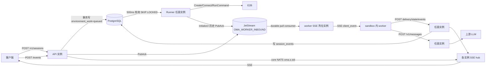
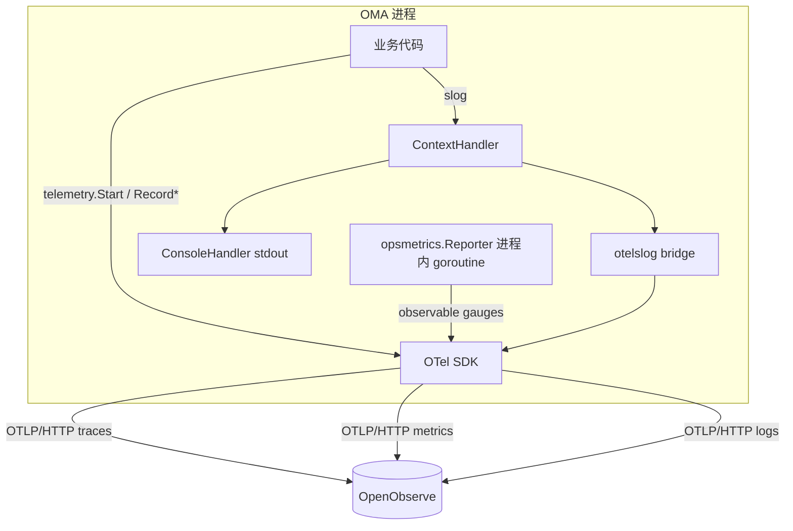
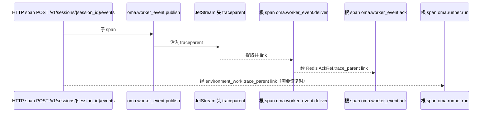

# OMA 服务端业务可观测性

本文是 OMA 服务端接入 OpenTelemetry（trace、指标、与 trace 关联的 slog 日志）并导出到 OpenObserve 的
设计与实施手册。它同时面向评审者与执行者：第 1–7 节说明目标、模型和约定，P0–P7 各节按阶段给出
可直接执行的改动清单、核心代码和验收标准，第 8–9 节是代码地图与完成定义。

## 0. 执行者必读

执行本文的模型或工程师必须遵守以下规则。任何一条与本文其他内容冲突时，以本节和仓库根目录
`CLAUDE.md` / `AGENTS.md` 为准。

1. **按阶段顺序修改代码，不提交。** 阶段顺序固定为 P0 → P1 → P2 → P3 → P4 → P5 → P6 → P7，
   所有改动都留在当前工作区。不执行 `git commit`、`git push`，不创建分支或 PR，除非用户明确要求。
   每完成一个阶段先跑门禁，全部通过后再进入下一阶段。
2. **只做可观测，不改业务行为。** 不修复第 2.3 节列出的已知缺陷，不改变任何 API 响应、状态机、
   重试策略、超时、锁顺序或事务边界。唯一允许的行为变化是第 P1 节明确列出的访问日志字段名与级别。
3. **禁止代码注释。** 新增和修改的 Go 代码不写注释；移动已有代码时保留其原有注释，不新增注释。
   本文所有示例代码均无注释，照此风格实现。
4. **不得新增未被调用的声明。** 死代码检测会检查生产代码中不可达的函数、方法、变量、常量和类型。
   每个阶段只新增该阶段实际调用的属性常量、指标和辅助函数；第 6 节目录中属于后续阶段的条目，
   到对应阶段再加。
5. **指标属性只能使用本文列出的枚举值。** 严禁把 session_id、code_session_id、work_id、event_id、
   URL、错误文本或任何用户输入放进指标属性。这些 ID 只能出现在 span 属性和日志字段中。
6. **span 和日志中禁止出现敏感内容。** 不记录请求/响应 body、消息内容、工具输入输出、
   Authorization、Cookie、token、API key、密码、OAuth code/state、完整 URL query。
   span 上不调用 `span.RecordError(err)`，错误细节只写日志，span 只记录 `error.type` 分类。
7. **质量门禁不得绕过。** 每个阶段完成后在仓库根目录依次运行：
   `./scripts/generate-go.sh`、`just lint`、`just dead-code`、`just duplicates`、`just complexity`、
   `just test`。失败时修复代码，不得使用 `nolint`、提高预算、扩大 ignore 或 `SKIP`。
   不得运行 `verify-be`，除非用户明确要求。
8. **修改 Mapper XML 或 Mapper interface 后**必须运行 `go generate ./internal/db`（由
   `./scripts/generate-go.sh` 完成），并同步更新已有的 Mapper 绑定单测（例如
   `internal/db/environment_mapper_test.go`、`internal/db/sandbox_lifecycle_mapper_test.go`）。
9. **测试组织顺序先写失败场景，再写成功场景。**
10. **遇到本文未覆盖的分歧时停下来报告**，说明位置、两种可选做法和影响，不要自行发挥。
11. 文中的行号是撰写时的参考位置，以函数名为准定位。
12. 把函数改为具名返回值（例如 `(err error)`）后，函数顶层作用域中左侧变量全部是具名返回值的
    `x, err := ...` 会编译失败，需要改为 `=`；嵌套作用域中的 `:=` 不受影响。不要为了绕开编译错误而改变逻辑。

## 1. 目标与非目标

### 1.1 已确认的决策

| 编号 | 决策 |
| --- | --- |
| D1 | 本期受众为内部 SRE / 研发，不进入客户控制台，不改 `internal/observability` 的客户仪表盘 |
| D2 | 只做 OMA 服务端；为 worker（em-rs）预留 W3C `traceparent` 传递点，不改 worker |
| D3 | 已发现的缺陷只做可观测与告警，不修复 |
| D4 | 先采集基线，SLO 目标值待数据积累后再定 |
| D5 | 不做任何采样：trace、指标、日志全量上报；不提供采样率配置 |
| D6 | 状态 gauge 由每个副本定期查询数据库，看板用 `max` 聚合，不用 `sum` |
| D7 | 交付埋点、导出、OpenObserve 看板与告警规则 |

### 1.2 要回答的问题

- 单个会话：输入 `session_id`，几分钟内看出卡在哪一段——排队、E2B 创建、安装软件包、激活、
  worker 注册、消息投递与 ack、模型请求、等待用户确认、本轮结束。
- 全局健康：每段耗时分布、错误率、积压、各状态会话数，以及卡住的会话数。
- 日志与 trace 互跳：每条日志带 `trace_id`、`span_id`、`request_id`。

### 1.3 非目标

- **不引入任何新服务**，包括 OTel Collector、Prometheus、Jaeger 等。OMA 进程内的 OTel SDK 直接通过
  OTLP/HTTP 写入现有 OpenObserve。
- 不做采样：所有 span 都记录并导出（`AlwaysSample`），不提供采样率配置。控制数据量只靠第 4.3 节
  的"不建 span 路由"清单，以及指标属性的枚举约束。
- 不改 worker、不改前端、不改客户可见的 observability API。
- 不新增 Prometheus `/metrics` 端点；指标通过 OTLP 推送。

## 2. 现状

### 2.1 已有能力

- 没有 OpenTelemetry SDK。`go.sum` 中已有间接依赖 `go.opentelemetry.io/otel v1.43.0`，
  `go.mod` 直接依赖只有 `go.opentelemetry.io/proto/otlp`，用于转发 Claude Code worker 自身的 OTLP
  （`internal/codesessions/otlp_forward.go`），目标流为 `oma_claude_code`。
- `internal/observability` 是读取 OpenObserve 的客户仪表盘，不写数据。
- `internal/diagnostics` 只提供 pprof。
- `internal/logging.ConsoleHandler.Handle` 忽略 ctx，因此 `*Context` 日志调用不会附加任何上下文。
- 访问日志 `internal/api/http_log.go` 使用驼峰字段 `requestId`、`durationMs`，并把所有非 2xx
  记为 Error。

### 2.2 异步链路与上下文断点



当前每一个异步跳点都会丢失上下文：`environment_work` 表没有 trace 字段；JetStream 发布只设置
`Nats-Msg-Id`（`internal/workerevents/broker.go` 的 `Publish`）；core NATS 扇出直接发 body
（`internal/sessionfanout/nats.go` 的 `Publish`）；River 参数不带 trace；worker 的回调请求是全新请求。

### 2.3 已知缺陷（本期只观测，不修复）

| 缺陷 | 观测手段 |
| --- | --- |
| 发送事件提交后交接失败，会话卡在 running | `oma.session.handoff.failures`、`oma.sessions.stale_running` |
| 沙箱准备失败不发 `session.error` | `oma.runner.runs{oma.outcome=error}` 与失败阶段 |
| Runner 崩溃后 work 永久停在 `starting` | `oma.environment_work.stuck_starting` |
| 流式连接被 10 分钟 `WriteTimeout` 截断 | `oma.sse.stream.duration` 在 600s 附近堆积 |
| SSE 循环不发 NAK，消息至少等 1 分钟重投 | `oma.worker_event.redeliveries`、`oma.worker_event.queue_wait` |
| Redis ack 引用缺失时回执被静默忽略 | `oma.worker_event.updates{oma.result=ignored}` |
| 扇出发布失败只打 Warn | `oma.fanout.publish.failures` |
| 过期 worker 终止 code session 但公开状态不变 | `oma.worker_event.expired` |

## 3. 总体架构



- 新包 `internal/telemetry`：provider 初始化、span 辅助函数、属性常量、指标定义与记录函数、
  W3C traceparent 编解码。它只依赖标准库、OTel、`internal/config` 和 `internal/httpapi`，
  不依赖任何业务包。
- `internal/logging` 新增 `ContextHandler`、`LevelHandler`，以及在标准库不提供
  `slog.NewMultiHandler` 时使用的 `FanoutHandler`。
- 新包 `internal/opsmetrics`：进程内的状态上报器 `Reporter`，是 OMA 进程里的一个 goroutine，
  定期查询数据库和 NATS 并上报 gauge。它不是独立服务，属于组装层，由 `main.go` 注入依赖。
- 部署上不新增任何组件：只需要在配置中填写现有 OpenObserve 的地址和写入账号。
- 全局 provider 通过 `otel.SetTracerProvider`、`otel.SetMeterProvider`、`global.SetLoggerProvider`
  在启动早期设置一次；未启用时保持 OTel 默认的 no-op 实现，所有埋点调用都是廉价空操作。
- OpenObserve 端点沿用 worker OTLP 转发的格式：`{base_url}/api/{organization}/v1/{traces|metrics|logs}`，
  使用 Basic 认证，traces 和 logs 通过 `stream-name` 头写入独立流 `oma_server`，
  不与 worker 的 `oma_claude_code` 混用。

## 4. Trace 模型

### 4.1 分段 trace 加 span link

一个会话可能跨越数小时、多个实例和多段异步跳转，不能做成一条 trace。规则如下：

- 每个同步处理单元是一条独立 trace 的根：一次 HTTP 请求、一次 Runner 领取、一次 worker 投递、
  一次 River 任务执行、一次 webhook 投递。
- 跨异步跳点时，生产方把当前 span 的 `traceparent` 写入载体（NATS 头、DB 列、River metadata、
  Redis ack 引用）；消费方用 `trace.WithNewRoot()` 新建根 span，并通过 `trace.WithLinks` 链接回生产方。
- 所有 span 都带 `oma.session.id` 或 `oma.code_session.id`。在 OpenObserve 中按这两个属性过滤，
  即可拼出一个会话的完整时间线。
- 属性名与 worker OTLP 注入的可信属性保持一致（`oma.session.id`、`oma.code_session.id`、
  `oma.workspace.uuid`、`oma.organization.uuid`、`oma.agent.id`），服务端 trace 与 worker 自身的
  trace 可以用同一个过滤条件关联。



### 4.2 传播点清单

| 跳点 | 载体 | 生产方 | 消费方 | 阶段 |
| --- | --- | --- | --- | --- |
| JetStream worker 入站 | NATS 头 `traceparent` | `workerevents.JetStreamBroker.Publish` | `jetStreamSubscription.receive` → `Delivery.TraceParent` | P2 |
| 投递到 ack | Redis `AckRef.TraceParent` | `streamCodeSessionWorkerEvents` 写 AckRef | `applyLockedWorkerDeliveryUpdates` | P2 |
| DB 队列 `environment_work` | 列 `trace_parent` | 创建会话、`ScheduleEnvironmentSandboxRecoveryForCodeSession` | `Runner.RunOnce` | P3 |
| River 任务 | job metadata `oma_trace_parent` | River 插入中间件 | River 执行中间件 | P5 |
| webhook 队列 | NATS 头 `traceparent` | `webhooks.Queue.Publish` | `webhooks.Worker.processMessage` | P5 |
| core NATS 扇出 | NATS 头 `Oma-Published-At`（只算延迟，不传 trace） | `sessionfanout.NATSBus.Publish` | `NATSBus.receiveMessage` | P2 |
| 外部 HTTP 入站 | 不提取 | — | HTTP 中间件总是新建根 span | P1 |

外部入站请求不提取 `traceparent`，避免客户端伪造父 span。以后接入 worker 时，
只在 `/v1/code/` 路由上提取，作为 link 而不是父 span。

### 4.3 不建 span 的路由与长连接

以下请求不建 HTTP span，也不记录 HTTP 耗时指标；它们由专门的指标覆盖：

| 条件（按 `r.URL.Path` 判断） | 原因 |
| --- | --- |
| 等于 `/healthz` 或 `/readyz` | 探活噪音 |
| 以 `/stream` 结尾 | 公开 SSE、线程 SSE、worker SSE、`/web-api/sessions/{id}/stream`，可能持续 10 分钟 |
| 包含 `/upstreamproxy/ws` | 被 hijack 的长连接 |
| 以 `/worker/heartbeat` 结尾 | 高频心跳，只记指标 |
| 包含 `/worker/otlp/` | worker 遥测转发，避免放大 |
| 以 `/v1/filestore/` 开头 | rclone 高频读写 |
| 以 `/connector` 开头 | tunnel 长轮询 |

`/v1/messages` 保留 HTTP span，它代表一次真实的模型调用，即使持续数分钟也有意义。

### 4.4 Span 命名与属性

- HTTP span：`{METHOD} {chi 路由模板}`，例如 `POST /v1/sessions/{session_id}/events`；
  未匹配路由为 `{METHOD} unmatched`。
- 业务 span：`oma.<领域>.<动作>`，名字只能来自本文表格，不得拼接 ID。

属性常量（`internal/telemetry/attributes.go`）：

| 常量 | 键 | 值 | 首次使用阶段 |
| --- | --- | --- | --- |
| `AttrRequestID` | `oma.request.id` | 请求 ID | P1 |
| `AttrOrganizationUUID` | `oma.organization.uuid` | 组织 UUID | P1 |
| `AttrWorkspaceUUID` | `oma.workspace.uuid` | 工作区 UUID | P1 |
| `AttrSessionID` | `oma.session.id` | `sesn_...` | P1 |
| `AttrCodeSessionID` | `oma.code_session.id` | `cse_...` | P1 |
| `AttrThreadID` | `oma.thread.id` | 线程 ID | P1 |
| `AttrOutcome` | `oma.outcome` | 见各指标 | P2 |
| `AttrReason` | `oma.reason` | 见各指标 | P2 |
| `AttrLane` | `oma.worker_event.lane` | `task`、`reply` | P2 |
| `AttrEventType` | `oma.event.type` | 事件类型 | P2 |
| `AttrEventID` | `oma.event.id` | 事件 ID，仅 span | P2 |
| `AttrWorkerEpoch` | `oma.worker.epoch` | epoch，仅 span | P2 |
| `AttrStreamKind` | `oma.stream.kind` | `public`、`worker` | P2 |
| `AttrSource` | `oma.source` | 见各指标 | P2 |
| `AttrRedelivered` | `oma.redelivered` | bool | P2 |
| `AttrDecision` | `oma.decision` | `allow`、`deny`、`ask` | P2 |
| `AttrToolKind` | `oma.tool.kind` | 工具分类 | P2 |
| `AttrBehavior` | `oma.behavior` | `allow`、`deny` | P2 |
| `AttrWorkID` | `oma.environment_work.id` | 仅 span | P3 |
| `AttrEnvironmentID` | `oma.environment.id` | 仅 span | P3 |
| `AttrProviderSandboxID` | `oma.provider_sandbox.id` | 仅 span | P3 |
| `AttrStage` | `oma.stage` | Runner 阶段名 | P3 |
| `AttrOperation` | `oma.operation` | E2B 操作名 | P3 |
| `AttrRecovered` | `oma.runner.recovered` | bool | P3 |
| `AttrDeliveryStatus` | `oma.delivery.status` | `received`、`processing`、`processed`、`other` | P2 |
| `AttrRiverKind` | `oma.river.kind` | River job kind | P5 |
| `AttrRiverQueue` | `oma.river.queue` | River queue | P5 |
| `AttrState` | `oma.state` | 状态值 | P6 |
| `AttrWorkerStatus` | `oma.worker.status` | worker_status | P6 |
| `AttrConnectionStatus` | `oma.connection.status` | connection_status | P6 |
| `AttrNATSStream` | `oma.nats.stream` | stream 名 | P6 |
| `AttrNATSConsumer` | `oma.nats.consumer` | consumer 名 | P6 |

HTTP 和 GenAI 相关属性直接使用 OTel 语义约定键名：`http.request.method`、`http.route`、
`http.response.status_code`、`gen_ai.request.model`、`gen_ai.token.type`、`error.type`。

### 4.5 单会话时间线的 span 覆盖

为了在 OpenObserve 中输入一个 `session_id` 就能看到完整时间线，下表中的每个 span 都必须带
`oma.session.id` 或 `oma.code_session.id`。会话诊断看板（第 7.5 节）用这两个属性把分散在多条 trace
中的 span 拼成一条时间线。

| 阶段 | span 名 | 关联属性 | 定义位置 |
| --- | --- | --- | --- |
| 创建会话 | `POST /v1/sessions` | `oma.session.id`（该路由没有路径参数，由 `create` 在成功后写入当前 span） | P1、P2.6 |
| 排队 | `oma.runner.run` 的属性 `oma.runner.queue_wait_s` | `oma.session.id` | P3.3 |
| E2B 创建、安装软件包、文件系统等 | `oma.runner.<stage>` | `oma.session.id` | P3.3 |
| 激活 | `oma.code_session.activate` | 两者 | P3.5 |
| worker 注册 | `POST /v1/code/sessions/{code_session_id}/worker/register`，属性 `oma.worker.register_delay_s` | `oma.code_session.id` | P1、P2.8 |
| 用户发送消息 | `POST /v1/sessions/{session_id}/events` | `oma.session.id` | P1 |
| 消息入队 | `oma.worker_event.publish` | `oma.code_session.id` | P2.1 |
| 唤醒沙箱 | `oma.sandbox.resume` | 两者 | P2.7 |
| 消息投递 | `oma.worker_event.deliver` | 两者 | P2.4 |
| worker 处理完成 | `oma.worker_event.ack` | `oma.code_session.id` | P2.5 |
| 模型请求 | `chat <model>` | 两者 | P4 |
| 工具权限请求 | `oma.tool_permission.request` | `oma.code_session.id` | P2.9 |
| 等待用户确认结束 | `oma.tool_permission.respond`，属性 `oma.tool_permission.wait_s` | `oma.code_session.id` | P2.9 |
| 状态变化（running、idle、本轮结束） | `oma.session.status`，属性 `oma.event.type` | `oma.session.id` | P2.11 |

E2B 单次调用等更细的子 span 不要求带会话属性，在时间线里点开所属 trace 即可看到。

## 5. 日志约定

- 新增 `ContextHandler` 包住全部 handler，从 ctx 中提取 `trace_id`、`span_id`、`request_id`
  并追加为记录属性，因此 console 和 OTLP 两路日志都能关联 trace。记录中已显式携带的同名键
  （例如访问日志和既有日志传入的 `request_id`）保持原值，不重复追加。
- 启用 `telemetry.logs` 时，日志同时写 console 和 OTLP；OTLP 一路受 `telemetry.logs.level` 过滤。
- 字段名一律 snake_case。访问日志字段在 P1 改为 snake_case（第 P1 节）。
- 本期新增两类 Info 日志：
  - `session status event`：每个持久化的 `session.status_*` 事件一条，字段为 `session_id`、
    `event_id`、`event_type`，用于在 OpenObserve 中计算单轮耗时（第 12.3 节）。
  - Runner 失败日志补充 `session_id`、`work_id`（P3）。
- OTel 导出错误交给 bootstrap console logger 打印，不能写回 OTLP，避免导出故障产生自我放大的日志。

## 6. 指标目录

单位：耗时为秒（`s`），计数用 `{实体}`。直方图分桶在 `internal/telemetry/metrics.go` 中统一定义：

```go
var (
	latencyBuckets  = []float64{0.005, 0.01, 0.025, 0.05, 0.1, 0.25, 0.5, 1, 2.5, 5, 10, 30, 60, 120, 300, 600}
	longWaitBuckets = []float64{1, 5, 15, 30, 60, 120, 300, 600, 1800, 3600, 7200, 21600, 86400}
	tokenBuckets    = []float64{16, 64, 256, 1024, 4096, 16384, 65536, 262144, 1048576}
)
```

### 6.1 请求入口（P1）

| 名称 | 类型 | 分桶 | 属性 | 记录位置 |
| --- | --- | --- | --- | --- |
| `http.server.request.duration` | Float64Histogram | latency | `http.request.method`、`http.route`、`http.response.status_code` | API 遥测中间件 |

### 6.2 会话、消息与确认（P2）

| 名称 | 类型 | 分桶 | 属性与取值 | 记录位置 |
| --- | --- | --- | --- | --- |
| `oma.session.created` | Int64Counter | — | `oma.source`=`api`、`deployment_schedule` | `sessions` 的 `create`；`deployments` 的 `scheduledDeploymentWorker.Work` |
| `oma.session.events.accepted` | Int64Counter | — | `oma.event.type`=`managedagentsevents.IsClientInput` 为真的类型，否则 `other` | `sendEventsRoute` |
| `oma.session.events.rejected` | Int64Counter | — | `oma.reason`=`invalid`、`archived`、`conflict`、`other` | `sendEventsRoute` |
| `oma.session.handoff.failures` | Int64Counter | — | `oma.reason`=`worker_event_unavailable`、`other` | `sendEventsRoute` 中 `QueuePublicSessionEvents` 失败 |
| `oma.worker_event.publish.duration` | Float64Histogram | latency | `oma.worker_event.lane`、`oma.outcome`=`ok`、`error`、`canceled`、`timeout` | `JetStreamBroker.Publish` |
| `oma.worker_event.queue_wait` | Float64Histogram | longWait | `oma.worker_event.lane`、`oma.redelivered` | worker SSE 写出前 |
| `oma.worker_event.redeliveries` | Int64Counter | — | `oma.worker_event.lane` | 投递次数大于 1 时 |
| `oma.worker_event.processed.latency` | Float64Histogram | longWait | `oma.worker_event.lane` | 回执 `processed` 时，从发布到处理完成 |
| `oma.worker_event.updates` | Int64Counter | — | `oma.delivery.status`=`received`、`processing`、`processed`、`other`；`oma.outcome`=`applied`、`ignored`、`error` | `applyLockedWorkerDeliveryUpdates` |
| `oma.sandbox.resume.duration` | Float64Histogram | latency | `oma.outcome`=`extended`、`recovery_requested`、`recovery_scheduled`、`no_provider_id`、`disabled`、`error` | `resumeSandboxForCodeSession` |
| `oma.worker.register` | Int64Counter | — | `oma.outcome`=`ok`、`error` | worker 注册 handler |
| `oma.worker.register.delay` | Float64Histogram | latency | 无 | 注册成功时，`now - JWT iat`，仅记录不超过 900 秒的值 |
| `oma.worker.heartbeat.rejected` | Int64Counter | — | `oma.reason`=`not_registered`、`lease_expired`、`epoch_mismatch`、`sandbox_timeout`、`error` | 心跳 handler |
| `oma.tool_permission.decisions` | Int64Counter | — | `oma.decision`、`oma.tool.kind` | `handleToolPermissionRequest` |
| `oma.tool_permission.responses` | Int64Counter | — | `oma.behavior`、`oma.source`=`respondToToolPermissionRequest` 的 source 字面量 | `respondToToolPermissionRequest` |
| `oma.tool_permission.wait` | Float64Histogram | longWait | `oma.source`=`tool-confirmation`、`custom-tool-result` | 同上，仅 `RequestedAt` 非零时 |
| `oma.sse.streams` | Int64UpDownCounter | — | `oma.stream.kind` | 公开 SSE 与 worker SSE 进入、退出 |
| `oma.sse.stream.duration` | Float64Histogram | longWait | `oma.stream.kind` | 流退出时 |
| `oma.sse.subscribers.dropped` | Int64Counter | — | 无 | `streamHub.enqueue` 丢弃订阅者 |
| `oma.fanout.publish.failures` | Int64Counter | — | 无 | `publishSessionEvents` |
| `oma.fanout.lag` | Float64Histogram | latency | 无 | `NATSBus.receiveMessage` |

### 6.3 Runner 与沙箱（P3）

| 名称 | 类型 | 分桶 | 属性与取值 | 记录位置 |
| --- | --- | --- | --- | --- |
| `oma.runner.queue_wait` | Float64Histogram | longWait | 无 | 领取成功后，`now - queued_at` |
| `oma.runner.runs` | Int64Counter | — | `oma.outcome`、`oma.runner.recovered` | `runnerRun.end` |
| `oma.runner.run.duration` | Float64Histogram | latency | `oma.outcome`、`oma.runner.recovered` | `runnerRun.end` |
| `oma.runner.stage.duration` | Float64Histogram | latency | `oma.stage`、`oma.outcome` | `runnerRun.begin` 与 `end` |
| `oma.sandbox.provider.duration` | Float64Histogram | latency | `oma.operation`=`create`、`kill`、`set_timeout`、`write_file`、`file_exists`、`run_command`、`start_background_command`；`oma.outcome`=`ok`、`not_found`、`error`、`canceled`、`timeout` | `E2BProvider` 各方法 |
| `oma.code_session.activation.duration` | Float64Histogram | latency | `oma.outcome` | `ActivateManagedAgentCodeSession` |

Runner 阶段名固定为：`claim`、`prepare`、`sandbox_record`、`e2b_create`、`work_metadata`、`packages`、
`filestore`、`mark_running`、`code_session`、`manager_start`、`publish_runtime`。

### 6.4 模型代理（P4）

| 名称 | 类型 | 分桶 | 属性 | 说明 |
| --- | --- | --- | --- | --- |
| `gen_ai.client.operation.duration` | Float64Histogram | latency | `gen_ai.request.model`、`oma.source`=`code_session`、`api_key`；`http.response.status_code`；`error.type` | 从模型解析完成到响应写完 |
| `oma.model.time_to_first_byte` | Float64Histogram | latency | `gen_ai.request.model`、`oma.source` | `client.Do` 返回时 |
| `oma.model.time_to_first_token` | Float64Histogram | latency | `gen_ai.request.model` | 仅 code session 调用方，首个内容增量 |
| `gen_ai.client.token.usage` | Int64Histogram | token | `gen_ai.request.model`、`gen_ai.token.type`=`input`、`output`、`cache_read`、`cache_creation` | 仅 code session 调用方 |

`error.type` 取值：`build_request`、`begin_model_request`、`transport_error`、
`http_error`、`stream_error`、`cancelled`、`observation_limit`，无错误时不设置。

### 6.5 后台任务（P5）

| 名称 | 类型 | 分桶 | 属性与取值 |
| --- | --- | --- | --- |
| `oma.river.jobs` | Int64Counter | — | `oma.river.kind`、`oma.river.queue`、`oma.outcome`=`ok`、`retry`、`discarded`、`cancelled`、`snoozed` |
| `oma.river.job.duration` | Float64Histogram | latency | 同上 |
| `oma.river.job.queue_wait` | Float64Histogram | longWait | `oma.river.kind`、`oma.river.queue` |
| `oma.webhook.deliveries` | Int64Counter | — | `oma.outcome`=`success`、`retry`、`dropped` |
| `oma.webhook.delivery.duration` | Float64Histogram | latency | `oma.outcome` |
| `oma.worker_event.expired` | Int64Counter | — | 无 |

River job kind 和 queue 都是代码中的有限常量，可以作为指标属性。

### 6.6 状态与积压 gauge（P6）

全部为 `Int64ObservableGauge`，每个副本都会上报，看板必须对同一组属性取 `max`。

| 名称 | 属性与取值 | 来源 |
| --- | --- | --- |
| `oma.sessions.live` | `oma.state`=`running`、`rescheduling` | `sessions` |
| `oma.sessions.stale_running` | 无 | running 且 `updated_at` 早于阈值 |
| `oma.code_sessions.active` | `oma.worker.status`、`oma.connection.status` | `code_sessions` 中 status 为 active 的行 |
| `oma.environment_work.live` | `oma.state`=`queued`、`starting`、`active`、`stopping` | `environment_work` |
| `oma.environment_work.oldest_queued_age` | 无，单位秒 | 最老 queued 行 |
| `oma.environment_work.stuck_starting` | 无 | starting 且 `updated_at` 早于阈值 |
| `oma.environment_sandboxes.live` | `oma.state`=`creating`、`running`、`stopping` | `environment_sandboxes` |
| `oma.nats.stream.messages` | `oma.nats.stream` | JetStream StreamInfo |
| `oma.nats.stream.oldest_message_age` | `oma.nats.stream`，单位秒 | `State.FirstTime` |
| `oma.nats.consumer.pending` | `oma.nats.consumer` | ConsumerInfo `NumPending` |
| `oma.nats.consumer.ack_pending` | `oma.nats.consumer` | `NumAckPending` |
| `oma.nats.consumer.redelivered` | `oma.nats.consumer` | `NumRedelivered` |
| `oma.db.pool.connections` | `oma.state`=`acquired`、`idle`、`total`、`max` | `pgxpool.Stat`，按实例求和 |
| `oma.state_metrics.collect.failures` | `oma.reason`=`database`、`nats` | Int64Counter |

## 7. 配置

### 7.1 YAML

```yaml
telemetry:
  enabled: false
  service_name: oma-server
  otlp:
    base_url: http://openobserve:5080
    organization: oma
    username: ""
    password: ""
    traces_stream: oma_server
    logs_stream: oma_server
    timeout: 10s
  traces:
    enabled: true
  metrics:
    enabled: true
    export_interval: 30s
  logs:
    enabled: true
    level: info
  state_metrics:
    enabled: true
    interval: 60s
    stale_running_after: 30m
    stuck_starting_after: 10m
```

### 7.2 Go 类型（`internal/config/types.go`）

```go
type TelemetryConfig struct {
	Enabled      bool                        `yaml:"enabled"`
	ServiceName  string                      `yaml:"service_name"`
	OTLP         TelemetryOTLPConfig         `yaml:"otlp"`
	Traces       TelemetryTracesConfig       `yaml:"traces"`
	Metrics      TelemetryMetricsConfig      `yaml:"metrics"`
	Logs         TelemetryLogsConfig         `yaml:"logs"`
	StateMetrics TelemetryStateMetricsConfig `yaml:"state_metrics"`
}

type TelemetryOTLPConfig struct {
	BaseURL      string        `yaml:"base_url"`
	Organization string        `yaml:"organization"`
	Username     string        `yaml:"username"`
	Password     string        `yaml:"password"`
	TracesStream string        `yaml:"traces_stream"`
	LogsStream   string        `yaml:"logs_stream"`
	Timeout      time.Duration `yaml:"timeout"`
}

type TelemetryTracesConfig struct {
	Enabled bool `yaml:"enabled"`
}

type TelemetryMetricsConfig struct {
	Enabled        bool          `yaml:"enabled"`
	ExportInterval time.Duration `yaml:"export_interval"`
}

type TelemetryLogsConfig struct {
	Enabled bool   `yaml:"enabled"`
	Level   string `yaml:"level"`
}

type TelemetryStateMetricsConfig struct {
	Enabled            bool          `yaml:"enabled"`
	Interval           time.Duration `yaml:"interval"`
	StaleRunningAfter  time.Duration `yaml:"stale_running_after"`
	StuckStartingAfter time.Duration `yaml:"stuck_starting_after"`
}
```

### 7.3 接入步骤

1. `Config` 增加字段 `Telemetry TelemetryConfig \`yaml:"telemetry"\``，位置放在 `Observability` 之后。
2. `internal/config/yaml_types.go`：`yamlConfig` 增加同名字段；`newYAMLConfig` 用
   `defaults.Telemetry` 填默认值；`resolve` 原样拷贝 `input.Telemetry`。参照 `Observability` 的三处写法。
3. `internal/config/defaults.go`：在 `defaultConfig` 中加入第 7.1 节的默认值，`Enabled` 为 `false`。
4. `Load` 中对外部输入只修剪一次：`BaseURL`、`Organization`、`Username`、`ServiceName`、`Level`、
   两个 stream 名。`Password` 不修剪。
5. 新建 `internal/config/telemetry.go`，实现 `validateTelemetryConfig(cfg TelemetryConfig) error`，
   并在 `validate` 中调用。只在 `Enabled` 为 true 时校验：
   - `service_name`、`otlp.organization` 非空；
   - `otlp.base_url` 能被 `url.Parse` 解析，scheme 为 `http` 或 `https`，host 非空；
   - `otlp.timeout` 大于 0；
   - `otlp.username` 与 `otlp.password` 要么都为空，要么都非空；
   - `traces.enabled` 时 `traces_stream` 非空；
   - `metrics.enabled` 时 `export_interval` 不小于 1 秒；
   - `logs.enabled` 时 `logs_stream` 非空，`level` 能被 `slog.Level.UnmarshalText` 解析；
   - `state_metrics.enabled` 时 `interval` 不小于 10 秒，两个阈值大于 0。
6. 在 `internal/config/telemetry.go` 中提供：

```go
func (c TelemetryConfig) StateMetricsActive() bool {
	return c.Enabled && c.Metrics.Enabled && c.StateMetrics.Enabled
}

func (c TelemetryLogsConfig) SlogLevel() slog.Level {
	var level slog.Level
	if err := level.UnmarshalText([]byte(c.Level)); err != nil {
		return slog.LevelInfo
	}
	return level
}
```

`StateMetricsActive` 在 P6 首次接线时加入，P0 不提前新增无调用方的方法。

7. 更新 `docs/configuration-reference.yaml`，加入第 7.1 节的完整 `telemetry` 段，并写明
   `password` 是敏感值。`TestConfigurationReferenceCoversConfigYAMLContract` 会检查覆盖情况。
   **不要修改** `config/config.example.yaml`，它有固定字段契约测试。
8. 更新 `docs/design/be/runtime-configuration.md` 的配置段表格，增加一行
   `TelemetryConfig | telemetry | 服务端 OTel 导出，见[服务端业务可观测性](server-observability.md)`。
9. 测试 `internal/config/telemetry_test.go`：先写失败场景（每条校验各一例），再写默认值和合法配置。

## P0. 基础设施

### P0.1 依赖

```bash
go get go.opentelemetry.io/otel@v1.43.0 \
  go.opentelemetry.io/otel/trace@v1.43.0 \
  go.opentelemetry.io/otel/metric@v1.43.0 \
  go.opentelemetry.io/otel/sdk@v1.43.0 \
  go.opentelemetry.io/otel/sdk/metric@v1.43.0 \
  go.opentelemetry.io/otel/exporters/otlp/otlptrace/otlptracehttp@v1.43.0 \
  go.opentelemetry.io/otel/exporters/otlp/otlpmetric/otlpmetrichttp@v1.43.0
```

日志相关模块使用与 otel v1.43.0 同批发布的版本（以 otel-go 仓库 v1.43.0 的 CHANGELOG 为准）：
`go.opentelemetry.io/otel/log`、`go.opentelemetry.io/otel/sdk/log`、
`go.opentelemetry.io/otel/exporters/otlp/otlplog/otlploghttp`、`go.opentelemetry.io/contrib/bridges/otelslog`。
本次核验采用日志模块 `v0.19.0`（2026-04-02）和 `otelslog v0.18.0`（2026-04-03），均已发布超过两周。
完成后运行 `go mod tidy`，并用 `go list -m all | grep opentelemetry` 确认所有 `otel` 核心模块版本一致，
`go.opentelemetry.io/proto/otlp` 未被降级。不得选择发布不足两周的版本。

### P0.2 `internal/telemetry/telemetry.go`

```go
package telemetry

import (
	"context"
	"encoding/base64"
	"errors"
	"fmt"
	"log/slog"
	"net/url"
	"os"
	"runtime/debug"
	"strconv"
	"strings"

	"go.opentelemetry.io/contrib/bridges/otelslog"
	"go.opentelemetry.io/otel"
	"go.opentelemetry.io/otel/attribute"
	"go.opentelemetry.io/otel/exporters/otlp/otlplog/otlploghttp"
	"go.opentelemetry.io/otel/exporters/otlp/otlpmetric/otlpmetrichttp"
	"go.opentelemetry.io/otel/exporters/otlp/otlptrace/otlptracehttp"
	"go.opentelemetry.io/otel/log/global"
	"go.opentelemetry.io/otel/propagation"
	sdklog "go.opentelemetry.io/otel/sdk/log"
	sdkmetric "go.opentelemetry.io/otel/sdk/metric"
	"go.opentelemetry.io/otel/sdk/resource"
	sdktrace "go.opentelemetry.io/otel/sdk/trace"

	"github.com/superduck-ai/open-managed-agents/internal/config"
)

const InstrumentationName = "github.com/superduck-ai/open-managed-agents"

type Runtime struct {
	loggerProvider *sdklog.LoggerProvider
	shutdowns      []func(context.Context) error
}

func Setup(ctx context.Context, cfg config.TelemetryConfig, environment string, errorLogger *slog.Logger) (*Runtime, error) {
	runtime := &Runtime{}
	if !cfg.Enabled {
		return runtime, nil
	}
	otel.SetErrorHandler(otel.ErrorHandlerFunc(func(err error) {
		errorLogger.WarnContext(context.Background(), "telemetry export failed", "error", err)
	}))
	otel.SetTextMapPropagator(propagation.TraceContext{})
	res := newResource(cfg, environment)
	if err := runtime.setupProviders(ctx, cfg, res); err != nil {
		return nil, errors.Join(err, runtime.Shutdown(ctx))
	}
	return runtime, nil
}

func (r *Runtime) setupProviders(ctx context.Context, cfg config.TelemetryConfig, res *resource.Resource) error {
	if cfg.Traces.Enabled {
		provider, err := newTracerProvider(ctx, cfg, res)
		if err != nil {
			return err
		}
		otel.SetTracerProvider(provider)
		r.shutdowns = append(r.shutdowns, provider.Shutdown)
	}
	if cfg.Metrics.Enabled {
		provider, err := newMeterProvider(ctx, cfg, res)
		if err != nil {
			return err
		}
		otel.SetMeterProvider(provider)
		r.shutdowns = append(r.shutdowns, provider.Shutdown)
	}
	if cfg.Logs.Enabled {
		provider, err := newLoggerProvider(ctx, cfg, res)
		if err != nil {
			return err
		}
		global.SetLoggerProvider(provider)
		r.loggerProvider = provider
		r.shutdowns = append(r.shutdowns, provider.Shutdown)
	}
	return nil
}

func (r *Runtime) LogHandler() slog.Handler {
	if r == nil || r.loggerProvider == nil {
		return nil
	}
	return otelslog.NewHandler(InstrumentationName, otelslog.WithLoggerProvider(r.loggerProvider))
}

func (r *Runtime) Shutdown(ctx context.Context) error {
	if r == nil {
		return nil
	}
	var errs []error
	for index := len(r.shutdowns) - 1; index >= 0; index-- {
		errs = append(errs, r.shutdowns[index](ctx))
	}
	r.shutdowns = nil
	return errors.Join(errs...)
}

func newTracerProvider(ctx context.Context, cfg config.TelemetryConfig, res *resource.Resource) (*sdktrace.TracerProvider, error) {
	exporter, err := otlptracehttp.New(ctx,
		otlptracehttp.WithEndpointURL(otlpURL(cfg.OTLP, "traces")),
		otlptracehttp.WithHeaders(otlpHeaders(cfg.OTLP, cfg.OTLP.TracesStream)),
		otlptracehttp.WithTimeout(cfg.OTLP.Timeout),
	)
	if err != nil {
		return nil, fmt.Errorf("create trace exporter: %w", err)
	}
	return sdktrace.NewTracerProvider(
		sdktrace.WithBatcher(exporter),
		sdktrace.WithResource(res),
		sdktrace.WithSampler(sdktrace.AlwaysSample()),
	), nil
}

func newMeterProvider(ctx context.Context, cfg config.TelemetryConfig, res *resource.Resource) (*sdkmetric.MeterProvider, error) {
	exporter, err := otlpmetrichttp.New(ctx,
		otlpmetrichttp.WithEndpointURL(otlpURL(cfg.OTLP, "metrics")),
		otlpmetrichttp.WithHeaders(otlpHeaders(cfg.OTLP, "")),
		otlpmetrichttp.WithTimeout(cfg.OTLP.Timeout),
	)
	if err != nil {
		return nil, fmt.Errorf("create metric exporter: %w", err)
	}
	reader := sdkmetric.NewPeriodicReader(exporter, sdkmetric.WithInterval(cfg.Metrics.ExportInterval))
	return sdkmetric.NewMeterProvider(sdkmetric.WithReader(reader), sdkmetric.WithResource(res)), nil
}

func newLoggerProvider(ctx context.Context, cfg config.TelemetryConfig, res *resource.Resource) (*sdklog.LoggerProvider, error) {
	exporter, err := otlploghttp.New(ctx,
		otlploghttp.WithEndpointURL(otlpURL(cfg.OTLP, "logs")),
		otlploghttp.WithHeaders(otlpHeaders(cfg.OTLP, cfg.OTLP.LogsStream)),
		otlploghttp.WithTimeout(cfg.OTLP.Timeout),
	)
	if err != nil {
		return nil, fmt.Errorf("create log exporter: %w", err)
	}
	return sdklog.NewLoggerProvider(
		sdklog.WithProcessor(sdklog.NewBatchProcessor(exporter)),
		sdklog.WithResource(res),
	), nil
}

func otlpURL(cfg config.TelemetryOTLPConfig, signal string) string {
	return strings.TrimRight(cfg.BaseURL, "/") + "/api/" + url.PathEscape(cfg.Organization) + "/v1/" + signal
}

func otlpHeaders(cfg config.TelemetryOTLPConfig, stream string) map[string]string {
	headers := map[string]string{}
	if cfg.Username != "" {
		credentials := base64.StdEncoding.EncodeToString([]byte(cfg.Username + ":" + cfg.Password))
		headers["Authorization"] = "Basic " + credentials
	}
	if stream != "" {
		headers["stream-name"] = stream
	}
	return headers
}

func newResource(cfg config.TelemetryConfig, environment string) *resource.Resource {
	return resource.NewWithAttributes("",
		attribute.String("service.name", cfg.ServiceName),
		attribute.String("service.version", buildVersion()),
		attribute.String("service.instance.id", instanceID()),
		attribute.String("deployment.environment.name", environment),
	)
}

func buildVersion() string {
	info, ok := debug.ReadBuildInfo()
	if !ok {
		return "unknown"
	}
	for _, setting := range info.Settings {
		if setting.Key == "vcs.revision" && setting.Value != "" {
			return setting.Value
		}
	}
	return "unknown"
}

func instanceID() string {
	host, err := os.Hostname()
	if err != nil || host == "" {
		host = "unknown"
	}
	return host + ":" + strconv.Itoa(os.Getpid())
}
```

### P0.3 `internal/telemetry/trace.go`

```go
package telemetry

import (
	"context"
	"errors"
	"time"

	"go.opentelemetry.io/otel"
	"go.opentelemetry.io/otel/attribute"
	"go.opentelemetry.io/otel/codes"
	"go.opentelemetry.io/otel/propagation"
	"go.opentelemetry.io/otel/trace"
)

const TraceParentHeader = "traceparent"

func tracer() trace.Tracer {
	return otel.Tracer(InstrumentationName)
}

func Start(ctx context.Context, name string, attrs ...attribute.KeyValue) (context.Context, trace.Span) {
	ctx, span := tracer().Start(ctx, name, trace.WithAttributes(attrs...))
	return ctx, span
}

func StartRoot(ctx context.Context, name string, traceParent string, attrs ...attribute.KeyValue) (context.Context, trace.Span) {
	options := []trace.SpanStartOption{trace.WithNewRoot(), trace.WithAttributes(attrs...)}
	if link, ok := LinkFromTraceParent(traceParent); ok {
		options = append(options, trace.WithLinks(link))
	}
	ctx, span := tracer().Start(ctx, name, options...)
	return ctx, span
}

func End(span trace.Span, err error) {
	SetErrorStatus(span, err)
	span.End()
}

func SetErrorStatus(span trace.Span, err error) {
	if err != nil {
		outcome := Outcome(err)
		span.SetAttributes(attribute.String("error.type", outcome))
		span.SetStatus(codes.Error, outcome)
	}
}

func Outcome(err error) string {
	switch {
	case err == nil:
		return "ok"
	case errors.Is(err, context.Canceled):
		return "canceled"
	case errors.Is(err, context.DeadlineExceeded):
		return "timeout"
	default:
		return "error"
	}
}

func TraceParent(ctx context.Context) string {
	carrier := propagation.MapCarrier{}
	propagation.TraceContext{}.Inject(ctx, carrier)
	return carrier.Get(TraceParentHeader)
}

func LinkFromTraceParent(traceParent string) (trace.Link, bool) {
	if traceParent == "" {
		return trace.Link{}, false
	}
	carrier := propagation.MapCarrier{TraceParentHeader: traceParent}
	spanContext := trace.SpanContextFromContext(propagation.TraceContext{}.Extract(context.Background(), carrier))
	if !spanContext.IsValid() {
		return trace.Link{}, false
	}
	return trace.Link{SpanContext: spanContext}, true
}

func Since(startedAt time.Time) float64 {
	return time.Since(startedAt).Seconds()
}
```

`StartRoot` 显式接收并返回 span，保持调用方负责结束的合同；P1 在 `.golangci.yml` 的 `spancheck.extra-start-span-signatures` 登记该创建函数，使分析器检查调用方的 span 结束路径。该配置扩展创建点识别，不使用 `ignore-check-signatures`、排除项或 `nolint`。P2 引入 `Start` 时也登记该创建函数；后续阶段实际引入新的 span 创建函数时再登记。

P0 中如果某个函数（例如 `StartRoot`、`LinkFromTraceParent`、`Since`）在本阶段没有调用方，就推迟到
首个调用方所在的阶段再加，见第 0 节第 4 条。P0 必须有调用方的是 `Setup`、`LogHandler`、`Shutdown`
和第 P0.5 节的 `LogContextAttrs`。

### P0.4 `internal/logging/context.go`

```go
package logging

import (
	"context"
	"log/slog"
)

type ContextAttrsFunc func(context.Context) []slog.Attr

type ContextHandler struct {
	next    slog.Handler
	extract ContextAttrsFunc
}

func NewContextHandler(next slog.Handler, extract ContextAttrsFunc) *ContextHandler {
	return &ContextHandler{next: next, extract: extract}
}

func (h *ContextHandler) Enabled(ctx context.Context, level slog.Level) bool {
	return h.next.Enabled(ctx, level)
}

func (h *ContextHandler) Handle(ctx context.Context, record slog.Record) error {
	if ctx != nil && h.extract != nil {
		record = record.Clone()
		record.AddAttrs(h.extract(ctx)...)
	}
	return h.next.Handle(ctx, record)
}

func (h *ContextHandler) WithAttrs(attrs []slog.Attr) slog.Handler {
	return &ContextHandler{next: h.next.WithAttrs(attrs), extract: h.extract}
}

func (h *ContextHandler) WithGroup(name string) slog.Handler {
	return &ContextHandler{next: h.next.WithGroup(name), extract: h.extract}
}

type LevelHandler struct {
	next  slog.Handler
	level slog.Leveler
}

func NewLevelHandler(next slog.Handler, level slog.Leveler) *LevelHandler {
	return &LevelHandler{next: next, level: level}
}

func (h *LevelHandler) Enabled(ctx context.Context, level slog.Level) bool {
	return level >= h.level.Level() && h.next.Enabled(ctx, level)
}

func (h *LevelHandler) Handle(ctx context.Context, record slog.Record) error {
	return h.next.Handle(ctx, record)
}

func (h *LevelHandler) WithAttrs(attrs []slog.Attr) slog.Handler {
	return &LevelHandler{next: h.next.WithAttrs(attrs), level: h.level}
}

func (h *LevelHandler) WithGroup(name string) slog.Handler {
	return &LevelHandler{next: h.next.WithGroup(name), level: h.level}
}
```

本次环境为 Go 1.27.0，已确认提供 `slog.NewMultiHandler`，直接使用标准库实现。

多路输出：先运行 `go doc log/slog NewMultiHandler`。如果标准库存在该函数（Go 1.26 起），直接使用
`slog.NewMultiHandler`；否则在同一文件中新增：

```go
type FanoutHandler struct {
	handlers []slog.Handler
}

func NewFanoutHandler(handlers ...slog.Handler) *FanoutHandler {
	return &FanoutHandler{handlers: handlers}
}

func (h *FanoutHandler) Enabled(ctx context.Context, level slog.Level) bool {
	for _, handler := range h.handlers {
		if handler.Enabled(ctx, level) {
			return true
		}
	}
	return false
}

func (h *FanoutHandler) Handle(ctx context.Context, record slog.Record) error {
	var errs []error
	for _, handler := range h.handlers {
		if handler.Enabled(ctx, record.Level) {
			errs = append(errs, handler.Handle(ctx, record.Clone()))
		}
	}
	return errors.Join(errs...)
}

func (h *FanoutHandler) WithAttrs(attrs []slog.Attr) slog.Handler {
	next := make([]slog.Handler, len(h.handlers))
	for index, handler := range h.handlers {
		next[index] = handler.WithAttrs(attrs)
	}
	return &FanoutHandler{handlers: next}
}

func (h *FanoutHandler) WithGroup(name string) slog.Handler {
	next := make([]slog.Handler, len(h.handlers))
	for index, handler := range h.handlers {
		next[index] = handler.WithGroup(name)
	}
	return &FanoutHandler{handlers: next}
}
```

测试 `internal/logging/context_test.go`：

- 失败场景：`extract` 为 nil 时不追加属性；`LevelHandler` 过滤低于阈值的记录。
- 成功场景：用一个记录型 handler 断言 `trace_id`、`request_id` 被追加；`WithAttrs` 后仍追加；
  多路输出时两个下游都收到，且其中一个修改记录不影响另一个。

### P0.5 `internal/telemetry/logattrs.go`

```go
package telemetry

import (
	"context"
	"log/slog"

	"go.opentelemetry.io/otel/trace"

	"github.com/superduck-ai/open-managed-agents/internal/httpapi"
)

func LogContextAttrs(ctx context.Context) []slog.Attr {
	attrs := make([]slog.Attr, 0, 3)
	if spanContext := trace.SpanContextFromContext(ctx); spanContext.IsValid() {
		attrs = append(attrs,
			slog.String("trace_id", spanContext.TraceID().String()),
			slog.String("span_id", spanContext.SpanID().String()),
		)
	}
	if requestID := httpapi.RequestID(ctx); requestID != "" {
		attrs = append(attrs, slog.String("request_id", requestID))
	}
	return attrs
}
```

### P0.6 `main.go` 接线

把 `run(logger *slog.Logger)` 的参数改名为 `bootstrap`，在 `config.Load()` 成功后、
`diagnostics.Start` 之前插入：

```go
	telemetryRuntime, err := telemetry.Setup(ctx, cfg.Telemetry, cfg.Env, bootstrap)
	if err != nil {
		return fmt.Errorf("setup telemetry: %w", err)
	}
	defer shutdownTelemetry(telemetryRuntime, bootstrap)
	logger := newApplicationLogger(bootstrap.Handler(), telemetryRuntime, cfg.Telemetry.Logs.SlogLevel())
	slog.SetDefault(logger)
```

并在 `main.go` 中新增：

```go
func newApplicationLogger(console slog.Handler, telemetryRuntime *telemetry.Runtime, level slog.Level) *slog.Logger {
	handler := console
	if otelHandler := telemetryRuntime.LogHandler(); otelHandler != nil {
		handler = slog.NewMultiHandler(console, logging.NewLevelHandler(otelHandler, level))
	}
	return slog.New(logging.NewContextHandler(handler, telemetry.LogContextAttrs))
}

func shutdownTelemetry(telemetryRuntime *telemetry.Runtime, bootstrap *slog.Logger) {
	ctx, cancel := context.WithTimeout(context.Background(), 10*time.Second)
	defer cancel()
	if err := telemetryRuntime.Shutdown(ctx); err != nil {
		bootstrap.WarnContext(ctx, "shutdown telemetry", "error", err)
	}
}
```

如果标准库没有 `slog.NewMultiHandler`，把它换成 `logging.NewFanoutHandler`。

要点：

- `defer shutdownTelemetry` 必须是 `run` 中最早注册的 defer 之一，以便最后执行，在 HTTP server、
  River、NATS 关闭之后才刷新遥测数据。
- `run` 中原先使用 `logger` 的所有地方继续使用新的 `logger` 变量，不得改为 `bootstrap`。
- `main()` 中的 `bootstrap` 保持 console-only，用于打印启动失败。
- 未启用遥测时，日志仍经过 `ContextHandler`，console 日志会多出 `request_id` 字段，这是预期变化。

### P0.7 测试与验收

本次门禁使用现有 PostgreSQL 中的临时隔离数据库，通过 `CONFIG_FILE` 指向替换数据库地址并恢复默认 SSRF 保护的临时配置，避免本地历史数据阻塞已有迁移以及开发配置影响安全测试。全量 Go 测试限制 package 并行为 4，不改变测试集合、超时或断言。已有 `TestRequestBindingRespectsCallerTimeout` 的 TCP 夹具在清理时显式关闭接收连接，避免 Redis 客户端关闭后仍等待服务端 `Read`；生产代码和调用超时语义不变。

P0 门禁另复现既有 `TestSessionTerminationBatchKeepsActiveWorkers` 失败，用户已单独授权先修复再继续。`sessionStatusEventsTx` 允许会话级 `running` 越过主线程的 terminated 守卫，使同批 `terminated → running` 以批末 running 状态保留 Worker；线程级状态仍不能复活已终止线程，其余终态过滤保持不变。为维持函数复杂度不超过 30，将既有状态事件排序与组装原样抽入 `orderedSessionStatusEvents` 私有函数。这是用户另行授权的业务修复，不属于本期可观测性行为变更。

- `internal/telemetry/telemetry_test.go`：
  - 失败场景：未启用时 `Setup` 返回的 runtime 中 `LogHandler()` 为 nil，`Shutdown` 返回 nil；
  - `otlpURL` 正确拼接（base_url 带或不带结尾斜杠）；
  - `otlpHeaders` 在无用户名时不带 Authorization，在 stream 为空时不带 `stream-name`；
  - `TraceParent` 在无 span 时返回空串，`LinkFromTraceParent` 拒绝空串和非法串，
    并能还原用 `sdktrace` 创建的 span 的 trace ID。
- 手工验收（可选，需要本地 OpenObserve）：设置 `telemetry.enabled: true`，执行
  `just restart-server`，发几次 API 请求，在 OpenObserve 的 `oma_server` 日志流中能看到带
  `trace_id` 的日志。

## P1. HTTP 入口

### P1.1 `internal/api/telemetry_http.go`

```go
package api

import (
	"net/http"
	"strings"
	"time"

	"github.com/go-chi/chi/v5"
	"github.com/go-chi/chi/v5/middleware"
	"go.opentelemetry.io/otel/attribute"
	"go.opentelemetry.io/otel/codes"

	"github.com/superduck-ai/open-managed-agents/internal/httpapi"
	"github.com/superduck-ai/open-managed-agents/internal/telemetry"
)

var routeParamAttributeKeys = map[string]attribute.Key{
	"session_id":      telemetry.AttrSessionID,
	"sessionId":       telemetry.AttrSessionID,
	"code_session_id": telemetry.AttrCodeSessionID,
	"thread_id":       telemetry.AttrThreadID,
}

func telemetryMiddleware(next http.Handler) http.Handler {
	return http.HandlerFunc(func(w http.ResponseWriter, r *http.Request) {
		if skipsRequestTelemetry(r.URL.Path) {
			next.ServeHTTP(w, r)
			return
		}
		startedAt := time.Now()
		ctx, span := telemetry.StartRoot(r.Context(), r.Method, "",
			attribute.String("http.request.method", r.Method),
			telemetry.AttrRequestID.String(httpapi.RequestID(r.Context())),
		)
		wrapped := middleware.NewWrapResponseWriter(w, r.ProtoMajor)
		next.ServeHTTP(wrapped, r.WithContext(ctx))
		status := wrapped.Status()
		if status == 0 {
			status = http.StatusOK
		}
		route := requestRoutePattern(r)
		span.SetName(r.Method + " " + route)
		span.SetAttributes(attribute.String("http.route", route), attribute.Int("http.response.status_code", status))
		span.SetAttributes(routeParamAttributes(r)...)
		if status >= http.StatusInternalServerError {
			span.SetStatus(codes.Error, http.StatusText(status))
		}
		span.End()
		telemetry.RecordHTTPRequest(ctx, r.Method, route, status, time.Since(startedAt))
	})
}

func skipsRequestTelemetry(path string) bool {
	switch {
	case path == "/healthz", path == "/readyz":
		return true
	case strings.HasSuffix(path, "/stream"), strings.HasSuffix(path, "/worker/heartbeat"):
		return true
	case strings.Contains(path, "/upstreamproxy/ws"), strings.Contains(path, "/worker/otlp/"):
		return true
	case strings.HasPrefix(path, "/v1/filestore/"), strings.HasPrefix(path, "/connector"):
		return true
	default:
		return false
	}
}

func requestRoutePattern(r *http.Request) string {
	if routeContext := chi.RouteContext(r.Context()); routeContext != nil {
		if pattern := routeContext.RoutePattern(); pattern != "" {
			return pattern
		}
	}
	return "unmatched"
}

func routeParamAttributes(r *http.Request) []attribute.KeyValue {
	routeContext := chi.RouteContext(r.Context())
	if routeContext == nil {
		return nil
	}
	attrs := make([]attribute.KeyValue, 0, 2)
	for index, key := range routeContext.URLParams.Keys {
		attributeKey, ok := routeParamAttributeKeys[key]
		if ok && index < len(routeContext.URLParams.Values) {
			attrs = append(attrs, attributeKey.String(routeContext.URLParams.Values[index]))
		}
	}
	return attrs
}
```

接线：在 `NewServer` 中按以下顺序注册中间件，保证访问日志拿得到 trace_id、panic 恢复后状态码为 500：

```go
	router.Use(s.requestIDMiddleware)
	router.Use(telemetryMiddleware)
	router.Use(requestLoggingMiddleware(componentLogger("http")))
	router.Use(s.recoverMiddleware)
```

### P1.2 Principal 属性

在 `internal/api/telemetry_http.go` 中新增：

```go
func annotatePrincipalSpan(ctx context.Context, principal auth.Principal) {
	span := trace.SpanFromContext(ctx)
	span.SetAttributes(
		telemetry.AttrOrganizationUUID.String(principal.OrganizationUUID),
		telemetry.AttrWorkspaceUUID.String(principal.WorkspaceUUID),
	)
	if principal.CodeSessionExternalID != "" {
		span.SetAttributes(
			telemetry.AttrCodeSessionID.String(principal.CodeSessionExternalID),
			telemetry.AttrSessionID.String(principal.PublicSessionExternalID),
		)
	}
}
```

在 `(*Server).authenticated` 和 `(*Server).platformAuthMiddleware` 中，鉴权成功、调用
`next.ServeHTTP` 之前调用 `annotatePrincipalSpan(r.Context(), principal)`。

### P1.3 HTTP 指标

在 `internal/telemetry/metrics.go` 中建立指标注册表，P1 只包含 HTTP 一项：

```go
package telemetry

import (
	"context"
	"sync"
	"time"

	"go.opentelemetry.io/otel"
	"go.opentelemetry.io/otel/attribute"
	"go.opentelemetry.io/otel/metric"
	"go.opentelemetry.io/otel/metric/noop"
)

var latencyBuckets = []float64{0.005, 0.01, 0.025, 0.05, 0.1, 0.25, 0.5, 1, 2.5, 5, 10, 30, 60, 120, 300, 600}

type instruments struct {
	httpRequestDuration metric.Float64Histogram
}

var (
	instrumentsOnce sync.Once
	registry        instruments
)

func metrics() *instruments {
	instrumentsOnce.Do(func() {
		meter := otel.Meter(InstrumentationName)
		registry = instruments{
			httpRequestDuration: float64Histogram(meter, "http.server.request.duration", "s", "HTTP server request duration", latencyBuckets),
		}
	})
	return &registry
}

func float64Histogram(meter metric.Meter, name, unit, description string, buckets []float64) metric.Float64Histogram {
	histogram, err := meter.Float64Histogram(name,
		metric.WithUnit(unit),
		metric.WithDescription(description),
		metric.WithExplicitBucketBoundaries(buckets...),
	)
	if err != nil {
		otel.Handle(err)
		return noop.Float64Histogram{}
	}
	return histogram
}

func RecordHTTPRequest(ctx context.Context, method, route string, status int, duration time.Duration) {
	metrics().httpRequestDuration.Record(ctx, duration.Seconds(), metric.WithAttributes(
		attribute.String("http.request.method", method),
		attribute.String("http.route", route),
		attribute.Int("http.response.status_code", status),
	))
}
```

后续阶段在 `instruments` 结构体中追加字段，在 `metrics()` 中追加创建语句，并新增对应的 `Record*` 函数。
同样追加 `int64Counter`、`int64Histogram`、`int64UpDownCounter` 三个构造辅助函数，写法与
`float64Histogram` 一致，失败时分别返回 `noop.Int64Counter{}`、`noop.Int64Histogram{}`、
`noop.Int64UpDownCounter{}`。每个 `Record*` 函数只接受枚举字符串、bool、数字和时长，不接受 ID。

### P1.4 访问日志修正（唯一允许的行为变化）

`internal/api/http_log.go`：

1. `httpLogAttrs` 中的字段改名：`requestId`→`request_id`，`userAgent`→`user_agent`，
   `clientKind`→`client_kind`，`anthropicClientPlatform`→`anthropic_client_platform`，
   `anthropicClientApp`→`anthropic_client_app`；响应日志中的 `durationMs`→`duration_ms`。
2. 响应日志级别：状态码小于 400 用 Info，400–499 用 Warn，500 及以上用 Error。

`internal/logging/logging.go` 的 `formatHTTPLine` 同步把读取的键 `clientKind`、`durationMs` 改为
`client_kind`、`duration_ms`，`skip` 集合同步修改。同步更新 `internal/api/http_log_test.go` 与
`internal/logging/logging_test.go`。不得修改其他包中同名但无关的 `durationMs`、`requestId`
（`internal/observability`、`internal/codesessions/worker_output_schema.go`、前端代码）。

### P1.5 测试与验收

`internal/api/telemetry_http_test.go`：用 `sdktrace.NewTracerProvider(sdktrace.WithSpanProcessor(tracetest.NewSpanRecorder()))`
配合 `otel.SetTracerProvider`，测试结束后恢复原 provider。

- 失败场景：跳过路径（表驱动覆盖第 4.3 节每一项）不产生 span；未匹配路由的 span 名为 `GET unmatched`；
  handler 返回 500 时 span 状态为 Error。
- 成功场景：`/v1/sessions/{session_id}/events` 产生名为 `POST /v1/sessions/{session_id}/events` 的 span，
  带 `oma.session.id` 和 `oma.request.id`；访问日志能读到同一个 trace_id。

## P2. 会话、消息队列与工具确认

### P2.1 JetStream 发布

`internal/workerevents/lanes.go` 新增：

```go
func (lane deliveryLane) name() string {
	if lane == replyLane {
		return "reply"
	}
	return "task"
}
```

`internal/workerevents/broker.go` 的 `JetStreamBroker.Publish` 改为：

```go
func (b *JetStreamBroker) Publish(ctx context.Context, messageID string, envelope EnvelopeV1) (err error) {
	lane := laneForEvent(envelope)
	ctx, span := telemetry.Start(ctx, "oma.worker_event.publish",
		telemetry.AttrCodeSessionID.String(envelope.CodeSessionID),
		telemetry.AttrEventID.String(envelope.EventID),
		telemetry.AttrEventType.String(envelope.EventType),
		telemetry.AttrLane.String(lane.name()),
	)
	startedAt := time.Now()
	defer func() {
		telemetry.RecordWorkerEventPublish(ctx, lane.name(), telemetry.Outcome(err), time.Since(startedAt))
		telemetry.SetErrorStatus(span, err)
		span.End()
	}()
	subjectName, err := lane.subject(envelope.CodeSessionID)
	if err != nil {
		return err
	}
	body, err := json.Marshal(envelope)
	if err != nil {
		return fmt.Errorf("marshal worker event envelope: %w", err)
	}
	if int64(len(body)) > int64(b.maxMessageBytes) {
		return fmt.Errorf("worker event envelope is %d bytes, limit is %d", len(body), b.maxMessageBytes)
	}
	message := nats.NewMsg(subjectName)
	message.Data = body
	message.Header.Set(nats.MsgIdHdr, messageID)
	if traceParent := telemetry.TraceParent(ctx); traceParent != "" {
		message.Header.Set(telemetry.TraceParentHeader, traceParent)
	}
	if _, err := b.js.PublishMsg(ctx, message); err != nil {
		return fmt.Errorf("publish worker event: %w", err)
	}
	return nil
}
```

`Publish` 的 deferred closure 复用 `telemetry.SetErrorStatus` 写入错误分类，再显式调用 `span.End()`，使 spancheck 能证明所有返回路径均结束 span；不重复结束、不增加错误文本。

### P2.2 JetStream 接收

`Delivery` 增加字段：

```go
type Delivery struct {
	Envelope      EnvelopeV1
	AckSubject    string
	Lane          string
	PublishedAt   time.Time
	DeliveryCount uint64
	TraceParent   string
}
```

`jetStreamSubscription.receive` 中构造 delivery 的那一行改为：

```go
			delivery := Delivery{
				Envelope:      envelope,
				AckSubject:    message.Reply(),
				Lane:          laneForEvent(envelope).name(),
				PublishedAt:   metadata.Timestamp,
				DeliveryCount: metadata.NumDelivered,
				TraceParent:   message.Headers().Get(telemetry.TraceParentHeader),
			}
```

内存 broker 不需要填这些字段。

### P2.3 Ack 引用携带发布信息

`internal/workerevents/ack_store.go` 的 `AckRef` 增加：

```go
type AckRef struct {
	PublicEventID string    `json:"public_event_id,omitempty"`
	AckSubject    string    `json:"ack_subject"`
	CleanupJobID  string    `json:"cleanup_job_id,omitempty"`
	Lane          string    `json:"lane,omitempty"`
	PublishedAt   time.Time `json:"published_at,omitzero"`
	TraceParent   string    `json:"trace_parent,omitempty"`
}
```

旧值反序列化后这些字段为零值，读取方必须容忍。缺少合法 lane（`task`/`reply`）时不记录按 lane 聚合的指标；发布时刻为零或计算出的延迟为负时不记录该时延。内存 broker 保持零元数据。

### P2.4 投递（worker SSE 循环）

在 `internal/codesessions/ingress.go` 的 `streamCodeSessionWorkerEvents` 中，`AckStore.Put` 成功、
`writeCodeSessionWorkerSSEEvent` 之前调用一个新的私有方法：

```go
func (h *Handler) observeWorkerEventDelivery(ctx context.Context, codeSession db.CodeSession, epoch int64, delivery workerevents.Delivery, eventID string) {
	_, span := telemetry.StartRoot(ctx, "oma.worker_event.deliver", delivery.TraceParent,
		telemetry.AttrCodeSessionID.String(codeSession.ExternalID),
		telemetry.AttrSessionID.String(codeSession.SessionExternalID),
		telemetry.AttrEventID.String(eventID),
		telemetry.AttrLane.String(delivery.Lane),
		telemetry.AttrWorkerEpoch.Int64(epoch),
		telemetry.AttrRedelivered.Bool(delivery.DeliveryCount > 1),
	)
	telemetry.RecordWorkerEventDelivered(ctx, delivery.Lane, delivery.DeliveryCount, delivery.PublishedAt)
	span.End()
}
```

同时把 `AckStore.Put` 的参数改为带上发布信息：

```go
workerevents.AckRef{
	AckSubject:    delivery.AckSubject,
	CleanupJobID:  cleanupJobID,
	PublicEventID: publicEvent.ID,
	Lane:          delivery.Lane,
	PublishedAt:   delivery.PublishedAt,
	TraceParent:   delivery.TraceParent,
}
```

`RecordWorkerEventDelivered` 的实现：`PublishedAt` 非零时记录 `oma.worker_event.queue_wait`，
`DeliveryCount > 1` 时为 `oma.worker_event.redeliveries` 加 1。

### P2.5 回执

在 `internal/codesessions/worker_delivery.go` 的 `applyLockedWorkerDeliveryUpdates` 中：

- 映射不存在（`!found`）时：`telemetry.RecordWorkerEventUpdate(ctx, deliveryStatusName(update.Status), "ignored")`。
- `InProgress`、`DoubleAck` 失败时：记录 `error`。
- 每条成功应用的更新：记录 `applied`。
- `processed` 且 `reference.PublishedAt` 非零时：
  `telemetry.RecordWorkerEventProcessed(ctx, reference.Lane, time.Since(reference.PublishedAt))`，
  并创建根 span `oma.worker_event.ack`（link 到 `reference.TraceParent`，属性为 code_session_id、
  event_id、lane），立即结束。

```go
func deliveryStatusName(status string) string {
	switch status {
	case "received", "processing", "processed":
		return status
	default:
		return "other"
	}
}
```

如果这些调用让 `applyLockedWorkerDeliveryUpdates` 超出复杂度预算，就把 `switch update.Status`
中的每个分支抽成私有方法，不得提高预算。

### P2.6 发送事件

在 `internal/sessions/service.go` 的 `sendEventsRoute` 中：

1. `normalizeInputEvent` 返回错误时：`telemetry.RecordSessionEventsRejected(r.Context(), "invalid")`。
2. `AppendSessionEvents` 返回错误时：调用新辅助函数，再按原逻辑返回。

```go
func sessionEventRejectionReason(err error) string {
	switch {
	case errors.Is(err, db.ErrInvalidState):
		return "archived"
	case errors.Is(err, db.ErrSessionInputConflict):
		return "conflict"
	default:
		return "other"
	}
}
```

3. 写入成功后：`recordAcceptedSessionEvents(r.Context(), created)`，对每个事件，
   `maevents.IsClientInput(event.EventType)` 为真时用事件类型，否则用 `other`。
4. `QueuePublicSessionEvents` 返回错误时，在原有日志之后：

```go
func sessionHandoffFailureReason(err error) string {
	if errors.Is(err, codesessions.ErrWorkerEventUnavailable) {
		return "worker_event_unavailable"
	}
	return "other"
}
```

`create` 成功返回前：

```go
	trace.SpanFromContext(r.Context()).SetAttributes(telemetry.AttrSessionID.String(sessionID))
	telemetry.RecordSessionCreated(r.Context(), "api")
```

`sessionID` 是 `create` 中已有的新会话 ID 变量，以实际变量名为准。
`internal/deployments/worker.go` 的 `Work` 中 `applyOccurrence` 成功且 `preparedRun` 非空时：
`telemetry.RecordSessionCreated(ctx, "deployment_schedule")`。实际 `preparedRun` 是值类型；准备函数成功返回后已获得有效值，因此在最终 `applyOccurrence` 的 `err == nil` 分支记录，保持现有 stale-schedule 返回语义。

P3 需要在会话创建时把 trace 写入 work，届时再修改 `create` 中构造 `db.EnvironmentWork` 的代码。

### P2.7 唤醒沙箱

把 `internal/codesessions/service.go` 的 `resumeSandboxForCodeSession` 改名为
`resumeSandbox(ctx, codeSession) (string, error)`，每个返回点返回对应 outcome：

| 原返回点 | outcome |
| --- | --- |
| `sandboxTimeoutExtender == nil` | `disabled` |
| `GetResumable...` 未找到并请求恢复 | `recovery_requested` |
| `ProviderSandboxID` 为空 | `no_provider_id` |
| `SetTimeout` 成功 | `extended` |
| `ErrSandboxNotFound` 后恢复（无论 `scheduled` 真假） | `recovery_scheduled` |
| 其余错误 | `error` |

新的 `resumeSandboxForCodeSession` 作为包装：

```go
func (s *Service) resumeSandboxForCodeSession(ctx context.Context, codeSession db.CodeSession) error {
	ctx, span := telemetry.Start(ctx, "oma.sandbox.resume",
		telemetry.AttrCodeSessionID.String(codeSession.ExternalID),
		telemetry.AttrSessionID.String(codeSession.SessionExternalID),
	)
	startedAt := time.Now()
	outcome, err := s.resumeSandbox(ctx, codeSession)
	if err != nil {
		outcome = "error"
	}
	span.SetAttributes(telemetry.AttrOutcome.String(outcome))
	telemetry.RecordSandboxResume(ctx, outcome, time.Since(startedAt))
	telemetry.End(span, err)
	return err
}
```

### P2.8 Worker 注册与心跳

`handleCodeSessionWorkerRegister`：注册失败时 `telemetry.RecordWorkerRegister(r.Context(), "error")`；
成功时：

```go
	delay, measured := workerRegisterDelay(claims)
	telemetry.RecordWorkerRegister(r.Context(), "ok")
	if measured {
		telemetry.RecordWorkerRegisterDelay(r.Context(), delay)
	}
```

```go
func workerRegisterDelay(claims SessionCredentialClaims) (time.Duration, bool) {
	if claims.WorkerEpoch <= 0 || claims.IssuedAt == nil {
		return 0, false
	}
	delay := time.Since(claims.IssuedAt.Time)
	if delay < 0 || delay > 15*time.Minute {
		return 0, false
	}
	return delay, true
}
```

`RecordWorkerRegisterDelay` 只在 `measured` 为 true 时调用，记录 `oma.worker.register.delay`。`measured` 为 true 时，
同时在当前 HTTP span 上写入时间线属性：

```go
	trace.SpanFromContext(r.Context()).SetAttributes(attribute.Float64("oma.worker.register_delay_s", delay.Seconds()))
```

该延迟表示
从签发 worker 凭证（Runner 启动 manager 前）到 worker 注册的时间；同一 epoch 内 15 分钟内的重新注册
也会被计入，看板中以 p50/p95 解读。

`handleCodeSessionWorkerHeartbeat`：在每个错误分支写响应之前调用
`telemetry.RecordWorkerHeartbeatRejected(r.Context(), reason)`，reason 按分支取
`epoch_mismatch`、`lease_expired`、`not_registered`、`error`；`extendCodeSessionSandboxTimeout`
失败时取 `sandbox_timeout`。

### P2.9 工具确认

`internal/codesessions/tool_permissions.go`：

1. `toolPermissionRequest` 增加 `RequestedAt time.Time \`json:"requested_at,omitzero"\``。
2. `persistToolPermissionRequest` 在 marshal 之前设置 `request.RequestedAt = time.Now().UTC()`。
3. `handleToolPermissionRequest` 在 `toolPermissionPublicPayloads` 成功返回之后调用
   `telemetry.RecordToolPermissionDecision(ctx, string(permission), identity.Kind)`，构造失败的请求不计入决策。
   实现前先确认 `identity.Kind` 只取有限值；如果不是，停下来报告。
4. `respondToToolPermissionRequest` 在 `request.RequestID == ""` 的提前返回之后调用：

```go
	telemetry.RecordToolPermissionResponse(ctx, string(behavior), source, request.RequestedAt)
```

`RecordToolPermissionResponse` 为 `oma.tool_permission.responses` 加 1；当 `source` 为
`tool-confirmation` 或 `custom-tool-result` 且 `RequestedAt` 非零时，记录 `oma.tool_permission.wait`。

5. 时间线 span。在第 3 步的同一位置创建并立即结束请求 span：

```go
	_, requestSpan := telemetry.Start(ctx, "oma.tool_permission.request",
		telemetry.AttrCodeSessionID.String(codeSessionID),
		telemetry.AttrDecision.String(string(permission)),
		telemetry.AttrToolKind.String(identity.Kind),
		attribute.String("oma.tool.name", toolName),
	)
	requestSpan.End()
```

   在第 4 步的同一位置创建并立即结束响应 span：

```go
	_, responseSpan := telemetry.Start(ctx, "oma.tool_permission.respond",
		telemetry.AttrCodeSessionID.String(codeSessionID),
		telemetry.AttrBehavior.String(string(behavior)),
		telemetry.AttrSource.String(source),
	)
	if !request.RequestedAt.IsZero() {
		responseSpan.SetAttributes(attribute.Float64("oma.tool_permission.wait_s", time.Since(request.RequestedAt).Seconds()))
	}
	responseSpan.End()
```

   工具名只作为 span 属性，不进入指标。如果新增代码让函数超出复杂度预算，就把这两段抽成私有函数。

### P2.10 SSE 与扇出

- `internal/sessions/stream_hub.go` 的 `streamEvents`：在 `eventBus.Subscribe` 成功之后执行：

```go
	streamStartedAt := time.Now()
	telemetry.AddSSEStreams(r.Context(), "public", 1)
	defer telemetry.CloseSSEStream(r.Context(), "public", streamStartedAt)
```

  `CloseSSEStream` 让计数器减 1，并记录 `oma.sse.stream.duration`。`defer` 中的 `r.Context()`
  可能已取消，指标记录不受影响。
- `internal/codesessions/ingress.go` 的 worker 流 handler：订阅成功后用 `"worker"` 做同样处理。
- `streamHub.enqueue` 的 `default` 分支：`telemetry.RecordSSESubscriberDropped(context.Background())`。
- `internal/sessions/fanout.go` 的 `publishSessionEvents`：发布失败的 Warn 日志之后调用
  `telemetry.RecordFanoutPublishFailure(ctx)`。
- `internal/sessionfanout/nats.go` 的 `Publish`：把 `b.connection.Publish(subject, body)` 改为：

```go
	message := nats.NewMsg(subject)
	message.Data = body
	message.Header.Set(publishedAtHeader, strconv.FormatInt(time.Now().UnixNano(), 10))
	return b.connection.PublishMsg(message)
```

  其中 `const publishedAtHeader = "Oma-Published-At"`。
- `internal/sessionfanout/nats_receive.go` 的 `receiveMessage`：在 envelope 校验通过后调用：

```go
func observeFanoutLag(ctx context.Context, message *nats.Msg) {
	if message.Header == nil {
		return
	}
	publishedAt, err := strconv.ParseInt(message.Header.Get(publishedAtHeader), 10, 64)
	if err != nil {
		return
	}
	telemetry.RecordFanoutLag(ctx, time.Since(time.Unix(0, publishedAt)))
}
```

  跨实例的扇出延迟包含时钟偏差；负值在 `RecordFanoutLag` 中丢弃。

### P2.11 状态事件日志

在 `internal/sessions/fanout.go` 的 `publishSessionEvents` 开头调用：

```go
func (h *Handler) logSessionStatusEvents(ctx context.Context, events []db.SessionEvent) {
	for _, event := range events {
		if !strings.HasPrefix(event.EventType, "session.status_") {
			continue
		}
		h.logger.InfoContext(ctx, "session status event",
			"session_id", event.SessionExternalID,
			"event_id", event.ExternalID,
			"event_type", event.EventType,
		)
		_, span := telemetry.Start(ctx, "oma.session.status",
			telemetry.AttrSessionID.String(event.SessionExternalID),
			telemetry.AttrEventID.String(event.ExternalID),
			telemetry.AttrEventType.String(event.EventType),
		)
		span.End()
	}
}
```

`oma.session.status` 是零时长的标记 span：`session.status_running` 表示本轮开始，
`session.status_idle` 表示本轮结束或进入等待确认。

实现前确认 `db.SessionEvent` 的字段名（`SessionExternalID`、`ExternalID`、`EventType`）；
如果不同，以实际字段为准，含义不变。

### P2.12 测试与验收

- `internal/workerevents`：`laneForEvent(...).name()` 表驱动测试；`AckRef` 的 JSON 兼容测试（旧 JSON 能解析、
  新字段能往返）。
- `internal/telemetry`：用 `sdkmetric.NewManualReader()` 构造 MeterProvider，断言每个 `Record*`
  函数产生的指标名、属性集合和数值；先测零值或无效输入不记录（例如 `PublishedAt` 为零、
  延迟为负），再测正常记录。
- `internal/sessions`：`sessionEventRejectionReason`、`sessionHandoffFailureReason` 表驱动测试。
- `internal/codesessions`：`workerRegisterDelay`、`deliveryStatusName` 表驱动测试，
  `resumeSandbox` 的 disabled 分支单测；其余各 outcome 在 `tests/observability_resume_test.go` 复用现有 fake extender、测试数据库和公开服务入口，断言 span 结果并保持业务断言。现有夹具实际位于 `tests`，因此不为可观测性改动生产 DB 依赖接口。
- 现有单测必须全部通过，行为不变。

P2 验收中，既有 `TestSandboxLifecycleDurableScheduleDispatchesReclaim` 暴露了跨时钟假设：
River databasesql 驱动以应用时间写入即时任务的 `scheduled_at`，默认领取查询却使用数据库时间。
本机 Mac 比 OrbStack PostgreSQL 快约 12 毫秒，通知可能早于任务在数据库时钟下到期。
该测试改用 River `TestConfig.Time` 为写入和领取提供同一测试时钟；仍使用同一 databasesql/pgx
LISTEN adapter、15 秒断言期限和 1 小时轮询间隔。只调整测试夹具，不改变生产客户端或任务行为。

## P3. Runner 与沙箱

### P3.1 迁移

新建 `internal/db/migrations/00077_environment_work_observability.sql`（实施时最大编号为 00076，取其加 1）：

```sql
-- +goose Up
ALTER TABLE environment_work ADD COLUMN queued_at timestamptz;
ALTER TABLE environment_work ADD COLUMN trace_parent text;
UPDATE environment_work SET queued_at = updated_at WHERE state = 'queued' AND deleted_at IS NULL;

-- +goose Down
ALTER TABLE environment_work DROP COLUMN trace_parent;
ALTER TABLE environment_work DROP COLUMN queued_at;
```

### P3.2 Mapper 改动

`internal/db/environment_work_mapper.xml`：

1. `storageColumns` 末尾增加 `queued_at, trace_parent`。
2. `columns` 末尾增加 `work.queued_at AS queued_at, work.trace_parent AS trace_parent`。
3. `Insert` 的列清单增加 `queued_at, trace_parent`，值增加 `#{params.CreatedAt}, #{params.TraceParent}`。
4. `RequeueIfRecoverable` 的 SET 子句增加 `queued_at = #{params.RetryAt}`：重排时 work 要到 `RetryAt` 才能被领取，
   排队起点取可领取时刻，避免把有意的退避等待计入 `oma.runner.queue_wait` 和 `oma.environment_work.oldest_queued_age`。

`internal/db/environment_sandbox_mapper.xml` 的 `ScheduleRecoveryForCodeSession` 中，最后一个
`UPDATE environment_work work SET` 增加：

```sql
            queued_at = NOW(),
            trace_parent = COALESCE(#{params.TraceParent}, work.trace_parent),
```

Go 侧：

- `environmentWorkMapperRow` 增加 `QueuedAt *time.Time \`db:"queued_at"\``、
  `TraceParent *string \`db:"trace_parent"\``，在 `work()` 中映射。
- `db.EnvironmentWork` 增加 `QueuedAt *time.Time`、`TraceParent string`。
- `environmentWorkWriteParams` 增加 `TraceParent *string`；`environmentWorkWriteParamsFrom` 把空串映射为 nil。
  先查 `internal/db` 是否已有通用的空串转 nil 辅助函数，有则复用，没有就新增 `nullableText(value string) *string`。
- `environmentSandboxRecoveryParams` 增加 `TraceParent *string`。
- `(*DB).ScheduleEnvironmentSandboxRecoveryForCodeSession` 增加最后一个参数 `traceParent string`，
  映射为 `TraceParent`。`internal/db/sandbox_lifecycle.go` 中直接调用 Mapper 的那处保持 nil。
- `db.EnvironmentWork` 新字段不得出现在任何公开 API DTO 中；用 `grep -rn "EnvironmentWork" internal/environments`
  确认响应映射没有自动带出它们。
- 运行 `go generate ./internal/db`，更新 Mapper 绑定单测中参数个数与取值的断言。
- 新增真实 PostgreSQL 测试，放在已有 `tests/` 中与 sandbox 恢复相关的测试文件旁边，验证：
  插入后 `queued_at` 等于 `created_at` 且 `trace_parent` 往返；恢复后 `queued_at` 刷新、
  `trace_parent` 被覆盖；传 nil 时保留原值。是否运行这些测试由用户决定。

调用方：

- `internal/sessions/service.go` 的 `create`：构造 `db.EnvironmentWork` 时增加
  `TraceParent: telemetry.TraceParent(r.Context())`。
- `internal/codesessions/service.go` 中两处 `ScheduleEnvironmentSandboxRecoveryForCodeSession`
  增加实参 `telemetry.TraceParent(ctx)`。

### P3.3 Runner 运行与阶段

新建 `internal/environments/runner_telemetry.go`：

```go
package environments

import (
	"context"
	"time"

	"go.opentelemetry.io/otel/attribute"
	"go.opentelemetry.io/otel/trace"

	"github.com/superduck-ai/open-managed-agents/internal/db"
	"github.com/superduck-ai/open-managed-agents/internal/telemetry"
)

type runnerRun struct {
	ctx        context.Context
	span       trace.Span
	sessionID  string
	startedAt  time.Time
	recovered  bool
	stage      string
	stageEnd   func(error)
	stageStart time.Time
}

func startRunnerRun(ctx context.Context, work db.EnvironmentWork) (context.Context, *runnerRun) {
	ctx, span := telemetry.StartRoot(ctx, "oma.runner.run", work.TraceParent,
		telemetry.AttrWorkID.String(work.ExternalID),
		telemetry.AttrSessionID.String(work.SessionExternalID),
		telemetry.AttrWorkspaceUUID.String(work.WorkspaceUUID),
		telemetry.AttrEnvironmentID.String(work.EnvironmentExternalID),
	)
	now := time.Now()
	if work.QueuedAt != nil {
		queueWait := now.Sub(*work.QueuedAt)
		span.SetAttributes(attribute.Float64("oma.runner.queue_wait_s", queueWait.Seconds()))
		telemetry.RecordRunnerQueueWait(ctx, queueWait)
	}
	run := &runnerRun{ctx: ctx, span: span, sessionID: work.SessionExternalID, startedAt: now}
	return run.begin("claim"), run
}

func (r *runnerRun) begin(stage string) context.Context {
	r.closeStage(nil)
	ctx, span := telemetry.Start(r.ctx, "oma.runner."+stage,
		telemetry.AttrStage.String(stage),
		telemetry.AttrSessionID.String(r.sessionID),
	)
	r.stage = stage
	r.stageEnd = func(err error) {
		defer span.End()
		telemetry.SetErrorStatus(span, err)
	}
	r.stageStart = time.Now()
	return ctx
}

func (r *runnerRun) markRecovered(recovered bool) {
	r.recovered = recovered
	r.span.SetAttributes(telemetry.AttrRecovered.Bool(recovered))
}

func (r *runnerRun) end(err error) {
	failedStage := r.stage
	r.closeStage(err)
	if err != nil {
		r.span.SetAttributes(telemetry.AttrStage.String(failedStage))
	}
	telemetry.RecordRunnerRun(r.ctx, telemetry.Outcome(err), r.recovered, time.Since(r.startedAt))
	telemetry.End(r.span, err)
}

func (r *runnerRun) closeStage(err error) {
	if r.stageEnd == nil {
		return
	}
	telemetry.RecordRunnerStage(r.ctx, r.stage, telemetry.Outcome(err), time.Since(r.stageStart))
	r.stageEnd(err)
	r.stageEnd = nil
}
```

改造 `internal/environments/runner.go` 的 `RunOnce`：

1. 把 `RunOnce` 中领取成功之后的全部代码原样移入新方法
   `func (r *Runner) runClaimedWork(ctx context.Context, run *runnerRun, work *db.EnvironmentWork) error`，
   把其中的 `return true, X` 改为 `return X`，`return true, nil` 改为 `return nil`。
2. 新的 `RunOnce`：

```go
func (r *Runner) RunOnce(ctx context.Context, workerID string) (bool, error) {
	work, err := r.db.PollNextEnvironmentWork(ctx, workerID, 5*time.Second)
	if err != nil || work == nil {
		return false, err
	}
	runCtx, run := startRunnerRun(ctx, *work)
	err = r.runClaimedWork(runCtx, run, work)
	run.end(err)
	return true, err
}
```

3. 在 `runClaimedWork` 中按以下位置插入 `ctx = run.begin("<阶段>")`，不新增任何分支：

| 插入位置 | 阶段 |
| --- | --- |
| `AckEnvironmentWork` 成功之后 | `prepare` |
| `CreateEnvironmentSandbox` 调用之前 | `sandbox_record` |
| `r.provider.Create` 调用之前 | `e2b_create` |
| `UpdateEnvironmentWorkMetadata` 所在代码块之前 | `work_metadata` |
| `buildPackageManifest` 之前 | `packages` |
| `prepareRcloneFilestoreLaunch` 所在代码块之前 | `filestore` |
| `UpdateEnvironmentSandboxState(..., "running", ...)` 之前 | `mark_running` |
| `createManagedAgentRuntimeLaunch` 之前（`if preparation != nil` 块内） | `code_session` |
| `StartBackgroundCommand` 之前 | `manager_start` |
| `publishManagedAgentRuntime` 之前 | `publish_runtime` |

4. `prepareManagedAgentLaunch` 成功之后调用 `run.markRecovered(isRecoveryLaunch(preparation))`：

```go
func isRecoveryLaunch(preparation *managedAgentLaunchPreparation) bool {
	return preparation != nil && preparation.RecoveryCodeSessionID != ""
}
```

   类型名以 `prepareManagedAgentLaunch` 的实际返回类型为准。
5. Runner 已有的错误日志（`environment runner`、`requeue ... recovery`、`terminate failed managed agent runtime`、
   `rclone filestore stage failed`、`managed agent runtime stage failed`）在能拿到 work 的地方补充
   `"session_id", work.SessionExternalID, "work_id", work.ExternalID`；拿不到的不改签名。
6. `loop` 中 `environment runner` 错误日志的 ctx 不变；`run.end` 已经记录失败阶段。

`runClaimedWork` 必须保持在圈复杂度 30 以内。如果移动后超标，按阶段把连续代码抽成私有方法，
不改变执行顺序和错误处理。

### P3.4 E2B Provider

在 `internal/runtime/e2bruntime/` 新建 `telemetry.go`：

```go
package e2bruntime

import (
	"context"
	"errors"
	"time"

	"github.com/superduck-ai/open-managed-agents/internal/runtime/sandboxruntime"
	"github.com/superduck-ai/open-managed-agents/internal/telemetry"
)

func observeProviderCall(ctx context.Context, operation string, sandboxID string) (context.Context, func(error)) {
	ctx, span := telemetry.Start(ctx, "oma.e2b."+operation,
		telemetry.AttrOperation.String(operation),
		telemetry.AttrProviderSandboxID.String(sandboxID),
	)
	startedAt := time.Now()
	return ctx, func(err error) {
		defer span.End()
		outcome := telemetry.Outcome(err)
		if errors.Is(err, sandboxruntime.ErrSandboxNotFound) {
			outcome = "not_found"
		}
		telemetry.RecordSandboxProviderCall(ctx, operation, outcome, time.Since(startedAt))
		telemetry.SetErrorStatus(span, err)
	}
}
```

在 `E2BProvider` 的 `Create`、`Kill`、`SetTimeout`、`WriteFile`、`FileExists`、`RunCommand`、
`StartBackgroundCommand` 中，把返回值改为具名返回（错误命名为 `err`），方法开头加入：

```go
	ctx, finish := observeProviderCall(ctx, "set_timeout", sandboxID)
	defer func() { finish(err) }()
```

`Create` 方法开头还没有 sandboxID，传空串。`Resolve` 不调用远端，不埋点。

### P3.5 激活

`internal/codesessions/activation.go` 的 `ActivateManagedAgentCodeSession` 改为具名返回 `err`，
在 nil 检查之后加入：

```go
	ctx, span := telemetry.Start(ctx, "oma.code_session.activate",
		telemetry.AttrCodeSessionID.String(codeSession.ExternalID),
		telemetry.AttrSessionID.String(codeSession.SessionExternalID),
	)
	startedAt := time.Now()
	defer func() {
		telemetry.RecordActivation(ctx, telemetry.Outcome(err), time.Since(startedAt))
		telemetry.SetErrorStatus(span, err)
		span.End()
	}()
```

P3 的 stage/provider 回调持有 span 到阶段或调用结束，使用实际会执行的闭包关闭 span。
`telemetry.SetErrorStatus` 复用原 `End` 中的有限错误分类；闭包显式调用 `span.End()`，
使 `spancheck` 能验证关闭路径。Runner 阶段字段因此由 `stageSpan` 改为 `stageEnd`；
根 span 和阶段时序不变，不增加忽略规则或重复 End。

### P3.6 测试与验收

- `internal/environments/runner_telemetry_test.go`：用 SpanRecorder 和 ManualReader 断言
  `begin` 依次产生阶段 span、`end(err)` 把失败阶段写到根 span、`QueuedAt` 为 nil 时不记录排队时间。
- `internal/runtime/e2bruntime`：现有基于本地 HTTP 服务的测试继续通过；新增一例断言 NotFound 时
  outcome 为 `not_found`。
- `tests/sandbox_observability_test.go` 复用现有隔离 PostgreSQL 夹具，验证插入、无效恢复不写入、恢复覆盖/保留关联和再次排队；公开 DTO 的字段隔离由 `TestEnvironmentWorkResponseOmitsTelemetry` 验证。
- Mapper 单测与生成代码通过，`just test` 通过。

## P4. 模型代理

### P4.1 调用计量对象

在 `internal/messages/` 新建 `telemetry.go`：

```go
package messages

import (
	"context"
	"time"

	"go.opentelemetry.io/otel/attribute"
	"go.opentelemetry.io/otel/codes"
	"go.opentelemetry.io/otel/trace"

	"github.com/superduck-ai/open-managed-agents/internal/auth"
	"github.com/superduck-ai/open-managed-agents/internal/codesessions"
	"github.com/superduck-ai/open-managed-agents/internal/telemetry"
)

type modelCall struct {
	ctx         context.Context
	span        trace.Span
	endSpan     func()
	model       string
	source      string
	startedAt   time.Time
	firstByteAt time.Time
	status      int
	errorType   string
	observation *responseObservation
}

func startModelCall(ctx context.Context, principal auth.Principal, model string) *modelCall {
	source := "api_key"
	if principal.CodeSessionExternalID != "" {
		source = "code_session"
	}
	ctx, span := telemetry.Start(ctx, "chat "+model,
		attribute.String("gen_ai.request.model", model),
		telemetry.AttrSource.String(source),
		telemetry.AttrCodeSessionID.String(principal.CodeSessionExternalID),
		telemetry.AttrSessionID.String(principal.PublicSessionExternalID),
	)
	return &modelCall{ctx: ctx, span: span, endSpan: func() { span.End() }, model: model, source: source, startedAt: time.Now()}
}

func (c *modelCall) fail(errorType string) {
	if c.errorType == "" {
		c.errorType = errorType
	}
}

func (c *modelCall) received(status int) {
	c.status = status
	c.firstByteAt = time.Now()
	if status >= 400 {
		c.fail("http_error")
	}
}

func (c *modelCall) end() {
	measurement := telemetry.ModelCallMeasurement{
		Model:     c.model,
		Source:    c.source,
		Status:    c.status,
		ErrorType: c.errorType,
		Duration:  time.Since(c.startedAt),
	}
	if !c.firstByteAt.IsZero() {
		measurement.TimeToFirstByte = c.firstByteAt.Sub(c.startedAt)
	}
	if c.observation != nil {
		measurement.TimeToFirstToken = c.observation.timeToFirstToken(c.startedAt)
		measurement.Usage = modelTokenUsage(c.observation.result.Usage)
		c.fail(modelObservationErrorType(c.observation.result.ErrorType))
		measurement.ErrorType = c.errorType
	}
	telemetry.RecordModelCall(c.ctx, measurement)
	c.span.SetAttributes(attribute.Int("http.response.status_code", c.status))
	if c.errorType != "" {
		c.span.SetAttributes(attribute.String("error.type", c.errorType))
		c.span.SetStatus(codes.Error, c.errorType)
	}
	c.endSpan()
}
```

`telemetry.ModelCallMeasurement` 定义在 `internal/telemetry/metrics.go`，避免 `telemetry` 依赖 `codesessions`：

```go
type TokenUsage struct {
	Input         *int64
	Output        *int64
	CacheRead     *int64
	CacheCreation *int64
}

type ModelCallMeasurement struct {
	Model            string
	Source           string
	Status           int
	ErrorType        string
	Duration         time.Duration
	TimeToFirstByte  time.Duration
	TimeToFirstToken time.Duration
	Usage            TokenUsage
}
```

`internal/messages/telemetry.go` 中的转换函数：

```go
func modelTokenUsage(usage codesessions.ModelRequestUsage) telemetry.TokenUsage {
	return telemetry.TokenUsage{
		Input:         usage.InputTokens,
		Output:        usage.OutputTokens,
		CacheRead:     usage.CacheReadInputTokens,
		CacheCreation: usage.CacheCreationInputTokens,
	}
}
```

`RecordModelCall` 记录第 6.4 节的四个指标，零值的耗时和 nil 的 token 不记录。

`startModelCall` 把实际的 span 关闭操作放入 `endSpan` 闭包，`end` 完成计量后调用一次，
使 `spancheck` 能识别所有权转移，不添加忽略规则。
现有观察器还会产生 `invalid_response`、`incomplete_response`、`provider_error`；
`modelObservationErrorType` 仅在遥测边界把这三种响应/流失败归入本设计已有的 `stream_error`。
原 `ModelRequestResult.ErrorType` 和持久化的模型请求事件保持不变。
`tokenBuckets` 与 `int64Histogram` 到本阶段出现实际调用时才加入。

### P4.2 接入 `Create` 与 `proxyModelRequest`

- `responseObservation` 增加字段 `firstTokenAt time.Time`；`observeContentDelta` 在通过类型检查后、
  `firstTokenAt` 为零时设置为 `time.Now()`。新增方法：

```go
func (o *responseObservation) timeToFirstToken(startedAt time.Time) time.Duration {
	if o.firstTokenAt.IsZero() {
		return 0
	}
	return o.firstTokenAt.Sub(startedAt)
}
```

- `Create`：在 `llmproviders.Resolve` 成功后（model 已通过白名单，未通过的任意 model 名不得进入指标属性）：

```go
	call := startModelCall(r.Context(), principal, modelID)
	defer call.end()
	r = r.WithContext(call.ctx)
```

  之后的错误分支在写响应前调用 `call.fail(...)`：`Resolve` 失败不建 span、不记指标；
  `Endpoint` 或 `NewRequestWithContext` 失败为 `build_request`，`beginModelRequest` 失败为
  `begin_model_request`。
- `proxyModelRequest` 增加参数 `call *modelCall`：
  - 创建 `observation` 后执行 `call.observation = observation`；
  - `client.Do` 失败时调用 `call.fail("transport_error")`；
  - `client.Do` 成功后立刻调用 `call.received(response.StatusCode)`；
  - `writeProxyResponse` 失败时调用 `call.fail("stream_error")`。
- 执行顺序：`proxyModelRequest` 返回时先执行其内部 defer（`finishModelRequest`），再执行 `Create` 中的
  `call.end()`，因此 `end` 能读到最终 usage。

### P4.3 测试与验收

- `internal/messages`：用 `httptest.Server` 模拟上游，分别覆盖传输失败、上游 500、上游流式成功；
  用 ManualReader 断言 `gen_ai.client.operation.duration` 的 `error.type`、`http.response.status_code`，
  以及流式成功时记录了 TTFB 和 TTFT。先写失败场景。
- `tests/messages_observability_test.go` 复用现有 Code Session 与隔离 PostgreSQL 夹具，通过完整 HTTP 代理路径验证传输失败、500、无效 SSE 和流式成功，以及最终 usage、TTFB/TTFT 和敏感内容不进入 span。带 Content-Length 的响应可能先读完、后执行请求清理，测试等待模型 span 结束后再收集最终指标；`internal/messages` 保留不依赖数据库的边界测试。
- 现有 messages 测试全部通过，代理行为（状态码、头、body）不变。

## P5. 后台任务

### P5.1 River 中间件

新建 `internal/riverjobs/telemetry.go`：

```go
package riverjobs

import (
	"context"
	"encoding/json"
	"errors"
	"time"

	"github.com/riverqueue/river"
	"github.com/riverqueue/river/rivertype"
	"go.opentelemetry.io/otel/attribute"

	"github.com/superduck-ai/open-managed-agents/internal/telemetry"
)

const traceParentMetadataKey = "oma_trace_parent"

type telemetryMiddleware struct {
	river.MiddlewareDefaults
}

func (m *telemetryMiddleware) InsertMany(ctx context.Context, manyParams []*rivertype.JobInsertParams, doInner func(context.Context) ([]*rivertype.JobInsertResult, error)) ([]*rivertype.JobInsertResult, error) {
	traceParent := telemetry.TraceParent(ctx)
	if traceParent != "" {
		for _, params := range manyParams {
			params.Metadata = withTraceParent(params.Metadata, traceParent)
		}
	}
	return doInner(ctx)
}

func (m *telemetryMiddleware) Work(ctx context.Context, job *rivertype.JobRow, doInner func(context.Context) error) error {
	startedAt := time.Now()
	ctx, span := telemetry.StartRoot(ctx, "oma.river."+job.Kind, traceParentFromMetadata(job.Metadata),
		attribute.Int64("oma.river.job.id", job.ID),
		attribute.String("oma.river.job.kind", job.Kind),
		attribute.String("oma.river.queue", job.Queue),
		attribute.Int("oma.river.attempt", job.Attempt),
	)
	err := doInner(ctx)
	outcome := riverOutcome(job, err)
	telemetry.RecordRiverJob(ctx, job.Kind, job.Queue, outcome, time.Since(startedAt), riverQueueWait(job))
	span.SetAttributes(telemetry.AttrOutcome.String(outcome))
	telemetry.SetErrorStatus(span, riverSpanError(outcome, err))
	span.End()
	return err
}

func riverOutcome(job *rivertype.JobRow, err error) string {
	var snooze *rivertype.JobSnoozeError
	var cancel *rivertype.JobCancelError
	switch {
	case err == nil:
		return "ok"
	case errors.As(err, &snooze):
		return "snoozed"
	case errors.As(err, &cancel):
		return "cancelled"
	case job.Attempt >= job.MaxAttempts:
		return "discarded"
	default:
		return "retry"
	}
}

func riverSpanError(outcome string, err error) error {
	if outcome == "snoozed" {
		return nil
	}
	return err
}

func riverQueueWait(job *rivertype.JobRow) time.Duration {
	if job.AttemptedAt == nil || job.AttemptedAt.Before(job.ScheduledAt) {
		return 0
	}
	return job.AttemptedAt.Sub(job.ScheduledAt)
}

func withTraceParent(metadata []byte, traceParent string) []byte {
	fields := map[string]json.RawMessage{}
	if len(metadata) > 0 && (json.Unmarshal(metadata, &fields) != nil || fields == nil) {
		return metadata
	}
	encoded, err := json.Marshal(traceParent)
	if err != nil {
		return metadata
	}
	fields[traceParentMetadataKey] = encoded
	merged, err := json.Marshal(fields)
	if err != nil {
		return metadata
	}
	return merged
}

func traceParentFromMetadata(metadata []byte) string {
	var fields struct {
		TraceParent string `json:"oma_trace_parent"`
	}
	if len(metadata) == 0 || json.Unmarshal(metadata, &fields) != nil {
		return ""
	}
	return fields.TraceParent
}
```

已核对当前 `v0.46.0-oma-v0.0.1` fork 的 `JobInsertMiddleware.InsertMany`、
`WorkerMiddleware.Work`、`MiddlewareDefaults` 和 `Config.Middleware`，签名与本节一致。
JSON `null` 不构成可合并的 metadata 对象，与非法 JSON 一样原样保留；避免在 nil map 上赋值。
`Work` 分开设置有限错误状态和显式结束 span，保持 `spancheck` 对关闭路径的检查。

在 `NewClient` 的 `river.Config` 中增加 `Middleware: []rivertype.Middleware{&telemetryMiddleware{}}`。
`RecordRiverJob` 在 `queueWait` 为 0 时不记录排队时间。

测试 `internal/riverjobs/telemetry_test.go`：`withTraceParent` 对非法 JSON 原样返回、对已有字段合并；
`traceParentFromMetadata` 对空和非法输入返回空串；`riverOutcome` 覆盖五种结果；`riverQueueWait`
覆盖 nil 和时间倒序。

### P5.2 Webhook

- `internal/webhooks/queue.go` 的 `Publish`：把 `q.js.Publish(ctx, deliverySubject, body, ...)` 改为构造
  `nats.NewMsg(deliverySubject)`，设置 Data，`telemetry.TraceParent(ctx)` 非空时设置 `traceparent` 头，再调用
  `q.js.PublishMsg(ctx, message, jetstream.WithMsgID(...), jetstream.WithRetryAttempts(0))`，
  两个选项保持不变。
- `internal/webhooks/worker.go` 的 `processMessage`：
  - 解析 envelope 之后用 `telemetry.StartRoot(ctx, "oma.webhook.deliver", msg.Headers().Get(telemetry.TraceParentHeader), ...)`
    开始 span，属性只放 `oma.workspace.uuid`；
  - `deliver` 前后计时；
  - 按分支记录 outcome：`err == nil` 为 `success`，`terminal` 为真或 `retry` 中达到最大次数为 `dropped`，
    其余为 `retry`。为此把 `retry` 改为返回 bool（是否丢弃），不改其行为；
  - 在函数结束前 `telemetry.End(span, err)`。
- 只在 envelope JSON 和事件字段校验成功后建立 span，解析失败的早退分支不变。
- 查询目标失败时按实际 retry/耗尽结果计数；无效或停用目标按 `dropped` 计数。
  这些路径没有执行投递，因此以零耗时表示未测量，`RecordWebhookDelivery` 不记录其耗时直方图。
  正常投递的计时覆盖目标校验和 HTTP 调用，不含后续统计写入及 ACK；metadata 失败或取消的
  原有早退路径只结束 span，不虚构投递结果。

### P5.3 过期 worker

`internal/codesessions/expiry_worker.go`：每成功终止一个 code session，调用
`telemetry.RecordWorkerEventsExpired(ctx, 1)`。

### P5.4 验收

新增 `internal/telemetry/metrics_background_test.go` 覆盖六个指标及未测量耗时；
`internal/riverjobs/telemetry_test.go` 覆盖 metadata、五种结果、传播/根 span link 和原错误返回；
`internal/webhooks/telemetry_test.go` 验证队列头与原 payload、失败/耗尽/成功结果及无敏感 span 属性。
既有 `testMessage` 补齐 `Headers` 方法，保持 JetStream message 测试替身与实际调用接口一致。


`just test` 通过；本地启用遥测时，OpenObserve 中能看到 `oma.river.sandbox_lifecycle_sweep`
每分钟一次的 span（仅 leader 实例）。

## P6. 状态 gauge 与积压

### P6.1 迁移（只建索引）

新建 `internal/db/migrations/00078_operational_metrics_indexes.sql`（实施时最大编号为 00077）：

```sql
-- +goose NO TRANSACTION

-- +goose Up
DROP INDEX CONCURRENTLY IF EXISTS sessions_live_status_v1_idx;
CREATE INDEX CONCURRENTLY sessions_live_status_v1_idx ON sessions (status, updated_at) WHERE deleted_at IS NULL AND archived_at IS NULL AND status IN ('running', 'rescheduling');
DROP INDEX CONCURRENTLY IF EXISTS code_sessions_active_worker_state_v1_idx;
CREATE INDEX CONCURRENTLY code_sessions_active_worker_state_v1_idx ON code_sessions (worker_status, connection_status) WHERE status = 'active' AND deleted_at IS NULL;
DROP INDEX CONCURRENTLY IF EXISTS environment_work_live_state_v1_idx;
CREATE INDEX CONCURRENTLY environment_work_live_state_v1_idx ON environment_work (state, updated_at) WHERE deleted_at IS NULL AND state IN ('queued', 'starting', 'active', 'stopping');
DROP INDEX CONCURRENTLY IF EXISTS environment_sandboxes_live_state_v1_idx;
CREATE INDEX CONCURRENTLY environment_sandboxes_live_state_v1_idx ON environment_sandboxes (state) WHERE state IN ('creating', 'running', 'stopping');

-- +goose Down
DROP INDEX CONCURRENTLY IF EXISTS environment_sandboxes_live_state_v1_idx;
DROP INDEX CONCURRENTLY IF EXISTS environment_work_live_state_v1_idx;
DROP INDEX CONCURRENTLY IF EXISTS code_sessions_active_worker_state_v1_idx;
DROP INDEX CONCURRENTLY IF EXISTS sessions_live_status_v1_idx;
```

与 `00065_session_input_index.sql` 一致使用 `NO TRANSACTION` 和 `CONCURRENTLY`，建索引期间不阻塞写入；
先 `DROP INDEX CONCURRENTLY IF EXISTS` 清理失败的 `CONCURRENTLY` 构建遗留的无效索引。

### P6.2 跨租户聚合的边界说明

这些查询是系统级运维聚合：只输出按状态分组的计数，不输出任何租户数据，也不参与授权或业务决策。
先例是 `environment_work` 的 `ClaimNext` 和沙箱回收 sweep 的跨租户扫描。这是对"每条查询绑定租户
UUID"规则的明确例外，仅限 `OperationalMetricsMapper`，其他代码不得引用。

### P6.3 Mapper

`internal/db/operational_metrics_mapper.go`：

```go
package db

import (
	"context"
	"time"
)

//go:generate go tool sqlmapgen -dir $PWD -mapper OperationalMetricsMapper -sql ./operational_metrics_mapper.xml -out ./operational_metrics_mapper.sqlmap.gen.go -dialect postgres

type OperationalMetricsMapper interface {
	CountLiveSessionsByStatus(ctx context.Context) ([]operationalStateCountRow, error)
	CountStaleRunningSessions(ctx context.Context, staleBefore time.Time) (int64, error)
	CountActiveCodeSessionsByWorkerState(ctx context.Context) ([]operationalCodeSessionCountRow, error)
	CountLiveEnvironmentWorkByState(ctx context.Context) ([]operationalStateCountRow, error)
	OldestQueuedEnvironmentWorkAgeSeconds(ctx context.Context) (int64, error)
	CountStuckStartingEnvironmentWork(ctx context.Context, startedBefore time.Time) (int64, error)
	CountLiveEnvironmentSandboxesByState(ctx context.Context) ([]operationalStateCountRow, error)
}

type operationalStateCountRow struct {
	State string `db:"state"`
	Total int64  `db:"total"`
}

type operationalCodeSessionCountRow struct {
	WorkerStatus     string `db:"worker_status"`
	ConnectionStatus string `db:"connection_status"`
	Total            int64  `db:"total"`
}
```

`internal/db/operational_metrics_mapper.xml`：

```xml
<?xml version="1.0" encoding="UTF-8" ?>
<mapper namespace="OperationalMetricsMapper">
    <select id="CountLiveSessionsByStatus" resultType="operationalStateCountRow">
        SELECT status AS state, count(*) AS total
        FROM sessions
        WHERE deleted_at IS NULL
        AND archived_at IS NULL
        AND status IN ('running', 'rescheduling')
        GROUP BY status
    </select>

    <select id="CountStaleRunningSessions" result="scalar">
        SELECT count(*) AS total
        FROM sessions
        WHERE deleted_at IS NULL
        AND archived_at IS NULL
        AND status = 'running'
        AND updated_at &lt; #{staleBefore}
    </select>

    <select id="CountActiveCodeSessionsByWorkerState" resultType="operationalCodeSessionCountRow">
        SELECT COALESCE(worker_status, 'unknown') AS worker_status, connection_status AS connection_status, count(*) AS total
        FROM code_sessions
        WHERE deleted_at IS NULL
        AND status = 'active'
        GROUP BY COALESCE(worker_status, 'unknown'), connection_status
    </select>

    <select id="CountLiveEnvironmentWorkByState" resultType="operationalStateCountRow">
        SELECT state AS state, count(*) AS total
        FROM environment_work
        WHERE deleted_at IS NULL
        AND state IN ('queued', 'starting', 'active', 'stopping')
        GROUP BY state
    </select>

    <select id="OldestQueuedEnvironmentWorkAgeSeconds" result="scalar">
        SELECT COALESCE(CAST(EXTRACT(EPOCH FROM (NOW() - MIN(COALESCE(queued_at, created_at)))) AS bigint), 0) AS age_seconds
        FROM environment_work
        WHERE deleted_at IS NULL
        AND state = 'queued'
        AND COALESCE(queued_at, created_at) &lt;= NOW()
    </select>

    <select id="CountStuckStartingEnvironmentWork" result="scalar">
        SELECT count(*) AS total
        FROM environment_work
        WHERE deleted_at IS NULL
        AND state = 'starting'
        AND updated_at &lt; #{startedBefore}
    </select>

    <select id="CountLiveEnvironmentSandboxesByState" resultType="operationalStateCountRow">
        SELECT state AS state, count(*) AS total
        FROM environment_sandboxes
        WHERE state IN ('creating', 'running', 'stopping')
        GROUP BY state
    </select>
</mapper>
```

`internal/db/operational_metrics.go`：

```go
package db

import (
	"context"
	"fmt"
	"time"
)

type StateCount struct {
	State string
	Total int64
}

type CodeSessionStateCount struct {
	WorkerStatus     string
	ConnectionStatus string
	Total            int64
}

type OperationalStateCounts struct {
	Sessions                []StateCount
	StaleRunningSessions    int64
	CodeSessions            []CodeSessionStateCount
	EnvironmentWork         []StateCount
	OldestQueuedWorkSeconds int64
	StuckStartingWork       int64
	EnvironmentSandboxes    []StateCount
}

func (d *DB) OperationalStateCounts(ctx context.Context, staleRunningBefore, stuckStartingBefore time.Time) (OperationalStateCounts, error) {
	mapper := NewOperationalMetricsMapper(d.mapperDB)
	var counts OperationalStateCounts
	sessions, err := mapper.CountLiveSessionsByStatus(ctx)
	if err != nil {
		return counts, fmt.Errorf("count live sessions: %w", err)
	}
	counts.Sessions = stateCounts(sessions)
	if counts.StaleRunningSessions, err = mapper.CountStaleRunningSessions(ctx, staleRunningBefore); err != nil {
		return counts, fmt.Errorf("count stale running sessions: %w", err)
	}
	codeSessions, err := mapper.CountActiveCodeSessionsByWorkerState(ctx)
	if err != nil {
		return counts, fmt.Errorf("count active code sessions: %w", err)
	}
	counts.CodeSessions = codeSessionStateCounts(codeSessions)
	work, err := mapper.CountLiveEnvironmentWorkByState(ctx)
	if err != nil {
		return counts, fmt.Errorf("count live environment work: %w", err)
	}
	counts.EnvironmentWork = stateCounts(work)
	if counts.OldestQueuedWorkSeconds, err = mapper.OldestQueuedEnvironmentWorkAgeSeconds(ctx); err != nil {
		return counts, fmt.Errorf("read oldest queued environment work: %w", err)
	}
	if counts.StuckStartingWork, err = mapper.CountStuckStartingEnvironmentWork(ctx, stuckStartingBefore); err != nil {
		return counts, fmt.Errorf("count stuck starting environment work: %w", err)
	}
	sandboxes, err := mapper.CountLiveEnvironmentSandboxesByState(ctx)
	if err != nil {
		return counts, fmt.Errorf("count live environment sandboxes: %w", err)
	}
	counts.EnvironmentSandboxes = stateCounts(sandboxes)
	return counts, nil
}

func stateCounts(rows []operationalStateCountRow) []StateCount {
	counts := make([]StateCount, len(rows))
	for index, row := range rows {
		counts[index] = StateCount{State: row.State, Total: row.Total}
	}
	return counts
}

func codeSessionStateCounts(rows []operationalCodeSessionCountRow) []CodeSessionStateCount {
	counts := make([]CodeSessionStateCount, len(rows))
	for index, row := range rows {
		counts[index] = CodeSessionStateCount{WorkerStatus: row.WorkerStatus, ConnectionStatus: row.ConnectionStatus, Total: row.Total}
	}
	return counts
}
```

测试：

- `internal/db/operational_metrics_mapper_test.go`：参照已有 Mapper 绑定测试，断言每条语句的 ID、
  类型和参数绑定。
- `internal/db/operational_metrics_postgres_test.go`：复用已有隔离迁移 schema 夹具，所有数据写入使用现有 Yourbatis Mapper，验证空库、各状态计数、归档/删除排除、最老年龄和阈值；无新增原生 CRUD SQL。是否运行由用户决定。

### P6.4 进程内状态上报器 `internal/opsmetrics`

```go
package opsmetrics

import (
	"context"
	"log/slog"
	"sync"
	"time"

	"github.com/jackc/pgx/v5/pgxpool"
	"github.com/nats-io/nats.go"
	"github.com/nats-io/nats.go/jetstream"
	"go.opentelemetry.io/otel"
	"go.opentelemetry.io/otel/metric"

	"github.com/superduck-ai/open-managed-agents/internal/config"
	"github.com/superduck-ai/open-managed-agents/internal/db"
	"github.com/superduck-ai/open-managed-agents/internal/logging"
	"github.com/superduck-ai/open-managed-agents/internal/telemetry"
)

type ConsumerTarget struct {
	Stream   string
	Consumer string
}

type stateDatabase interface {
	OperationalStateCounts(context.Context, time.Time, time.Time) (db.OperationalStateCounts, error)
	ListenerPool() *pgxpool.Pool
}

type Dependencies struct {
	DB        stateDatabase
	NATS      *nats.Conn
	Config    config.TelemetryStateMetricsConfig
	Streams   []string
	Consumers []ConsumerTarget
	Logger    *slog.Logger
}

type Reporter struct {
	deps     Dependencies
	js       jetstream.JetStream
	logger   *slog.Logger
	mu       sync.RWMutex
	snapshot snapshot
	gauges   gauges
}

type snapshot struct {
	ready     bool
	states    db.OperationalStateCounts
	streams   []streamState
	consumers []consumerState
}

type streamState struct {
	name      string
	messages  int64
	oldestAge int64
}

type consumerState struct {
	name        string
	pending     int64
	ackPending  int64
	redelivered int64
}

func New(deps Dependencies) (*Reporter, error) {
	js, err := jetstream.New(deps.NATS)
	if err != nil {
		return nil, err
	}
	return &Reporter{deps: deps, js: js, logger: logging.LoggerOrDefault(deps.Logger)}, nil
}

func (c *Reporter) Start(ctx context.Context) (func(), error) {
	registration, err := c.register(otel.Meter(telemetry.InstrumentationName))
	if err != nil {
		return nil, err
	}
	ctx, cancel := context.WithCancel(ctx)
	done := make(chan struct{})
	go c.loop(ctx, done)
	return func() {
		cancel()
		<-done
		if err := registration.Unregister(); err != nil {
			c.logger.WarnContext(context.Background(), "unregister state metrics", "error", err)
		}
	}, nil
}

func (c *Reporter) loop(ctx context.Context, done chan<- struct{}) {
	defer close(done)
	c.refresh(ctx)
	ticker := time.NewTicker(c.deps.Config.Interval)
	defer ticker.Stop()
	for {
		select {
		case <-ctx.Done():
			return
		case <-ticker.C:
			c.refresh(ctx)
		}
	}
}

func (c *Reporter) refresh(ctx context.Context) {
	queryCtx, cancel := context.WithTimeout(ctx, c.deps.Config.Interval/2)
	defer cancel()
	now := time.Now().UTC()
	states, err := c.deps.DB.OperationalStateCounts(queryCtx, now.Add(-c.deps.Config.StaleRunningAfter), now.Add(-c.deps.Config.StuckStartingAfter))
	if err != nil {
		c.logger.WarnContext(ctx, "collect operational state counts", "error", err)
		telemetry.RecordStateMetricsFailure(ctx, "database")
		c.store(snapshot{})
		return
	}
	c.store(snapshot{
		ready:     true,
		states:    states,
		streams:   c.collectStreams(queryCtx, now),
		consumers: c.collectConsumers(queryCtx),
	})
}

func (c *Reporter) store(next snapshot) {
	c.mu.Lock()
	c.snapshot = next
	c.mu.Unlock()
}

func (c *Reporter) current() snapshot {
	c.mu.RLock()
	defer c.mu.RUnlock()
	return c.snapshot
}
```

还需要实现以下方法，写法参照上面：

- `collectStreams`：对每个 `deps.Streams` 调用 `c.js.Stream(ctx, name)` 和 `stream.Info(ctx)`，
  取 `State.Msgs`；当 `State.Msgs > 0` 且 `State.FirstTime` 非零时，`oldestAge = now - FirstTime`（秒）。
  出错时记录 Warn 日志和 `RecordStateMetricsFailure(ctx, "nats")`，跳过该 stream。
- `collectConsumers`：对每个 `deps.Consumers` 调用 `c.js.Consumer(ctx, stream, consumer)` 和
  `Info(ctx)`，取 `NumPending`、`NumAckPending`、`NumRedelivered`。
- `register(meter)`：定义 `gauges` 结构体，字段为第 6.6 节每个 `Int64ObservableGauge` 句柄；创建全部 gauge 后用
  `meter.RegisterCallback(c.observe, ...)` 注册，并把句柄保存在 `c.gauges`。属性使用 `oma.state`、`oma.worker.status`、
  `oma.connection.status`、`oma.nats.stream`、`oma.nats.consumer`。
- `observe(ctx, observer)`：先观察数据库连接池（`c.deps.DB.ListenerPool().Stat()` 的
  `AcquiredConns`、`IdleConns`、`TotalConns`、`MaxConns`），再读取 `current()`；`ready` 为 false
  时不观察其余 gauge。对已知状态集合补零，避免某状态计数为 0 时序列消失：

```go
func withZeroStates(counts []db.StateCount, states []string) map[string]int64 {
	totals := make(map[string]int64, len(states))
	for _, state := range states {
		totals[state] = 0
	}
	for _, count := range counts {
		totals[count.State] = count.Total
	}
	return totals
}
```

`main.go` 接线，放在 River client 启动之后、HTTP server 构造之前：

```go
	if cfg.Telemetry.StateMetricsActive() {
		reporter, err := opsmetrics.New(opsmetrics.Dependencies{
			DB:     database,
			NATS:   natsConnection,
			Config: cfg.Telemetry.StateMetrics,
			Streams: []string{
				workerevents.StreamName,
				webhooks.StreamName,
				tunnels.CommandStreamName,
			},
			Consumers: []opsmetrics.ConsumerTarget{
				{Stream: webhooks.StreamName, Consumer: webhooks.DeliveryConsumerName},
			},
			Logger: logger.With("component", "state_metrics"),
		})
		if err != nil {
			return fmt.Errorf("create state metrics reporter: %w", err)
		}
		stopReporter, err := reporter.Start(ctx)
		if err != nil {
			return fmt.Errorf("start state metrics reporter: %w", err)
		}
		defer stopReporter()
	}
```

为此把 `internal/tunnels/broker_store.go` 中的 `commandStreamName` 改名导出为 `CommandStreamName`，
把 `internal/webhooks/queue.go` 中的 `deliveryConsumer` 改名导出为 `DeliveryConsumerName`，
并同步修改包内所有引用，值不变。如果这一段让 `run` 超出复杂度预算，就抽成
`startStateMetrics(ctx, cfg, database, natsConnection, logger) (func(), error)`。

生产依赖仍为同一个 `*db.DB`，`Dependencies.DB` 使用只含两项现有只读能力的私有接口，
让观察回调和失败刷新测试无需连接数据库。`observe` 只读取连接池统计和缓存快照。
Code Session 对 `unknown/idle/running/requires_action` 与 `connected/disconnected` 的组合补零；
worker 状态来自数据库约束及查询的 NULL 回退，连接状态与现有写入路径一致。
NATS 的未来 `FirstTime` 按零年龄处理，避免跨时钟差产生负年龄。
`main.go` 使用本节允许的 `startStateMetrics` 辅助函数接线。新增调用的错误检查仍使 `run`
达到复杂度 31，因此把原有连续的数据库迁移与 seed 步骤机械提取为 `initializeDatabase`；
初始化顺序、日志、错误包装和资源释放顺序不变，预算仍为 30。

代码放在 `internal/opsmetrics/reporter.go`。测试 `internal/opsmetrics/reporter_test.go`：`withZeroStates` 补零与覆盖；`observe` 在
`ready=false` 时只观察连接池指标（用 ManualReader 断言）。NATS 部分不写需要真实服务的单测；`nats_test.go` 使用 JetStream 接口测试替身覆盖失败、空流、未来时间和正常统计。

## P7. 看板与告警

看板与告警的定义提交在 `docs/design/be/openobserve/`，均在本地 OpenObserve v0.91.1 中创建并验证过：

| 文件 | 内容 |
| --- | --- |
| `dashboard-oma-server-health.json` | 看板"OMA 服务健康"，6 个 Tab、49 个面板，全部为 PromQL |
| `dashboard-oma-session-diagnosis.json` | 看板"OMA 会话诊断"，变量 `session_id`，时间线、阶段耗时、失败 span、日志与判读提示 |
| `alerts-oma-server.json` | 第 7.2 节的 12 条告警，PromQL 类型 |

导入方式：看板在 UI 的 Dashboards → Import 中选择 JSON 文件；告警通过 `POST /api/v2/{org}/alerts?folder=default`
逐条创建，`destinations` 改为目标环境中已有的告警目的地名称。

### 7.0 OpenObserve 中的实际存储形式（v0.91.1 已核对）

- 指标名和属性名中的 `.` 规范化为 `_`，例如 `oma.runner.stage.duration` 对应 `oma_runner_stage_duration`。
- 直方图拆成 `<name>_bucket`（带 `le` 标签）、`_count`、`_sum`、`_min`、`_max` 五个流；计数器和直方图都是
  累计值，查询用 `rate`/`increase`，分位数用
  `histogram_quantile(0.95, sum by (le, ...) (rate(<name>_bucket[5m])))`。
- 资源属性 `service.instance.id` 对应标签 `service_instance_id`，看板变量"实例"取自它。
- traces 流：`duration` 单位为微秒，`start_time` 为纳秒，`_timestamp` 为微秒；`span_status` 取值
  `UNSET`、`ERROR`；span 属性展开为 `oma_session_id`、`oma_stage` 等列。
- logs 流：消息文本在 `body` 列，级别在 `severity` 列（不是 `message`、`level`）；其他 slog 属性
  （`session_id`、`trace_id`、`request_id`、`component`、`error` 等）直接成为列。
- SQL 引用的列如果从未写入过，整条查询报 `Search field not found`。因此诊断看板的时间线只选用常规流量
  就会出现的列；`oma_worker_register_delay_s`、`oma_tool_permission_wait_s` 只在对应 span 上查看。
- OTel SDK 只在计数器第一次累加后才导出该指标，失败类计数器（交接失败、River 丢弃等）在首次失败前
  不存在对应的流；而 OpenObserve 创建告警要求 `stream_name` 已存在。因此这类告警的 `stream_name`
  统一挂在始终由状态上报器导出的 `oma_db_pool_connections` 上，PromQL 本身不受影响。
- 看板面板按可见区域懒加载，滚动到视口外的面板在首次进入视口前显示 "No Data"，不代表查询失败。

### 7.1 看板

| Tab | 面板 | 数据 |
| --- | --- | --- |
| 会话诊断 | 见第 7.5 节，单独建一个看板 | traces 与 logs |
| 总览 | 启动链路 p95：排队、Runner 总耗时、worker 注册延迟 | `oma.runner.queue_wait`、`oma.runner.run.duration{outcome=ok}`、`oma.worker.register.delay` |
| 总览 | 消息处理 p95（task/reply） | `oma.worker_event.processed.latency` |
| 总览 | 模型 TTFT p95、上游错误率 | `oma.model.time_to_first_token`、`gen_ai.client.operation.duration` |
| 总览 | 卡住数 | `oma.sessions.stale_running`、`oma.environment_work.stuck_starting`、`oma.nats.stream.oldest_message_age{OMA_WORKER_INBOUND}` |
| 启动 | 各阶段 p50/p95 堆叠 | `oma.runner.stage.duration` 按 `oma.stage` |
| 启动 | E2B 调用耗时与错误率 | `oma.sandbox.provider.duration` 按 `oma.operation` |
| 启动 | 激活耗时 | `oma.code_session.activation.duration` |
| 投递 | 发布耗时与失败 | `oma.worker_event.publish.duration` |
| 投递 | 排队等待、重投次数 | `oma.worker_event.queue_wait`、`oma.worker_event.redeliveries` |
| 投递 | 回执结果 | `oma.worker_event.updates` 按 `oma.outcome` |
| 投递 | 交接失败 | `oma.session.handoff.failures` |
| 恢复 | 唤醒结果分布与耗时 | `oma.sandbox.resume.duration` 按 `oma.outcome` |
| 恢复 | 恢复型 Runner 运行 | `oma.runner.run.duration{oma.runner.recovered=true}` |
| 确认 | 决策分布、确认等待 p50/p95 | `oma.tool_permission.decisions`、`oma.tool_permission.wait` |
| 模型 | 耗时、TTFB、TTFT、token、状态码 | 第 6.4 节 |
| 状态 | 各状态数量（取 max） | 第 6.6 节 |
| 基础设施 | HTTP 路由 p95 与 5xx、连接池、River、webhook、SSE | 第 6.1、6.5、6.6 节与 SSE 指标 |

### 7.2 告警（阈值为初始值，积累基线后调整）

| 名称 | 条件 | 持续 |
| --- | --- | --- |
| 启动队列积压 | `max(oma.environment_work.oldest_queued_age) > 120` | 5 分钟 |
| work 卡在 starting | `max(oma.environment_work.stuck_starting) > 0` | 10 分钟 |
| worker 入站消息过旧 | `max(oma.nats.stream.oldest_message_age{oma.nats.stream=OMA_WORKER_INBOUND}) > 900` | 10 分钟 |
| 发布失败 | `oma.worker_event.publish.duration{oma.outcome!=ok}` 计数率大于 1% | 5 分钟 |
| 交接失败 | `increase(oma.session.handoff.failures) > 0` | 立即 |
| 运行无进展 | `max(oma.sessions.stale_running) > 0` | 15 分钟 |
| E2B 错误率 | `oma.sandbox.provider.duration{oma.outcome=error}` 占比大于 5% | 10 分钟 |
| 上游模型错误率 | `gen_ai.client.operation.duration` 中 5xx 或 529 占比大于 5% | 10 分钟 |
| River 丢弃 | `increase(oma.river.jobs{oma.outcome=discarded}) > 0` | 立即 |
| webhook 丢弃 | `increase(oma.webhook.deliveries{oma.outcome=dropped}) > 0` | 立即 |
| 连接池耗尽 | `acquired == max`（同一实例） | 5 分钟 |
| 状态采集失败 | `increase(oma.state_metrics.collect.failures) > 0` | 10 分钟 |

实现方式：每条告警每分钟评估一次（`frequency` 单位为秒，取 60），`period` 等于"持续"列；"持续 N 分钟"的阈值类条件写成
`min_over_time(<表达式>[Nm:1m]) > 阈值`，"立即"类计数条件写成 `sum(increase(<计数器>[5m])) > 0`，触发后静默 30–60 分钟。

### 7.3 用日志计算单轮耗时（示例）

```sql
SELECT session_id,
       event_type,
       _timestamp,
       _timestamp - LAG(_timestamp) OVER (PARTITION BY session_id ORDER BY _timestamp) AS since_previous_us
FROM oma_server
WHERE body = 'session status event'
ORDER BY session_id, _timestamp
```

取 `event_type = 'session.status_idle'` 且上一条为 `session.status_running` 的行，
`since_previous_us` 即单轮耗时（微秒）。字段名以 OpenObserve 实际 schema 为准。

### 7.4 在 Traces 页面查看单个会话

不建看板也能直接查看：

1. 打开 OpenObserve 的 **Traces** 页面，stream 选 `oma_server`，时间范围覆盖会话的整个生命周期
   （例如最近 24 小时）。
2. 查询框输入 `oma_session_id = 'sesn_xxx'`，得到这个会话相关的 trace 列表：创建会话、Runner、
   发送事件、激活、模型请求、状态标记等。
3. 再输入 `oma_code_session_id = 'cse_xxx'`（`cse_` ID 可以从上一步 Runner 或激活 span 的属性中复制），
   补上 worker 回调类 trace：注册、投递、ack、工具权限。
4. 点开任意 trace 看瀑布图；带 span link 的根 span（Runner、deliver、ack、River）可以在 span 详情中
   找到生产方的 trace_id。
5. 在 **Logs** 页面、`oma_server` 流中用 `trace_id = '...'` 或 `session_id = 'sesn_xxx'` 查看错误详情。

### 7.5 会话诊断看板

看板"OMA 会话诊断"（`dashboard-oma-session-diagnosis.json`）只有一个文本框变量 `session_id`。
code session 不再单独设变量：traces 面板用子查询按 `session_id` 自动带出同一会话的
`oma_code_session_id`，日志面板用同一会话出现过的 `trace_id` 补齐只带 code session 标识的记录。

以下 `TIMELINE_WHERE` 指：

```sql
oma_session_id = '$session_id'
OR oma_code_session_id IN (
  SELECT DISTINCT oma_code_session_id FROM oma_server
  WHERE oma_session_id = '$session_id' AND oma_code_session_id IS NOT NULL)
```

**面板 1：时间线（表格）**

```sql
SELECT to_timestamp_micros(_timestamp) AS time, operation_name,
       ROUND(duration / 1000.0, 1) AS duration_ms, span_status,
       oma_stage, oma_outcome, oma_event_type, oma_runner_queue_wait_s, trace_id
FROM oma_server
WHERE <TIMELINE_WHERE>
ORDER BY _timestamp ASC
```

**面板 2：各阶段耗时汇总（横向柱状图）**：按 `operation_name` 汇总 `SUM(duration) / 1000000.0` 秒。

**面板 3：失败的 span（表格）**：在面板 1 的条件上加 `span_status = 'ERROR'`，并输出 `error_type`。

**面板 4：该会话的日志（logs 流表格）**

```sql
SELECT to_timestamp_micros(_timestamp) AS time, severity, component, body, error, trace_id
FROM oma_server
WHERE session_id = '$session_id'
   OR trace_id IN (SELECT DISTINCT trace_id FROM oma_server WHERE session_id = '$session_id')
ORDER BY _timestamp ASC
```

**面板 5：判读提示（Markdown）**，内容同下表。

**如何判断卡在哪一段**：看面板 1 最后一条记录，以及它之后应该出现却没有出现的 span。

| 最后出现 | 应该接着出现 | 缺失时的含义与下一步 |
| --- | --- | --- |
| `POST /v1/sessions` | `oma.runner.run` | 在排队：看 `oma.environment_work.oldest_queued_age`，Runner 是否繁忙或进程是否存活 |
| `oma.runner.<stage>`，`oma_outcome=error` | — | 沙箱准备失败：`oma_stage` 就是失败阶段，用 trace_id 查日志 |
| `oma.runner.run` 成功 | `worker/register` | worker 没有启动或没有注册：看 `register_delay_s` 分布，以及沙箱是否存活 |
| `POST .../events` 与 `oma.worker_event.publish` | `oma.worker_event.deliver` | worker 没有连上事件流，或者前一条消息未 ack 造成队头阻塞：看 `oma.nats.stream.oldest_message_age` |
| `oma.worker_event.deliver` | `oma.worker_event.ack` | worker 收到消息但没有回执：看 `oma.worker_event.updates{oma.outcome=ignored}`、Redis TTL（20 分钟） |
| `chat <model>` 耗时很长或出错 | — | 上游模型慢或失败：看 `error.type`、`http.response.status_code` |
| `oma.tool_permission.request`（`oma_decision=ask`） | `oma.tool_permission.respond` | 在等待用户确认，不是系统问题 |
| `oma.session.status`（`session.status_running`） | `oma.session.status`（`session.status_idle`） | 本轮仍在进行；如果长时间没有其他 span，属于 `oma.sessions.stale_running` 统计的卡住会话 |
| `oma.sandbox.resume`（`oma_outcome=recovery_scheduled`） | 新的 `oma.runner.run`（`oma_runner_recovered=true`） | 沙箱已失效，正在重建：同"排队"一行排查 |

## 8. 代码地图

| 阶段 | 新增文件 | 修改文件 |
| --- | --- | --- |
| P0 | `internal/telemetry/telemetry.go`、`trace.go`、`logattrs.go`，`internal/logging/context.go`，`internal/config/telemetry.go` 及测试 | `go.mod`、`go.sum`、`main.go`、`internal/config/types.go`、`yaml_types.go`、`defaults.go`、`config.go`、`docs/configuration-reference.yaml`、`docs/design/be/runtime-configuration.md` |
| P1 | `internal/api/telemetry_http.go`、`internal/telemetry/metrics.go`、`attributes.go` 及测试 | `internal/api/server.go`、`http_log.go`、`internal/logging/logging.go` 及相关测试 |
| P2 | — | `internal/workerevents/broker.go`、`lanes.go`、`ack_store.go`，`internal/codesessions/ingress.go`、`worker_delivery.go`、`service.go`、`tool_permissions.go`，`internal/sessions/service.go`、`stream_hub.go`、`fanout.go`，`internal/sessionfanout/nats.go`、`nats_receive.go`，`internal/deployments/worker.go`，`internal/telemetry/metrics.go` |
| P3 | 迁移 `000NN_environment_work_observability.sql`，`internal/environments/runner_telemetry.go`，`internal/runtime/e2bruntime/telemetry.go` | `internal/db/environment_work_mapper.xml/.go`、`environment_sandbox_mapper.xml/.go`、`environments.go`，`internal/environments/runner.go`，`internal/runtime/e2bruntime/runtime.go`，`internal/codesessions/activation.go`、`service.go`，`internal/sessions/service.go` |
| P4 | `internal/messages/telemetry.go` | `internal/messages/handler.go`、`model_request.go`，`internal/telemetry/metrics.go` |
| P5 | `internal/riverjobs/telemetry.go` | `internal/riverjobs/client.go`，`internal/webhooks/queue.go`、`worker.go`，`internal/codesessions/expiry_worker.go` |
| P6 | 迁移 `000NN_operational_metrics_indexes.sql`，`internal/db/operational_metrics*.{go,xml}`，`internal/opsmetrics/reporter.go` | `main.go`，`internal/tunnels/broker_store.go`，`internal/webhooks/queue.go` |
| P7 | `docs/design/be/openobserve/*.json` | 本文档 |

## 9. 每阶段完成定义

- 该阶段第 0 节的门禁全部通过。
- 新增代码没有注释、没有未使用的声明，指标属性都在本文枚举之内。
- 本文对应小节如果和实现有出入，同步更新本文。
- 改动留在工作区，不提交。每个阶段结束时向用户汇报：改动文件、新增指标与 span 名、测试清单、
  未运行的集成验证（如有）。
