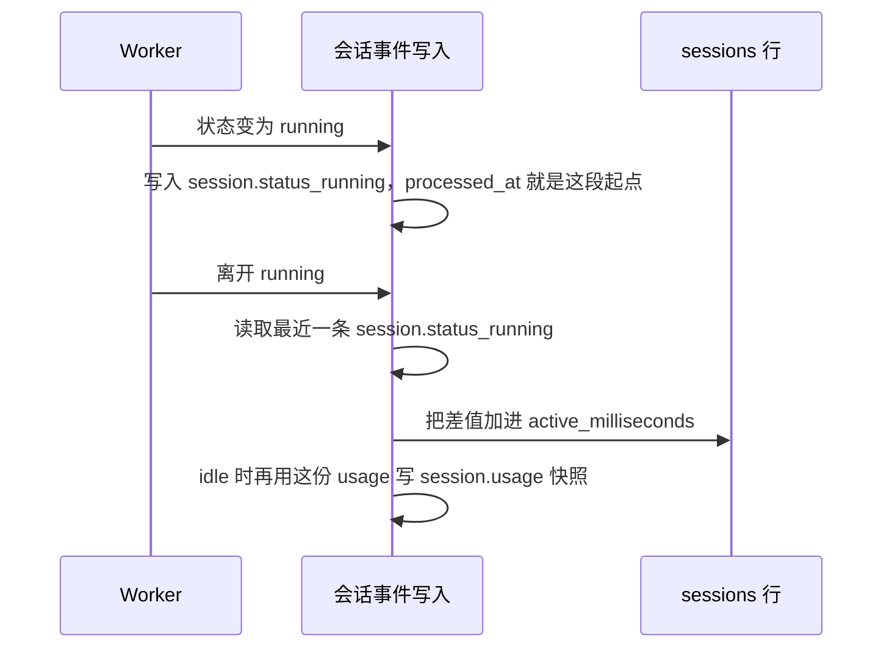

# 会话成本

2026-10-14。对照 [用量与成本核对](usage-cost-module-research.md) 里的 CMA 与 Qoder Cloud Agents。本文定 OMA 记什么、在哪记。运行时单价、冻进 `usage` 的金额、控制台成本页，以及 Admin `usage_report` / `cost_report` 按本文实现。不实现 Credits 余额。

## 记两笔，都挂在会话上

OMA 的模型来自组织自己的 Provider，没有 Anthropic 发票，也没有 Credits 资源包。CMA 费用页上的网页搜索、代码执行容器小时，OMA 没有对应的计费产品。Qoder 的服务账号限额、按小时出账和预付余额同样对不上。

适合 OMA 的是两边都有、而且 OMA 已经有一半的那两笔：

| 笔 | 计量 | 现在 |
| --- | --- | --- |
| 模型 | 已观察到的 token：未缓存输入、输出、缓存读取、5 分钟与 1 小时缓存写入 | `span.model_request_end` 首次插入时累加进 `sessions.usage` 和线程 `usage` |
| 运行 | 会话状态为 `running` 的时长 | 没有。沙箱 `stopped_at - created_at` 含 `idle` 期间容器还活着的时间，不能用 |

运行时长采用 CMA 的口径，记账时点比 Qoder 更早：

- 只计 `running`。`idle`、`rescheduling`、`terminated` 不计。
- 多个线程重叠时，会话状态已经按 `running`、`rescheduling`、`idle` 的顺序折叠（`sessionStatusAfterThread`）。会话仍是 `running` 就继续计，不把各线程时长相加。
- 时长在状态离开 `running` 的同一事务里加上。Qoder 要等沙箱按小时结算，所以当次 `session.usage` 会缺一截。OMA 没有这道结算，不必留这个缺口。

线程不单独记运行时长。CMA 的线程费用也不含会话运行时间。

## 接口

调用方仍是现有的会话事件写入。不新增成本模块的对外类型。

累计时长只放一个键：`sessions.usage.active_milliseconds`，单位是毫秒整数。token 累加使用 `usage || jsonb_build_object(...)`，只覆盖 token 键，不会清掉这个键。线程 `usage` 不加它。没有这段时长时不要写 0。已经写成小数秒的 `active_seconds` 在下一次累加时乘 1000 并入这个整数，然后从 `usage` 里去掉。

当前这段 `running` 的起点是最近一条已写入的 `session.status_running` 的 `processed_at`。会话还不是 `running` 时才会写入这条事件，重复上报不会再插一条，所以不需要额外的列。会话响应和 `session.usage` 事件都原样输出 `sessions.usage`，起点放进这份 JSON 会变成公开字段。

离开 `running` 时，用离开事件的 `processed_at` 减去这个起点。差值不大于 0 则不加。大于 0 时把整毫秒加进 `usage.active_milliseconds`。下一次进入 `running` 会写入更新的状态事件，下一段从那条事件另计。

`idle` 的实际写入顺序是线程 `idle`、`session.usage`、会话 `idle`。结算发生在生成 `session.usage` 之前，快照才能带上刚结束的这段。`rescheduling` 和 `terminated` 不发 `session.usage`，在会话状态离开 `running` 时结算到同一行。

用事件上的 `processed_at`，不用写入时的墙钟。同一状态事件重试时，状态没有再次从 `running` 离开，时长只加一次。这和 token 只在 `span.model_request_end` 首次插入时累加是同一条规则。

`session.usage` 快照继续在真正的会话 `idle` 之前发出，`budget` 仍为 null。快照直接带出这份 `usage`，其中已经是 `active_milliseconds`。

模型调用失败且上游没有给出 token 时，维持现在的行为：不补 0，也不产生金额。

## 明确不做

- 不把沙箱 `state = running` 或 `stopped_at` 算进成本。容器在会话 `idle` 时通常仍在运行。
- 不建价目表、Credits 余额、资源包或服务账号限额。没有单价时，`list_cost` 继续不出现。检查器已经会在没有 `list_cost` 时不画成本点。
- 不在这一版拒绝超预算的用户消息。OMA 的 `session.usage` 现在固定带 `budget: null`。
- 不记网页搜索次数，也不记代码执行容器小时。

运行时长按 `runtime_cost.usd_per_hour` 计价，并在累加的那次事务里把当时的金额冻进 `usage.runtime_cost_usd`。历史不随以后的改价重算。Token 价目仍只在文档里，不写入 `usage`。不带 `workspace_id` 的成本查询只对组织管理员开放。

## 验收

先写失败，再写成功：

- 乱序：离开事件不晚于这段 `session.status_running`，时长不变，下一段从新的 `running` 另计。
- 重试：同一次离开 `running` 投递两次，`active_milliseconds` 只加一次。
- 折叠：一个线程已 `idle`、另一个仍 `running`，会话时长不截止。
- `rescheduling` 截止当前这段；再次 `running` 另起一段。
- 成功路径：`running` 到 `idle` 的时长进入随后那条 `session.usage` 的 `active_milliseconds`。token 累加与现在一致。沙箱停止不改变这个数。

分析页 `/cost` 读取这些 `session.usage` 快照里的 `runtime_cost_usd`。这个金额在一段 `running` 结束时，按当时的 `runtime_cost.usd_per_hour` 写成小数点后 6 位的十进制美元金额，之后改配置不会改写它。没写这项时不写入新金额，成本页提示未配置。页面把相邻快照的差额按 UTC 日相加。工作区、模型缩小计入范围；分组决定每日图的拆分。没有该字段的旧快照在配置了单价之后，按当前配置折算。正在 `running`、尚未写入快照的时长不出现在这张图里。
