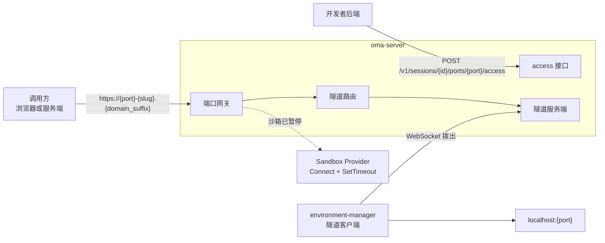
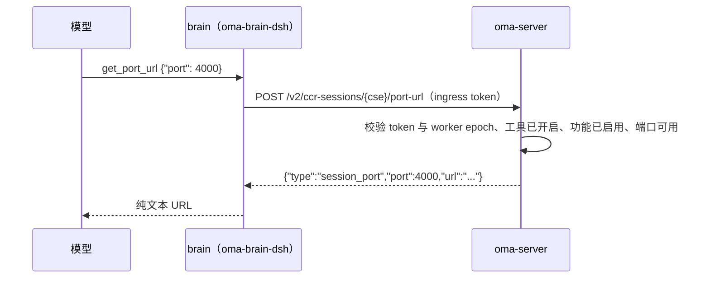
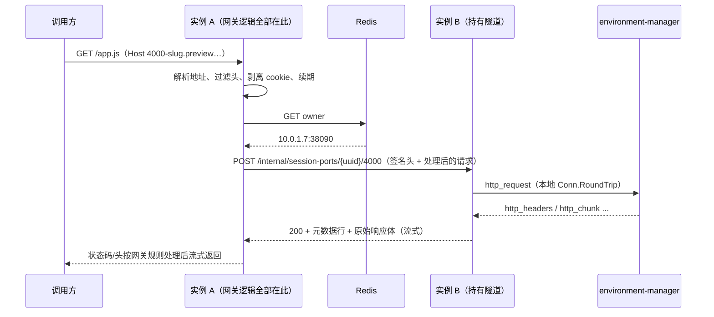
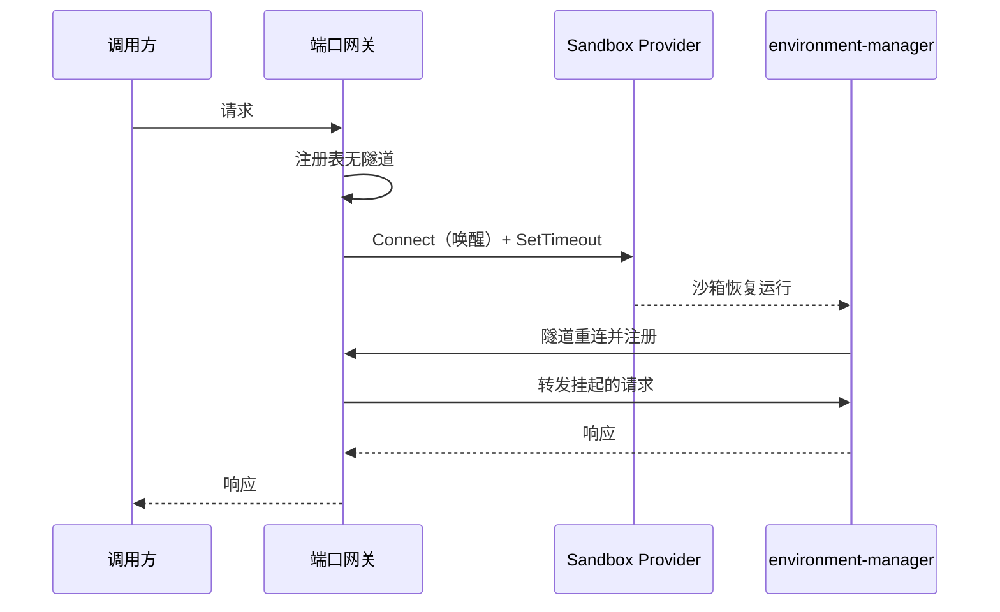

# Session 端口访问

状态：单实例本地链路已实现（隧道服务端、端口网关、取地址接口、idle 回收条件、每流流控、唤醒后尽快重连），跨实例 Pod 直连转发已实现；访问凭据和控制台界面未实现。

## 范围

开发者用 workspace API key，为某个 Session 沙箱内的 HTTP 端口取得一个外部可访问的地址。
平台只提供这一个原子能力，不提供预览界面、分享、公开发布或格式转换；这些由基于 OMA 的上层产品实现。

不在范围内：

- 产物文件预览。写入 `/mnt/session/outputs` 的文件继续通过 Files API 取回，见 `session-generated-file-download.md`。
- 非 HTTP 协议（裸 TCP、UDP）。
- 自托管 Environment。
- 访问凭据。见"安全"一节末尾的后续方向。
- 端口自动发现、端口上线事件、控制台预览界面。

### 方案取舍

| 方案 | 结论 | 原因 |
| --- | --- | --- |
| 沙箱 Provider 的端口域名（`GetHost(port)`） | 不采用 | 只监听 `127.0.0.1` 的服务不可达；`e2b-local` 不做 Host 路由，Docker 只能访问创建时声明的端口；各 Provider 的鉴权与唤醒语义不一致 |
| 复用 MCP Tunnel | 不采用 | 方向相反（私网拨出、沙箱是调用方），长轮询队列只承载 MCP JSON-RPC，见 `mcp-tunnels.md` |
| Cloudflare Tunnel 等外部隧道 | 不采用 | OMA Server 自己就是边缘；外部隧道无法接入 Session 鉴权和唤醒，私有化部署不可用 |
| 沙箱内 `environment-manager` 拨出反向隧道 | 采用 | 客户端已存在于生产代码线；目标是 `localhost`；不依赖 Provider 的端口发布 |

## 总体链路



端口网关、隧道路由和隧道服务端都是 `oma-server` 内的模块，不新增独立部署的服务。
模块之间只通过接口交互，保留以后把网关拆成独立进程的可能。

## 公开 API

### 取地址

`GET /v1/sessions/{session_id}/ports/{port}`，只接受 workspace API key 或控制台登录（session manager 凭据），并要求对该 Session 有读取权限。Environment key 和 work token 返回 403，使沙箱内的 Agent 无法通过 API 取得地址。

```json
{
  "type": "session_port",
  "session_id": "sesn_...",
  "port": 4000,
  "url": "https://4000-k7m2p9x4q1ab8cdtw3ye5fz6hn.preview.example.com/"
}
```

- 同一 Session 同一端口的 `url` 固定不变。
- 接口不检查端口上是否已有服务在监听，也不唤醒沙箱。
- `port` 取值 1–65535，且不在禁止列表中，否则 400。禁止列表固定包含 envd 端口 49983 和实际生效的沙箱 MCP 端口（`environment_runner.sandbox_mcp_port`，未配置时为 Runner 实际使用的默认值 3001，两处共用 `EnvironmentRunnerConfig.EffectiveSandboxMCPPort`），可用 `blocked_ports` 追加。端口 0 是客户端 `/__control/` action 的入口，被取值范围排除。
- Session 已归档或删除返回 404；`session_ports.domain_suffix` 未配置返回 404。

### 地址

`{port}-{slug}.{domain_suffix}`。整段是一个 DNS label，长度不超过 63。

`slug` 是公开 Session 的 `sessions.uuid` 用按端口派生的密钥做确定性加密后的 26 位小写 base32 串：`portKey = HMAC-SHA256(masterKey, "session-port:" + port)`，用 `portKey` 做 AES-256 单块加密 16 字节 UUID（单块 AES 是伪随机置换），无填充 base32 编码后转小写。解码要求长度 26、全小写、末 2 bit 为 0（编码唯一），否则视为无效地址。
网关用主机名里的端口派生密钥解密即可得到 Session UUID，不需要映射表；没有密钥的人无法从 Session ID 推出地址，伪造的串解出随机 UUID，查不到 Session 时返回 404。地址绑定端口：同一 Session 不同端口的 slug 不同，把 `4000-<slug>` 改成 `8888-<slug>` 会用 8888 的密钥解出随机 UUID，同样返回 404。
密钥通过 `slug_key_file` 配置，文件内容是 32 字节随机数的 base64；生产环境必填，dev 留空时使用进程内临时密钥（重启后地址失效）并输出 Warn。相对路径与其他 `*_file` 配置一致，按配置文件所在目录解析，支持 `~`。轮换密钥会使所有已发出的地址失效。

26 位 slug 只能容纳 128 bit，所以地址里没有租户信息。网关按 `sessions.uuid` 做一次不带租户条件的查询，这是“查询必须带租户范围”规则的有意例外：地址本身就是由密钥保护的能力凭证。查到的 organization/workspace 随后用于所有读写（例如 `port_last_access_at`）。

使用通配子域而不是路径前缀，原因有两点：

- 沙箱内的应用普遍假定自己在域名根路径，路径前缀会破坏绝对路径资源和 HMR。
- 每个端口一个源，端口之间、Session 之间由浏览器同源策略隔离。

## Agent 内置工具 `get_port_url`

Agent 在对话中需要给出预览地址时调用该工具。上面的公开 API 拒绝沙箱内的凭据，所以工具由平台侧执行：brain 用现有 session ingress 凭据回调 `oma-server`，服务端算出地址。沙箱内不增加凭据或环境变量，`environment-manager-rs` 不变。



### 开启方式

属于 `agent_toolset_20260401`，只能显式开启：`configs` 中有 `{"name": "get_port_url", "enabled": true}` 才会提供给模型。`default_config.enabled: true` 不会带上它。

- 未配置时按禁用处理（与 `ask_user_question` 共用同一套运行时判断），规范化时不补任何条目。未配置该工具的 Agent，创建、读取返回的 `tools` 和模型收到的工具列表都与引入该工具前一致。
- 配置了但没写 `permission_policy` 时取 `always_allow`，不继承 `default_config` 的策略；显式写 `always_ask` 时照常走确认。
- 子线程（delegation）沿用 web 工具的规则：工具列表按线程快照计算；服务端要求根快照及每一级祖先线程快照都开启了该工具。
- `session_ports.domain_suffix` 为空（功能未启用）时工具仍按配置提供给模型，调用返回“未启用”错误。这样模型看到的工具列表只取决于 Agent 配置，不随部署配置变化，Agent 也能如实告诉用户该部署未开启端口预览。

### 合同

- 入参 `{"port": integer}`，1–65535，不允许其他字段。Session 由服务端从 ingress 凭据确定，Agent 无法指定别的 Session。
- 成功时模型收到 URL 纯文本，与公开 API 对同一 Session、同一端口返回的 `url` 完全相同（同一个 `sessionports.Settings` 计算）。
- 不检查端口上是否有服务在监听。工具描述告诉模型：地址固定，与服务是否已启动无关；服务需监听在沙箱内该端口，只监听 127.0.0.1 也能直接访问（隧道客户端连的是沙箱内的 `localhost`），不需要改成 0.0.0.0；任何拿到地址的人都能访问；不要编造地址，出错时如实告知用户。
- 公开事件与其它内置工具一致：`agent.tool_use` / `agent.tool_result`，`name` 为 `get_port_url`。

### 错误

错误以工具错误结果返回给模型，文本为 `OMA port URL HTTP <status>: <message>`。

| 情况 | 状态 | message |
| --- | --- | --- |
| 端口不是 1–65535 的整数，或带了其他字段 | 400 | `port must be an integer between 1 and 65535`（brain 先在本地拦截，不发请求） |
| 屏蔽端口（49983、生效的沙箱 MCP 端口、`blocked_ports`） | 400 | `port N is reserved by the sandbox and has no preview URL` |
| 功能未启用 | 409 | `Session port preview URLs are not enabled on this server` |
| Agent 或祖先线程未开启该工具 | 403 | `get_port_url is not enabled for this Agent` |
| 凭据无效 / worker epoch 过期 | 401 / 409 | 与 web 工具相同 |
| `oma-server` 不可达或超时（10s） | — | `OMA port URL service unavailable or timed out` |

### 部署顺序

开启该工具的 Agent 会在 `launch.tools` 中下发 `get_port_url`，旧 brain 校验时报 `Invalid launch tools`。先部署新 brain，再给 Agent 开启该工具；未开启的 Agent 不受影响。

## 数据模型

不新增表，只在 `code_sessions` 上增加一个字段：

| 表 | 字段 | 语义 |
| --- | --- | --- |
| code_sessions | port_last_access_at | 最近一次经网关的请求时间，节流写入，至多每分钟一次 |

migration `00117_add_code_session_port_last_access.sql`。Mapper 为 `internal/db/session_port_mapper.{go,xml}`：

- `FindTarget(sessionUUID)`：返回 Session 是否归档/删除、租户、最新 active Code Session，以及该 Session 活跃 Work 下最新的、带 provider ID 的沙箱及其状态。
- `TouchPortLastAccess`：带租户条件，并以 `port_last_access_at < now - 1m` 兜底节流；进程内另有每 Code Session 每分钟一次的节流。

## 隧道服务端

隧道客户端已存在于 `environment-manager-rs` 的 `src/internal/tunnel/`，wire 协议定义在其 `gen/proto/anthropic/sessions/tunnel/v1alpha/tunnel.proto`。
服务端按该协议实现，不改 wire 格式。

### 连接

- 路径：`GET {sandbox_api_base_url}/v2/sandbox/tunnel`，WebSocket 升级。放在 `/v2` 前缀下，使只按 `/v1`、`/v2` 等前缀把流量转给 `oma-server` 的入口也能到达；路由直接挂在根 router 上，不经过 `/v2` 子路由，只用下述沙箱凭据鉴权。旧路径不再提供。
- 鉴权：`Authorization: Bearer <SessionIngressToken>`，`x-session-id` 为 code session external ID。复用 `/v1/code/upstreamproxy/ws` 等沙箱运行时端点的同一条规则（`codesessions.Service.authorizeRuntimeCredential`）：先按 worker 凭据校验，失败再按沙箱凭据校验。
  - brain 模式下 Runner 下发给 environment-manager 的 `auth[session_ingress]` 是沙箱凭据（`SandboxIngressToken`，role `sandbox`，带 `sandbox_uuid`，不带 epoch），由 `ValidateCodeSessionSandbox` 校验沙箱仍为 `creating`/`running` 且属于该 Code Session。DSH 每次领取都会推进 `current_worker_epoch`，但不影响沙箱凭据，所以隧道不会因领取而失效。
  - 非 brain 模式下 environment-manager 持有 worker 凭据，仍按当前 worker epoch 校验；该模式下 epoch 只随沙箱重建或回收变化。
  - 凭据错误、身份失效、epoch 不匹配返回 401；数据库等瞬时错误返回 503，客户端按退避重连。
- 每个 code session 同时只保留一条连接。新连接注册后关闭旧连接，旧连接上的在途请求按连接断开处理。
- 连接存续期间每 30s（±20% 随机抖动，避免所有连接同相位查库）用同一凭据重新执行上述校验；网关每个请求本身都会查沙箱状态，复查只用于清理残留连接。沙箱失效（回收进入 stopping、Session 删除）或 epoch 失效时服务端主动关闭连接，瞬时错误只记录 Warn。

### 帧

帧是 protobuf 消息的 JSON 编码，客户端发送文本帧，接收文本或二进制帧均可；`bytes` 字段为 base64。

服务端不引入 protoc 生成代码（仓库不提交 `*.gen.go`），在 `internal/porttunnel/wire.go` 手写与 `tunnel.proto` 对应的 DTO：lowerCamel 字段名、零值省略、`bytes` 编码为标准 base64，解码时同时接受 snake_case 字段名和标准/URL-safe、带或不带填充的 base64。协议一致性由与 `environment-manager-rs/tests/protojson_contract.rs` 相同的 JSON golden 测试保证。

| 方向 | 消息 | 用途 |
| --- | --- | --- |
| 服务端 → 客户端 | `http_request` | 一次完整的 HTTP 请求，body 整块携带 |
| | `http_cancel` | 调用方断开时取消 |
| | `ws_open`、`ws_message`、`ws_close` | WebSocket 透传 |
| | `window_update` | 流控：归还客户端该流（`http_chunk` / `ws_message`）的发送额度，仅在协商流控后发送 |
| | 空 payload | 保活 |
| 客户端 → 服务端 | `http_headers`、`http_chunk`、`http_error` | 响应头、32 KiB 分块的响应体、错误；`sequence_number` 从 0 递增 |
| | `ws_opened`、`ws_message`、`ws_close`、`ws_error` | WebSocket 透传 |
| | `window_update` | 流控：归还服务端该 WebSocket 流（服务端 → 本地服务的 `ws_message`）的发送额度 |

`window_update` 是在 `TunnelRequest.payload`（field 7）与 `TunnelResponse.payload`（field 8）中新增的 oneof 成员，消息为 `TunnelWindowUpdate { string stream_id = 1; uint32 bytes = 2; }`；`stream_id` 是 HTTP 的 `request_id` 或 WebSocket 的 `tunnel_id`。已有字段与编号不变，旧实现收到未知 oneof 成员时按空 payload 处理（Go 手写 DTO 忽略未知字段；pbjson 解码未知字段时忽略）。

### 保活

客户端的读超时是 60s 绝对时限，WebSocket 控制帧不续期。
服务端每 `keepalive_interval`（20s）发送一条空 payload 的 `TunnelRequest`。
客户端每 30s 发 ping；服务端 90s 未收到任何帧即判定连接失效。

### 客户端的已知限制

这些限制来自客户端实现，通过服务端限额规避。标注“旧客户端”的两项在双方协商每流流控（见下节）后不再存在：

| 限制 | 服务端对策 |
| --- | --- |
| 请求体整块发送，不支持流式上传 | 请求体上限 `max_request_body_bytes`（16 MiB），超出返回 413；`http_request` 不纳入流控 |
| 旧客户端：无每流流控，所有流共用一条连接和一把写锁 | 每 Session 并发请求上限 `max_concurrent_requests`（64），超出返回 429；按字节限界的每流缓冲 + 5s 无进展取消 |
| 每个请求直接起任务，无并发上限 | 同上 |
| 旧客户端：`ws_message` 在读循环内同步转发，本地服务写得慢会阻塞整条连接 | 每 Session WebSocket 数上限 `max_websockets`（32）；调用方发来的单条消息上限 1 MiB，超出以 1009 关闭 |
| 重连后在途请求丢失，不续传 | 网关对在途请求返回 502，由调用方重试。新连接替换旧连接时旧连接上尚未收到响应头的请求也返回 502，平台不自动在新连接上重放（非幂等请求不能由平台重放） |
| 本地服务 30s 内未返回响应头则报错 | 网关返回 504 |

### 每流流控

目标：一个慢的或不读的调用方 / 沙箱内服务只影响它自己的流；服务端和客户端的隧道读循环都不因某个流而等待。

**协商**：客户端在握手请求里带 `X-Tunnel-Capabilities: flow-control-v1`；服务端支持时在 101 响应里回同名头。双方都看到才启用，按连接生效（重连后重新协商）。

| 服务端 | 客户端 | 结果 |
| --- | --- | --- |
| 新 | 新 | 启用流控 |
| 新 | 旧（当前 pin 的镜像，不带请求头） | 不回头，服务端走旧路径：4 MiB 每流缓冲 + 5s 无进展取消，网关写超时 5s |
| 旧 | 新 | 旧服务端不回头，客户端不等额度，`ws_message` 仍在读循环里同步写本地 |
| 旧 | 旧 | 原行为 |

**窗口**：每流初始 1 MiB（`FlowControlWindow` / `FLOW_CONTROL_WINDOW`，双方常量一致，不协商）。

**计费**：每个数据帧（`http_chunk`、`ws_message`，两个方向）的额度成本 = `data` 长度 + 固定 64 字节（`FlowControlFrameOverhead` / `FLOW_CONTROL_FRAME_OVERHEAD`）。发送方按此扣额度，接收方按此记账与归还。零长度帧（包括 HTTP 结束块）也有成本，因此单流在途帧数天然 ≤ 窗口 / 64 ≈ 16384，不需要单独的条目上限。`http_headers`、`http_error`、`ws_opened`、`ws_close`、`ws_error` 不占额度。

**沙箱 → 服务端（`http_chunk`、`ws_message`）**

- 客户端每流维护发送额度：发数据帧前等待额度 > 0，发送后扣除该帧成本（可透支一帧）。等待可被该流的 `http_cancel`、服务端 `ws_close`、流结束和隧道断开打断。
- 服务端在调用方每消费累计 ≥ 半个窗口（512 KiB）时回 `window_update`（在消费方 goroutine 中入队，不在读循环里）。
- 超发判定：服务端记录该流已收到与已归还的额度（按帧成本），若一个数据帧到达时“已收到 − 已归还 ≥ 窗口”，说明客户端在额度不为正时仍然发送，视为协议错误，只取消该流（`http_cancel` / `ws_close` 1008），隧道不受影响。这与“每流缓冲上限 = 窗口 + 单帧最大值”等价，但不依赖单帧大小上限（WebSocket 消息没有固定上限）。
- 启用流控后读循环对数据帧只做入队，不再等待任何流；“调用方 5s 无进展取消”只保留给未协商流控的旧客户端。
- 合并：HTTP 响应流入队时，若队尾也是普通数据块（非 headers、非结束块、无错误）且合并后不超过 32 KiB，就并入队尾，减少小分块场景的事件数与对调用方的小写次数；合并项的额度按被合并各帧成本之和记账，消费时一并归还。WebSocket 消息不合并。

**服务端 → 沙箱（调用方发给沙箱内服务的 `ws_message`）**

- 服务端 `WebSocketStream.Send` 在发送前等待该流额度，可被 ctx、流关闭、隧道断开打断；额度用尽时网关停止从调用方读取，背压传回调用方。
- 客户端每个 WebSocket 一条写队列 + 独立写任务，读循环只入队；本地写出累计 ≥ 半个窗口（按帧成本）回 `window_update`。`ws_close` 排在已入队消息之后执行。服务端超发（未归还额度 ≥ 窗口时仍收到数据）由客户端判为协议错误，以 1008 关闭该本地连接并向服务端发 `ws_close`（1008）。
- 本地写超时：流控启用时写队列的单次本地写入上限为 30s（与网关写调用方的 30s 对称），计时覆盖等待写锁与实际写入；未启用流控的旧路径保持 10s。
- 失败传播：本地写失败或超时，客户端关闭本地连接并向服务端发 `ws_close`（1011，原因 `local websocket write timed out` / `local websocket write failed`），网关据此把调用方连接以 1011 关闭，不会悬挂。旧路径（读循环里同步写）失败时同样通知服务端。

**网关写超时**：启用流控时网关写给调用方的单次写入截止时间为 30s（`FlowControlledWriteTimeout`）——不读的调用方只占住自己的流和一个并发名额，不再伤害别人；未启用时保持 5s（`StallTimeout`）。截止时间在每次写入前重设，因此中断条件是“一次写入阻塞持续 30s”：调用方停止读取后，内核发送缓冲与中间缓冲先被写满，此后的那次写入阻塞满 30s 才中断，从调用方停读算起的总时长会更长。

**出站队列**：服务端 → 客户端的出站帧队列按字节限界，总量 64 MiB，满了让入队方等待（带 ctx），不丢帧；队列为空时单个超大帧也允许进入。`window_update`、`http_cancel`、`ws_close` 这类小控制帧不受该上限约束，立即入队，只在连接关闭时放弃——丢一个 `window_update` 会让该流额度永远不回来，丢一个取消帧会让客户端继续执行已放弃的请求。控制帧数量受流数与窗口约束。保活帧由写 goroutine 直接写出，不经队列。

### 旧客户端：慢调用方与背压

以下机制只在未协商流控时生效。

每个 HTTP 请求和 WebSocket 在服务端有一个按字节限界的缓冲（4 MiB，每个事件另计 256 字节开销；缓冲为空时单个超大帧也允许进入，避免死锁）。缓冲满时隧道读循环等待该流的消费进展；只要调用方在 `porttunnel.StallTimeout`（5s）内取走任何事件，等待就重新计时。5s 内没有任何消费进展时只取消这一个流：HTTP 发 `http_cancel` 并中断调用方连接，WebSocket 发 `ws_close`（1008）；取消帧在后台入队，读循环立即继续。流被取消后从映射中删除，客户端仍在发的该流后续帧找不到流，直接丢弃，不会再次阻塞读循环。服务端 90s 失效判定只在每次真正读取前重置，等待本身不计入。

网关写给调用方时每次写入都设置写截止时间，取值同为 `porttunnel.StallTimeout`（HTTP 用 `ResponseController.SetWriteDeadline`，WebSocket 用 `SetWriteDeadline`）。一次写入阻塞持续 5s 即中断，释放网关 goroutine 与该 Session 的并发名额。

为什么是 5s：Rust 客户端所有响应帧和 ping 共用一把写锁，每次写入有 10s 超时（`WRITE_TIMEOUT`）。服务端读循环停顿超过 10s 时，客户端的 TCP 发送缓冲写满，后果是（黑盒测试实测）：

1. 被卡住的那个流的下一帧写超时，客户端放弃该请求，且不发 `http_error`；
2. 同一隧道上其他请求的 `http_headers` 也写超时被丢弃，这些请求在服务端永远等不到响应头；
3. 客户端 ping 写超时，`tunnel_run_failed: write tunnel ping timed out`，整条隧道断开重连，所有在途请求 502。

因此停顿窗口必须明显小于 10s。另外，服务端对每个请求的响应头等待设了 35s 上限（客户端自身 30s 头超时再加余量），即使某个响应头帧因客户端写超时丢失，请求也会以 504 结束，而不是无限挂起。

旧客户端下的残留限制：协议没有每流流控，一个“慢但持续在读”的大下载会把同一 Session 其他流的吞吐拉到它的消费速度。新客户端协商流控后，每个流在途数据不超过 1 MiB，其他流不受影响。

### WebSocket 关闭码

1005、1006、1015 等保留码只表示本地状态，不能出现在线上的 Close 帧里。网关双向规范化（`porttunnel.NormalizeClose`）：允许上线的是 1000–1003、1007–1014、3000–4999；其余（包括 0、<1000、1004、1006、1015、>4999）一律换成 1001。隧道 → 调用方方向的 1005 发送不带状态码的 Close 帧；调用方 → 隧道方向的 1005 也换成 1001。原因文本截断到 123 字节（按 UTF-8 字符边界）。

## 多副本路由

隧道连接落在某一个 `oma-server` 实例上，外部请求可能到达任意实例。实例之间通过 Pod IP 直接转发 HTTP，不经 NATS 传数据，不新增服务。

- **注册表**：Redis key `oma:session_port:owner:<code_session_uuid>`，值为 `internal_advertise_addr#<实例随机 ID>`。TTL 60s，每 20s 刷新，连接断开时比较值后删除。
- **本地命中**：请求到达的实例就是持有者，直接写入隧道。
- **跨实例**：`porttunnel.ClusterRouter` 先查本地，本地没有再读 owner。owner 是其它实例时，返回一个 `remoteTunnel`，网关照常调用它的 `RoundTrip` / `OpenWebSocket`。
- **单实例**：未配置 `internal_listen_addr` 时不创建 `ClusterRouter`、不监听内部端口，网关直接使用 `Registry`，行为与之前完全相同。本地开发属于这种情况。



### 职责划分

网关的全部对外逻辑只在请求到达的实例 A 上执行一次，与是否跨实例无关：

- Host 解析与 Session 查找；
- 错误码与错误页；
- 请求头过滤与 cookie 剥离；
- 请求体上限；
- 响应头处理；
- 唤醒、续期、`port_last_access_at`；
- 调用方写超时与响应空闲超时。

持有者 B 不查库，只做三件事：校验签名，把 A 处理好的请求原样写进本地隧道，把结果原样流式送回。

转发的是"已经由网关处理过的隧道请求"，而不是调用方的原始 HTTP 请求。否则 B 要重复一遍头处理和错误映射，两侧逻辑会分叉。

并发与 WebSocket 配额只在 B 侧计数：它们是每条隧道的上限，只有持有连接的一侧能准确计数。B 回 `too_many_*`，A 映射为 429。

### 内部端点

内部端点只在独立的 `internal_listen_addr` 上提供，公开 router 不挂任何 `/internal` 路由。

**HTTP**：`POST /internal/session-ports/{code_session_uuid}/{port}`

- 请求：方法、路径、头以 JSON 编码后 base64url，放在 `X-OMA-Port-Request` 头；请求体就是 HTTP body（A 已整体读入并受 `max_request_body_bytes` 限制）。
- 响应：B 拿到上游响应头后回 200。body 第一行是 JSON 元数据 `{"status","headers","flow_control"}`，之后是原始响应体，边收边写边 flush。上游响应头放在 body 里，避免 Go 的 HTTP 栈改写 `Content-Length`、`Transfer-Encoding` 等。
- 上游响应头之前失败：B 回错误状态和 `{"code": "no_tunnel" | "too_many_requests" | "too_many_websockets" | "upstream" | "timeout" | "disconnected"}`，A 映射回同名的 `porttunnel` 错误。上游错误原文（例如响应头超时）也透传，网关的 502/504 区分不变。
- 流中途失败：B 中止连接，A 读到错误后像本地一样中止调用方。

**WebSocket**：`GET /internal/session-ports/{code_session_uuid}/{port}/ws`

- B 先在本地隧道打开 WebSocket，失败时按上面的错误格式回 HTTP 错误，成功后才升级。
- 协商出的子协议放在 `X-OMA-Port-Protocol` 头，是否流控放在 `X-OMA-Port-Flow-Control` 头。
- 之后双向逐条转发，文本/二进制保持不变，关闭码与原因透传（两侧都经 `NormalizeClose`）。

### 鉴权

签名密钥由 slug 主密钥派生：`HMAC-SHA256(slugMaster, "session-port-internal-forward")`。多副本本来就必须共享 slug 密钥，否则地址只能在一个实例上解码，因此不新增配置；启用转发时必须配置 `slug_key_file`。

签名头 `X-OMA-Port-Signature: v1.<unix_ms>.<base64url(HMAC)>`，覆盖：

- 版本、方法、内部路径（含 Session UUID、端口和 `/ws`）；
- 目标 owner 值（`addr#实例 ID`）；
- `X-OMA-Port-Request` 内容的 SHA-256；
- 时间戳。

有效期 ±30s。B 校验签名与时间窗，并要求 owner 值等于自己当前的 owner 值，所以发往已重启实例的请求被拒。body 不签（流式）；内部端点只在内部网络可达，被重放的后果等同一次公开访问。

### 连接参数

A→B 的 HTTP 客户端和 WebSocket 拨号器都显式不使用代理（Pod 里可能设置了 `HTTP_PROXY`）。

| 参数 | 值 | 原因 |
| --- | --- | --- |
| 拨号超时 | 2s | 持有者失效时尽快进入等待 |
| 等待 B 响应头 | 45s | 大于 B 侧等上游响应头的 35s |
| WebSocket 握手 | 40s | 大于 B 侧打开 WebSocket 的 30s |

调用方断开时，A 取消到 B 的请求（关闭连接）。B 的请求 context 随之取消，本地隧道流收到 `http_cancel` / `ws_close`。

### 背压

两跳都是 TCP，由 TCP 自然传导：调用方慢时 A 停止读 B，B 写 A 阻塞，B 停止从本地队列取数据。

- 流控客户端：窗口用尽后停止发送；
- 旧客户端：触发 5s 停滞保护。

B 写 A 的写超时与隧道模式一致（30s / 5s）。A 对调用方的写超时取 B 元数据里的 `flow_control`。

### 持有者失效

A 拨号失败、或 B 回答 `no_tunnel` 时：

1. A 用比较删除清除这条 owner 记录（不会误删已经换到别的实例的新值），返回 `ErrTunnelGone`；
2. 网关回到现有的唤醒等待（`WaitOnline` + 唤醒），然后重试一次。

请求体已整体缓冲，重试前也没有向调用方写任何字节，所以重试是安全的。仍失败时返回现有的 503 `waking`。内部地址只出现在日志里，不出现在任何返回给调用方的响应中。

`ClusterRouter.WaitOnline` 先订阅 NATS 上线通知，订阅后再读一次 owner：已有其它实例的记录就立即返回，避免"通知早于订阅"时空等到超时。持有者在注册时先写 owner 再发通知。

### 滚动升级

收到退出信号时，实例按以下顺序处理：

1. 对本实例的全部隧道发 WebSocket close 1012（Service Restart），并释放 owner；
2. 关闭内部监听；
3. 走公开 server 的正常关闭。

environment-manager 收到断开后约 1s 重连，经入口落到其它实例，新实例写 owner 并发通知。期间：

- 新请求进入唤醒等待，重连后继续，通常 1–5s，上限 `wake_timeout`；
- 正经过旧实例的流被中止：HTTP 断流，WebSocket 收到 1001 / 1012。不做连接迁移。

## 端口网关

### 请求处理

`oma-server` 在进入现有路由前按 Host 分流：Host（去掉端口、转小写、去掉末尾点）以 `.{domain_suffix}` 结尾的请求进入端口网关，其余不变。分流中间件位于 request ID、请求观测和 panic recovery 之后。

1. 解析 Host 得到 `port` 和 `slug`，解密 `slug` 得到 Session；解密失败、端口被禁止、Session 不存在或已归档返回 404。没有 Code Session、没有带 provider ID 的沙箱，或沙箱状态不是 `running`/`creating` 时返回 409。
2. 查注册表。无隧道时进入唤醒流程。
3. 给沙箱续期。
4. 组装请求并写入隧道，流式回传响应。调用方断开时发送 `http_cancel`。

### 头与 cookie

转发给沙箱前：

- 删除 `strip_cookie_names` 列出的 cookie，默认包含主站的 `sessionKey` 和 `lastActiveOrg`。
- 删除逐跳头；追加 `X-Forwarded-For`、`X-Forwarded-Proto`、`X-Forwarded-Host`。客户端会把 `Host` 改写为 `localhost:<port>`。

返回给调用方前：

- 删除沙箱应用 `Set-Cookie` 中的 `Domain` 属性，使其成为仅限当前主机名的 cookie。
- 网关自身产生的错误带 `X-OMA-Port-Error: <code>`，用于与沙箱应用自己的错误区分。

### 唤醒与续期



- **唤醒**：注册表中无隧道且沙箱记录为 running 时，调用 `SandboxTimeoutExtender.SetTimeout`（E2B Provider 内部先 `Connect`，暂停的沙箱因此恢复）唤醒并设置超时，然后等待隧道注册，最长 `wake_timeout`（30s）。沙箱为 `creating` 时只等待，不唤醒。隧道注册时持有者发一条 Core NATS 通知 `oma.session_port.online.<code_session_uuid>`，等待中的请求据此放行，不轮询 Redis。同一 Session 的并发请求共用一次唤醒。超时返回 503 并带 `Retry-After`。
- **沙箱已回收或 Session 未启动过**：返回 409 `sandbox_unavailable`。网关不重建沙箱，因为重建后进程已不存在，访问没有意义；由开发者向 Session 发新消息触发重建。
- **续期**：每次请求调用 `SetTimeout` 把沙箱超时延长到 `e2b.sandbox_timeout`（与 worker heartbeat 续期同一配置），每个 provider 沙箱节流为每 `sandbox_timeout / 3` 至多一次；续期在后台执行，失败只记 Warn。长连接（WebSocket、SSE）存续期间按同一节奏续期。
- **续期没有上限**：只要有请求，沙箱就保持运行；请求停止后按原有策略暂停。
- **长期 idle 回收**：`sandbox-lifecycle.md` 的回收条件增加一项，`code_sessions.port_last_access_at` 在 `idle_timeout` 内的 Session 不回收。端口访问不清空 `code_sessions.idle_since`。

### 错误语义

| 状态码 | `X-OMA-Port-Error` | 场景 |
| --- | --- | --- |
| 404 | `not_found` | 地址不存在，或 Session 已归档、删除 |
| 409 | `sandbox_unavailable` | 沙箱已回收或从未启动 |
| 413 | `request_too_large` | 请求体超限 |
| 429 | `too_many_requests` | 并发请求或 WebSocket 数超限 |
| 502 | `tunnel_disconnected` | 请求在途时隧道断开，或本地端口拒绝连接 |
| 503 | `waking` | 唤醒超时，带 `Retry-After` |
| 504 | `upstream_timeout` | 本地服务未在 30s 内返回响应头 |

响应体空闲超过 `response_idle_timeout`（5m）时网关取消请求。

错误响应是纯文本，带 `X-OMA-Port-Error`、`Referrer-Policy: no-referrer` 和 `Cache-Control: no-store`，不使用 Anthropic 错误 JSON。响应头已发出后的失败（隧道断开、`http_error`、空闲超时、慢调用方被取消、上游在响应中途断开）通过 `http.ErrAbortHandler` 中断调用方连接，状态码已经发出，无法再改写成 502，调用方看到的是截断的响应（例如 200 后连接提前关闭，HTTP 客户端报 IncompleteRead）。避免把截断的响应当作完整响应；API 的 panic recovery 中间件对它重新 panic，交给 `net/http` 静默关闭连接。

## 安全

- **隔离域**：沙箱内的内容是 Agent 生成的不可信代码，不能与控制台同源。`domain_suffix` 必须与主站是不同的主机名。
- **使用主站同级子域时的残余风险**：例如主站 `oma.example.com`、端口域 `*.preview.example.com`。
  - 浏览器会把设在 `.example.com` 上的 cookie 发给端口域。网关无法从 `Cookie` 头里分辨 cookie 来自哪一级域，只能按名字删除，所以必须把上级域上所有敏感 cookie 的名字配进 `strip_cookie_names`。
  - 页面脚本仍能通过 `document.cookie` 读到 `.example.com` 上非 HttpOnly 的 cookie，网关无法阻止。
  - 页面脚本能往 `.example.com` 写 cookie。主站的 `sessionKey` 目前不设 `Domain` 但没有 `__Host-` 前缀，可被同名的上级域 cookie 干扰。上线前把主站登录 cookie 改为 `__Host-` 前缀。
- **生产使用独立注册域名**，上述三点不存在。保留这一段是为了说明为什么不能图方便改用主站的同级子域。
- **地址即访问权**：平台不认识开发者的终端用户，无法校验访问者身份；地址由密钥加密生成、不可猜测，拿到地址的任何人都能访问该端口并唤醒沙箱，直到 Session 归档或删除。谁能拿到地址由开发者控制。地址只授权该端口：slug 由端口派生的密钥加密，改主机名里的端口号不能访问同一沙箱的其他端口。
- **地址泄露的途径**：浏览器历史、`Referer`、代理和 DNS 日志。网关对经网关处理的响应追加 `Referrer-Policy: no-referrer`（`net/http` 在进入任何 handler 前直接拒绝的畸形请求，例如重复 Host，其 400 响应不含该头，也不含沙箱内容）。泄露后目前只能归档 Session 止损。
- **访问端口可能等于控制沙箱**：沙箱内的服务通常没有自己的登录；如果它带代码执行能力（Notebook、调试接口），拿到地址就能在沙箱内执行代码并读到其中的凭据。开发者应把地址当作密钥对待。
- **Agent 不能自行得到地址**：地址只能由持有 API key 的开发者通过 API 取得，沙箱内没有 `slug` 密钥。
- **隧道只能访问 `localhost`**：客户端把目标固定为 `http://localhost:<port>`，不能借隧道访问沙箱网络内的其他主机。

### 后续方向

访问凭据第一版不做。需要收紧时有三种做法，都不改变地址格式：

| 做法 | 适用 |
| --- | --- |
| 地址轮换：作废某个 Session 的现有地址并换新 | 泄露后止损 |
| API key 通道：开发者后端带 API key 访问端口，再经自己的域名和登录体系转给终端用户 | 需要严格控制访问者 |
| 短期凭据换 cookie | 浏览器直连且要求链接自动过期 |

## 配置

```yaml
session_ports:
  # 为空时整个能力关闭：access 接口返回 404，不向沙箱下发 TUNNEL_ENABLED。
  domain_suffix: ""
  slug_key_file: ""
  # 写入返回地址的 scheme 与端口；url_port 为 0 时省略端口。
  url_scheme: https
  url_port: 0
  # 跨实例转发：两项同时为空（单实例）或同时配置。internal_listen_addr 是内部端点的监听地址，
  # 不经入口暴露；internal_advertise_addr 写入 Redis owner 记录，供其它实例直连，支持 ${ENV}
  # 展开，例如 "${POD_IP}:38090"（POD_IP 由 K8s downward API status.podIP 注入）。
  # 启用转发时必须配置 slug_key_file。
  internal_listen_addr: ""
  internal_advertise_addr: ""
  wake_timeout: 30s
  keepalive_interval: 20s
  response_idle_timeout: 5m
  max_request_body_bytes: 16777216
  max_concurrent_requests: 64
  max_websockets: 32
  blocked_ports: []
  strip_cookie_names: [sessionKey, lastActiveOrg]
```

`domain_suffix` 配置后，隧道对所有 cloud Session 默认开启，没有 Environment 级开关。

## 各仓库改动

| 仓库 | 改动 |
| --- | --- |
| `open-managed-agents` | 本文全部服务端内容；启动 `environment-manager` 时导出 `TUNNEL_ENABLED=true` |
| `environment-manager-rs` | 见下 |
| `managed-agent-sandbox` | 新 artifact 发布后更新 `versions.env` 的 pin，重建并验收镜像 |
| 部署 | `*.{domain_suffix}` 的通配 DNS 和证书；入口代理把该域转给 `oma-server`，并放行隧道 WebSocket 路径 |

`e2b-local` 和 `rclone` 不改。

### environment-manager-rs

1. **brain 模式启动隧道**（已实现）。现在隧道只在 `execute_claude_and_tunnel` 里启动，而 brain 模式（`ENVRUNNER_SKIP_CLAUDE_CODE=true`）初始化后只等待关闭信号，走不到这里。改为在该分支内与关闭信号并发运行隧道客户端，生命周期到进程退出为止。
2. **唤醒后尽快重连**（已实现）。
   - 重连退避上限从 30s 降到 5s（保留 0–50% 抖动）；连接成功建立过之后，下一次断开从最小延迟 1s 重新开始。
   - 时间跳变探测：隧道运行期间每 1s tick，比较相邻两次 tick 的墙上时钟差；差值 > 5s 视为进程被冻结过（沙箱暂停/恢复）。此时立即发一个 ping，要求 3s 内收到 pong 或任何入站帧；收不到就断开并立即重连（不走退避），收到则什么都不做——Docker 冻结后连接仍存活的情况不会被无谓重连。
   - 时序：恢复后最多约 1s 发现跳变 + 3s 探测 + 握手（毫秒级），约 4–5s，在 `wake_timeout` 30s 之内。服务端不改唤醒逻辑。
   - 尚未在 CubeSandbox 上实测连接与时钟表现。
3. **保活帧日志降级**（已实现）。空 payload 目前每次打一条 warn，每 20s 一条，降为 debug。
4. **每流流控**（已实现）。见“每流流控”一节；客户端在握手请求中声明能力，并按服务端响应头决定是否启用。

以上改动只有在发布 artifact 并更新 pin 之后才进入实际 Session。

## 测试计划

- **协议一致性**：服务端测试直接使用 `tunnel.proto` 生成的类型；另有一条集成测试启动真实的 `environment-manager` 隧道客户端对接服务端，覆盖 HTTP、流式响应、取消、WebSocket、保活 60s 以上不掉线。
- **网关**：`slug` 加解密与伪造地址、端口禁止列表、头与 cookie 过滤、各错误码。
- **多副本**：两个实例，连接在 B、请求到 A；持有者下线；内部端点拒绝未签名请求；大响应与慢调用方下完整到达。
- **唤醒**：暂停后的首个请求、并发请求共用一次唤醒、唤醒超时、沙箱已回收。分别在 `e2b-local` 的 Docker backend 和 CubeSandbox 上测量从请求到首字节的时间。
- **生命周期**：端口流量续期、无请求后沙箱按原策略暂停、有端口访问的 Session 不被 idle 回收、worker epoch 变化后旧连接被关闭。
- **本地开发**：`domain_suffix` 可设为 `preview.localhost`，浏览器把 `*.localhost` 解析到回环地址并视为安全上下文。本地设 `url_scheme: http`、`url_port: <oma-server 监听端口>`，浏览器直连 oma-server，不经 portless。

已实现的单测（不依赖真实沙箱）：

| 包 | 覆盖 |
| --- | --- |
| `internal/sessionports` | slug 往返与确定性、换密钥、按端口绑定、伪造/长度/大小写/末位、端口禁止列表、地址格式与 Host 解析、密钥文件 |
| `internal/porttunnel` | wire golden 与双拼写解码；鉴权拒绝；凭据撤销后关闭；复查间隔抖动范围；90s 失效判定与 ping 续期；空 payload 保活；新连接替换旧连接且在途请求失败；并发与 WS 上限；504/502 区分；慢调用方无进展 5s 后只取消该流、后续请求立即可用；大于缓冲的响应完整且发送端被背压；WebSocket 关闭码规范化；响应空闲超时；Redis owner；NATS 上线通知 |
| `internal/porttunnel`（`gateway_e2e_test.go`） | 进程内按 wire 协议实现的隧道客户端 + 真实网关与隧道端点：流式 HTTP 逐块到达、头与 cookie 过滤、WebSocket 文本/二进制往返与关闭、唤醒后等待隧道、伪造地址与换端口 404、停止读取的调用方在写超时后释放 HTTP 与 WebSocket 名额；一个调用方停止读取时同 Session 另一端口的请求 6s 内成功且隧道不重连（测试客户端模拟 Rust 的 10s 写超时）；限速读取的调用方完整下载 24 MiB；调用方或上游异常断开时对端收到 1001 |
| `internal/porttunnel`（流控） | 能力协商与旧客户端回退；未读的流不影响同隧道其他请求（毫秒级）且客户端发送量不超过窗口；按消费回 `window_update`；超发判为协议错误只取消该流；零长度帧洪泛按帧成本判超发；小分块合并保序且记账正确；WebSocket 服务端 → 沙箱方向的额度等待；出站队列按字节限界、满时等待不丢帧；`window_update` golden |
| `internal/porttunnel`（`gateway_e2e_test.go`，流控） | 不读的调用方只在 30s（测试中注入 3s）写超时后被取消，期间另一端口请求不受影响、隧道不断；限速读取的大下载期间另一端口延迟不上升；2 万 / 5 万个 8 字节小分块的响应在慢读者下经网关完整到达 |
| `internal/portgateway` | Host 分流、404/409/413/429/502/503/504、并发请求共用一次唤醒、头与 cookie、续期与访问时间节流、调用方断开取消 |
| `internal/porttunnel`（`cluster_e2e_test.go`，多副本） | 进程内两个实例共享 miniredis 与嵌入式 NATS，隧道连 B、请求打 A：HTTP 往返（经 B 内部端点一次，头与 cookie 规则与单实例一致，续期只在 A）、8 MiB 下载在慢读者下完整、SSE 逐条到达、调用方取消传到沙箱服务、WebSocket 子协议/文本/二进制/关闭码、B 侧配额满时 A 返回 429、B 内部端点不可达时 2s 级别进入等待后返回 503 且清除 owner、owner 指向无隧道的 B 时等到隧道连上 A 后成功；所有失败响应不含内部地址 |
| `internal/porttunnel`（转发单测） | 伪造密钥、缺失/格式错误、过期、未来时间、改路径/端口/Session、篡改请求头、目标 owner 不符均 401；有效签名进入查找；客户端不用代理且响应头/握手超时大于持有者侧；错误码往返；`WaitOnline` 在 owner 已在别处时立即返回；停机时隧道收到 1012 且 owner 释放 |
| `internal/api` | 公开 router 上 `/internal/session-ports/...` 404；隧道路径只走隧道鉴权 |
| `internal/sessions` | 取地址接口的 404/403/400 |
| `internal/db` | Mapper SQL 与参数绑定；`session_port_mapper_postgres_test.go`（`integration` tag）覆盖真实 PostgreSQL 的可空列扫描与节流 |

`environment-manager-rs` 侧：额度等待与取消、`window_update` 处理、本地 WebSocket 写队列不阻塞读循环、帧成本（零长度帧也耗额度）、本地写阻塞未超限时数据完整有序、超限时服务端收到 `ws_close` 1011 且本地连接关闭、能力头协商（服务端不回头时不等额度）、退避上限、注入时钟的时间跳变探测（连接已死时立即重连、连接存活时不重连）。

未覆盖：真实 `environment-manager` 二进制对接、60s 以上保活实测、真实多 Pod 部署（Pod IP、NetworkPolicy、滚动升级）、各 Provider 唤醒耗时、CubeSandbox 恢复后的连接表现。

## 待确认

1. CubeSandbox 恢复后，沙箱内已建立的 TCP 连接和时钟的表现。第 2 项已按“墙上时钟跳变 + ping 探测”实现，需在 CubeSandbox 上实测跳变是否可见、探测是否在 5s 内完成重连。

已确认：实例之间可通过 Pod IP 互相寻址；沙箱到 `sandbox_api_base_url` 的路径上没有限制 WebSocket 的代理；端口域使用独立注册域名，本地先以 `preview.localhost` 调通。
