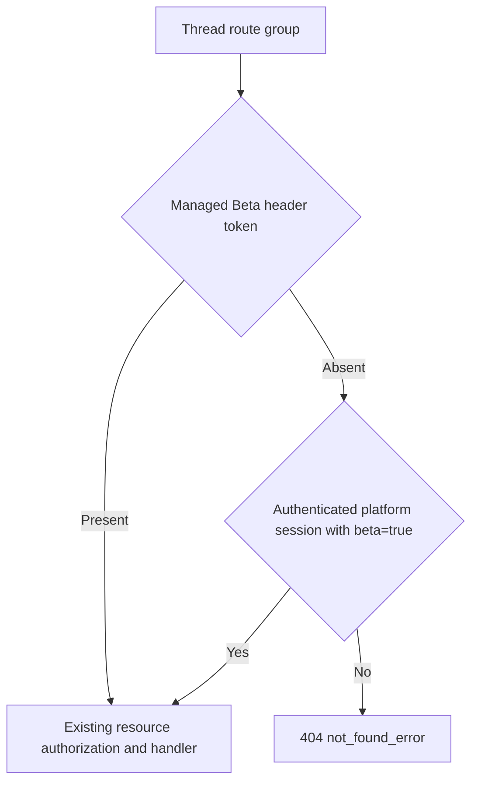

# Session thread Beta access

CMA's thread-stream troubleshooting contract says that thread endpoints do not exist without the managed-agents Beta header. The sessions resource applies this gate to its Chi /{session_id}/threads group, including list, retrieve, archive, history and stream. A missing or unrelated header returns the normal public404 not_found_error before resource lookup.

Public API clients opt in with anthropic-beta: managed-agents-2026-04-01. Comma-separated tokens and multiple physical header values are supported. A beta=true query alone does not opt in an API key. Header matching uses a complete token; a substring or a suffixed Beta name does not enable the contract.

The first-party console preserves the existing platform-session convention used by other Managed Agents resources: an authenticated platform_session principal may opt in with beta=true. The principal comes from trusted authentication context. A query or a caller-supplied header cannot create that principal. Existing workspace/resource authorization still runs after this protocol gate.

The primary Session events/stream endpoint, ordinary Session CRUD and unrelated resource contracts retain their current behavior. The gate does not grant authentication or change child state, model execution, event history, previews or archive semantics.

Local route regressions cover all five thread endpoints without a Beta header, including query-only requests; accepted headers retain existing resource authentication. Middleware regressions cover wrong/empty/suffixed tokens, comma-separated and repeated header values, public API query rejection, console opt-in and console omission. The existing ordinary Session no-Beta regression stays enabled. These are ordinary unit tests and do not use a configured database or external service.

The external Subagent comparison additionally verifies the original official SDK positive wire, actual no-opt-in wire, unchanged owned child and complete native execution evidence in a fresh report. It does not substitute these unit checks for platform verification.
