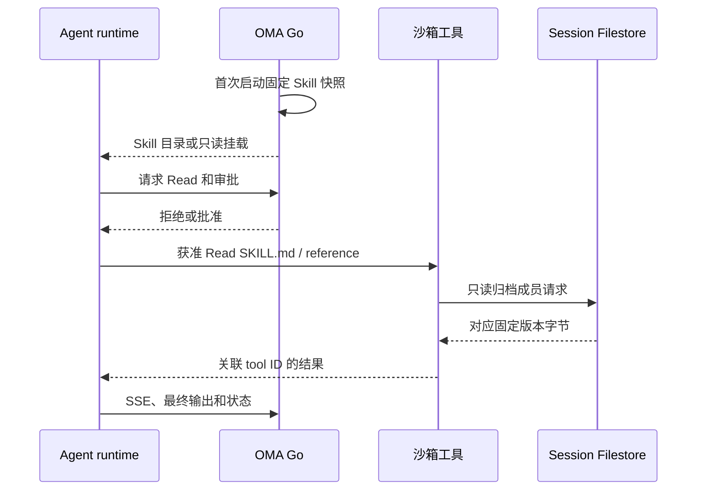

# Skill 的 verify-be 验证

本设计从废弃 Crush worktree 的 `a54caf7e` 迁入，按当前 oma-brain-dsh 与 Claude 沙箱架构适配。
已注册 `chat.skills-loading`，完整安全矩阵和真实模型场景仍有未实现项。
Skill 解析、具体版本固定和 Resource/File 快照由共用 Runner 负责，运行时负责消费目录和文件。

## 可运行场景

| 入口 | 验证内容 | 上游 |
| --- | --- | --- |
| `just verify-be test` | 普通单测、真实 PostgreSQL/MinIO/Redis 集成和快照恢复回归 | 无真实模型 |
| `just verify-be chat doctor skills-loading` | oma-brain-dsh 可执行入口、Worker、MCP 和 FUSE 先决条件 | 无模型 |
| `just verify-be chat skills-loading` | 两种 runtime 的目录、拒绝/批准 Read、正文/引用加载、只读挂载和沙箱复用 | 脚本模型 |
| `just verify-be chat doctor brain-skills`，`just verify-be chat brain-skills` | Brain 提示词组合、公开上传、latest 固定和新会话使用新版本 | 脚本模型 |

旧场景的 `prewarm` 与 `deferred` 均属于 Go Crush Host，当前仓库没有对应生产实现。
迁移后用 `brain` 与 `sandbox` 子测试分别验收当前路径。每个模式使用独立 Session、Agent 和 Skill。
Brain 拒绝 Read 和展示目录时不创建沙箱，首次批准 Read 才创建一个沙箱并调用真实 MCP。
Claude 由 Environment Manager 在沙箱内启动并使用同一只读 Skill 挂载。两种路径都复用已创建沙箱。
Skill 正文读取均在沙箱中，不能把旧 Host 的后端直读行为带入当前合同。

## 夹具与断言

公开 Skills multipart API 上传 `SKILL.md` 和 `references/proof.md`，公开 Agent API 绑定明确版本。
正文及附属文件具有不同 marker，输入和系统提示词不包含这些答案 marker。
`brain-skills` 检查 dsh 的远端沙箱规则、环境、Skill 目录和 Agent 指令，不再依赖旧 Grok 提示词标签。
先拒绝 Read，检查关联的工具结果为错误且正文未进入模型或公开历史。
随后发送文本回合，检查目录名称和描述存在，正文未预注入 system。
批准 Read 后，后续模型请求必须包含目标文件 marker；再读取引用和普通文件，核对审批、工具结果和历史关联。
实际 FUSE 挂载拒绝写入，原文件 marker 保持。每轮比较公开 SSE 预览与最终消息，并等待 idle 与入站队列排空。

## 覆盖矩阵

| 项目 | 当前覆盖 | 未覆盖边界 |
| --- | --- | --- |
| 目录元数据与正文不预载 | skills-loading 两种 runtime；brain-skills 提示词断言 | 恶意目录元数据、真实模型自动选择 |
| 拒绝/批准与工具关联 | skills-loading | UpdatedInput 路径重写、审批前对象请求次数 |
| SKILL.md 和引用正文加载 | skills-loading 两种 runtime；brain-skills 同一回合双文件 | 二进制、大文本、图片和分页 |
| 路径与租户隔离 | 既有 Filestore/Skill 单测和普通集成 | runtime 的越界/同名跨租户完整集成矩阵 |
| 归档缺失、损坏和读取错误 | 既有 Filestore 归档测试 | Agent 完整失败回合、冷/热缓存并行隔离 |
| 只读权限 | 两场景实际挂载拒写；既有 Filestore mutation 测试 | runtime scope 的全部 mutation 组合 |
| 固定版本与恢复 | brain-skills latest 场景；Runner 的 catalog 删除后沙箱恢复回归 | 读取中重启、并发版本恢复 |
| 实际模型按 Skill 完成任务 | 未实现 | 显式 opt-in Provider、随机探针和真实输出验收 |

真实模型扩展需要专用私有 Provider 配置，缺少配置应报告 blocked，不能替换为脚本模型。
可使用状态映射 Skill，让 SKILL.md 只指向参考文件，参考文件包含中文状态和随机探针的标签。
真实模型必须实际读取两份文件，再输出精确映射；不能向用户输入或 system 预注入答案。
建议限制为三回合、五分钟，并分别报告显式调用与自动匹配结果。
这些扩展尚未注册为可运行 CLI 命令。

## Proof、判定与清理

`chat.skills-loading` 必须产生 `skill_loading_brain` 和 `skill_loading_sandbox`。
每个 proof 只在该模式的目录、审批、读取、复用和只读字节断言完成后输出。
判定单测分别移除两种 proof，确认任何缺失均失败，不能只保留其中一种 runtime 的成功结果。
`chat.brain-skills` 继续要求目录、真实读取、只读、固定版本和清理五个 proof。

上游脚本仅决定测试请求，不代表模型的真实 Skill 选择或遵循能力。
缺少 proof、跳过、源码变更、模型失败或清理失败均不得通过。
CLI 移除继承的模型凭据、endpoint、profile 和自定义 header，使用隔离配置和脚本上游。
证据保存在 `report.json`、`report.md`，不上传完整凭据或生产正文。
先停止 run-owned Runner/Brain，清理 Session、Skill 和沙箱，再销毁临时依赖。
不通过 SQL 修改 Session 状态绕过公开删除守卫，也不清空共享 NATS 或 Redis。
