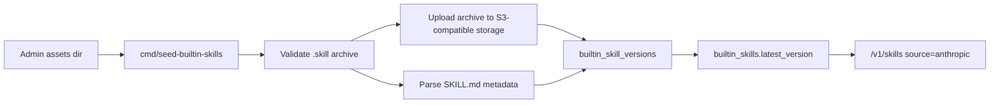

# Builtin Skills Seed And Storage

## 背景

Skills 资源现在分成两类：

- `source: "anthropic"`：全局只读 builtin skill，由管理员导入到数据库 catalog，并把 `.skill` archive 存在对象存储。
- `source: "custom"`：workspace 自定义 skill，继续使用现有 `skills` / `skill_versions` 表和对象存储。

临时 `assets/skills/public` 只作为管理员 seed 工具的输入目录，不是服务运行时依赖，也不进入 git。

## 数据模型

新增 migration `internal/db/migrations/00010_builtin_skills.sql`，创建：

- `builtin_skills`
  - `id bigint generated always as identity`
  - `uuid uuid default gen_random_uuid()`
  - `external_id text`，例如 `xlsx`
  - `display_title text`
  - `latest_version text`
  - `created_at` / `updated_at` / `deleted_at`
- `builtin_skill_versions`
  - `id bigint generated always as identity`
  - `uuid uuid default gen_random_uuid()`
  - `external_id text`
  - `skill_id bigint`
  - `skill_external_id text`
  - `version text`
  - `name text`
  - `description text`
  - `directory text`
  - `s3_bucket text`
  - `s3_key text`
  - `size_bytes bigint`
  - `sha256 text`
  - `created_at` / `deleted_at`

表之间不使用 PostgreSQL foreign key，符合项目 schema 规则；完整性由 seed 事务和 API 查询边界保证。



## Seed 工具

命令：

```bash
go run ./cmd/seed-builtin-skills --dir /path/to/assets/skills/public --versions /path/to/versions.txt
```

参数：

- `--dir` 必填，只扫描目录下的 `*.skill` archive。
- `--versions` 可选，支持 JSON object 或 `skill_id=version` 行格式。生产导入推荐显式指定平台版本号。
- `--prune` 可选，软删除本次目录中缺失的 builtin skill/version；默认只 upsert，不删除旧项。

CLI 会在导入前主动执行 goose migrations，不依赖服务端运行时的 `database.auto_migrate` 配置。这样管理员可以在新环境里先运行 seed 工具完成表结构和 catalog 初始化。

Archive 校验规则：

- 单个 archive 解包后必须只有一个顶层目录。
- 顶层目录必须包含 `SKILL.md`。
- 路径必须是安全相对路径，禁止绝对路径、空路径、`..` 和 NUL。
- 忽略 `__MACOSX`、`.DS_Store`、`._*` 这类系统文件。
- 总大小限制为 8 MiB。

对象存储 key：

```text
builtin-skills/{skill_id}/versions/{version}/{sha256}.skill
```

幂等规则：

- 缺省版本号由 archive 内容 sha 派生；生产导入推荐通过 `--versions` 显式指定平台版本号。
- 同一个 `skill_id + version + sha256` 重跑只刷新 catalog，不产生语义变化，并保留已存在 active version 的 `created_at`，避免版本排序被幂等重跑改变。
- 同一个 `skill_id + version` 但内容 sha 不同会返回冲突错误，管理员需要换新版本号。
- `--prune` 只软删除 DB row，不立即删除对应对象。已启动 Session 可能仍通过具体 version UUID 的 Filestore skill 投影借用该 archive；物理删除必须由后续 reference-aware catalog GC 在确认无活动投影后执行。

## API 行为

`/v1/skills` 组合两个来源：

- `source=anthropic`：只查询 builtin 表。
- `source=custom`：只查询 workspace 表。
- 未指定 `source`：返回 builtin catalog 和当前 workspace custom skills 的合并页。

未指定 `source` 的合并分页按逻辑序列 `builtin catalog -> workspace custom skills` 处理，`next_page` cursor 覆盖这个合并序列的 offset。即使当前页刚好在 builtin 尾部结束，只要后面仍存在 custom skill，旧版响应必须返回 `has_more=true`，两套契约均须返回下一页 cursor，避免 custom 资源被隐藏。

Builtin retrieve、versions 和 content/download 都从 DB metadata 定位 S3-compatible archive；服务不再读取 `assets` 目录。

## 正式 Skills 与旧版兼容

`/v1/skills` 默认使用正式契约，不要求 Skills beta header 或 `beta=true`。只有显式包含
`skills-2025-10-02` 的 `anthropic-beta` 才选择旧契约；多个 header 值和逗号分隔的组合均可使用。
`managed-agents-2026-04-01` 不选择旧 Skills 契约，Agent/Session 等资源原有的 header 检查保持不变。

| 项目 | 正式契约 | 显式旧 Skills header |
| --- | --- | --- |
| 显示名称 | `display_name`，最多 255 字符，省略时取 Skill name，允许重名 | `display_title`，最多 64 字符，workspace 内检查重名 |
| 最新版本 | `latest_version_id`，具体版本 ID | `latest_version`，时间戳字符串 |
| 来源 | `source.type` 为 `custom` 或 `anthropic_example` | `source` 为 `custom` 或 `anthropic` |
| 版本响应 | `id`、`created_at`、`description`、`name`、`skill_id`、`type` | 额外保留 `directory` 和 `version` |
| 分页 | `data`、`next_page`；limit 1–1000 | 保留 `has_more` 和旧 limit 行为 |
| 版本排序 | 新到旧 | 旧到新 |
| 删除 Skill | 软删除 Skill 及全部版本 | 存在版本时返回 400 |
| 删除最后一个版本 | 返回 400 | 允许，留下无版本 Skill |
| 上传布局 | 根目录 SKILL.md 或与 name 一致的单层包目录 | 保留旧版单包目录布局 |

两套接口共享已有 `skills`、`skill_versions` 和 archive，不增加表。新版本生成 `skver_` ID；既有
版本 ID 保持可用，`skill_version_` 前缀可作为相同后缀 `skver_` ID 的输入别名。`versions/latest`
直接返回最新版本。执行端和 Agent 版本固定继续通过同一个 DB 查询解析 ID 或既有版本值。
正式版不返回旧版 `directory`、`version`；路径和下载归档仍统一带 Skill name 顶层目录。
正式版后续上传不得更改 name。正式上传包上限为 30 MiB，旧版保留 8 MiB 上限。

迁移 `00081_skills_display_names.sql` 把 active display title 唯一索引改为普通查询索引，保留现有
非空列。创建事务使用 workspace 锁，旧版在锁内检查重名；正式版在同一锁下允许创建独立同名
Skill。版本删除和新增沿用 Skill 行锁，最后版本保护和删除操作位于同一事务中。
回滚该迁移要求先处理正式版产生的重名数据，不能静默删除或重命名已有 Skill。

旧版删除完全部版本后，正式 retrieve 返回 400，正式列表不包含该 Skill；可继续上传新版本或直接
删除 Skill。分页游标带契约标记，不允许跨新旧契约使用。软删除不立即删除 archive，以保证已经
启动的 Session 仍能读取钉住版本。

契约来源：[官方迁移说明](https://platform.claude.com/docs/en/build-with-claude/skills-guide#migrate-from-skills-2025-10-02)。

Builtin 写操作保持只读：

- create version
- delete skill
- delete version

以上对 builtin 都返回 read-only error。Custom skill 的 create/update/delete 继续走现有 workspace 表和对象存储。

## 测试

后端覆盖：

- seed 成功导入、幂等重跑、同版本不同 sha 冲突。
- seed archive 失败场景：缺 `SKILL.md`、多顶层目录、路径穿越。
- `--prune` 软删除。
- API 从 DB + S3-compatible storage 返回 builtin list/retrieve/version/content。
- builtin update/delete 只读。
- 新旧字段、显示名称重名规则、版本 ID/别名、latest、两种版本顺序及跨契约游标拒绝。
- 两套删除语义、无版本 Skill 的正式列表过滤和 archive 保留。
- 正式根目录上传、slug 校验与旧版目录上传兼容。
- custom 单 `.zip` / `.skill` archive 与目录 multipart 上传。
