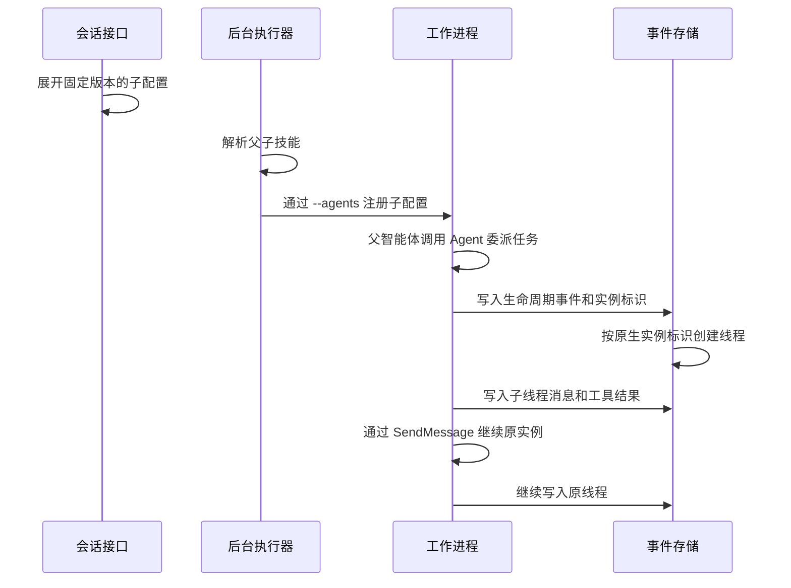

# 子智能体委派设计

OMA 支持父智能体在同一会话中委派任务。
子智能体按需启动，并在独立线程中执行任务。
控制台通过现有接口读取线程列表、历史事件和事件流。
本次验证使用 Claude Code 2.1.251。

## 术语

| 术语       | 含义                                                |
| ---------- | --------------------------------------------------- |
| 智能体     | Agent 配置，包含模型、提示词、技能、工具和 MCP 服务 |
| 会话       | Session，一次独立的执行上下文                       |
| 线程       | Session Thread，保存一次执行实例的历史事件          |
| 工作进程   | Worker，在沙箱内运行 Claude Code                    |
| 后台执行器 | Runner，负责领取工作并启动沙箱                      |
| 配置快照   | 会话保存的完整配置，包含已固定的子智能体版本        |
| 原始事件   | 归属于子线程的工具事件                              |
| 镜像事件   | 主线程中用于提示客户端处理的工具事件副本            |

## 配置与版本固定

`agentsnapshot` 在创建会话或部署时，直接读取 Agent 的固定版本名单，展开子配置后生成父快照。

公开接口兼容 `multiagent.type = coordinator`，并接受 CMA 的 `multiagent_20261001` 配置。旧配置示例：

```json
{
  "multiagent": {
    "type": "coordinator",
    "agents": [{ "type": "agent", "id": "agent_child" }]
  }
}
```

支持两种智能体引用：

| 引用                                              | 固定规则                                             |
| ------------------------------------------------- | ---------------------------------------------------- |
| `{"type":"agent","id":"agent_child"}`             | 创建父智能体或更新名单时，固定子智能体当时的最新版本 |
| `{"type":"agent","id":"agent_child","version":1}` | 固定子智能体的第 1 版                                |

保存后的每条引用都包含数字版本。
子智能体升级后，已保存的引用保持原版本。
再次发送不含版本的名单时，系统重新选择最新版本。
仅修改父智能体名称或提示词时，系统保留原名单和原版本。

系统拒绝以下引用：

- 智能体 ID 不存在。
- 智能体版本不存在。
- 版本小于 1。
- 被引用的其他智能体在该固定版本配置了非空 `multiagent`，包括已关闭所有开关的配置。带版本号和保存时解析最新版本的引用都在创建或更新写入前校验；失败返回 `400/invalid_request_error`，不改写父配置或版本。CMA 的 subagent/workflow 名单与旧 coordinator 名单共用该校验。

系统只解析同一工作区内的智能体。
Agent 的 model.inference_geo 在创建和更新的输入规范化时保留为 us 或 global；省略或 null 不生成显式 pin，其他值返回400。该字段随版本模型JSON持久化并返回，创建会话时继续进入固定配置快照。本项修复不声称验证上游请求的实际物理地域路由。

保存普通 multiagent_20261001 Agent 的创建或更新时，按最终配置检查父模型与启用名单内每个固定版本模型的 inference_geo：全部省略，或全部相同。父有pin而子无pin、反向情况以及不同pin均返回400，拒绝发生在写入版本前。更新仅改父model且不重发名单也检查原固定版本；当前self采用待保存父模型，历史self读取原版本；旧coordinator配置不新增此CMA约束。Session创建入口接受agent_with_overrides的model覆盖：先校验并规范化工作区可用模型，以副本生成Session快照，不改Agent或版本。快照展开后再次校验CMA固定名单地域；模型覆盖同pin可创建Session，改变/移除父pin而与固定子模型不一致则在Session写入前拒绝。system覆盖同样只作用于Session副本，省略继承、null清除、字符串替换；固定版本专家不改，self由有效父副本展开。tools覆盖复用Agent工具规范化与MCP引用校验，整体替换到Session副本，不合并源工具；有效skills非空时必须保留内置read，省略工具继承、null/空数组清除。mcp_servers覆盖复用Agent的URL/名称/数量校验，先计算新服务器，再校验最终有效工具引用，允许同一请求同时替换或清除tools和mcp_servers；只改变Session副本。skills覆盖复用Agent技能引用校验，省略继承、null或空数组清除、非空数组整体替换；先应用有效技能再校验最终工具/MCP状态，允许同时清除技能与工具，新增技能但无内置read时拒绝。五个公开覆盖字段均只作用于Session副本，源Agent/版本和固定专家不变。普通Agent引用输入保持原语义。

创建会话时，系统将引用展开为完整配置快照。
创建部署时，系统使用同一个解析器。
展开引用后，系统校验固定版本的子名称：名称必须非空，不能以 `-` 开头，且在名单内唯一。
该校验包含当前和历史 `self`。校验失败时，Session 和 Deployment 创建接口返回 `400`，不保存资源。
部署创建的会话继续使用该部署保存的快照。

后台执行器直接使用创建时保存的完整快照，不在启动时展开引用或改写快照。
`self` 指向父智能体的当前版本时，使用父 Agent 的副本并清除副本中的 `multiagent`。
创建会话或部署时，缺少固定版本或找不到该版本则返回错误。
子技能和启动定义使用展开后的子配置；工具权限使用会话配置。

其他子智能体不得配置嵌套委派。
`self` 引用按父智能体 ID 识别。
父智能体升级到 V2 后，仍可引用自身 V1。
系统按引用版本读取配置，并移除子快照中的 `multiagent`。
系统不会将历史 `self` 自动升级到父智能体的当前版本。

### CMA 20261001 配置

```json
{
  "multiagent": {
    "type": "multiagent_20261001",
    "workflows": {
      "type": "enabled",
      "inline_agents": { "type": "enabled" },
      "predefined_agents": []
    },
    "subagents": {
      "type": "enabled",
      "inline_agents": { "type": "enabled" },
      "predefined_agents": []
    },
    "advisor": { "type": "enabled", "model": "claude-haiku-5-5" }
  }
}
```

`workflows` 和 `subagents` 默认启用，内部的 `inline_agents` 默认启用，`predefined_agents` 默认空名单；`advisor` 默认禁用，启用时必须提供非空模型。
两份名单独立解析和固定版本，每份最多 20 个不重复 Agent。禁用 inline agents 后，启用的委派设置必须有至少一个预定义 Agent。

保留 `multiagent_20261001` 类型的更新按字段合并。省略的设置和字段保留原值，显式 `null` 恢复默认值，发送名单替换该名单。设置切换类型时整体替换，省略的内部字段取默认值。发送的设置对象必须带 `type`，启用的 advisor 每次发送都必须带 `model`。切换顶层类型时替换整个配置，顶层 `null` 清除 multiagent。

会话和部署快照保留全部设置，并展开两份名单中的固定版本 Agent。父快照中的 advisor 模型保持原值。DSH 运行时将 `subagents.predefined_agents` 和 `subagents.inline_agents` 映射到现有委派配置；禁用 subagents 时不注册委派。Claude Code 启动参数将 subagents 的预定义名单映射到 `--agents`。两份名单的技能都进入快照技能解析。

本次提供配置读写兼容和现有 subagents 执行链的接入。OMA 尚未实现 CMA 的 workflow run 调度、事件和 advisor consultation 执行，也未实现 CMA advisor 模型能力配对校验。配置被接受和保存不代表这些能力已经执行；Claude Code 对 inline agents 的行为仍取决于其原生能力。

配置合同依据本地 `cma-docs/claude-managed-agents/multiagent-orchestration.md` 的默认值、更新规则和类型迁移说明。回归入口为 `TestCMAMultiagent*`、`TestAgentsCMAMultiagentConfiguration`、`TestCMASnapshotPreservesIndependentSettings` 和 `TestRuntimeCMASubagents`。
官方委派语义见 [Claude 子智能体文档](https://platform.claude.com/docs/zh-CN/managed-agents/multiagent-orchestration#delegate-to-subagents)。

## Session热更新边界

现有Session仅允许热更新agent.tools和agent.mcp_servers。multiagent、model、system、skills、身份/版本及其他未知键即使显式null也返回400 invalid_request_error，不静默忽略。请求在持久化前完整校验，因此与title或metadata组合的非法agent patch不会部分写入其他字段。合法工具/服务器更新复用Agent规范化和有效skills需要Read、MCP双向引用等约束；省略字段继承，显式null或空数组清空，联合更新按最终状态校验。根快照其他字段和未知扩展原样保留，不推进源Agent版本或修改源资源。

## 启动与续聊



Claude Code 的 `--agents` 启动参数接收 JSON 格式的子配置。
注册键使用子智能体名称。介绍保留用户填写的描述，不自动拼接名称。
描述为空时，介绍使用名称。
注册直接使用快照的 `name`。名称必须非空，不能以 `-` 开头，且在同一名单内唯一。
启动侧保留同样的名称检查。校验失败时停止启动，不自动添加名称、前缀或数字后缀，也不维护内置名称名单。
Claude 按注册名称选择子定义。OMA 不按 `subagent_type` 回查配置，也不向子线程补写 Agent 配置快照。

子定义包含自己的提示词、模型和技能目录。旧 Claude Code 启动路径的 `mcpServers` 使用会话统一配置；Brain 普通 subagent 使用下面的线程配置边界。
技能解析一次读取父技能和直接子技能，按名单顺序合并后统一校验，不递归处理名单。
技能字段保留大小写不敏感、分隔符敏感的匹配规则；`multiagent` 和 `agents` 字段保持精确匹配。
解析拒绝重复 JSON 字段和非法 UTF-8。指向同一技能字段的多个大小写别名也被拒绝。
技能继续使用现有挂载路径。
系统按实际技能版本去重，并检查目录冲突。

技能目录索引包含来源、技能 ID 和版本。
请求版本与实际版本可以指向同一目录。
若 `latest` 与显式版本指向同一技能版本，系统保留 `latest` 查找标识。
同一技能的不同版本可以使用不同目录。

执行过程使用四类身份：

| 身份                  | 用途                                                  |
| --------------------- | ----------------------------------------------------- |
| 智能体 ID 和版本      | 标识内部固定配置。原生 `subagent_type` 使用快照名称 |
| 运行实例 ID           | 标识一次执行实例。原生 `SendMessage` 使用该 ID        |
| 会话线程 ID           | 标识公开历史和事件路由                                |
| 任务 ID 或工具调用 ID | 标识一次委派或调用                                    |

系统从已有 `session.thread_created` 事件读取身份映射。
运行实例、线程和工具调用 ID 只用于事件及审批路由。
后续生命周期事件复用原线程映射。
续聊继续使用原实例和原线程。

本实现复用现有事件存储。
系统不新增调度器、子进程注册表、数据库表或迁移。

## 事件乱序与线程路由

子模型请求等待原生实例与线程的映射，使用现有 10 秒期限。
生命周期和委派工具事件的到达顺序不影响权限选择。
OMA 不补齐子线程配置；未知实例不能将模型请求发送到主线程。

内部回复记录使用 `requestId`。
实时工作进程事件使用 `request_id`。
系统将两者统一为 `model_request_start_id`。
现有事务去重逻辑据此关联模型代理回复与内部回复副本。
独立模型请求和不同回复内容仍分别保存。

编辑父智能体名单不会更新已有会话。
新会话使用重新固定的名单。

## 工具审批与调用身份

父线程、配置子智能体和原生 Task 子线程使用同一份会话工具策略。
子配置的工具规则不切换会话权限。会话策略为 `ask` 时，工具等待客户端确认。
未知线程或已终止线程的工具请求被拒绝。

阻塞工具有原始事件 ID 和主线程镜像 ID。
子工具事件 ID 包含 Code Session ID、provider 工具 ID 和实际子线程 ID。
同一配置的不同运行实例可以复用 provider 工具 ID，仍产生独立公开身份；主线程 ID 规则保持不变。
两套 ID 指向同一个待处理请求。
后端在现有会话锁和工作进程锁内检查 ID 与线程。
未知 ID、其他线程的 ID 和已处理的请求返回输入冲突。
校验失败时，后端不保存确认事件。
子线程终止时，在同一事务中清理其待审批请求，保留其他线程的请求。
终止后的确认返回 409，晚到的工具请求被拒绝，晚到的状态不能重新激活已终止子线程。

公开事件保留原 ID，并声明两份事件的关联：

- 镜像事件的 `original_event_id` 指向原始事件。
- 原始事件的 `primary_event_id` 指向镜像事件。

前端先统一调用身份，再执行去重和结果关联。
同一身份用于工具记录、审批确认、工具结果和待处理状态。
两份事件都已加载时，前端选择原始事件。
仅加载镜像事件时，前端仍提供审批入口。
前端合并副本时归一化 `id`、工具引用和待处理 ID。
审批提交使用原始工具 ID 和子线程 ID。

不同调用即使线程、路径、输入或时间相同，也分别显示。
前端不根据相似内容推测调用身份。
该修复属于共享会话层，不修改智能体配置或工作进程执行方式。

前端分别跟踪会话和各子线程的待处理审批。
父线程继续运行时，子线程审批入口仍然可用。
确认、结果或后续线程状态清除对应待处理项。

## MCP 与共享环境

Brain 父线程使用当前 Session 配置。每个子线程创建并持久化后，通过已认证运行时上下文接口读取该线程固定快照的 MCP 文档，分别创建客户端、发现工具和管理连接。self 快照继承有效父配置，固定版本专家使用自身配置。父工具刷新和子连接关闭互不改写其他线程客户端。
子线程上下文及 MCP 代理携带内部 `X-OMA-Session-Thread-ID`。服务端按已验签 Code Session 的 organization/workspace 和关联 Session 查询线程，拒绝其他租户、其他会话、根线程、已终止或归档线程；不信任客户端给出的 URL 或 Agent 配置作为授权。线程的固定快照决定服务器名称和精确 URL，原 Environment 网络约束仍然适用。不带线程标识的请求保持父会话策略。该内部标识在转发到上游前移除，入口凭据仍由现有 Vault/Tunnel 路径处理。
沙箱网络名单只使用会话 MCP 主机；子配置不会扩大该名单。
网关、资源发现和 OAuth 元数据地址不传递配置名称或 ID。

父子智能体共享沙箱文件系统、技能文件和会话凭据。
技能预加载不提供文件系统隔离。

## 公开接口与展示

| 接口                                                       | 用途                         |
| ---------------------------------------------------------- | ---------------------------- |
| `GET /v1/sessions/{session_id}/threads`                    | 读取原生执行线程列表       |
| `GET /v1/sessions/{session_id}/threads/{thread_id}/events` | 读取线程历史                 |
| `GET /v1/sessions/{session_id}/threads/{thread_id}/stream` | 订阅线程事件流               |
| `POST /v1/sessions/{session_id}/events`                    | 提交携带子线程 ID 的工具确认 |

内部工具结果转换为公开 `agent.tool_result` 事件。
线程详情展示原生线程事件提供的信息，缺失信息显示为未知。
工具配置表使用会话策略；线程筛选只改变调用统计的范围。

## 验收范围

运行入口与必需阶段见[子智能体验证场景](../../../.agents/skills/verify-be/features/subagents.md)。
真实工作进程使用脚本提供的模型响应，不验证模型自主推理质量。
完整隧道服务、云端分配、定向中断和子线程重启恢复仍未验收。
组件回放不代表原控制台的完整端到端验收。

## 专家 effort 快照

Agent 的 `model.effort` 接受 `low`、`medium`、`high`、`xhigh`、`max`
字符串或 `{ "type": "high" }` 对象，并统一以对象形式保存和返回。
省略或 `null` 使用模型默认值，不写入显式 effort；非法值拒绝保存。
创建、更新及 Session model override 使用同一规范化入口。
固定版本的专家配置随 Session roster 及子线程快照保留，更新专家后不回写旧版本。
此处验证配置保存和快照，不用输出长度判断上游实际推理预算；
实际 provider 的 effort 支持范围和上游参数应用不在本次快照回归覆盖内。


### 公共归档后的容量同步

HTTP归档idle child后，持久状态已terminated，运行中的Brain缓存可能仍idle。新建委派遇到25个保留线程时，通过CCRv2已有的worker/subagent-threads只读端点核对idle候选的权威状态。只有明确archived/terminated才关闭对应缓存runtime、解除绑定并释放本地名额，不重复产生公开terminated事件。错误、未知身份或关闭失败不得当作空槽。刷新期间的新建委派共用一次刷新，刷新完成后同步重计数并占位；已转running的线程不被关闭。普通follow-up仍执行既有权威归档校验。

当前Brain通过HTTP claim和CCRv2处理任务。就绪验证应使用实际claim/模型/工具进展及HTTP连接，旧OMA_BRAIN_TASKS NATS消费者不是当前Brain进程的直接订阅要求。


### Agent名称的公共边界

创建及显式更新Agent.name时，按公共CreateAgent schema限制为1至256个Unicode字符。保留原有非空校验和有效值原文，不用UTF-8字节数代替字符数。超过256字符返回invalid_request_error；创建时在模型解析之前拒绝，更新时在持久化之前拒绝。未更新name的旧Agent保留原值。该限制不推导roster数量、全局配额或未公开errorcode。
