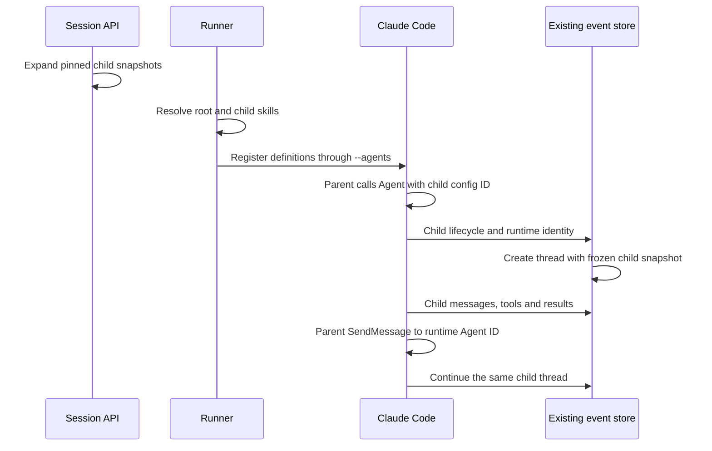

# Subagent delegation

OMA supports a parent Agent delegating to a configured child Agent inside the same Session. Each child execution has an independent public Session Thread. Thread listing, history and SSE reuse the existing Session APIs. Claude Code 2.1.251 is the validated runtime baseline.

## Configuration and snapshot

The public Agent API retains the existing configuration:

```json
{"multiagent":{"type":"coordinator","agents":[{"type":"agent","id":"agent_child"}]}}
```

The two supported object references are:

| Reference | Version selection |
| --- | --- |
| `{"type":"agent","id":"agent_child"}` | Pin the child's latest version when creating the parent or updating it with this roster |
| `{"type":"agent","id":"agent_child","version":1}` | Pin exactly child version 1, even when newer versions exist |

The saved roster always includes the resolved numeric `version`. Later child updates leave that reference unchanged. Sending an unversioned roster again selects the latest version at that update; updating other parent fields without sending `multiagent` retains the existing pins. Unknown Agent IDs, nonexistent versions and versions below 1 are rejected.

Agent creation/update resolves each roster entry to an Agent ID and exact version in the same workspace. Session creation expands those references into full child snapshots, including model, system, skills, tools and MCP servers. Deployment creation uses the same resolver, so scheduled Sessions receive the same frozen configuration. Updating a referenced Agent after the parent is saved does not change the pinned version in a new Session. Existing Sessions retain their snapshots.

Referenced children must have no multiagent configuration; nested delegation definitions are rejected during snapshot resolution. Existing coordinator self entries are recognized by their parent Agent ID and use the referenced version with its multiagent field removed. A name/system update that leaves the roster unchanged preserves historical self versions, without treating self as a nested child or repinning it to the current parent version. This implements the predefined-child runtime behavior described by [Claude Managed Agents](https://platform.claude.com/docs/zh-CN/managed-agents/multiagent-orchestration#delegate-to-subagents). OMA continues using its coordinator schema; workflows, advisors and the newer `multiagent_20261001` API schema are outside this change.

## Startup and continuation



`--agents` is a Claude Code startup parameter accepting JSON definitions. Registration makes the configured children available; the actual child runs when the parent delegates. Startup definitions include the child's prompt, model, skill directory names and inline `mcpServers`. Skills use the existing resolver/mount path with deduplication and directory conflict checks.

Skill directory lookup includes source, Skill ID and version. Actual-version and requested-version keys point to the same resolved directory; deduplication retains a requested `latest` alias when it shares an actual version with an explicit reference. Different skill versions in distinct directories therefore remain independent of resolver traversal order.

The runtime uses four identities:

| Identity | Meaning |
| --- | --- |
| Agent ID + version | Pinned configuration, used as native `subagent_type` |
| Runtime Agent ID | Claude execution instance, used by native `SendMessage` |
| Session Thread ID | Public persisted history and event routing |
| Task ID / Tool Use ID | Individual delegation/turn/call |

The existing persisted `session.thread_created` events provide runtime/task/tool-to-thread mappings. The initiating public Agent tool event selects the frozen child snapshot. Later lifecycle events reuse the mapping so a new task can continue an existing execution thread. This adds no scheduler, process per child, registry table or migration.

Lifecycle events and the initiating tool event may arrive in either order. After either is persisted, the service reconciles missing thread snapshots through the existing tool-to-thread mapping. The conditional write only fills child snapshots without an Agent ID, preserving already pinned configurations. Child model dispatch waits for both its thread mapping and configuration within the existing ten-second dispatch deadline. Tool authorization denies a configured child whose snapshot is not ready, instead of using the empty-toolset default.

Internal transcripts may carry `requestId` while live Worker output carries `request_id`. The input DTO normalizes both to `model_request_start_id`, so the existing transactional cross-source echo deduplication handles a proxy reply and its transcript copy even when their message IDs differ. Independent model requests and unique transcript content remain separate.

This is lazy execution of predefined children within a Session. Editing the parent's roster during an active Session does not hot-reload that Session; a new Session uses the newly pinned roster.

## Tools, MCP and shared environment

Child tool events and Worker permission requests resolve the actual thread and evaluate its Agent snapshot. Child `ask` requires public confirmation even if the parent allows the same tool. An unknown runtime/thread identity receives a deny response rather than inheriting the parent policy. Confirmations preserve `session_thread_id`.

Blocking child tools have a child-history event ID and a separate primary-stream mirror ID. Both IDs resolve to the same pending Worker permission request, including requests persisted before this fix. Input acceptance checks the submitted ID and thread against pending metadata while holding the existing Session/Worker locks. Unknown IDs, another thread's IDs and completed requests return an input conflict before the confirmation is persisted. A missing request during Worker delivery returns an error instead of forwarding the confirmation as ordinary input.

The frontend tracks pending approvals for the Session and each child thread independently. A running parent does not clear a child's `session.thread_status_idle` with `requires_action`; a confirmation, tool result or subsequent status clears the corresponding pending action. The existing approval card submits the selected public tool event ID and its child thread ID.

Inline child MCP configuration reuses the existing runtime config builder. Child Tunnel gateway URLs carry `config_agent_id` after normal Session-ingress authentication; the gateway selects only a referenced frozen child from that authenticated Session. Unknown selectors fail closed. Resource and OAuth discovery URLs retain the selector. Shared sandbox networking includes all configured MCP hosts, while each MCP gateway policy uses the selected Agent's exact URLs.

Parent and children share the sandbox filesystem, mounted skill files and Session credentials. Skill preload and tool policy selection do not establish filesystem or skill-access isolation. The MCP configuration selector is a scope selector within the authenticated Session, not a separate child credential.

## Public observation

- `GET /v1/sessions/{session_id}/threads` lists the parent and instantiated children with their Agent snapshots.
- `GET /v1/sessions/{session_id}/threads/{thread_id}/events` reads persisted thread history.
- `GET /v1/sessions/{session_id}/threads/{thread_id}/stream` streams that thread's events.
- `POST /v1/sessions/{session_id}/events` accepts tool confirmations carrying the child `session_thread_id`.

Internal child tool results are mapped to the public `agent.tool_result` contract. A resumed child keeps its thread ID and previous context. This change adds no new public route or frontend flow.

The frontend thread inspector displays the selected child's Agent ID, name, version and model from that thread's snapshot. It does not replace historical child configuration with the parent or the catalog's current Agent version; incomplete snapshots remain unknown.

## Acceptance

The [Subagent verification scenario](../../../.agents/skills/verify-be/features/subagents.md) exercises both object-reference forms through public Agent creation/update, rejected references, version retention after child upgrades, repinning when resending a roster and preservation when updating other parent fields. The child reaches V3 while the actual Worker must dispatch explicitly pinned V1. The scenario also covers the child's model/system/skill, tool rejection and approval with filesystem checks, remote MCP execution, thread listing/history/SSE and same-thread continuation. The upstream model is scripted, so this verifies protocol behavior rather than autonomous model decisions. Handler tests additionally cover child Tunnel selection, rejection of unknown configuration IDs and OAuth scope preservation.

The scenario also forces lifecycle-before-tool delivery for two child instances, verifies pending-configuration denial and repaired ask/deny policies, and tests proxy/transcript delivery in both orders with changed message IDs. Two real background instances of the same V1 configuration overlap, request independent Write confirmations and leave no files after rejection. First-turn, follow-up and new-Session histories must contain one copy of each child reply.

Approval regression rejects unknown IDs and child approvals addressed to the primary thread without persisting them. Real child Write rejection and approval use IDs read from child history. Parallel children exercise one child-history ID and one primary mirror ID, proving both resume the correct Worker request. Frontend component tests require approval buttons while the parent runs and retain another child's approval after one thread resumes.

Child Worker-restart recovery, directed interruption, real Tunnel service execution, cloud allocation and browser presentation remain outside this backend scenario. Frontend component regression separately verifies snapshot display.
