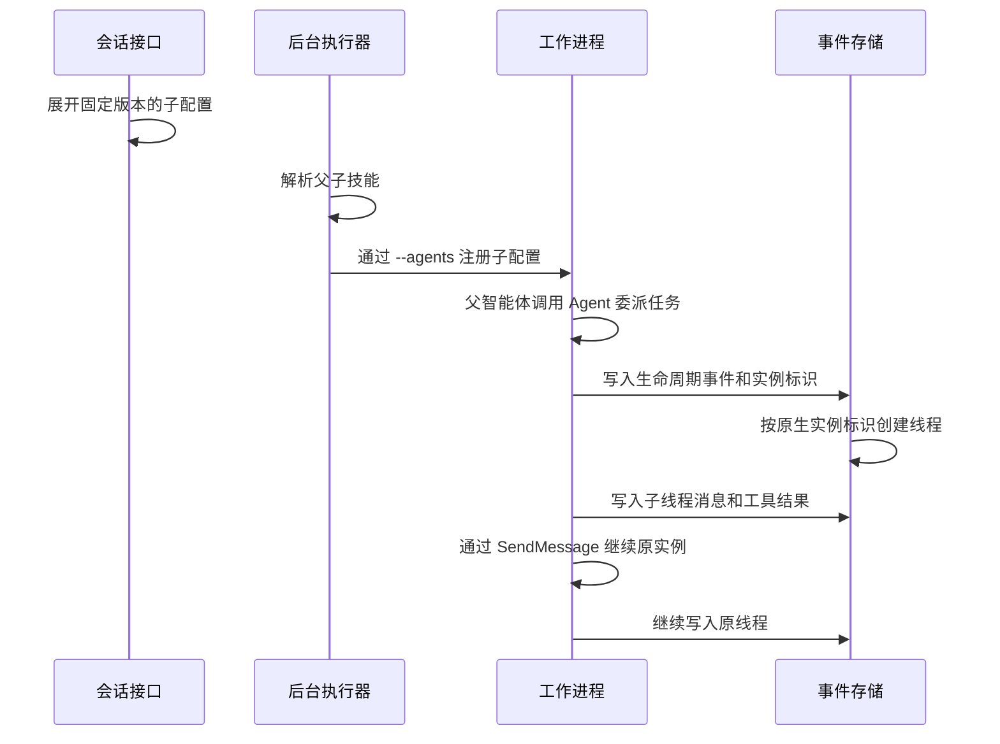

# 子智能体委派设计

OMA 支持父智能体在同一会话中委派任务。
子智能体按需启动，并在独立线程中执行任务。
控制台通过现有接口读取线程列表、历史事件和事件流。
本次验证使用 Claude Code 2.1.251。

## 术语

| 术语       | 含义                                                |
| ---------- | --------------------------------------------------- |
| 智能体     | Agent 配置，包含模型、提示词、技能、工具和 MCP 服务 |
| 会话       | Session，一次独立的执行上下文                       |
| 线程       | Session Thread，保存一次执行实例的历史事件          |
| 工作进程   | Worker，在沙箱内运行 Claude Code                    |
| 后台执行器 | Runner，负责领取工作并启动沙箱                      |
| 配置快照   | 会话保存的完整配置，包含已固定的子智能体版本        |
| 原始事件   | 归属于子线程的工具事件                              |
| 镜像事件   | 主线程中用于提示客户端处理的工具事件副本            |

## 配置与版本固定

`agentconfig` 只读取配置 JSON，不依赖数据库。技能解析复用其子名单读取；`agentsnapshot` 在创建会话或部署快照时按固定版本展开子配置。

公开接口沿用 `multiagent.type = coordinator`：

```json
{
  "multiagent": {
    "type": "coordinator",
    "agents": [{ "type": "agent", "id": "agent_child" }]
  }
}
```

支持两种智能体引用：

| 引用                                              | 固定规则                                             |
| ------------------------------------------------- | ---------------------------------------------------- |
| `{"type":"agent","id":"agent_child"}`             | 创建父智能体或更新名单时，固定子智能体当时的最新版本 |
| `{"type":"agent","id":"agent_child","version":1}` | 固定子智能体的第 1 版                                |

保存后的每条引用都包含数字版本。
子智能体升级后，已保存的引用保持原版本。
再次发送不含版本的名单时，系统重新选择最新版本。
仅修改父智能体名称或提示词时，系统保留原名单和原版本。

系统拒绝以下引用：

- 智能体 ID 不存在。
- 智能体版本不存在。
- 版本小于 1。

系统只解析同一工作区内的智能体。
创建会话时，系统将引用展开为完整配置快照。
创建部署时，系统使用同一个解析器。
部署创建的会话继续使用该部署保存的快照。

后台执行器直接使用创建时保存的完整快照，不在启动时展开引用或改写快照。
`self` 指向父快照的同一版本时，直接使用父快照并移除 `multiagent`。
创建会话或部署时，缺少固定版本或找不到该版本则返回错误。
子技能和启动定义使用展开后的子配置；工具权限使用会话配置。

其他子智能体不得配置嵌套委派。
`self` 引用按父智能体 ID 识别。
父智能体升级到 V2 后，仍可引用自身 V1。
系统按引用版本读取配置，并移除子快照中的 `multiagent`。
系统不会将历史 `self` 自动升级到父智能体的当前版本。

本实现仅覆盖 `coordinator` 配置。
官方委派语义见 [Claude 子智能体文档](https://platform.claude.com/docs/zh-CN/managed-agents/multiagent-orchestration#delegate-to-subagents)。

## 启动与续聊



Claude Code 的 `--agents` 启动参数接收 JSON 格式的子配置。
coordinator 启动提示说明：`SendMessage` 后可用 `TaskOutput` 阻塞等待运行实例，子完成消息会自动到达。
`ReadNotifications` 读取外部通知，不用于轮询子回复。子工具等待审批时，父智能体应将控制权交还用户。
该提示不提供请求频率保证；真实模型等待行为仍需运行验证。
注册键使用子智能体名称。父智能体可见的介绍同时保留名称和描述。
描述为空时，介绍使用名称。
注册直接使用快照的 `name`。名称必须非空，不能以 `-` 开头，且在同一名单内唯一。
校验失败时停止启动，不自动添加名称、前缀或数字后缀，也不维护内置名称名单。
Claude 按注册名称选择子定义。OMA 不按 `subagent_type` 回查配置，也不向子线程补写 Agent 配置快照。

子定义包含自己的提示词、模型和技能目录。`mcpServers` 使用会话统一配置。
启动侧只构建一次会话 MCP 文档，所有子定义复用同一份服务器配置。
技能继续使用现有解析器和挂载路径。
系统按实际技能版本去重，并检查目录冲突。

技能目录索引包含来源、技能 ID 和版本。
请求版本与实际版本可以指向同一目录。
若 `latest` 与显式版本指向同一技能版本，系统保留 `latest` 查找标识。
同一技能的不同版本可以使用不同目录。

执行过程使用四类身份：

| 身份                  | 用途                                                  |
| --------------------- | ----------------------------------------------------- |
| 智能体 ID 和版本      | 标识内部固定配置。原生 `subagent_type` 使用快照名称 |
| 运行实例 ID           | 标识一次执行实例。原生 `SendMessage` 使用该 ID        |
| 会话线程 ID           | 标识公开历史和事件路由                                |
| 任务 ID 或工具调用 ID | 标识一次委派或调用                                    |

系统从已有 `session.thread_created` 事件读取身份映射。
运行实例、线程和工具调用 ID 只用于事件及审批路由。
后续生命周期事件复用原线程映射。
续聊继续使用原实例和原线程。

本实现复用现有事件存储。
系统不新增调度器、子进程注册表、数据库表或迁移。

## 事件乱序与线程路由

子模型请求等待原生实例与线程的映射，使用现有 10 秒期限。
生命周期和委派工具事件的到达顺序不影响权限选择。
OMA 不补齐子线程配置；未知实例不能将模型请求发送到主线程。

内部回复记录使用 `requestId`。
实时工作进程事件使用 `request_id`。
系统将两者统一为 `model_request_start_id`。
现有事务去重逻辑据此关联模型代理回复与内部回复副本。
独立模型请求和不同回复内容仍分别保存。

编辑父智能体名单不会更新已有会话。
新会话使用重新固定的名单。

## 工具审批与调用身份

父线程、配置子智能体和原生 Task 子线程使用同一份会话工具策略。
子配置的工具规则不切换会话权限。会话策略为 `ask` 时，工具等待客户端确认。
未知线程或已终止线程的工具请求被拒绝。

阻塞工具有原始事件 ID 和主线程镜像 ID。
子工具事件 ID 包含 Code Session ID、provider 工具 ID 和实际子线程 ID。
同一配置的不同运行实例可以复用 provider 工具 ID，仍产生独立公开身份；主线程 ID 规则保持不变。
两套 ID 指向同一个待处理请求。
后端在现有会话锁和工作进程锁内检查 ID 与线程。
未知 ID、其他线程的 ID 和已处理的请求返回输入冲突。
校验失败时，后端不保存确认事件。
子线程终止时，在同一事务中清理其待审批请求，保留其他线程的请求。
终止后的确认返回 409，晚到的工具请求被拒绝，晚到的状态不能重新激活已终止子线程。

公开事件保留原 ID，并声明两份事件的关联：

- 镜像事件的 `original_event_id` 指向原始事件。
- 原始事件的 `primary_event_id` 指向镜像事件。

前端先统一调用身份，再执行去重和结果关联。
同一身份用于工具记录、审批确认、工具结果和待处理状态。
两份事件都已加载时，前端选择原始事件。
仅加载镜像事件时，前端仍提供审批入口。
前端合并副本时归一化 `id`、工具引用和待处理 ID。
审批提交使用原始工具 ID 和子线程 ID。

不同调用即使线程、路径、输入或时间相同，也分别显示。
前端不根据相似内容推测调用身份。
该修复属于共享会话层，不修改智能体配置或工作进程执行方式。

前端分别跟踪会话和各子线程的待处理审批。
父线程继续运行时，子线程审批入口仍然可用。
确认、结果或后续线程状态清除对应待处理项。

## MCP 与共享环境

启动时通过现有 MCP 构造器生成一份会话配置，所有子定义复用该配置。
网关验证会话入口凭据，并按会话配置检查服务器名称和具体 URL。
沙箱网络名单只使用会话 MCP 主机；子配置不会扩大该名单。
网关、资源发现和 OAuth 元数据地址不传递配置名称或 ID。

父子智能体共享沙箱文件系统、技能文件和会话凭据。
技能预加载不提供文件系统隔离。

## 公开接口与展示

| 接口                                                       | 用途                         |
| ---------------------------------------------------------- | ---------------------------- |
| `GET /v1/sessions/{session_id}/threads`                    | 读取原生执行线程列表       |
| `GET /v1/sessions/{session_id}/threads/{thread_id}/events` | 读取线程历史                 |
| `GET /v1/sessions/{session_id}/threads/{thread_id}/stream` | 订阅线程事件流               |
| `POST /v1/sessions/{session_id}/events`                    | 提交携带子线程 ID 的工具确认 |

内部工具结果转换为公开 `agent.tool_result` 事件。
线程详情展示原生线程事件提供的信息，缺失信息显示为未知。
工具配置表使用会话策略；线程筛选只改变调用统计的范围。

## 验收范围

运行入口与必需阶段见[子智能体验证场景](../../../.agents/skills/verify-be/features/subagents.md)。
真实工作进程使用脚本提供的模型响应，不验证模型自主推理质量。
完整隧道服务、云端分配、定向中断和子线程重启恢复仍未验收。
组件回放不代表原控制台的完整端到端验收。
