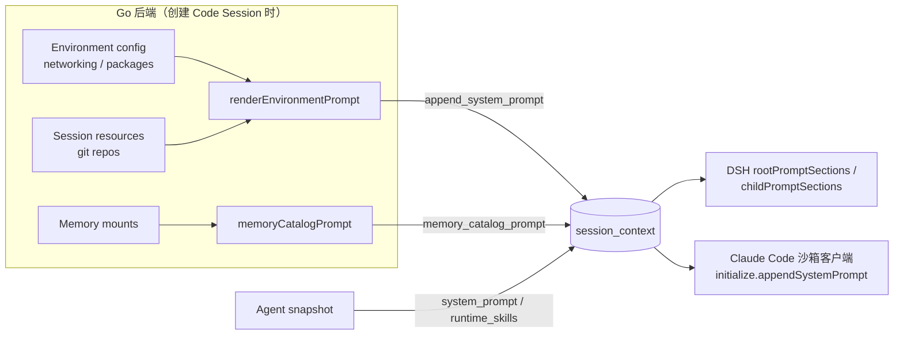

# 系统提示词分层组装

托管 Agent 的系统提示词由多方内容拼成：平台规则、Environment 约束、Skill 列表、用户 Agent 指令和会话级信息。本文约定每一段由谁渲染、按什么顺序拼接，以及为什么这样分工。

## 分层与顺序

段落按稳定性从高到低排列，越靠前的段在越多会话之间保持不变，使模型请求的前缀缓存命中尽可能长。

| 顺序 | 段 | 渲染方 | 变化频率 | 内容 |
|---|---|---|---|---|
| 1 | platform | DSH（`src/prompt/platform.ts`） | 随 DSH 版本 | 身份、何时提问、工作方式、审批、委派、不可信内容、收尾、指令优先级 |
| 2 | environment | Go（`internal/environments/environment_prompt.go`） | 随 Environment 配置 | 挂载路径、文件查找与输出、持久化语义、网络策略、预装软件 |
| 3 | skills | DSH | 随 Agent 版本 | Skill 名称、描述和 `SKILL.md` 路径，不含版本号 |
| 4 | instructions | DSH 原样引用 | 随 Agent 版本 | 用户 Agent 的 `system`，不做插值 |
| 5 | session | DSH 组装，Memory 文本由 Go 渲染 | 每个会话 | 工作目录、Memory store 目录 |

空段整体省略，不留下空标题。

## 分工原则

依据是每段内容依赖谁持有的信息：

- 平台段依赖执行端自己的工具集和 loop 行为，例如 `send_to_agent`、子 thread 上限、后台任务不可用，因此由 DSH 维护。Claude Code 沙箱客户端使用其自带的系统提示词，不接收 DSH 平台段。
- 环境段依赖数据库中的 Environment 配置和会话资源，且两种执行端共用，因此由 Go 渲染一次，写入 `metadata.config`。它在创建 Code Session 时固定，凭据恢复不重新渲染。
- 子 Agent 的提示词只有在创建 thread 时才能确定，由 DSH 通过 `SessionConfig.subagentSystemPrompt(thread)` 生成。子 Agent 使用独立的平台段：不含委派说明，最终消息写给父 Agent，并且不继承父 Agent 的 instructions 段。
- Go 不实现第二份拼装逻辑。需要在控制台预览最终提示词时，应复用 DSH 的组装函数。

## 环境段内容

`renderEnvironmentPrompt` 的输入为 `networkpolicy.Config`、已校验的 `environmentPackages` 和按挂载顺序排列的 Git 仓库。

- 网络为 `limited` 时，列出 `allowed_hosts`，并按开关说明包管理源和 MCP server 是否可达；同时要求模型在被拒后不要换客户端重试。缺省或非 cloud 配置按 `unrestricted` 渲染，与 `networkpolicy.ParseConfig` 的语义一致。
- 预装软件最多列出 40 个 spec，其余以 "and N more" 概括，避免大型清单挤占上下文。
- 非法 networking 或 packages 配置会使启动准备失败，与沙箱创建时的校验保持 fail closed。

## 兼容性

- `session_context` 字段不变：`append_system_prompt` 的内容由固定常量改为按 Environment 渲染的文本，`memory_catalog_prompt` 仍为独立字段。
- DSH 不再把 `memory_catalog_prompt` 拼进 `environment_prompt`，而是作为 launch 的 `memory_prompt` 放到会话段。
- 子 Agent 平台段保留 "You are subagent <name>." 句式。

## 验证

- Go：`environment_prompt_test.go` 覆盖非法配置拒绝、cloud 缺省等价于零值输入、limited 网络、包与仓库渲染，以及包清单截断。`tests/environments_runner_cloud_test.go` 校验沙箱客户端收到的 `appendSystemPrompt` 包含各环境小节。
- DSH：`tests/prompt.test.ts` 覆盖空段省略、子 Agent 不含委派说明和父指令、段顺序、平台段跨会话一致，以及用户指令按字面插入；`tests/worker-registration.test.ts` 校验 `memory_catalog_prompt` 单独映射。
