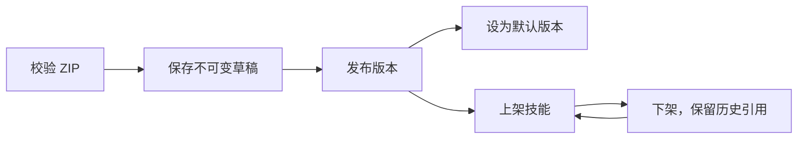

# 系统 Skill 管理

## 范围

在已有平台超管后台增加 `/platform-admin/skills`，采用列表与详情侧栏的 A 方案。工作区自定义技能的管理入口保持原状。页面复用现有 Skill 页面的 ResourcePageHeader、表格交互、复制 ID、Sheet、Dialog、Tabs 和分页组件，不引入独立主题。

HAR 仅作为列表、版本和详情的信息组织参考，不复制第三方页面、脚本或品牌。HAR 和交互原型保留在本地，不进入生产代码。

本功能不自动导入预置技能，也不改变沙箱镜像。Skill ZIP 包与沙箱工具预装分别管理。

## 数据与权限

复用 `builtin_skills`、`builtin_skill_versions` 和默认对象存储。迁移 00114 增加发布者、来源、授权、上架状态、修订号和版本发布状态；版本关系改用 `skill_uuid`。旧版本保留为已发布，旧的默认版本保持不变；未知来源留空，界面显示未标注，不伪造 Anthropic 来源。

`system_skill_events` 记录操作者账号 UUID、技能 UUID、操作、版本和时间。成功写入与操作记录在同一 Yourbatis 事务内提交；历史 seed 操作不补造审计记录。批量导入每个包独立提交，并向用户保留逐包结果。

所有路由挂在现有 `/api/platform-admin` 认证与 CSRF 中间件之下，拒绝 API Key/Bearer，要求真实验证登录及现存超级管理员授权。子路由再次检查平台身份。写事务锁定并复核管理员授权，避免请求检查后撤权仍可提交。新增 `platform:skills:manage` 权限描述不改变目前所有超管拥有完整管理权限的边界。

## 接口

| 方法与路径，相对 /api/platform-admin | 用途 |
| --- | --- |
| GET /skills | 名称或 ID、精确发布者、状态筛选，limit 与 offset 分页 |
| POST /skills/inspect | 校验单个 ZIP 或文件夹并返回元数据、内容预览和已存在技能，不写目录与对象 |
| POST /skills | 导入单个版本，可保存草稿或立即发布 |
| GET /skills/{id} | 超管详情，包含来源、默认版本、状态与 revision |
| GET /skills/{id}/versions | 包含草稿的版本分页 |
| GET /skills/{id}/events | 操作记录分页 |
| GET /skills/{id}/versions/{version}/content | 文件清单与 SKILL.md 文本，包含草稿 |
| POST /skills/{id}/actions | publish、set_default、list、unlist |

JSON 接口使用 Console 的 `error.code/message/request_id`，不依赖兼容 SDK 的错误结构。分页上限 100，偏移上限 100000；输入长度在服务端限制。

导入与 inspect 使用 multipart `files[]`。每次请求一个独立 ZIP 或一个技能文件夹，ZIP 批量选择最多 20 包，按包请求并呈现结果。文件夹通过浏览器目录选择器获取文件，保留 webkitRelativePath 作为 multipart filename，复用已有原始文件解析和服务端规范化打包；文件夹根目录必须有 SKILL.md，总文件大小不超过 8 MiB。文件夹与 ZIP 均复用 inspect、不可变版本、发布与权限流程。服务端同时限制压缩包、解压内容、条目数量、安全路径和文件类型；拒绝路径穿越、符号链接与特殊文件。支持根目录或单层目录内的 SKILL.md，复用现有规范化与校验逻辑，重新压缩计算 SHA-256。SKILL.md 预览上限 256 KiB，超限不能导入此管理流程。

导入字段为 version、revision、publish、publisher、source_url、license、display_title、notes，以及可选目标 skill_id。首次导入取包内名称为稳定标识；既有技能可用明确目标 ID 追加版本，包内名称必须匹配原名称。新增版本不覆盖现有展示名或来源。

版本标识允许 1–64 位 ASCII 字母、数字、点、下划线、横线，首位为字母或数字；保留 latest。兼容历史数字与 seed 版本，不强制 SemVer。相同 skill/version 且内容摘要一致为幂等无变化；不同内容返回 409，不能覆盖。重复导入不会将历史草稿自动发布；界面明确提示该版本已存在、内容未改变。

上传对象键使用版本 UUID，与版本字符串及文件名分离，避免并发冲突和覆盖。目录提交失败或重复导入后，先确认该键没有目录引用，再在独立 10 秒清理上下文中删除；提交结果不明时保留对象，日志记录对象键以供核查。清理失败会记录日志，目前没有新增全局孤立上传对象的后台重试任务。

## 状态与并发

版本状态只有 draft 与 published。技能的 listed 与 default version 独立，列表中的草稿表示尚无默认已发布版本。

所有变更串行锁定技能行，并比较用户确认时的 revision，成功后增加 revision。409 后前端刷新详情，但保留错误且禁用原确认；用户必须关闭弹窗重新确认。不能使用后台刷新的修订号静默重试原确认。首次发布自动设默认并上架；后续发布保留原默认。默认版本只能指向该技能的已发布版本。上架必须已有有效的已发布默认版本。

上传的版本内容不可修改。MVP 不提供物理删除、覆盖或强制撤销执行的入口。

## 工作区与会话兼容

旧 `/v1/skills` beta 的内置 source 值仍为 anthropic，稳定接口仍为 anthropic_example，Agent 引用 type 不变；这些兼容类别不再被界面误解为发布者。beta 列表与详情可附带 publisher/source_url/license，工作区界面用“系统内置 / 发布者”展示。

工作区技能列表和组合分页计数只包含 listed 且有默认版本的系统技能。草稿不在公开技能详情、版本列表、内容下载和运行时解析中暴露。

下架只从可选目录隐藏，保留公开读取已发布版本和 existing latest 的能力，保证已有 Agent 引用可用；不引入新的 Agent API 强制禁绑策略，也不把下架当紧急禁用。首次运行 Session 时 latest 解析为具体已发布版本。已有会话和恢复运行继续沿用固定资源快照，不随默认切换改变。

## 验证

- 单测覆盖平台路由 CSRF、缺少平台身份、版本标识、安全压缩包及错误边界。
- Mapper 单测覆盖 SQL 参数绑定、动态筛选、行锁、修订条件、发布草稿条件及 UUID 关联。
- 隔离 PostgreSQL 的 HTTP 集成测试覆盖权限、重复与冲突上传、草稿不可见、内容预览、发布、默认切换、目录下架、引用保留、审计、并发冲突和事务内撤权校验。对象存储在该测试中使用进程内替身，不代表真实 S3 验收。
- 前端组件测试覆盖 ZIP multipart、检查与写入分离、错误包保留、修订冲突和确认快照；生产构建与静态检查另行执行。
- 浏览器验收：使用隔离测试账号选择 ZIP 或未压缩技能文件夹，检查版本与来源，发布后核对包内容中的脚本和参考文件。通过工作区绑定 Skill 后发起实际会话，确认运行时读取对应已发布版本。结构检查与组件测试不能替代真实运行验收。
- 不将用户的预置技能导入主环境；能力包仅进入可销毁的隔离测试环境。
