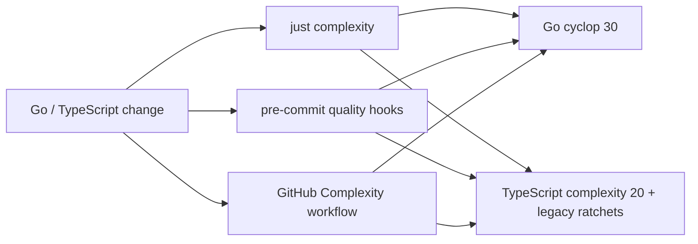

# 圈复杂度门禁

## 目标

仓库对 Go 和前端生产代码持续检查圈复杂度，并在本地提交与 CI 阶段阻止分支结构超过预算。文件总行数和函数行数不再作为自动化门禁；代码职责与可维护性继续通过评审、重复代码检查、静态分析和测试保证。

## Go 策略

- `.golangci-complexity.yml` 仅启用 `cyclop`，生产函数圈复杂度上限为 30。
- `run.tests: false` 将测试文件排除在生产代码复杂度指标之外；测试仍由常规 golangci-lint 和 `go test ./...` 覆盖。
- `scripts/go-complexity.sh` 只枚举当前 Go module 的仓库 package，避免本地 `web/node_modules` 中第三方 Go 源码污染结果。

## TypeScript 与 React 策略

- `web/eslint.complexity.config.js` 使用 ESLint `complexity` 的 `modified` 变体，默认圈复杂度上限为 20。
- `*.test.*`、`*.suite.*` 和 `test-utils.*` 不纳入生产指标；生成文件也不参与手写代码门禁。
- 首次测量已超过默认值的历史文件记录当前最大圈复杂度，作为只能下降的 ratchet；新文件不会继承历史预算。
- 后续拆分热点时应同步下调或删除对应复杂度预算，禁止扩大文件模式或加入 disable 注释。

## 执行链



## 验收

```bash
just complexity
just hooks-run
go test ./... -count=1
cd web && bun test && bun run build && bun run format:check
```

## Go 1.27 分析工具链

Go 编译器与静态分析器必须兼容导出数据格式。Go 1.27.2 的统一导出格式为 V5，
`golangci-lint v2.13.0` 使用的 `x/tools v0.49.0` 仅支持到 V4；只使用 Go 1.27
重新编译同一版本的分析器不能修复解码能力。

分析工具依赖独立维护在 `tools/golangci-lint/go.mod` 和 `go.sum`，固定
`golangci-lint v2.14.0` 与支持 V5 的 `x/tools v0.52.0`，不改变应用模块依赖。
`scripts/golangci-lint.sh` 使用只读依赖模式运行该工具，保留仓库根目录作为分析目录。
本地 just、受管 pre-commit 和三个 Go 分析工作流统一使用此入口，不依赖 PATH 中
分析器的版本。工具模块或入口变更会触发相同的 CI 与提交门禁。

三个 Go 分析工作流从 `tools/golangci-lint/go.mod` 选择 Go 版本，满足分析器及其依赖的最低要求；应用构建继续从根模块选择版本。`GOTOOLCHAIN=local` 下不依赖隐式下载或自动切换。

验收须实际运行 lint、dead-code、complexity 和受管 hooks，不能只检查工具版本输出。
分析规则、排除范围和复杂度预算保持不变，不通过禁用分析器或降低 Go 版本绕过失败。

仓库中可放置其他独立 Git checkout。本仓库 `./...` 分析由 `go-packages.sh` 展开，
根据每个 Go package 的 Git 根目录确定归属，完整保留当前仓库的所有 package（包括
待提交文件所在的 package），不把另一个 Git 仓库的源码或验收 fixture 当作主仓库
独立 package。该规则不按文件名、报错内容或分析器类型排除主仓库代码；CI 与本地
使用相同的归属判断。独立仓库须在其自身构建和验收入口检查。

暂存文件的 package 选择也以 Go 的实际 package 清单为准。标准 `testdata/` 中的
Go 模板是验收输入数据，不单独传给分析器；正常 package 内的测试继续参与检查。
