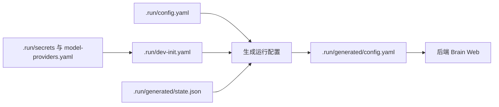
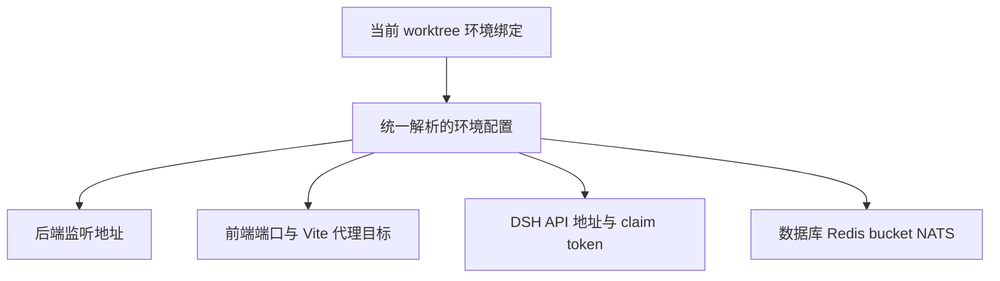
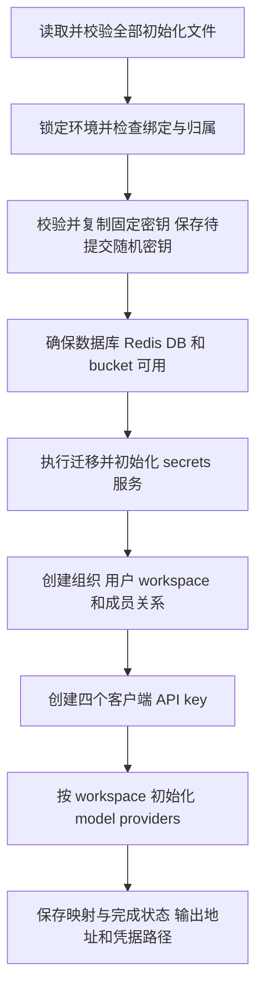

# 多 worktree 开发环境与初始化方案

状态：已实现。初始化 CLI 位于 `cmd/dev-init`（`just dev-init` / `just slot-info`），
核心逻辑在 `internal/devinit`。本文描述当前行为、恢复约定与验收边界。

开发者操作步骤见[本地开发环境使用指南](../development-guide.md)，包括首次初始化、Brain 模式配置和 Herdr 日常重启。

## 目标

每个 worktree 绑定一个固定的本地开发环境，隔离任务领取、数据库迁移、消息、对象存储、登录状态和监听端口。通过一条命令初始化开发账号、组织、两个 workspace、四个 API key，以及从文件读取的 model providers。

每个环境使用独立 Compose 栈，包含 PostgreSQL、Redis、三节点 NATS、MinIO 和 e2b-local。共享 Docker daemon，但网络和卷按项目隔离。外部服务账号的额度和账号级资源仍然共享。

## 命令与日常使用

本地开发统一使用 `.run/`：人工配置与生成状态分层存放。`config/` 中的配置文件
仅作为模板，开发初始化与重启不再读取旧的 `config/config.yaml`。

```text
.run/
  config.yaml
  dev-init.yaml
  model-providers.yaml
  secrets/
  env.json
  generated/
    config.yaml
    state.json
    credentials.json
    stack.env
    e2b-local.yaml
    secrets/
```

`just dev-init` 默认读取 `.run/dev-init.yaml`，也允许显式指定初始化文件。
`fixed_secrets_dir` 和 `model_providers_file` 支持相对于初始化文件目录的路径；
人工密钥放在 `.run/secrets/`，生成密钥副本和 Brain token 放在
`.run/generated/secrets/`。基础配置中的相对路径以 `.run/config.yaml` 的目录解析。



清理环境仅删除 `.run/env.json` 和 `.run/generated/`，保留人工配置与
`.run/secrets/`。这样清理后可以直接重新初始化，不需要重新填写 provider 凭证。
旧布局不自动覆盖迁移，升级时需停止服务并保留环境身份、凭证与输入配置，
再调整路径；操作步骤见开发指南的旧布局迁移部分。

入口如下：

```bash
just dev-init
just slot-info

just restart-server
just restart-web
just restart-brain
```

在 Herdr 终端内执行 `just restart`，可在同一个终端窗口中重启三个服务。
`scripts/restart-dev.sh` 首次创建一个 `OMA services` 标签页，后端位于左侧，
Brain 和 Web 位于右侧上下分屏。重复执行时，在当前 Herdr workspace 中按服务名称
和 worktree 工作目录查找并复用原分屏，只补建缺失的分屏；旧版本创建的同名分屏
也可复用。多个匹配标签页存在时优先选择服务分屏最完整的一组，不自动关闭其他标签页。

重启前识别对应分屏中的服务进程，发送 Ctrl+C 并等待最多 30 秒返回 shell；
分屏中存在其他程序时拒绝中断。从服务分屏自身执行会被拒绝，应在控制分屏执行。
脚本先等待后端输出监听成功，再启动 Brain，等待 Brain ready 后启动 Web；
每次启动使用唯一就绪标记，避免旧日志导致误判。各服务仍调用现有 `restart-*`
入口，使用当前 worktree 的配置和进程归属检查。

三个服务就绪后，脚本汇总输出当前环境的 Web 与 API 完整 HTTP URL。
交互终端使用 OSC 8 超链接，重定向输出或 `TERM=dumb` 时使用纯文本 URL。

每个服务的启动等待默认最多 180 秒，可通过 `HERDR_DEV_START_TIMEOUT_MS` 调整。
超时或命令失败时停止后续启动，保留分屏供排查；已经启动的服务继续运行。
脚本依赖 Herdr、just 和 Bun，必须在 Herdr 内运行。退出或 detach Herdr 客户端
不等于停止服务；在对应分屏按 Ctrl+C 停止服务。

| 命令                       | 职责                                               |
| -------------------------- | -------------------------------------------------- |
| `dev-init [FILE]`          | 默认使用 `.run/dev-init.yaml`，初始化配置、依赖资源、固定密钥和开发数据 |
| `dev-init [FILE] --update` | 显式更新已登记资源的可修改配置                     |
| `slot-info`                | 显示环境名称、访问地址、资源名称和初始化状态       |
| `restart-server`           | 使用当前环境配置重启后端                           |
| `restart-web`              | 使用当前环境的前端端口和后端代理目标               |
| `restart-brain`            | 使用当前环境的 API 地址和 Brain claim token        |

日常重启只读取已准备好的配置，不同步开发数据、不轮换密钥，也不覆盖页面修改。未启用环境初始化的 worktree 保留现有运行方式。

## 环境名称与归属

环境名称从 worktree 路径派生，保存在 `.run/env.json`，绑定后保持稳定。
主 checkout 使用仓库目录名，linked worktree 使用区分该 checkout 的父目录名。
同 clone 内重名由注册表追加后缀。资源身份同时包含独立的 env_id。

- 重复初始化复用同一身份，未完成登记也不会重新分配名字或 env_id。
- 目录移动后用当前真实路径刷新本地绑定和公共 Git 目录中的注册表。
- 旧路径仍存在时拒绝把同一绑定迁移到另一路径，避免复制绑定后接管活跃环境。
- 跨 clone 同名会触发 Docker 资源身份冲突，不能自动复用或删除对方资源。
- 初始化失败保留绑定和恢复状态；三个启动入口拒绝未完成环境。
- `just dev-teardown --yes` 回收本环境；`--orphans --yes` 回收路径已不存在的环境。

## 资源与地址隔离

以名字 `feature-x` 为例：

| 项目 | 配置 |
| --- | --- |
| Compose 项目 | `oma-feature-x` |
| 后端监听地址 | loopback 动态端口，记录在 state.json runtime |
| 前端监听地址 | loopback 动态端口，记录在 state.json runtime |
| 后端稳定地址 | `http://oma-feature-x-api.localhost` |
| 前端稳定地址 | `http://oma-feature-x-web.localhost` |
| Vite 代理目标与 DSH API 地址 | portless 发现的后端名字地址 |
| PostgreSQL、Redis、NATS、MinIO | 本环境 Compose 栈中的独立实例与卷 |
| 数据库和 bucket | 沿用基底配置名称，各栈内部独立 |
| NATS namespace | 本地独立栈使用空值 |
| Brain claim token、客户端 API key | 本环境独立随机生成 |

运行端口由初始化和重启入口探测，不从编号计算。初始化重跑保留已有 API/web
端口；重启先停当前 worktree 旧实例，再探测新端口。基础设施端口以已运行且
归属正确的容器发布信息为准，健康栈复用，异常栈由 Compose 协调恢复。

独立数据库隔离 DSH、Runner、River 后台任务和 goose 迁移版本。任务领取 SQL
不增加环境标签，也不引入 worker pool。

## 前端、后端与 DSH 地址一致性

三个启动入口消费同一份已解析环境配置，不能分别推导端口。



启用环境隔离后：

- 只停止已记录且属于当前 worktree 的实例，再探测新端口；记录中的端口被其他 worktree 或进程占用时拒绝停止对方。
- 重启脚本只停止确认属于当前 worktree 的服务；无法确认归属时明确报错。
- 临时 `PORT`、`API_PORT`、`OMA_API_URL` 等值与绑定配置冲突时，报错，不静默选择其中一个。
- DSH 显式接收当前环境的 API 地址和 claim token，避免 `.env` 中的默认地址覆盖它们。
- 如果配置了 diagnostics 固定监听端口，也需要单独检查冲突。
- 重启后端保留先完成 Go 代码生成、再停止旧服务的顺序。

未启用环境隔离时保留现有脚本语义，包括前端遇到其他 checkout 占用端口时顺延。

浏览器通过 `oma-<name>-web.localhost` 访问，隔离各环境 Cookie。portless 使用纯 HTTP；首次需要 `sudo portless proxy start --no-tls`。未安装 portless 的绑定环境拒绝启动。

前端继续通过现有相对路径和 Vite 代理访问后端，不改变 `/api`、`/v1`、`/auth`、`/oauth`、`/web-api` 的 API 语义。

`tunnel.public_base_url` 可以使用生成的本地地址，但远端 sandbox 或容器需要访问时，必须显式配置其可达地址。不能对所有运行模式强制使用 `127.0.0.1`。

## 初始化后的开发数据

```text
组织：OMA Local
└── 用户：test@oma.ai，组织管理员
    ├── default，默认 workspace
    │   ├── default-key-1
    │   ├── default-key-2
    │   └── model providers
    └── secondary，普通 workspace
        ├── secondary-key-1
        ├── secondary-key-2
        └── model providers
```

- `test@oma.ai` 可以访问两个 workspace，并作为四个 API key 的创建人。
- 普通 workspace 建立对应成员关系；默认 workspace 遵循现有权限规则。
- 新环境只有上述测试账号和四个初始化 API key，不额外创建 `admin@example.local` 或第五个默认 key。
- 登录继续沿用现有邮箱验证码流程，不增加密码登录或新的鉴权绕过。
- 已有数据库不自动删除历史账号、workspace 或 key；无法安全复用时报告冲突。

当前基础 seed 会创建并更新默认用户和资源。启用开发初始化模式后，必须调整其调用关系，使其与文件初始化使用一致的数据来源，防止后续重启把测试用户改回原默认账号。未启用此模式时保留原行为。

## 初始化文件

开发数据通过一个入口文件描述，provider 定义引用独立文件，便于各 worktree 共用。

`dev-init.yaml` 示例：

```yaml
version: 1

fixed_secrets_dir: ./secrets

organization:
  name: OMA Local

user:
  email: test@oma.ai
  name: Local Test
  role: admin

workspaces:
  - ref: default
    name: default
    is_default: true
    api_keys:
      - ref: key-1
        name: default-key-1
      - ref: key-2
        name: default-key-2

  - ref: secondary
    name: secondary
    is_default: false
    api_keys:
      - ref: key-1
        name: secondary-key-1
      - ref: key-2
        name: secondary-key-2

model_providers_file: ./model-providers.yaml
```

`ref` 是初始化配置内的稳定引用，与显示名称分开。API key 的引用在所属 workspace 内唯一。数据库资源继续使用 UUID 和现有 external ID 机制，引用与实际 ID 的映射保存在环境状态中。

组织初始化不假设现有数据库具备组织 external ID 字段，也不按名称自动接管无归属记录。新环境创建后登记组织 UUID；已有默认组织只能经过明确的归属校验后复用。

所有相对文件路径按声明它的配置文件目录解析。严格校验未知字段、重复引用、缺失密钥、默认 workspace 数量以及资源归属。

第一版开发配置要求一个测试用户、一个组织、两个 workspace，并且每个 workspace 声明两个 API key。

## Model provider 文件

`model-providers.yaml` 示例：

```yaml
version: 1

providers:
  - name: primary
    api_backend: messages
    base_url: https://api.anthropic.com
    api_key_env: ANTHROPIC_API_KEY
    model_ids:
      - your-model-id

  - name: compatible
    api_backend: chat_completions
    base_url: https://provider.example
    api_key_file: ./secrets/compatible-api-key
    model_ids:
      - another-model-id
```

- 支持现有 `messages` 和 `chat_completions` backend。
- `api_key`、`api_key_env`、`api_key_file` 必须三选一。
- 两个 workspace 分别创建 provider 记录，使用同一组文件定义。
- provider 密钥经现有 secrets 服务加密后写入当前环境数据库。
- 模型列表以文件为准，初始化时不自动访问上游同步模型。
- 保留现有 URL 校验、模型数量限制和模型归属约束。
- 同一 workspace 内的同名 provider 用于匹配，修改名称视为新增，旧记录不自动删除。
- 密钥是否一致不能通过 last4 判断，应通过现有 secrets 服务解密后在内存比较。

现有 HTTP handler 中的校验和密钥封装应整理到共享业务层，由页面操作和初始化共同调用，避免维护两套业务规则。

## 固定 JWT 与上游代理 CA 密钥

以下两个文件使用固定来源，不为每个环境重新生成：

| 文件                  | 来源                                                                                           |
| --------------------- | ---------------------------------------------------------------------------------------------- |
| 上游代理 CA 私钥      | `/Users/arthur/GolandProjects/open-managed-agents/config/secrets/upstream-proxy-ca-key.pem`    |
| Code Session JWT 私钥 | `/Users/arthur/GolandProjects/open-managed-agents/config/secrets/code-session-jwt-ed25519.pem` |

初始化时按 `fixed_secrets_dir` 读取并复制到当前 worktree：

```text
.run/generated/secrets/upstream-proxy-ca-key.pem
.run/generated/secrets/code-session-jwt-ed25519.pem
```

处理规则：

- 来源必须存在且为有效的对应私钥文件，不输出文件内容。
- 目标不存在时原子复制，目录权限 `0700`，文件权限 `0600`。
- 来源与目标内容相同则跳过；不同则报告冲突，不覆盖。
- 来源缺失时报错，不自动生成替代密钥。
- 来源与目标为同一文件时只校验，不进行自复制。
- 目标文件不纳入 Git，也不提交开发者机器上的私有配置。
- 生成的服务配置使用目标文件的绝对路径。

这两个密钥允许跨环境共用。Brain claim token 和四个 workspace API key 仍按环境独立生成。

## 幂等、更新与凭据保存

| 情况                           | 处理                               |
| ------------------------------ | ---------------------------------- |
| 已登记资源缺失且可确认安全补齐 | 创建并登记                         |
| 已有资源与配置一致             | 跳过                               |
| 已登记资源的可修改配置不同     | 报告差异，使用 `--update` 显式更新 |
| 未登记资源发生名称或身份冲突   | 报错，不自动接管                   |
| 文件移除某项资源               | 保留数据库资源                     |
| API key 已撤销或过期           | 报告状态，不自动恢复               |
| 已登记用户或 workspace 被删除  | 报告冲突，不自动复活               |
| 重复或并发初始化               | 加锁，避免创建副本                 |

`--update` 保留资源 UUID 和 external ID，只更新已登记资源的可修改配置。身份冲突继续报错，不自动迁移组织归属、不删除资源，也不隐式轮换客户端 API key。

四个客户端 API key 和 Brain claim token 使用安全随机值，不从邮箱或环境名称推导。数据库中的客户端 API key 沿用哈希存储。

拟保存以下本地文件：

```text
.run/
  env.json

.run/generated/
  config.yaml
  state.json
  credentials.json
  secrets/
```

- `env.json` 保存名称、环境标识、绑定路径和初始化文件位置。
- `state.json` 保存资源引用、实际 ID、初始化阶段和可恢复状态。
- `credentials.json` 保存客户端 API key 明文、对应 key ID 和 workspace 信息。
- `secrets/` 保存当前环境独立的 Brain claim token 等生成密钥。
- 私有目录权限 `0700`，配置、状态和凭据文件权限 `0600`，全部忽略提交。
- `slot-info` 只显示路径和脱敏信息，不输出密码、token 或私钥。

本地文件与数据库无法共享事务。初始化先原子保存待提交的随机密钥，再写入数据库，提交后标记完成。中断重试复用相同密钥，通过实际资源状态恢复，不重复创建 key。

客户端 key 的明文文件丢失后不能从数据库哈希还原。初始化应报告问题并提供显式轮换入口，不能静默产生新 key。资源映射丢失时也不能仅按名称重建归属。

## 初始化流程与实现边界



使用小型 Go CLI 负责配置解析、初始化和状态查询，Shell 脚本只作为入口及进程管理层。不额外要求安装 `yq`、`psql` 或 `mc`。

组织、用户、workspace、成员关系和 API key 的关联数据库写入保持事务一致。provider 按 workspace 批量写入并沿用模型归属锁。整个初始化跨数据库、文件和对象存储，采用可恢复阶段，不宣称全局事务。

API key 创建必须同时维护 Console 展示记录和实际鉴权记录，复用现有业务语义。不能只插入鉴权表导致页面不可见，或只插入展示表导致 key 无法使用。

所有应用运行时 SQL 使用 Yourbatis。数据库创建和迁移仅在现有启动期维护例外范围内使用原生接口。修改 Mapper 前阅读 `docs/design/be/yourbatis-guidelines.md`，需要 schema 变更时新增 goose migration。

生成的服务配置以当前 worktree 的基底配置为来源。所有现有路径字段先按基底配置目录解析，再写为绝对路径，避免配置移动到 `.run/generated/` 后导致 Vault KEK、manager 等路径失效。原有 Vault 主密钥配置保持可用，不隐式轮换。

初始化失败保留已创建资源和恢复状态，不自动删除数据库或 bucket。重试从实际完成阶段继续；正式启动只接受初始化完成的环境。

## NATS namespace

新增可选配置：

```yaml
nats:
  namespace: s1
```

空值保持现有名称和行为，非空值使用统一规则派生消息名称，例如 `OMA_S1_WORKER_INBOUND` 和 `oma.s1.brain.work.available`。

| 消息路径         | 必须隔离的对象                           |
| ---------------- | ---------------------------------------- |
| Worker 入站事件  | stream、subject、consumer 操作和清理目标 |
| Webhook 投递     | stream、subject、consumer                |
| Brain 唤醒       | subject                                  |
| Session 事件广播 | subject                                  |
| MCP Tunnel       | 命令 stream、命令和响应 subject          |

namespace 在组装层显式传入各消息组件，不使用可变全局变量。发布、订阅、过期扫描和清理使用一致规则，不能只修改 stream 创建名称。

namespace 采用受限格式并在配置边界校验，禁止通配符或会改变 subject 层级的字符。独立 namespace 提供消息隔离，不替代 NATS 账号或 ACL 的安全隔离。

## 文档与交付范围

实现范围包括：

- Go 初始化 CLI、状态查询和恢复逻辑。
- 环境配置、初始化文件和 provider 文件的命名 schema。
- NATS namespace 的完整传递与命名规则。
- server、web、DSH 重启脚本及 `just` 入口。
- 基础 seed 与开发初始化的兼容处理。
- 私有文件忽略规则和权限处理。
- 配置参考、DSH README、重启说明及相关后端设计文档。

配置模型变更同步更新严格 YAML 输入模型、运行时配置映射和配置合同测试。仓库中的示例不得包含真实密钥。

## 验收标准

先覆盖失败场景，再覆盖成功场景：

- 配置非法、密钥缺失、资源归属冲突、端口冲突及 Redis DB 不可用时明确失败。
- 固定私钥内容不一致时不覆盖；来源与目标相同时可重复执行。
- 模型被其他 provider 占用时失败，同一 workspace 批量写入回滚。
- 中断和并发初始化不产生重复用户、workspace 或 API key。
- 凭据或资源映射丢失时不静默换 key、不误接管其他资源。
- 新环境创建 `test@oma.ai`、一个组织、两个 workspace，每个 workspace 两个 key。
- 重复初始化不改变资源 ID 和密钥；重启不把测试账号改回原默认账号。
- 四个 key 在 Console 可见，并正确鉴权到各自 workspace。
- 两个 workspace 都能使用文件配置的 providers。
- 两套环境同时运行时，Runner、DSH、后台任务和 NATS 消息不会跨环境处理。
- 使用相同 Session ID 验证 namespace 隔离，扫描和清理不影响另一环境。
- 两边登录互不覆盖，重启 A 不停止 B 的服务。
- 配置移动后所有相对路径仍正确，前端代理及远端可达地址符合各自配置。
- 未启用开发环境初始化时保持现有行为兼容。

实现后按实际改动执行仓库要求的代码生成、静态检查和单测，包括 Go 的 lint、dead-code、duplicates、complexity，以及前端改动对应的格式、命名、构建和测试检查。

真实双环境集成验收按用户授权范围执行。不得自动运行 `verify-be`；未执行的真实服务、Worker、远端 sandbox 或性能场景需在交付时明确列出。

## 9. 实现说明与初稿差异

实现保留本文全部目标与验收语义，以下细节以代码为准：

- 实现位置：`cmd/dev-init`（CLI 入口）、`internal/devinit`（spec 解析、布局派生、
  注册表、本地状态、固定密钥、编排、配置生成）、`internal/db/dev_init.go` 与
  admin mapper 扩展（组织/用户写入、成员关系、指定明文 key 的双表 API key 插入）。
- 身份是 worktree 的名字：`.run/env.json` 绑定文件随 worktree 走，名字取
  "区分该 checkout 的目录"的 slug——linked worktree 取父目录名（如 codex
  的 `6abc`、手动的 `feature-login`），主 checkout 取仓库 basename
  （`open-managed-agents`）。对外路由与 compose 项目即 `oma-<名字>-api/web`
  与 `oma-<名字>`。名字在绑定时钉死，目录改名后 re-init 通过 env_id 匹配
  刷新注册表路径、名字与栈不变；同 clone 内重名由注册表加后缀（-0000）。
  跨 clone 同名环境在 Docker 资源归属校验时报错，不允许自动复用、重建
  或删除另一 env_id 的资源。整数 slot、
  env_id 短码后缀与 Redis 逻辑 DB 分配都已删除。
- 回收语义：注册表条目只记录名字、env_id、worktree 路径与初始化文件。
  worktree 删除后条目成为孤儿（路径不存在）——孤儿的名字保留不自动复用
  （栈未删，复用会失败）；`just dev-teardown --orphans --yes` 对孤儿的
  compose 项目执行 `down -v`（连数据卷删除）并移除注册表条目，之后新环境
  完整复用名字。本 worktree 环境的显式回收用 `just dev-teardown --yes`
  （不带 --yes 只列出将删除的资源）。
- 端口是运行时状态：初始化与每次重启动态探测空闲 loopback 端口（应用
  40000+/61000+，栈 pg 45432+/redis 46379+/nats 44222+/minio 49000+/
  e2b 43099+ 扫描段），写入 `state.json` 的 `runtime`，重启脚本据此停止
  上一个实例再探测新端口，`dev-init set-runtime --api-port/--web-port`
  重新生成服务配置；没有对外端口算术。
- 基础设施是每环境一个 compose 栈：`deploy/docker-compose/dev-env.yaml`
  定义 postgres/redis/nats（**三节点集群**，与共享拓扑一致）/minio/
  e2b-local，以
  `docker compose -p oma-<name> --env-file .run/generated/stack.env up -d`
  启动。compose 项目名自带 volume/网络前缀隔离，栈内资源用固定名（库
  `claude_api`、bucket `claude-files`、NATS 默认名、namespace 空）；NATS
  三个客户端端口按环境探测发布，监控端口只在 compose 网络内用于
  健康检查；stream replicas 保持默认 3（`tunnel.command_stream.replicas`
  为新增配置项，默认 3）。e2b-local 按环境参数化 `server.addr` 端口与
  `container_name_prefix`，使用 host 网络（要求 Linux Docker Engine 或
  OrbStack，与共享拓扑同一约束）。`set-runtime` 复用健康栈否则 `compose
up -d` 协调重建；teardown 用 `compose down -v` 连数据卷删除；孤儿清理
  按 compose 项目名执行，不依赖原 worktree。未绑定 worktree 继续使用根目录
  共享 compose 拓扑。
- 对外访问使用 portless（`--no-tls`，纯 HTTP）按名字路由：重启入口把
  `oma-<name>-api` / `oma-<name>-web` 注册为静态 alias 指向当前端口，浏览器
  与服务间统一使用 `http://oma-<name>-{api,web}.localhost`（80 端口；未迁移
  到 80 前由 `portless get` 发现实际地址）。未安装 portless 时绑定环境拒绝
  启动；sandbox 面（tunnel.public_base_url）与直接访问仍用裸端口。重启脚本
  自动启动 proxy（80 端口首次需要 sudo）、注册 alias，跨服务引用（Vite 代理
  目标、DSH `OMA_API_URL`）一律走名字。
- 归属登记：同一 Git clone 的名字与 env_id 登记在 Git common dir 的
  `oma-devinit-registry.json`，使用 flock 互斥。创建后立即保存 `.run/env.json`，
  在固定密钥复制和任何基础设施操作前确定环境身份。同一路径的未完成登记在
  重试时复用；目录移动后以当前真实路径和初始化文件位置刷新绑定与注册表。
- Compose 归属：容器、卷和默认网络都包含 `oma.devinit.env_id` 标签。
  每次复用、协调或回收前检查项目下全部现存资源；标签缺失或 env_id 不符均
  拒绝操作。项目级机器本地锁串行化同名环境的检查与操作，防止不同 clone
  同时通过空资源检查。旧的无身份标签资源不会自动接管或删除。
- 初始化阶段：`pending-secrets → infra → migrated → identity → keys →
providers → complete`，每阶段先落盘 `state.json` 再进入下一阶段；重试按
  实际数据库状态对齐，不产生重复用户、workspace 或 API key。
- 固定密钥：按 `fixed_secrets_dir` 原子复制到 `.run/generated/secrets/`
  （目录 0700、文件 0600）；内容一致跳过、不一致报错、同源同文件仅校验。
- 生成的服务配置：`.run/generated/config.yaml` 从基底 `.run/config.yaml`
  派生，路径字段一律写绝对路径；`server.diagnostics_addr` 若配置则派生为
  后端端口 +1；`code_session` 三个密钥文件指向复制后的固定密钥与
  Brain claim token。重启入口只消费该配置，不做端口推导。
- seed 兼容：生成的配置覆写组织、默认 workspace 和用户信息，并显式设置
  `bootstrap.seed_api_keys: []`。四个客户端 key 都由初始化创建，普通启动
  不再 upsert key，因此不会恢复被撤销的 key，也不会改写 Console 展示状态。
- `--update` 目前支持 workspace 重命名与 provider 的 base_url/backend/
  model_ids/密钥更新；组织重命名和用户 email/name 变更报错而不隐式修改。
- 普通 workspace 成员角色实现为 `workspace_admin`；默认 workspace 沿用
  组织管理员继承规则，不额外写成员行。
- NATS namespace 命名规则：`namespace: s1` 时 stream 为
  `OMA_S1_WORKER_INBOUND`、`OMA_S1_WEBHOOK_DELIVERY`、
  `OMA_S1_TUNNEL_COMMANDS_V1`；subject 统一加 `oma.s1.` 前缀
  （worker inbound、brain 唤醒、session 广播、webhook、tunnel 命令与响应）；
  consumer 名前缀 `oma_s1_`。namespace 在配置边界校验
  （`^[a-z0-9][a-z0-9_-]{0,15}$`），组装层显式传入各消息组件。
- `auth.console_url` 校验放宽为：生产环境必须 HTTPS，`env: dev` 允许
  HTTP，使 `http://sN.localhost:<port>` 可用于本地邀请链接。

## 初始化恢复与审查修复

- 数据库写入前保存组织 UUID、用户 external ID、workspace UUID/external ID
  以及每把 API key 的 external ID。`identity_pending` 和 key 的 `pending`
  标记区分尚未完成的写入与已经登记后被删除的资源，禁止自动恢复已删除记录。
- 组织、用户、两个 workspace 及普通 workspace 成员在同一个 Yourbatis 事务
  中创建。事务提交后中断时，重试校验已预留身份，复用已经创建的整组记录。
- API key 明文与预留 external ID 在写入前落盘。每把 key 的 Console 与鉴权
  记录保持事务一致；某把 key 已提交、阶段状态未保存时，按同一 external ID
  找回记录并补齐其余 key，不能生成新身份后重复插入同一 key_hash。
- 运行中的 API/web 端口在基础设施复用和重复初始化时保持原值，只在第一次
  尚无端口记录时探测。端口更换只由重启入口停止旧实例后执行，保留旧实例
  的定位能力。
- 配置生成先解析基底文件路径，最后写入环境专属 claim token、JWT 和 CA
  路径，避免被基底配置重新覆盖。
- Brain 唤醒发布与订阅均使用 broker 的 namespace subject，与其他 NATS
  消息路径遵循相同的隔离规则。
- 孤儿回收不依赖已删除 worktree 的 stack.env，也不使用调用方环境的端口
  配置；先校验目标 Docker 项目归属，再删除栈和卷，成功后移除对应路由及登记。

回归测试覆盖失败重试、目录迁移、跨环境资源拒绝、运行端口保留、密钥路径、
namespace 唤醒隔离，以及真实 PostgreSQL 上的身份事务回滚、部分 key 已提交
后的恢复和撤销状态在 seed 后的保持。真实服务的双环境验收仍须单独执行。
