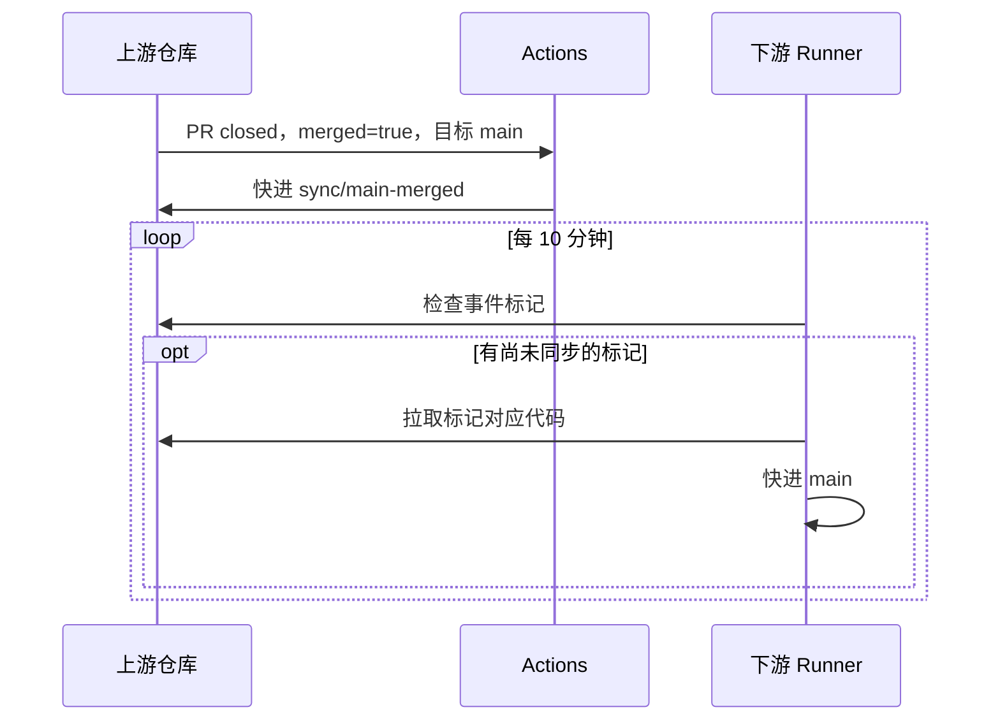

# 主线合并事件标记

上游 `main` 的 PR 合并后，`sync-downstream-main.yml` 将 `sync/main-merged` 分支快进到当前 `main`。下游从自己的网络中检测这个公开 Git 引用，无需上游访问下游，也无需向上游提供下游凭证。

## 事件与权限

使用 `pull_request_target.closed` 并检查 `merged == true`，覆盖来自 fork 的已合并 PR；未合并关闭的 PR 不发布标记。工作流不 checkout、不执行 PR 代码，不插入 PR 标题、分支名等输入，仅从 API 读取当前 `main` 并通过临时 GitHub Token 更新标记。

只有 `superduck-ai/open-managed-agents` 执行此工作流。仅标记作业持有 `contents: write`，不需要长期凭证、仓库 Secret 或下游地址。并发组串行发布标记，每次读取最新主线，不强制更新引用。重复事件不会回退标记；连续合并可以合并处理。GitHub Token 创建的 push 不会递归触发普通 push 工作流。

`workflow_dispatch` 用于初始化标记和补偿发布失败。标记指向代码提交，不包含事件正文、组织信息或下游配置。下游仅使用固定引用，不能把来自上游的内容当作可执行同步脚本。

## 下游检测

下游保留原有每小时同步，并增加每 10 分钟的事件检测。标记等于下游 `main` 时无需拉取历史；下游已经包含标记时也跳过。只有尚未处理的标记才触发快进同步。标记对应最近一次发布时的主线，不因之后的直接 push 而变化；直接 push 仍由每小时任务补齐。

检测任务和每小时任务共用串行锁，不使用强制推送。下游出现分叉时同步失败，由维护者处理。实际延迟还受调度频率限制、Runner 排队和网络影响，这不是秒级 webhook。

## 验证与维护

验证 PR 关闭但未合并时作业跳过；PR 合并和手动补偿能发布标记。下游验证无事件跳过、新标记同步、已处理标记跳过、每小时补齐，以及分叉拒绝。工作流成功只表示标记已发布，实际同步结果以各下游任务为准；代码同步不代表构建或部署通过。

停用此工作流可暂停自动发布，停用下游事件检测可暂停分钟级同步；每小时任务独立保留。完全暂停同步需同时停用下游两类任务。
