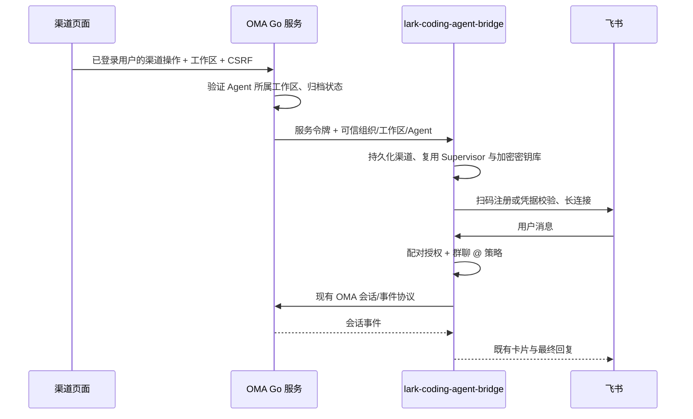

# Agent 飞书渠道

## 产品边界

侧栏「渠道」提供工作区级控制台，对齐火山方舟 Managed Agents 的渠道列表、三步创建/编辑向导和详情页。智能体详情的「渠道」页只跳到工作区渠道，不再创建、编辑、启停、删除或审批配对。首期只接通飞书 IM；钉钉、企业微信和微信在类型选择中展示为不可选。创建表单保持名称（最多 40 字）、不可变的开放/配对模式、扫码/凭据绑定，以及思考过程、工具调用和话题归属开关。控制台每个 Agent 最多 5 个机器人，API 创建数量单独展示。支持编辑、启停、删除、配对批准/拒绝/撤销。

飞书继续复用 OMA 到 `lark-channel` 的既有代理，以及现有绑定、凭据和配对 API。桥接逻辑不迁入 OMA，OMA 数据库仍不保存飞书 App Secret。

开放模式允许消息进入；配对模式要求单聊用户或群聊分别获批，应用创建者不绕过配对。群聊仍必须明确 @ 本机器人。关闭话题归属时整个群复用会话；开启时按话题隔离；私聊始终不创建话题。现有非受管 bridge profile 保留原策略。

## 服务边界



Go 是控制台的唯一后端入口。新增 `internal/channels` 资源，通过已有 Agent Mapper 查验租户归属。工作区专用 OMA 凭据通过独立关联表加密保存。渠道运行数据由 bridge 的配置持久化层管理，OMA 数据库不保存飞书 App Secret。bridge 的 `managed-channels.json` 使用文件锁与原子写入，保存渠道、配对和软删除状态；`config.json` 保存加密密钥引用；App Secret 存入 profile 私有目录的既有 `secrets.enc`。运行目录须使用持久卷，首期部署一个 bridge 控制面实例，不支持跨主机共享本地文件作为高可用数据库。

每次 API 调用先验证 Agent 归属；浏览器不能选择桥接地址、服务令牌或 OMA 运行凭据。bridge 的管理接口只接受独立 Bearer 令牌，拒绝 Origin 和 UI Cookie 鉴权。跨主机连接应由受信私网及 TLS 保护。工作区运行凭据由 OMA 自动创建并同步，必须属于相应组织和工作区，不使用全局默认密钥回退。

## API

智能体渠道路径挂在 `/v1/agents/{agent_id}` 下，与主线 Agent API 一致，不要求 `beta=true`（保留旧参数兼容），复用现有平台会话/API key 鉴权和工作区访问边界。`GET /v1/channels` 是工作区级列表，不挂在某个智能体下面：

渠道资源在进入桥接服务前校验平台 Cookie 会话的变更请求，缺失或错误的 `X-CSRF-Token` 返回 403，且不修改渠道。读取不要求 CSRF；合法 API key 调用继续使用凭据鉴权，不要求 Cookie 或 CSRF。该校验只约束渠道资源，不改变其他 `/v1` 资源的鉴权合同。

| 路径                                           | 方法          | 行为                                |
| ---------------------------------------------- | ------------- | ----------------------------------- |
| `/v1/channels`                                 | GET           | 工作区渠道列表                      |
| `/channels`                                    | GET / POST    | 智能体渠道列表 / 创建               |
| `/channels/settings`                           | GET / POST    | 读取 / 保存智能体渠道环境           |
| `/channels/{channel_id}`                       | POST / DELETE | 修改 / 停止并软删除                 |
| `/channels/{channel_id}/qr`                    | POST / GET    | 创建或复用有效二维码 / 查询扫码状态 |
| `/channels/{channel_id}/pairings`              | GET           | 配对申请及已批准项                  |
| `/channels/{channel_id}/pairings/{pairing_id}` | POST          | `status: approved/rejected`         |

创建参数为 `name`、`mode: open/pairing`、可选 `app_id/app_secret`、`enabled`、`include_thinking`、`include_tool_calls`、`reply_in_thread`。无凭据时先保存未绑定记录。二维码状态为 pending/bound/expired/error；过期或被替代的注册结果不再绑定。中途关闭弹窗保留基础配置，可以继续绑定。密钥不会在列表、更新响应、配对结果中回显；编辑时留空保留原密钥。

配对申请以单聊用户或群聊去重，最多保留 1000 项，不保存聊天正文。拒绝后可在控制台重新批准。启停状态与绑定状态分离，只有已绑定且启用的 profile 才启动。连接启动失败保留配置并显示“连接失败”，可编辑重试或重新启用。删除停止运行并移除活跃 profile，历史 OMA 会话保留。

## 部署

本功能涉及两个 checkout：OMA 与 `lark-coding-agent-bridge`；必须同时部署本次对应版本。

1. 在 bridge 仓库执行 `pnpm install --frozen-lockfile && pnpm build`。
2. 设置 `LARK_CHANNEL_HOME` 为独立、持久化目录；设置 `OMA_CHANNEL_BRIDGE_TOKEN` 为随机服务令牌。
3. 设置桥接 `OMA_BASE_URL` 为可访问的 OMA 服务地址；工作区专用 API Key 由 OMA 自动登记，不再要求手工维护工作区清单。
4. 执行环境在渠道页显式选择，须可用且属于同一工作区。运行 `node dist/managed-channels.js`。默认监听 `127.0.0.1:39100`，可用 `OMA_CHANNEL_BRIDGE_HOST`、`OMA_CHANNEL_BRIDGE_PORT` 调整。该入口也支持既有密钥读取协议。
5. 在 OMA 配置中添加：

```yaml
channel_bridge:
  url: http://127.0.0.1:39100
  token: 与桥接服务完全一致的服务令牌
```

6. 重启 OMA，从侧栏「渠道」或 Agent → 渠道创建飞书机器人。扫码授权由本人在飞书完成；配置凭据需应用已启用机器人、消息接收订阅和相应权限。

未配置 bridge 时页面展示服务不可用，不伪造已连接状态。真实应用创建和消息验收由用户明确授权后执行；本地验收不改变线上部署。

## 验证

- Go：渠道请求的未认证、跨工作区、归档禁写、可信范围转发及浏览器 Cookie 隔离。
- bridge：跨工作区/Agent 隔离、不可切换模式、并发配额、配对申请去重、批准/撤销、删除、创建者不绕过配对、群聊 @ 与话题策略。
- 前端：服务错误、凭据提交、模式和话题开关、工作区及 CSRF 请求头；构建、格式、命名、复杂度和重复预算。
- 真实飞书验收需已授权的测试应用：扫码完成、私聊与群聊、配对前后、话题开关、启停及服务重启恢复。

## 本地实测范围

已在开发 checkout 完成真实飞书扫码、4 条私聊消息收发、中文连续对话和 bridge 重启恢复；多条消息复用同一 OMA 会话。旧沙箱流式预览与最终正文 ID 不同导致的卡片重复，已在 bridge 中修复并实测确认。

工作区渠道列表使用表格（渠道、应用、连通状态、智能体、Environment、操作）。智能体详情不再放渠道表格。删除操作仍在工作区渠道流程里保留确认。

## 工作区渠道控制台

| 路径 | 行为 |
| --- | --- |
| `/channels`、`/workspaces/{workspaceId}/channels` | 工作区渠道列表 |
| `.../channels/new` | 三步创建：渠道类型、基本信息、应用凭据 |
| `.../channels/{agentId}/{channelId}` | 详情 |
| `.../channels/{agentId}/{channelId}/edit` | 编辑向导 |

工作区列表调用 `GET /v1/channels`。OMA 按当前工作区的活跃智能体分页读取，再复用既有桥接 `GET /api/managed-channels` 与 `/settings`（仍带 `X-OMA-Agent`）聚合。查询参数 `limit`（默认 20，最大 100）和 `page`（从 0 起的行偏移）只切分已经聚合好的渠道行，并返回 `next_page`。响应里的渠道对象追加 `agent_id`、`agent_name`、`environment_id`，并去掉 `app_secret`。单个智能体的桥接失败不会失败整次请求：该智能体被跳过，响应 `incomplete: true`。活跃智能体超过 200 个时截断并返回 `truncated: true`。控制台按 `limit=100` 跟随 `next_page`，最多 5 页，再在表格里按 10 条本地分页；不完整或截断时在表上方提示。列表里的应用 ID 写在「飞书」下一行。创建向导在宽屏把步骤条放在表单左侧。Environment 显示工作区环境名称，查不到名称时回落 ID。`/channels/settings` 只接受 `environment_id`，未知字段会被拒绝，因此详情里的 Memory / Vault 继续显示「—」，向导里显示「不挂载」。桥接没有工作区级列表接口，因此服务端仍按智能体扇出。创建向导选择智能体时仍读取智能体列表，渠道的创建、编辑、详情和配对继续走 `/v1/agents/{agent_id}/channels`。

连通状态把已返回的 `enabled`、`binding_status`、`connected` 映射为已连通、待测试、异常、已停用。「连接检测」只根据这些字段提示，不发起新的探测。

详情「会话管理」读取该智能体的 `GET /v1/sessions?agent_id=`。会话列表没有 metadata 查询参数，所以先按智能体分页取回，再在浏览器里过滤。只保留桥接会话（`metadata.source` 为 `lark-channel-bridge`、`lark-channel`、`feishu`、`lark`，或带有 `bridge_binding_id`），并且 `metadata.channel_id` 等于当前渠道 ID。没有 `channel_id` 时，才用 `metadata.app_id` 对照当前渠道的飞书应用 ID。两者都不匹配、或旧会话还没写上这些键时，不显示；同一智能体的其他渠道会话不会混进来。单次最多读取 20 页、每页 100 条，更早的会话可能被截断。三张统计卡只按过滤后的会话计算：会话总数、按 `open_id` / `actor_id` / `sender_id` 去重的来源用户、最近 `updated_at`。有用户标识时统计是去重人数，单元格显示该标识；没有时统计显示「—」，表格回落展示 `scope_id` 并标注「会话范围」，不编造 Open ID。会话来源第一行是渠道名称，第二行是「· 单聊」「· 群聊」或「· 飞书」。`chat_type` 为 `p2p` 或 `group` 时分别显示单聊、群聊，也兼容 `conversation_type` 与 `scope_type`。智能体版本复用会话上的 agent version。「查看详情」进入现有 OMA 会话详情 `/workspaces/{workspaceId}/sessions/{sessionId}`。没有匹配会话时才显示空表。表头始终保留「会话数据同步中」。

Environment 仍是智能体级设置：向导里选中的环境写入该 Agent 的 `/channels/settings`。详情和列表优先显示环境名称。渠道设置没有 Memory / Vault 字段，详情继续显示「—」。本次未做浏览器端到端，也未做真实飞书手测。

### 桥接会话元数据

按渠道隔离依赖 [lark-channel #12](https://github.com/pxguan/lark-channel/pull/12)。桥接在创建、复用和下一次入站合并时写入：

```ts
metadata: {
  source: 'lark-channel-bridge',
  bridge_binding_id: binding.id,
  scope_id: scopeId,
  channel_id: channel.id,
  app_id: channel.appId,
  ...(sender.openId ? { open_id: sender.openId, actor_id: sender.openId } : {}),
  chat_type: chatType === 'p2p' ? 'p2p' : 'group',
}
```

OMA 没有单独的 metadata PATCH。桥接通过 `POST /v1/sessions/{id}` 合并 metadata，只对空闲且未归档的会话生效；会话仍在运行时跳过，已有 `open_id` 不覆盖。部署 #12 之后，新会话和再次收到消息的旧会话才会带上这些键，渠道详情才能拆开。部署前创建、且之后没有新入站消息的会话仍不会出现在任一渠道的会话表里。

上述飞书实测基于开发 checkout，不代表本分支适配最新主线后再次完成全链路验证。群聊、配对及话题开关未做真实飞书验收。本 PR 不包含 bridge 仓库变更，部署前必须准备对应版本的桥接控制面。

飞书分组使用飞书官网的品牌图标（来源：https://www.feishu.cn/favicon.ico），作为本地静态资源随前端打包。

渠道界面文案（含状态、表单校验和无障碍标签）复用现有 i18n catalogs，支持中英文切换。智能体详情的渠道页只检查跳转到工作区渠道。

## 智能体渠道环境

创建向导的 MA 步骤选择执行环境，选项仅包含当前工作区未归档的环境。不提供默认环境或自动选择。保存渠道时把所选环境写入该智能体的渠道设置。智能体详情不再单独提供环境选择器。

`GET /v1/agents/{agent_id}/channels/settings` 返回 `{"environment_id": null}`（未设置）或显式环境 ID；`POST` 必须提交非空环境 ID，不接受清除环境。OMA 验证平台会话 CSRF、Agent 归属和归档状态，并按当前工作区查询环境，拒绝不存在或已归档的环境。桥接控制面对应路径为 `/api/managed-channels/settings`，以组织 UUID、工作区 UUID 和 Agent ID 为保存范围。

保存渠道或发起绑定前，页面先检查是否已选择环境；OMA 再读取当前桥接设置，检查环境仍属于当前工作区且未归档。未选择、已归档或跨工作区的环境返回 400，不转发保存或绑定请求。

桥接 MySQL 模式将选择保存为独立配置记录，文件模式使用独立配置文件。运行配置必须使用智能体显式选择的环境，不回退部署默认值；既有未配置的渠道也须先选择环境。环境配置的修订纳入 MySQL 运行配置代次，使已有机器人重新加载配置；文件模式保存后重新协调当前智能体的机器人。新建 OMA 会话使用所选环境，既有会话继续保留创建时的环境。

本功能需要同时升级 `lark-channel` 桥接服务的 settings 接口、内部工作区凭据登记接口与运行环境解析。OMA 地址和飞书租户身份由部署者配置；OMA 在渠道变更前自动创建或复用当前工作区的专用 API Key 并同步给桥接，不跨工作区复用其他身份。环境选择本身只保存环境设置；凭据创建或同步失败时，不继续执行渠道变更。

## 工作区运行凭据自动登记

创建、启用、修改配置或发起绑定前，OMA 先校验当前智能体的环境，再确保当前组织、工作区拥有一把名为“飞书渠道专用”的 API Key。前端保持现有流程，不增加凭据表单。

`channel_workspace_credentials` 按组织、工作区唯一关联专用 Key 及其加密副本；与现有控制台、鉴权 Key 记录在同一 Yourbatis 事务中创建。使用工作区行锁串行化首次签发，后续请求解密复用。密文的 AAD 绑定组织、工作区和 Key 标识。停用或归档 Key 后返回明确错误，不重新签发以绕过停用；原文不返回浏览器。该 Key 使用现有工作区级权限，没有新增更细的渠道权限模型。

OMA 通过既有服务令牌调用桥接内部 `POST /api/managed-channels/internal/workspace-runtime`，请求仅包含 `api_key`，组织、工作区来自鉴权 Principal。桥接的 OMA 地址由部署 `OMA_BASE_URL` 提供，存储租户使用桥接配置；已有手工配置的存储租户保持不变。工作区凭据与按智能体保存的环境分开管理。需要运行身份的渠道变更前同步同一份凭据，桥接丢失配置或同步失败后可在下一次用户请求恢复，失败时不继续创建渠道。仅提交 `{"enabled":false}` 的停用请求和删除操作不要求执行环境或运行凭据可用；混合修改仍完整校验。配对审批只更新已有渠道的授权列表，复用已有运行身份，不触发凭据签发、同步或恢复。

桥接新增接口应先部署，再部署 OMA；旧桥接不支持时返回“同步渠道工作区凭据失败，请检查桥接版本与配置”。MySQL 新配置按组织、工作区独立加密存储，保留旧整份工作区配置读取兼容；文件模式使用既有加密 keystore。该接口不暴露为 OMA 公共路由，不接受浏览器 Cookie 或 Origin。

### 工作区凭据无法解密时的恢复

凭据 JSON 损坏、旧 Provider 缺失或解密失败会返回“渠道工作区凭据无法解密”，并保留底层错误供服务日志排查。重复请求不更换 Key、不覆盖坏密文；停用或恢复 API Key 不能修复加密材料。

1. 先核对主密钥配置、旧 Provider、KEK 版本和密钥文件。恢复旧解密材料后，按 `docs/design/be/vault-migrate.md` 完成预览、备份、停写和迁移，确认 `channel_workspace_credentials` 无失败记录后再下线旧 Provider。
2. 若信封被损坏，从可信备份恢复同一关联记录的 `envelope`。组织、工作区、API Key 标识必须保持一致，并保留当前 Key 的停用/归档状态，不能复制其他工作区的密文。
3. 若旧密钥与有效备份均已丢失，原凭据无法解密。管理员需在维护窗口停止渠道配置写入并备份，先停用或归档旧专用 Key，再按组织 UUID、工作区 UUID 和 API Key UUID 精确核对并移除损坏的关联记录；保留旧 Key 的审计记录。恢复后，由用户再次发起需运行身份的渠道操作，重新签发并同步新 Key。不得仅清空关联表或保留仍有效的旧 Key。

第三步是显式的运维恢复流程，本版本不新增自动重建或对浏览器开放的凭据重置接口。
