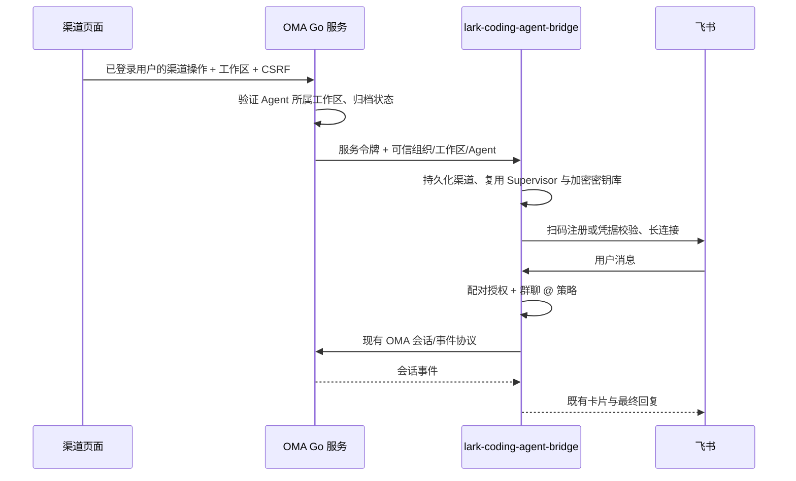

# Agent 飞书渠道

## 产品边界

Agent 详情增加“渠道”页，首期提供飞书 IM 连接管理。参考 Qoder 模板渠道的创建表单：名称（最多 40 字）、不可变的开放/配对模式、扫码/凭据绑定，以及思考过程、工具调用和话题归属开关。控制台每个 Agent 最多 5 个机器人，API 创建数量单独展示。支持编辑、启停、删除、配对批准/拒绝/撤销。

开放模式允许消息进入；配对模式要求单聊用户或群聊分别获批，应用创建者不绕过配对。群聊仍必须明确 @ 本机器人。关闭话题归属时整个群复用会话；开启时按话题隔离；私聊始终不创建话题。现有非受管 bridge profile 保留原策略。

## 服务边界



Go 是控制台的唯一后端入口。新增 `internal/channels` 资源，通过已有 Agent Mapper 查验租户归属，不新增业务 SQL。渠道运行数据由 bridge 的配置持久化层管理，OMA 数据库不保存飞书 App Secret。bridge 的 `managed-channels.json` 使用文件锁与原子写入，保存渠道、配对和软删除状态；`config.json` 保存加密密钥引用；App Secret 存入 profile 私有目录的既有 `secrets.enc`。运行目录须使用持久卷，首期部署一个 bridge 控制面实例，不支持跨主机共享本地文件作为高可用数据库。

每次 API 调用先验证 Agent 归属；浏览器不能选择桥接地址、服务令牌或 OMA 运行凭据。bridge 的管理接口只接受独立 Bearer 令牌，拒绝 Origin 和 UI Cookie 鉴权。跨主机连接应由受信私网及 TLS 保护。工作区运行凭据由部署者分别配置，必须属于相应组织和工作区，不使用全局默认密钥回退。

## API

在现有 `/v1/agents/{agent_id}` 下增加以下路径，与主线 Agent API 一致，不要求 `beta=true`（保留旧参数兼容），复用现有平台会话/API key 鉴权和工作区访问边界：

渠道资源在进入桥接服务前校验平台 Cookie 会话的变更请求，缺失或错误的 `X-CSRF-Token` 返回 403，且不修改渠道。读取不要求 CSRF；合法 API key 调用继续使用凭据鉴权，不要求 Cookie 或 CSRF。该校验只约束渠道资源，不改变其他 `/v1` 资源的鉴权合同。

| 路径                                           | 方法          | 行为                                |
| ---------------------------------------------- | ------------- | ----------------------------------- |
| `/channels`                                    | GET / POST    | 列表 / 创建                         |
| `/channels/{channel_id}`                       | POST / DELETE | 修改 / 停止并软删除                 |
| `/channels/{channel_id}/qr`                    | POST / GET    | 创建或复用有效二维码 / 查询扫码状态 |
| `/channels/{channel_id}/pairings`              | GET           | 配对申请及已批准项                  |
| `/channels/{channel_id}/pairings/{pairing_id}` | POST          | `status: approved/rejected`         |

创建参数为 `name`、`mode: open/pairing`、可选 `app_id/app_secret`、`enabled`、`include_thinking`、`include_tool_calls`、`reply_in_thread`。无凭据时先保存未绑定记录。二维码状态为 pending/bound/expired/error；过期或被替代的注册结果不再绑定。中途关闭弹窗保留基础配置，可以继续绑定。密钥不会在列表、更新响应、配对结果中回显；编辑时留空保留原密钥。

配对申请以单聊用户或群聊去重，最多保留 1000 项，不保存聊天正文。拒绝后可在控制台重新批准。启停状态与绑定状态分离，只有已绑定且启用的 profile 才启动。连接启动失败保留配置并显示“连接失败”，可编辑重试或重新启用。删除停止运行并移除活跃 profile，历史 OMA 会话保留。

## 部署

本功能涉及两个 checkout：OMA 与 `lark-coding-agent-bridge`；必须同时部署本次对应版本。

1. 在 bridge 仓库执行 `pnpm install --frozen-lockfile && pnpm build`。
2. 设置 `LARK_CHANNEL_HOME` 为独立、持久化目录；设置 `OMA_CHANNEL_BRIDGE_TOKEN` 为随机服务令牌。
3. 在该目录创建权限为 0600 的 `managed-channel-workspaces.json`。键使用 OMA 的组织 UUID/工作区 UUID，不使用展示名称或 external ID：

```json
{
  "组织UUID/工作区UUID": {
    "baseUrl": "http://oma-server:38080",
    "apiKey": "${OMA_WORKSPACE_API_KEY}"
  }
}
```

4. 通过部署环境注入该工作区的 `OMA_WORKSPACE_API_KEY`；多个工作区分别使用不同环境变量及独立密钥。执行环境在渠道页显式选择，须可用且属于同一工作区。运行 `node dist/managed-channels.js`。默认监听 `127.0.0.1:39100`，可用 `OMA_CHANNEL_BRIDGE_HOST`、`OMA_CHANNEL_BRIDGE_PORT` 调整。该入口也支持既有密钥读取协议。
5. 在 OMA 配置中添加：

```yaml
channel_bridge:
  url: http://127.0.0.1:39100
  token: 与桥接服务完全一致的服务令牌
```

6. 重启 OMA，进入 Agent → 渠道 → 创建机器人。扫码授权由本人在飞书完成；配置凭据需应用已启用机器人、消息接收订阅和相应权限。

未配置 bridge 时页面展示服务不可用，不伪造已连接状态。真实应用创建和消息验收由用户明确授权后执行；本地验收不改变线上部署。

## 验证

- Go：渠道请求的未认证、跨工作区、归档禁写、可信范围转发及浏览器 Cookie 隔离。
- bridge：跨工作区/Agent 隔离、不可切换模式、并发配额、配对申请去重、批准/撤销、删除、创建者不绕过配对、群聊 @ 与话题策略。
- 前端：服务错误、凭据提交、模式和话题开关、工作区及 CSRF 请求头；构建、格式、命名、复杂度和重复预算。
- 真实飞书验收需已授权的测试应用：扫码完成、私聊与群聊、配对前后、话题开关、启停及服务重启恢复。

## 本地实测范围

已在开发 checkout 完成真实飞书扫码、4 条私聊消息收发、中文连续对话和 bridge 重启恢复；多条消息复用同一 OMA 会话。旧沙箱流式预览与最终正文 ID 不同导致的卡片重复，已在 bridge 中修复并实测确认。

控制台采用飞书分组框，内部每个机器人一张独立卡片，桌面每行 4 张，窄屏为双列或单列。渠道标签与其他智能体标签一致，删除操作放在更多菜单中并保留确认。

上述飞书实测基于开发 checkout，不代表本分支适配最新主线后再次完成全链路验证。群聊、配对及话题开关未做真实飞书验收。本 PR 不包含 bridge 仓库变更，部署前必须准备对应版本的桥接控制面。

飞书分组使用飞书官网的品牌图标（来源：https://www.feishu.cn/favicon.ico），作为本地静态资源随前端打包。

渠道界面文案（含状态、表单校验和无障碍标签）复用现有 i18n catalogs，支持中英文切换；测试覆盖英文表单及校验提示，并锁定二维码与配对请求的上游路径及方法。

## 智能体渠道环境

渠道页在 IM 连接管理之前展示环境选择，选项仅包含当前工作区未归档的环境，并提供环境管理入口。不提供默认环境或自动选择，未设置时显示“选择环境”。选择后立即保存，刷新页面后回显。无编辑权限时只展示当前值，保存失败保留原值并显示错误。

`GET /v1/agents/{agent_id}/channels/settings` 返回 `{"environment_id": null}`（未设置）或显式环境 ID；`POST` 必须提交非空环境 ID，不接受清除环境。OMA 验证平台会话 CSRF、Agent 归属和归档状态，并按当前工作区查询环境，拒绝不存在或已归档的环境。桥接控制面对应路径为 `/api/managed-channels/settings`，以组织 UUID、工作区 UUID 和 Agent ID 为保存范围。

保存渠道或发起绑定前，页面先检查是否已选择环境；OMA 再读取当前桥接设置，检查环境仍属于当前工作区且未归档。未选择、已归档或跨工作区的环境返回 400，不转发保存或绑定请求。

桥接 MySQL 模式将选择保存为独立配置记录，文件模式使用独立配置文件。运行配置必须使用智能体显式选择的环境，不回退部署默认值；既有未配置的渠道也须先选择环境。环境配置的修订纳入 MySQL 运行配置代次，使已有机器人重新加载配置；文件模式保存后重新协调当前智能体的机器人。新建 OMA 会话使用所选环境，既有会话继续保留创建时的环境。

本功能需要同时升级 `lark-channel` 桥接服务的 settings 接口与运行环境解析。工作区 OMA 地址、API Key 和飞书租户身份仍由部署者配置；选择环境不会自动创建凭据，也不会跨工作区复用其他身份。工作区未配置身份时，创建机器人仍会明确失败。
