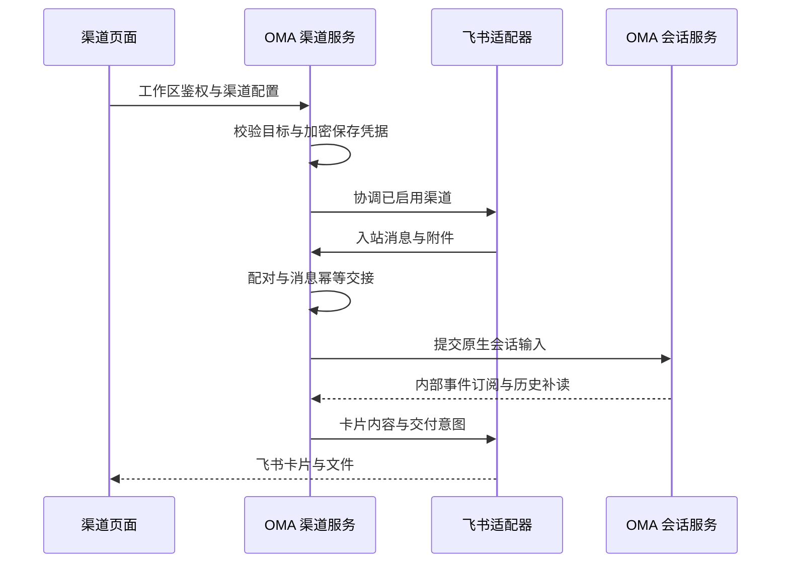

# Agent 飞书渠道

## 产品边界

工作区渠道列表、三步创建/编辑向导和详情页是渠道管理入口。智能体详情不提供独立渠道页。当前仅接通飞书，其他渠道类型展示为暂未开放。共享渠道编排与飞书适配器分离，后续渠道复用同一套 OMA 会话、事件和文件能力。

名称最多 40 字。支持手工凭据和飞书授权、启停、删除、配对批准/拒绝/撤销、思考过程与工具调用展示、话题回复策略、固定智能体版本、执行环境与资源挂载。控制台和 API 不限制每个智能体的渠道数量。

开放模式允许消息进入；配对模式要求单聊用户或群聊分别获批，应用创建者不绕过配对。群聊必须明确 @ 本机器人。关闭话题回复时整个群复用会话，开启时按话题隔离；私聊回复始终平铺。

## 服务边界

Go 是控制台唯一后端入口。`internal/channels` 通过现有 Mapper 验证组织、工作区和智能体归属。渠道、配对、工作区运行凭据、输入交接及平台交付关联持久化在 OMA 数据库中，敏感凭据使用已有信封加密。列表和更新响应不回显 App Secret 或 Git 访问令牌。

渠道和网页 SSE 共用 OMA 内部会话订阅及历史补读链路；同进程渠道不经过 HTTP/SSE，也不按秒轮询会话历史。模型与工具记录以 OMA 为准，渠道仅保存外部输入、会话、事件位置和平台交付的关联。慢消费者不能阻塞公共事件分发。后端合同见 [原生渠道运行时](../be/feishu-channel-runtime.md)、[输入交接](../be/channel-input-handoff.md)及[输入幂等](../be/session-input-idempotency.md)。

## API 与权限

智能体渠道路径挂在 `/v1/agents/{agent_id}/channels` 下，不要求 `beta=true`。工作区级列表、授权及凭据校验位于 `/v1/channels`。浏览器 Cookie 变更请求必须携带合法的 `X-CSRF-Token`；API Key 调用不要求 Cookie 或 CSRF。

工作区 API Key 可以调用渠道列表、创建、更新和连接检查，工作区列表、扫码授权、凭据校验，以及 `/v1/channel_pairings` 的查询和解除绑定。渠道删除、执行环境读写、渠道内旧配对审批，以及渠道二维码 `/qr` 与 `/qr_sessions`，只接受平台登录会话。工作区 API Key 访问这些路径返回 HTTP 404 和 `not_found_error`。这是相对原先这些路径同时接受 API Key 的收窄；公开合同以 `openapi/oma.zh.json` 为准，不包含这些控制台路径。

| 路径 | 方法 | 行为 |
| --- | --- | --- |
| `/v1/channels` | GET | 工作区列表，API Key 可调用 |
| `/v1/channels/authorizations` | POST | 发起工作区飞书授权，API Key 可调用 |
| `/v1/channels/authorizations/{authorization_id}` | GET | 查询授权状态，API Key 可调用 |
| `/v1/channels/credentials/check` | POST | 验证应用凭据，不返回平台令牌，API Key 可调用 |
| `/v1/channels/{channel_id}/qr` | GET / POST | 控制台查询或发起渠道授权 |
| `/v1/channels/{channel_id}/qr_sessions` | POST | 控制台发起扫码会话 |
| `/v1/channels/{channel_id}/qr_sessions/{qr_id}` | GET | 控制台查询扫码会话 |
| `/v1/agents/{agent_id}/channels` | GET / POST | 智能体列表与创建，API Key 可调用 |
| `/v1/agents/{agent_id}/channels/settings` | GET / POST | 控制台读取与保存执行环境 |
| `/v1/agents/{agent_id}/channels/{channel_id}` | POST | 更新渠道，API Key 可调用 |
| `/v1/agents/{agent_id}/channels/{channel_id}` | DELETE | 控制台停止并软删除 |
| `/v1/agents/{agent_id}/channels/{channel_id}/check` | GET | 连接、凭据及配置预检，API Key 可调用 |
| `/v1/agents/{agent_id}/channels/{channel_id}/pairings` | GET | 控制台查看旧配对申请与已批准项 |
| `/v1/agents/{agent_id}/channels/{channel_id}/pairings/{pairing_id}` | POST | 控制台批准、拒绝或撤销旧配对 |
| `/v1/channel_pairings` | GET | 查询范围配对，API Key 可调用 |
| `/v1/channel_pairings/{pairing_id}` | GET / DELETE | 查询或按当前修订号解除绑定，API Key 可调用 |

创建后渠道模式与智能体不可由编辑向导切换。未绑定记录可先保存，绑定和启用状态分离。删除保留已有 OMA 会话。连接检查不等同于模型执行、沙箱就绪、资源实际读取或 Git 检出验证。

## 向导与资源

向导依次配置渠道应用、渠道策略和 MA 策略。第一步未完成接入时禁止进入后续步骤；已绑定渠道编辑时密钥留空保留，切换应用 ID 则必须提供新密钥。应用凭据页链接、验证结果和完整表单文案均走中英文 catalogs。

执行环境必须显式选择，限定当前工作区可用目标。`agent_version: null` 表示新会话使用最新版本，固定版本仅用于后续新会话。默认 Memory、多个 Vault、多个文件和多个 Git 资源复用 OMA 原生资源合同；资源变化后的新输入使用匹配配置的会话，已有会话历史继续保留。

文件选择器提交 File ID 和可选挂载路径，运行时路径位于 `/mnt/session/uploads/`。Git 支持 HTTPS 地址、可选令牌、分支或完整提交 SHA、`/workspace/` 下路径；读取只返回 `tokenConfigured`。保留原配置保存时不丢失服务端令牌。渠道不额外设置附件数量、单文件或整批总大小预算，也不新增这类配置；平台格式和上传约束由飞书适配器处理。

底部操作栏随表单内容排列，不固定覆盖资源字段或“添加资源”按钮。多项资源通过页面滚动编辑，取消不落库，保存后详情与再次编辑必须回显相同配置。

## 运行身份与授权

工作区运行凭据按组织、工作区关联，使用已有事务和加密能力创建、复用。停用或归档后不自动签发新 Key 绕过停用；原文不返回浏览器。仅停用或删除渠道不依赖运行凭据恢复，配对审批不触发凭据重签。

飞书授权独立于智能体：第一步发起工作区授权，完成后第三步提交目标智能体、环境及授权 ID。设备码和凭据不以明文落盘或进入 API 响应。外部领取结果未知时不盲目重放，用户可核对飞书应用后手动填写凭据。凭据解密故障应恢复正确的密钥材料或受控备份；不得清空关联表或自动重签绕过。

## 部署与验证

渠道运行时内置于 OMA，不再部署外置 `lark-channel`。未创建渠道时不建立飞书连接；需要回环 API 地址时使用 `channels.oma_url`，否则由 `server.addr` 推导。旧 bridge 配置仅保留解析兼容。飞书应用需启用机器人、消息接收订阅、卡片回调和对应权限。

验收分别核对页面操作、保存响应、刷新回显和真实会话/平台交付，不能只以成功保存或显示已连接判断通过。原始证据保留在独立本机验收记录，不纳入公开仓库。已验证范围与剩余项见 [迁移验证记录](../be/channel-migration-validation.md)。

工作区渠道列表首次加载返回 503时，页面展示普通「暂无渠道」空态，不显示错误告警。后台刷新失败时保留已有渠道并提示错误，避免丢失已读取的数据。列表对 503 和 4xx 不自动重试，其他错误最多重试一次，保留错误说明和手动重试入口；原有 15 秒刷新继续用于恢复服务后的数据更新。首次加载使用真实表头与三行骨架占位，不再显示整块空框。此降级仅作用于列表展示，不改变 API 错误合同、渠道创建和详情行为，不伪造已连接状态。真实应用创建和消息验收由用户明确授权后执行；本地验收不改变线上部署。

创建向导标题为「创建渠道」。底栏按钮统一右对齐：创建模式第1–2步主按钮为「下一步」，第3步为「保存配置」；编辑模式第1–2步另提供次要「保存配置」按钮，第3步使用主保存按钮。保存仍要求全部必填配置有效。
