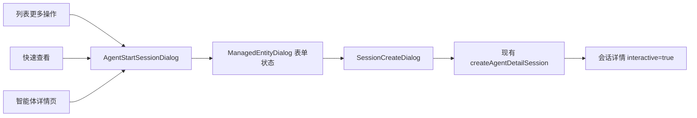

# 智能体列表快速查看与开始对话

## 目标与参考

参考 Claude Console 的智能体列表、快速查看侧栏和创建会话弹窗，在现有控制台中增加列表级查看和开始对话入口。通用交互使用仓库内的 shadcn/ui new-york 组件、Base UI primitives 和语义化主题令牌；浅色与深色主题共用组件。

本次参考用户提供的三张截图。附带的 `platform.claude.com.har` 超过上传工具的 32 MiB 传输上限，未读取其中的 JavaScript 或请求内容。

## 列表与快速查看

- 列表内容居中，最大宽度 1280px。紧凑页头提供创建智能体和文档入口，搜索与筛选紧邻表格；分页仅展示前后箭头，页码保留为读屏文本。
- 表格列为复选框、完整 ID、名称、模型、创建时间、更新时间和操作。日期展示月日，完整时间保留在 `time` 标签提示中。活跃状态通过筛选器控制，归档条目在名称旁展示状态标签。
- 行末在悬停或键盘聚焦时提供快速查看按钮；触摸设备始终显示入口。更多操作菜单提供开始对话和原有的归档操作。名称和 ID 继续链接到完整详情页。
- `AgentListHeader` 和 `AgentListTable` 负责列表展示，表格使用 TanStack Table 行模型和 shadcn Table。`AgentRowActions` 负责行操作，`AgentListOverlays` 负责弹层组合，列表页维持原有搜索、筛选、分页和归档状态。
- 复选框选择当前页未归档的智能体，支持全选和部分选择。选择后展示批量归档入口，使用原有确认弹窗和归档请求。选择范围包含工作区、当前页 ID 和归档状态，搜索、翻页或归档后清空过期选择。
- `AgentQuickView` 使用非模态 `Sheet`，不遮罩列表。桌面显示右侧 480px 面板，窄屏显示全宽面板，正文独立滚动。
- 通过现有 `retrieveAgent` 请求读取当前智能体详情，Query key 包含组织、工作区和智能体 ID。切换条目时不展示上一个条目的内容；加载失败显示错误和重试按钮。
- 面板展示 ID、名称、版本、创建/更新时间、模型、描述、系统提示词、工具和 Skills。工具展示复用 `AgentToolsSection` 的保存快照读取与手动刷新能力。
- 上下条按钮仅遍历当前可见页，边界按钮禁用。打开按钮进入完整详情，关闭按钮和 Escape 由 Base UI 处理。
- 归档智能体允许查看，开始对话按钮和菜单项禁用。切换工作区清空弹层选择。

## 创建会话

- 列表、快速查看和详情页共享 `AgentStartSessionDialog`，固定当前智能体，复用现有 `ManagedEntityDialog` 的表单状态、引用加载、凭据确认和表单校验。会话展示由独立的 `SessionCreateDialog` 承载。
- 会话弹窗桌面宽度为 896px、最小高度为 600px，最小和最大高度都受视口限制；长表单在正文区域滚动，底部仅显示创建会话主按钮。提交期间关闭控件禁用，避免已发出的创建请求失去反馈。
- 从指定智能体发起时省去重复的 Agent 选择框；会话列表创建仍提供 Agent 选择。字段顺序为可选标题、环境、可选凭据库和资源，保留现有默认环境行为。
- 环境与凭据库保留管理入口。会话中的凭据库使用添加按钮、搜索弹层和可移除标签，授权确认及凭据集变化后重置确认的规则保持不变。其他功能中的凭据库选择器保留原有展示。
- 请求继续使用 `/v1/sessions?beta=true`，保持现有 workspace scope、鉴权、CSRF 和资源请求合同。
- 创建失败在弹窗内展示错误，保留填写内容并允许重试；成功关闭弹窗，显示成功提示并进入会话详情的交互模式。
- 截图中的费用预算不在当前会话创建 API 合同中，本次不新增预算字段或费用控制逻辑。

## 验证

- `AgentListInteractions.test.tsx` 覆盖详情读取失败重试、会话创建失败保留输入、上下条切换、创建请求与成功导航、归档状态禁用、批量归档确认和搜索后的选择清理。
- 运行现有智能体与会话创建回归用例、前端构建、格式、命名、复杂度和重复代码门禁。
- 使用 Chromium 和模拟 API 验证明暗主题、Escape 关闭、列表菜单、资源菜单 portal、390px 窄屏侧栏和弹窗。浏览器检查不等价于真实后端、Worker 或模型对话验证。
