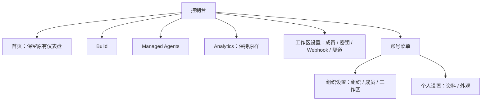

# Console 导航

首页仪表盘保持原有布局、卡片、文案与操作入口。主界面仅调整原 Manage 分组为工作区设置，其他模块与页面保持原样；组织设置仍按已确认方案精简。

## 品牌标识

共享 `BrandLogo` 使用官方 OMA SVG 的原始几何与比例，浅色主题展示深蓝版本，深色主题展示白色版本。控制台、组织设置及个人设置共用侧栏品牌入口，点击返回仪表盘；展开时仅展示完整 OMA 字标，不附加产品名称文字，折叠时隐藏品牌图形，仅保留居中的展开按钮。移动端页头展示完整字标并保留当前标题。桌面端在字标右侧提供独立展开/收起按钮，折叠后顶部仅展示展开按钮，不显示 OMA 字标或 O 图形；按钮复用 `SidebarTrigger` 和现有侧栏状态、Cookie 持久化及快捷键。品牌链接继续只负责返回仪表盘，移动端使用原有导航抽屉开关。

登录页、独立邀请页与鉴权加载状态复用相同标识。浏览器图标采用深蓝底白色 O 图形，在明暗浏览器标签栏中均保持对比度。HTML 引用独立的 OMA SVG 地址，并提供 16/32/48 像素 ICO 后备图标和 180 像素 Apple touch icon；根目录旧 SVG 同步替换，避免继续显示旧标志。品牌链接具有可访问名称和键盘焦点样式，重复的装饰图片不向辅助技术重复播报。

品牌视觉验收覆盖共享外壳下的资源、分析、工作区、组织和个人设置页面，以及明暗主题、折叠侧栏和移动端；浏览器测试数据仅用于视觉验收，不改变应用鉴权或 API 合同。

## 控制台导航

顶层首页、LLM models、API keys 保持原样。Managed Agents 默认展开；Build、Analytics 和工作区设置默认折叠，进入其可见子项时自动展开。用户手动展开的其他分组保持原状态。

- Build：Files、Skills、MCP Servers。真实 Workbench、Batches 仍保留路由，暂时隐藏导航入口。
- Managed Agents：Quickstart、Agents、Sessions、Observability、Deployments、Environments、Credential vaults、Memory stores。
- Analytics 与 Claude Code 的导航定义、可见性和页面保持原有行为。
- 工作区设置：Members、API keys、Webhooks、MCP tunnels（Preview）。密钥、Webhook、隧道使用当前工作区的规范设置路径。Members 使用当前工作区上下文；默认工作区引导到组织成员管理。

组织设置独立侧栏只包含组织、成员、工作区。个人资料与外观入口位于账号菜单，其页面使用个人设置侧栏；账号菜单内的语言与主题切换继续生效。

## 下线页面和兼容入口

组织设置移除账单、限制、管理员密钥、服务账号、工作负载身份、隐私控制、身份和访问页面。工作区设置移除原 Manage 分组中的限制、服务账号、隐私控制、安全入口，对应历史路径显示下线提示。主界面的 Analytics、Playground、Claude Code 和账单等其他页面保留原有实现与路由。

`/settings/api-keys` 重定向到当前工作区的 `/settings/workspaces/{workspaceId}/keys`；`/webhooks` 重定向到对应工作区规范入口。`/settings/billing` 替换历史记录并重定向到保留的 `/billing` 页面，让 Workbench 的 Buy credits 操作和已有链接继续使用原有主界面入口；组织设置不恢复账单导航或模拟配置。主界面原有 `/api-keys` 入口保留。真实后端接口、鉴权、资源页面和 Observability 保持原有行为。

## 验证

组件回归覆盖三项组织导航、个人设置上下文、原有首页内容、中英文展示、已下线页面无模拟操作、工作区导航分组及既有真实资源操作。浏览器验收覆盖首页、账号菜单、组织设置、密钥规范入口与历史 URL。侧栏 rail 和 Session 详情的行为见 [Session 会话 Viewer](sessions/session-conversation-workspace.md)。
