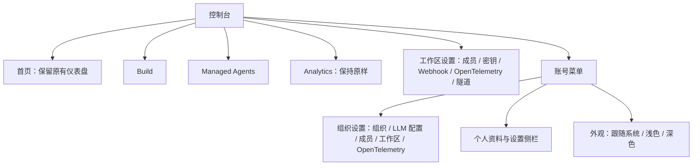

# Console 导航

首页仪表盘保持原有布局、卡片、文案与操作入口。主界面仅调整原 Manage 分组为工作区设置，其他模块与页面保持原样；组织设置仍按已确认方案精简。

## 品牌标识

共享 `BrandLogo` 使用官方 OMA SVG 的原始几何与比例，浅色主题展示深蓝版本，深色主题展示白色版本。控制台、组织设置及个人设置共用侧栏品牌入口，点击返回仪表盘；展开时仅展示完整 OMA 字标，不附加产品名称文字，折叠时隐藏品牌图形，仅保留居中的展开按钮。移动端页头展示完整字标并保留当前标题。桌面端在字标右侧提供独立展开/收起按钮，折叠后顶部仅展示展开按钮，不显示 OMA 字标或 O 图形；按钮复用 `SidebarTrigger` 和现有侧栏状态、Cookie 持久化及快捷键。品牌链接继续只负责返回仪表盘，移动端使用原有导航抽屉开关。

登录页、独立邀请页与鉴权加载状态复用相同标识。浏览器图标采用深蓝底白色 O 图形，在明暗浏览器标签栏中均保持对比度。HTML 引用独立的 OMA SVG 地址，并提供 16/32/48 像素 ICO 后备图标和 180 像素 Apple touch icon；根目录旧 SVG 同步替换，避免继续显示旧标志。品牌链接具有可访问名称和键盘焦点样式，重复的装饰图片不向辅助技术重复播报。

品牌视觉验收覆盖共享外壳下的资源、分析、工作区、组织和个人设置页面，以及明暗主题、折叠侧栏和移动端；浏览器测试数据仅用于视觉验收，不改变应用鉴权或 API 合同。

## 控制台导航

顶层首页、LLM models、API keys 保持原样。Managed Agents 默认展开；Build、Analytics 和工作区设置默认折叠，进入其可见子项时自动展开。用户手动展开的其他分组保持原状态。

- Build：Files、Skills、MCP Servers。真实 Workbench、Batches 仍保留路由，暂时隐藏导航入口。
- Managed Agents：Quickstart、Agents、Sessions、Observability、Deployments、Environments、Credential vaults、Memory stores。
- Analytics 与 Claude Code 的导航定义、可见性和页面保持原有行为。
- 工作区设置：Members、API keys、Webhooks、OpenTelemetry、MCP tunnels（Preview）。密钥、Webhook、OpenTelemetry、隧道使用当前工作区的规范设置路径（`/settings/workspaces/{workspaceId}/telemetry`，`/telemetry` 重定向到当前工作区）。Members 使用当前工作区上下文；默认工作区引导到组织成员管理。

组织设置独立侧栏只包含组织、LLM 配置、成员、工作区、OpenTelemetry。个人资料入口位于账号菜单，其页面使用个人设置侧栏。账号菜单“外观”行直接提供跟随系统、浅色、深色三个图标选项，无需进入外观设置页；个人设置侧栏仍可进入完整外观页面。语言保留原子菜单。

## 左下角账号区与平台返回入口

账号区保持原有 `SidebarMenuButton size="lg"` 的尺寸和圆角，仅菜单打开时使用 sidebar-accent 背景与前景色，不添加常驻背景或额外圆角类，左侧建筑图标，右侧两层文字及 ChevronDown。上层用户名沿用 display_name、full_name、邮箱前缀的优先级；下层显示当前组织名，优先有效 organizationAccess，再取当前 orgUuid 的真实 membership 名称，最后回退 orgUuid，不再展示角色或工作区名。长组织名截断并保留完整 title；用户名不随组织切换改变。

平台管理员进入组织时，下层显示目标组织名，不显示平台标识或角色。组织名可收缩截断，折叠账号区保留建筑图标与用户名可访问名称。

仅 platformScope 存在时，SidebarFooter 在账号区正上方显示独立的全宽圆角“返回平台管理”按钮，带 ArrowLeft 图标，与账号区宽度对齐；折叠时只显示图标，保留完整可访问名称与提示。点击先确认未保存内容，再调用 exitOrganization；成功后导航 `/platform-admin/organizations/{targetOrganizationUuid}`，目标缺失时回退 `/platform-admin`，失败不导航。清除平台与 Console scope 的合同见 [平台超级管理员设计](../platform-super-admin.md)。

账号菜单内只保留带 Shield 图标、直接导航 `/platform-admin` 的“平台管理”一级入口，仍由 `platform:access` 控制可见性；不显示平台进入状态说明或返回项，也不增加弹出子菜单、折叠层级或额外分隔。中英文、明暗主题、窄屏、键盘操作和未保存内容确认均复用现有共享组件。

## 下线页面和兼容入口

组织设置移除账单、限制、管理员密钥、服务账号、工作负载身份、隐私控制、身份和访问页面。工作区设置移除原 Manage 分组中的限制、服务账号、隐私控制、安全入口，对应历史路径显示下线提示。主界面的 Analytics、Playground、Claude Code 和账单等其他页面保留原有实现与路由。

`/settings/api-keys` 重定向到当前工作区的 `/settings/workspaces/{workspaceId}/keys`；`/webhooks` 重定向到对应工作区规范入口。`/settings/billing` 替换历史记录并重定向到保留的 `/billing` 页面，让 Workbench 的 Buy credits 操作和已有链接继续使用原有主界面入口；组织设置不恢复账单导航或模拟配置。主界面原有 `/api-keys` 入口保留。真实后端接口、鉴权、资源页面和 Observability 保持原有行为。

## 验证

组件回归覆盖三项组织导航、个人设置上下文、原有首页内容、中英文展示、已下线页面无模拟操作、工作区导航分组及既有真实资源操作。浏览器验收覆盖首页、账号菜单、组织设置、密钥规范入口与历史 URL。侧栏 rail 和 Session 详情的行为见 [Session 会话 Viewer](sessions/session-conversation-workspace.md)。

## 移动导航动效

移动导航的Sheet Popup保留sidebar数据标记，并复用共享220ms方向滑动及淡入淡出。标记差异不能导致漏用动效；减少动态效果时取消过渡。匹配移动标记的额外条件使用零特异性选择器，避免改变共享Dialog180ms与Popover150ms时长。关闭后键盘焦点回展开入口。

## 内容区固定操作条对齐

图标式侧栏收起时，SidebarInset 内继承的侧栏宽度应反映实际图标栏宽度，不继续使用展开宽度。环境的保存提示条和批量操作条以内容区中心定位，侧栏展开/收起时使用220ms ease-out跟随位置变化；减少动态效果时取消该过渡。宽度覆盖仅发生在内容区，不改变侧栏本身的展开配置。

### 2026-10-26 组织邀请界面复核

- 账号菜单中的邀请弹窗由外层限制视口高度，固定标题、说明和边界，InvitationList在剩余空间内部滚动；独立邀请页保留原有高度与页面结构。列表使用共享4px细滚动条，长组织名可断词完整展示。
- 初始焦点放在弹窗自身，避免自动聚焦“接受”时把长组织名开头滚走；不增加确认步骤，不自动接受邀请。原有接受/拒绝、刷新失败重试、返回路径和组织切换合同不变。
- 邀请加载失败和登录信息失败的说明与重试按钮分行排列。保留原有邀请卡片、圆角、0.5px边界、颜色和动效。
- 390×280样本弹窗从top=-6/bottom=286收敛至16/264，列表124px内部滚动到226px时标题仍在32px位置。实页无待处理邀请，已验证空弹窗和初始焦点；其余使用隔离实际组件，无任何邀请响应写请求。
- invitations-review-2026-10-26归档12组固定主题/尺寸的隔离前后，包含未改动的兼容状态；另有1张真实产品当前观察和1张隔离滚动观察。未将截图数量视为独立修复数量或全站完成。

### 2026-10-26 账号菜单内直接切换外观

外观行左侧保留图标和名称，右侧用紧凑分段选项展示显示器、太阳、月亮，分别代表跟随系统、浅色、深色。复用DropdownMenu RadioGroup/RadioItem，提供本地化可访问名称、悬停标题、互斥选中语义及菜单原生键盘导航；中性轨道和选中表面沿用现有new-york样式，不增加子菜单或重复说明。

选择直接调用既有ThemeProvider.setMode并保留菜单，不触发路由跳转；使用既有本机主题持久化与系统主题监听，不新增主题存储或请求。个人资料和完整外观设置路由保持可用。相关回归覆盖中英文三种模式、即时应用、菜单保持、无导航和重新挂载后的选择恢复。

account-appearance-review-2026-10-26保留真实菜单前后截图及深浅主题细节，实际点击深色、刷新恢复、键盘切换浅色、恢复原有system均已核对。定向47/0，全量1410/0（150文件），格式、构建、命名、重复、Go1.27.2及前端复杂度、diff通过。只变更本机外观偏好，验收后恢复原值；没有组织、权限或账号服务端写操作。
