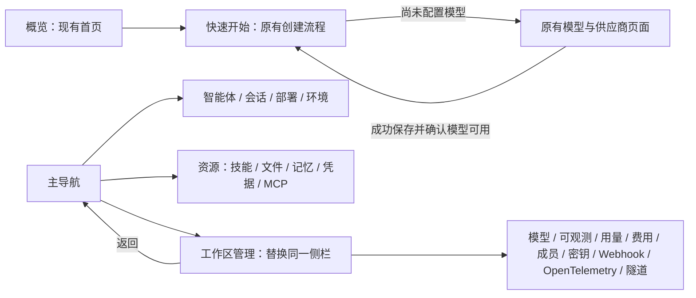

# Console 导航

首页仪表盘保持原有布局、卡片、文案与操作入口。本次只调整主侧栏组织方式和快速开始缺少模型时的设置往返，保留所有模块的页面、路由、权限、数据与交互。左下角账号菜单和组织、个人设置侧栏保持原样。

## 品牌标识

共享 `BrandLogo` 使用官方 OMA SVG 的原始几何与比例，浅色主题展示深蓝版本，深色主题展示白色版本。控制台、组织设置及个人设置共用侧栏品牌入口，点击返回仪表盘；展开时仅展示完整 OMA 字标，不附加产品名称文字，折叠时隐藏品牌图形，仅保留居中的展开按钮。移动端页头展示完整字标并保留当前标题。桌面端在字标右侧提供独立展开/收起按钮，折叠后顶部仅展示展开按钮，不显示 OMA 字标或 O 图形；按钮复用 `SidebarTrigger` 和现有侧栏状态、Cookie 持久化及快捷键。品牌链接继续只负责返回仪表盘，移动端使用原有导航抽屉开关。

登录页、独立邀请页与鉴权加载状态复用相同标识。浏览器图标采用深蓝底白色 O 图形，在明暗浏览器标签栏中均保持对比度。HTML 引用独立的 OMA SVG 地址，并提供 16/32/48 像素 ICO 后备图标和 180 像素 Apple touch icon；根目录旧 SVG 同步替换，避免继续显示旧标志。品牌链接具有可访问名称和键盘焦点样式，重复的装饰图片不向辅助技术重复播报。

品牌视觉验收覆盖共享外壳下的资源、分析、工作区、组织和个人设置页面，以及明暗主题、折叠侧栏和移动端；浏览器测试数据仅用于视觉验收，不改变应用鉴权或 API 合同。

## 控制台导航

主导航依次为概览、快速开始、智能体、会话、部署、环境、资源。概览沿用现有 DashboardHome，不把首次使用或模型缺失状态替换为创建表单。快速开始仍进入现有 AgentQuickstartPage，保留对话构建与手动配置；本次不重做 Builder、Wizard、Session、Deployment 或 Environment 内容。

资源在宽度大于 1100px 且高度大于 780px 的窗口默认展开，窄窗口或较矮窗口默认收起；可手动展开或收起，进入具体资源页面时自动展开。子项按已确认的中文名称长度排列：技能、文件、记忆存储、凭据保险库、MCP 服务器。子项带 Central 图标，相对主项图标缩进 12px；整行选中背景使用 Radix Slate 4，无左侧色条和层级竖线。滚动条隐藏但保留滚轮、触控与键盘操作。折叠状态下主项保留可访问名称，点击资源恢复完整目录。

文档下方提供带向右箭头的工作区管理入口，点击恢复当前账号、组织和工作区上次访问的管理模块；没有有效记录时进入模型目录，同时在同一个主侧栏替换为工作区管理目录；顶部返回主导航恢复进入前的工作页面。目录路由直接加载时，返回概览；从快速开始的模型引导进入则返回同工作区、同创建方式的快速开始。进入目录从右侧滑入，返回从左侧滑入，240ms；减少动态效果模式直接切换。内容区不新增侧栏或设置标签页。

| 工作区管理入口                    | 保留的原模块与路由                                     |
| --------------------------------- | ------------------------------------------------------ |
| LLM 模型                          | 当前工作区 llm-models，组织共享管理逻辑不变            |
| 可观测                            | 当前工作区 observability，原运行视图完整保留           |
| 用量、费用                        | /usage 与工作区 cost，作用域、筛选、计量与费用逻辑不变 |
| 缓存、速率限制、日志              | 仅保留旧路由，因目前仅为未接入占位页，从目录隐藏       |
| 成员                              | /members，原工作区与默认工作区处理不变                 |
| API 密钥                          | 当前工作区规范 keys 路径；移除重复侧栏入口，不移除功能 |
| Webhooks、OpenTelemetry、MCP 隧道 | 原工作区规范设置路径，隧道不再展示 Preview 标记        |

可观测与 OpenTelemetry 是现有两个独立模块，本次只收敛入口，不按早期交互稿合并页面。原有 23 个目的地址的路由保留，其中缓存、速率限制、日志从可见目录隐藏，其余 20 个目的地址继续展示。Workbench、Batches、Claude Code 保持原有隐藏状态与可用路由，不恢复已下线模块。

组织设置独立侧栏、个人资料和外观、账号菜单的外观与语言选项、组织切换、平台管理与返回入口均不改变。主导航使用 Central Icon System 的已保存图标几何；来源和许可保留在 layout/icons，个人菜单及其他页面原图标不替换。

## 首次使用与模型配置往返

没有智能体时，概览继续展示原有首页，智能体、会话、部署各自使用已有模块空状态。不会依据资源是否为空自动把首页替换为快速开始。

快速开始的模型查询继续区分加载、加载失败、无模型与无权限；只有确认模型未配置才展示既有配置引导。配置链接附带同工作区快速开始的 returnTo，保留 mode=chat|api。模型表单的字段、验证、发现、保存、错误和退出生命周期保持不变。

只有本次表单保存成功且完成关闭后，才额外查询已有模型列表；确认有可用模型且用户仍停留原设置地址时返回快速开始。空模型供应商、保存失败、取消、模型列表读取失败均不自动跳转，留在原模型页面；用户可通过侧栏返回。普通模型管理没有 returnTo 时保持原行为。返回目标只接受当前工作区规范快速开始路径，拒绝外站、其他工作区和其他模块地址。

## 左下角账号区与平台返回入口

账号区保持原有 `SidebarMenuButton size="lg"` 的尺寸和圆角，仅菜单打开时使用 sidebar-accent 背景与前景色，不添加常驻背景或额外圆角类，左侧建筑图标，右侧两层文字及 ChevronDown。上层用户名沿用 display_name、full_name、邮箱前缀的优先级；下层显示当前组织名，优先有效 organizationAccess，再取当前 orgUuid 的真实 membership 名称，最后回退 orgUuid，不再展示角色或工作区名。长组织名截断并保留完整 title；用户名不随组织切换改变。

平台管理员进入组织时，下层显示目标组织名，不显示平台标识或角色。组织名可收缩截断，折叠账号区保留建筑图标与用户名可访问名称。

仅 platformScope 存在时，SidebarFooter 在账号区正上方显示独立的全宽圆角“返回平台管理”按钮，带 ArrowLeft 图标，与账号区宽度对齐；折叠时只显示图标，保留完整可访问名称与提示。点击先确认未保存内容，再调用 exitOrganization；成功后导航 `/platform-admin/organizations/{targetOrganizationUuid}`，目标缺失时回退 `/platform-admin`，失败不导航。清除平台与 Console scope 的合同见 [平台超级管理员设计](../platform-super-admin.md)。

账号菜单内只保留带 Shield 图标、直接导航 `/platform-admin` 的“平台管理”一级入口，仍由 `platform:access` 控制可见性；不显示平台进入状态说明或返回项，也不增加弹出子菜单、折叠层级或额外分隔。中英文、明暗主题、窄屏、键盘操作和未保存内容确认均复用现有共享组件。

## 下线页面和兼容入口

组织设置移除账单、限制、管理员密钥、服务账号、工作负载身份、隐私控制、身份和访问页面。工作区设置移除原 Manage 分组中的限制、服务账号、隐私控制、安全入口，对应历史路径显示下线提示。主界面的 Analytics、Playground、Claude Code 和账单等其他页面保留原有实现与路由。

`/settings/api-keys` 重定向到当前工作区的 `/settings/workspaces/{workspaceId}/keys`；`/webhooks` 重定向到对应工作区规范入口。`/settings/billing` 替换历史记录并重定向到保留的 `/billing` 页面，让 Workbench 的 Buy credits 操作和已有链接继续使用原有主界面入口；组织设置不恢复账单导航或模拟配置。主界面原有 `/api-keys` 入口保留。真实后端接口、鉴权、资源页面和 Observability 保持原有行为。

## 验证

组件回归覆盖三项组织导航、个人设置上下文、原有首页内容、中英文展示、已下线页面无模拟操作、工作区导航分组及既有真实资源操作。浏览器验收覆盖首页、账号菜单、组织设置、密钥规范入口与历史 URL。侧栏 rail 和 Session 详情的行为见 [Session 会话 Viewer](sessions/session-conversation-workspace.md)。

## 移动导航动效

移动导航的Sheet Popup保留sidebar数据标记，并复用共享220ms方向滑动及淡入淡出。标记差异不能导致漏用动效；减少动态效果时取消过渡。匹配移动标记的额外条件使用零特异性选择器，避免改变共享Dialog180ms与Popover150ms时长。关闭后键盘焦点回展开入口。

## 内容区固定操作条对齐

图标式侧栏收起时，SidebarInset 内继承的侧栏宽度应反映实际图标栏宽度，不继续使用展开宽度。环境的保存提示条和批量操作条以内容区中心定位，侧栏展开/收起时使用220ms ease-out跟随位置变化；减少动态效果时取消该过渡。宽度覆盖仅发生在内容区，不改变侧栏本身的展开配置。

### 2026-10-26 组织邀请界面复核

- 账号菜单中的邀请弹窗由外层限制视口高度，固定标题、说明和边界，InvitationList在剩余空间内部滚动；独立邀请页保留原有高度与页面结构。列表使用共享4px细滚动条，长组织名可断词完整展示。
- 初始焦点放在弹窗自身，避免自动聚焦“接受”时把长组织名开头滚走；不增加确认步骤，不自动接受邀请。原有接受/拒绝、刷新失败重试、返回路径和组织切换合同不变。
- 邀请加载失败和登录信息失败的说明与重试按钮分行排列。保留原有邀请卡片、圆角、0.5px边界、颜色和动效。
- 390×280样本弹窗从top=-6/bottom=286收敛至16/264，列表124px内部滚动到226px时标题仍在32px位置。实页无待处理邀请，已验证空弹窗和初始焦点；其余使用隔离实际组件，无任何邀请响应写请求。
- invitations-review-2026-10-26归档12组固定主题/尺寸的隔离前后，包含未改动的兼容状态；另有1张真实产品当前观察和1张隔离滚动观察。未将截图数量视为独立修复数量或全站完成。

### 2026-10-26 账号菜单内直接切换外观

外观行左侧保留图标和名称，右侧用紧凑分段选项展示显示器、太阳、月亮，分别代表跟随系统、浅色、深色。复用DropdownMenu RadioGroup/RadioItem，提供本地化可访问名称、悬停标题、互斥选中语义及菜单原生键盘导航；中性轨道和选中表面沿用现有new-york样式，不增加子菜单或重复说明。

选择直接调用既有ThemeProvider.setMode并保留菜单，不触发路由跳转；使用既有本机主题持久化与系统主题监听，不新增主题存储或请求。个人资料和完整外观设置路由保持可用。相关回归覆盖中英文三种模式、即时应用、菜单保持、无导航和重新挂载后的选择恢复。

account-appearance-review-2026-10-26保留真实菜单前后截图及深浅主题细节，实际点击深色、刷新恢复、键盘切换浅色、恢复原有system均已核对。定向47/0，全量1410/0（150文件），格式、构建、命名、重复、Go1.27.2及前端复杂度、diff通过。只变更本机外观偏好，验收后恢复原值；没有组织、权限或账号服务端写操作。

## 控制台侧栏布局与状态

展开宽度在大于 1200px 的桌面窗口为 224px，其余桌面为 204px；图标栏为 64px，手机抽屉为 238px。导航使用 14px 文字、36px 行高、4px 主菜单间距；手机触控行高至少 40px。主入口图标为 18px，资源子项为 16px，子项相对主项缩进 12px。图标栏控件居中对齐，保留可访问名称与提示。

侧栏底色与选中背景使用 Radix Slate 2 / Slate 4，不添加选中色条。工作区选择器和侧栏开关默认透明，无边框或阴影，仅悬停或打开时呈现背景。工作区列表在选择器下方打开。文档位于导航滚动区域之外、账号区上方，不使用额外占位高度。

工作区目录保留三个分组，组内按已确认的中文名称长度固定排序，切换语言不重排：

- 模型与访问：成员、LLM 模型、API 密钥。
- 用量与运行：用量、成本、可观测。
- 集成：MCP 隧道、Webhooks、OpenTelemetry。

管理入口用 localStorage 按账号 UUID、组织 UUID 和工作区 ID 保存最近访问的可见模块键。只保存模块，不保存详情 ID、查询参数、筛选或表单内容；重新进入时使用当前工作区生成地址。无记录、无效记录、隐藏模块或存储不可用时回退 LLM 模型。路由与当前工作区不匹配时不写入记录。

资源分组在路由变化或跨越宽高媒体条件时重新采用自动展开规则，普通重渲染不覆盖手动选择。进入资源子页面时优先展开，保证选中项可见；窄窗口和矮窗口仍可手动展开。

回归应覆盖主导航与工作区目录往返、历史入口隔离、模型配置返回、资源自动与手动展开、折叠图标对齐、底部文档、手机抽屉以及减少动态效果。浏览器隔离数据用于验证导航与外观，不替代真实业务后端集成。
