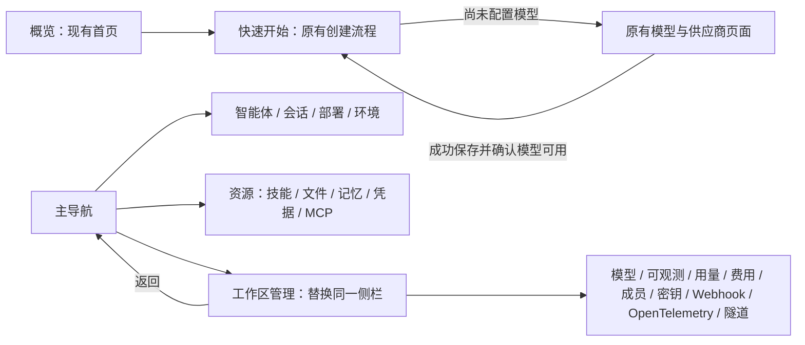

# Console 导航

首页仪表盘保持原有布局、卡片、文案与操作入口。本次只调整主侧栏组织方式和快速开始缺少模型时的设置往返，保留所有模块的页面、路由、权限、数据与交互。左下角账号菜单和组织、个人设置侧栏保持原样。

## 品牌标识

共享 `BrandLogo` 使用官方 OMA SVG 的原始几何与比例，浅色主题展示深蓝版本，深色主题展示白色版本。控制台、组织设置及个人设置共用侧栏品牌入口，点击返回仪表盘；展开时仅展示完整 OMA 字标，不附加产品名称文字，折叠时隐藏品牌图形，仅保留居中的展开按钮。移动端页头展示完整字标并保留当前标题。桌面端在字标右侧提供独立展开/收起按钮，折叠后顶部仅展示展开按钮，不显示 OMA 字标或 O 图形；按钮复用 `SidebarTrigger` 和现有侧栏状态、Cookie 持久化及快捷键。品牌链接继续只负责返回仪表盘，移动端使用原有导航抽屉开关。

登录页、独立邀请页与鉴权加载状态复用相同标识。浏览器图标采用深蓝底白色 O 图形，在明暗浏览器标签栏中均保持对比度。HTML 引用独立的 OMA SVG 地址，并提供 16/32/48 像素 ICO 后备图标和 180 像素 Apple touch icon；根目录旧 SVG 同步替换，避免继续显示旧标志。品牌链接具有可访问名称和键盘焦点样式，重复的装饰图片不向辅助技术重复播报。

品牌视觉验收覆盖共享外壳下的资源、分析、工作区、组织和个人设置页面，以及明暗主题、折叠侧栏和移动端；浏览器测试数据仅用于视觉验收，不改变应用鉴权或 API 合同。

## 控制台导航

主导航依次为概览、快速开始、智能体、会话、评测、部署、环境、资源。评测只包含评测集。概览沿用现有 DashboardHome，不把首次使用或模型缺失状态替换为创建表单。快速开始仍进入现有 AgentQuickstartPage，保留对话构建与手动配置；本次不重做 Builder、Wizard、Session、Deployment 或 Environment 内容。

资源在宽度大于 1100px 且高度大于 780px 的窗口默认展开，窄窗口或较矮窗口默认收起；可手动展开或收起，进入具体资源页面时自动展开。子项按已确认的中文名称长度排列：技能、文件、记忆存储、凭据保险库、MCP 服务器。子项带 Central 图标，相对主项图标缩进 12px；整行选中背景使用 Radix Slate 4，无左侧色条和层级竖线。滚动条隐藏但保留滚轮、触控与键盘操作。折叠状态下主项保留可访问名称，点击资源恢复完整目录。

文档下方提供带向右箭头的工作区管理入口，点击恢复当前账号、组织和工作区上次访问的管理模块；没有有效记录时进入模型目录，同时在同一个主侧栏替换为工作区管理目录；顶部返回主导航恢复进入前的工作页面。目录路由直接加载时，返回概览；从快速开始的模型引导进入则返回同工作区、同创建方式的快速开始。进入目录从右侧滑入，返回从左侧滑入，240ms；减少动态效果模式直接切换。内容区不新增侧栏或设置标签页。

| 工作区管理入口 | 保留的原模块与路由 |
| --- | --- |
| LLM 模型 | 当前工作区 llm-models，组织共享管理逻辑不变 |
| 可观测 | 当前工作区 observability，原运行视图完整保留 |
| 用量、费用 | /usage 与工作区 cost，作用域、筛选、计量与费用逻辑不变 |
| 缓存、速率限制、日志 | 仅保留旧路由，因目前仅为未接入占位页，从目录隐藏 |
| 成员 | /members，原工作区与默认工作区处理不变 |
| API 密钥 | 当前工作区规范 keys 路径；移除重复侧栏入口，不移除功能 |
| Webhooks、OpenTelemetry、MCP 隧道 | 原工作区规范设置路径，隧道不再展示 Preview 标记 |

可观测与 OpenTelemetry 是现有两个独立模块，本次只收敛入口，不按早期交互稿合并页面。原有 23 个目的地址的路由保留，其中缓存、速率限制、日志从可见目录隐藏，其余 20 个目的地址继续展示。Workbench、Batches、Claude Code 不进入导航配置；保留原有可用路由，不恢复已下线模块。

组织设置独立侧栏、个人资料和外观、账号菜单的外观与语言选项、组织切换、平台管理与返回入口均不改变。主导航使用 Central Icon System 的已保存图标几何；来源和许可保留在 layout/icons，个人菜单及其他页面原图标不替换。

## 首次使用与模型配置往返

没有智能体时，概览继续展示原有首页，智能体、会话、部署各自使用已有模块空状态。不会依据资源是否为空自动把首页替换为快速开始。

快速开始的模型查询继续区分加载、加载失败、无模型与无权限；只有确认模型未配置才展示既有配置引导。配置链接附带同工作区快速开始的 returnTo，保留 mode=chat|api。模型表单的字段、验证、发现、保存、错误和退出生命周期保持不变。

只有本次表单保存成功且完成关闭后，才额外查询已有模型列表；确认有可用模型且用户仍停留原设置地址时返回快速开始。空模型供应商、保存失败、取消、模型列表读取失败均不自动跳转，留在原模型页面；用户可通过侧栏返回。普通模型管理没有 returnTo 时保持原行为。返回目标只接受当前工作区规范快速开始路径，拒绝外站、其他工作区和其他模块地址。

## 左下角账号区与平台返回入口

账号区保持原有 `SidebarMenuButton size="lg"` 的尺寸和圆角，仅菜单打开时使用 sidebar-accent 背景与前景色，不添加常驻背景或额外圆角类，左侧建筑图标，右侧两层文字及 ChevronDown。上层用户名沿用 display_name、full_name、邮箱前缀的优先级；下层显示当前组织名，优先有效 organizationAccess，再取当前 orgUuid 的真实 membership 名称，最后回退 orgUuid，不再展示角色或工作区名。长组织名截断并保留完整 title；用户名不随组织切换改变。

平台管理员进入组织时，下层显示目标组织名，不显示平台标识或角色。组织名可收缩截断，折叠账号区保留建筑图标与用户名可访问名称。

仅 platformScope 存在时，SidebarFooter 在账号区正上方显示独立的全宽圆角“返回平台管理”按钮，带 ArrowLeft 图标，与账号区宽度对齐；折叠时只显示图标，保留完整可访问名称与提示。点击先确认未保存内容，再调用 exitOrganization；成功后导航 `/platform-admin/organizations/{targetOrganizationUuid}`，目标缺失时回退 `/platform-admin`，失败不导航。清除平台与 Console scope 的合同见 [平台超级管理员设计](../platform-super-admin.md)。

账号菜单内只保留带 Shield 图标、直接导航 `/platform-admin` 的“平台管理”一级入口，仍由 `platform:access` 控制可见性；不显示平台进入状态说明或返回项，也不增加弹出子菜单、折叠层级或额外分隔。中英文、明暗主题、窄屏、键盘操作和未保存内容确认均复用现有共享组件。

## 下线页面和兼容入口

组织设置移除账单、限制、管理员密钥、服务账号、工作负载身份、隐私控制、身份和访问页面。工作区设置移除原 Manage 分组中的限制、服务账号、隐私控制、安全入口，对应历史路径显示下线提示。主界面的 Analytics、Playground、Claude Code 和账单等其他页面保留原有实现与路由。

`/settings/api-keys` 重定向到当前工作区的 `/settings/workspaces/{workspaceId}/keys`；`/webhooks` 重定向到对应工作区规范入口。`/settings/billing` 替换历史记录并重定向到保留的 `/billing` 页面，让 Workbench 的 Buy credits 操作和已有链接继续使用原有主界面入口；组织设置不恢复账单导航或模拟配置。主界面原有 `/api-keys` 入口保留。真实后端接口、鉴权、资源页面和 Observability 保持原有行为。

## 验证

组件回归覆盖三项组织导航、个人设置上下文、原有首页内容、中英文展示、已下线页面无模拟操作、工作区导航分组及既有真实资源操作。浏览器验收覆盖首页、账号菜单、组织设置、密钥规范入口与历史 URL。侧栏 rail 和 Session 详情的行为见 [Session 会话 Viewer](sessions/session-conversation-workspace.md)。

## 移动导航动效

移动导航的Sheet Popup保留sidebar数据标记，并复用共享220ms方向滑动及淡入淡出。标记差异不能导致漏用动效；减少动态效果时取消过渡。匹配移动标记的额外条件使用零特异性选择器，避免改变共享Dialog180ms与Popover150ms时长。关闭后键盘焦点回展开入口。

## 内容区固定操作条对齐

图标式侧栏收起时，SidebarInset 内继承的侧栏宽度应反映实际图标栏宽度，不继续使用展开宽度。环境的保存提示条和批量操作条以内容区中心定位，侧栏展开/收起时使用220ms ease-out跟随位置变化；减少动态效果时取消该过渡。宽度覆盖仅发生在内容区，不改变侧栏本身的展开配置。

### 2026-10-26 组织邀请界面复核

- 账号菜单中的邀请弹窗由外层限制视口高度，固定标题、说明和边界，InvitationList在剩余空间内部滚动；独立邀请页保留原有高度与页面结构。列表使用共享4px细滚动条，长组织名可断词完整展示。
- 初始焦点放在弹窗自身，避免自动聚焦“接受”时把长组织名开头滚走；不增加确认步骤，不自动接受邀请。原有接受/拒绝、刷新失败重试、返回路径和组织切换合同不变。
- 邀请加载失败和登录信息失败的说明与重试按钮分行排列。保留原有邀请卡片、圆角、0.5px边界、颜色和动效。
- 390×280样本弹窗从top=-6/bottom=286收敛至16/264，列表124px内部滚动到226px时标题仍在32px位置。实页无待处理邀请，已验证空弹窗和初始焦点；其余使用隔离实际组件，无任何邀请响应写请求。
- invitations-review-2026-10-26归档12组固定主题/尺寸的隔离前后，包含未改动的兼容状态；另有1张真实产品当前观察和1张隔离滚动观察。未将截图数量视为独立修复数量或全站完成。

### 2026-10-26 账号菜单内直接切换外观

外观行左侧保留图标和名称，右侧用紧凑分段选项展示显示器、太阳、月亮，分别代表跟随系统、浅色、深色。复用DropdownMenu RadioGroup/RadioItem，提供本地化可访问名称、悬停标题、互斥选中语义及菜单原生键盘导航；中性轨道和选中表面沿用现有new-york样式，不增加子菜单或重复说明。

选择直接调用既有ThemeProvider.setMode并保留菜单，不触发路由跳转；使用既有本机主题持久化与系统主题监听，不新增主题存储或请求。个人资料和完整外观设置路由保持可用。相关回归覆盖中英文三种模式、即时应用、菜单保持、无导航和重新挂载后的选择恢复。

account-appearance-review-2026-10-26保留真实菜单前后截图及深浅主题细节，实际点击深色、刷新恢复、键盘切换浅色、恢复原有system均已核对。定向47/0，全量1410/0（150文件），格式、构建、命名、重复、Go1.27.2及前端复杂度、diff通过。只变更本机外观偏好，验收后恢复原值；没有组织、权限或账号服务端写操作。

## 2026-11-06 实施验收

- 导航回归以改动前 23 个可见唯一目的地址为基线，确认仅 API 密钥重复入口归一；旧路径、隐藏路由、组织和个人入口保留。AccountMenu 实现与改动前逐字比较一致；DashboardHome、Builder、Wizard、会话、部署、环境等功能页面未修改。
- 前端全量 1765 项测试通过。构建、格式、命名、前后端重复代码预算通过；复杂度检查使用项目要求的 Go 1.27.2，Go 与 TypeScript 均通过。
- 浏览器使用本次真实前端与独立的本地 API fixture 验证，没有连接或写入生产服务。覆盖资源展开/收起、图标栏恢复、单侧栏管理目录、返回原页面、原账号菜单、未配置模型引导、保存后返回原 chat 快速开始。944×853 与 390×844 无页面横向溢出，实测资源缩进差 12px；目录进入和返回动画均为 240ms，减少动态效果时 animation 为 none。主题和视口模拟在验证后恢复。
- `just test` 已执行，但未全绿：未改动的 internal/environments 中 TestPackageSourcePersistScriptRewritesManagerConfigIdempotently 在本机 npm 11.6.2 下读取到默认 registry，定向重跑同样失败。此次未修改 Go 业务代码，也未将该失败计为通过。
- 本次未运行 verify-be 或生产后端集成验收。隔离 API fixture 与前端验收进程在验证结束后停止。

## 2026-11-06 交互稿比例对齐

按同一 944×853 视口核对，原产品侧栏 256px、导航文字起点 x=40、首行 y=128，交互稿分别为 204px、x=56、y≈147。交互稿为 36px 行高与 4px 间距，产品原实现主菜单间距为 0；本次补齐 4px 间距，调整侧栏横向比例及顶部节奏，避免仅靠放大行高制造留白。

ConsoleShell 展开宽度在 >1200px 时为 224px，其余桌面为 204px，图标栏 64px。品牌区顶距 22px、行高 34px，品牌与工作区选择间距 20px；工作区选择使用 56px 轻边框卡片，与导航间距 16px。主菜单外侧 14px、内侧 12px、图标 18px、图文间距 12px；资源子项保留 12px 额外缩进、16px 图标及已确认排序。

背景与选中使用 Radix Slate 2 / Slate 4 的近白和浅中性色，明暗主题继承官方色阶。样式仅针对控制台导航和顶部选择器；AccountMenu、个人及组织设置侧栏、模块内容和业务交互保持原样。手机抽屉为 238px，触控行高至少 40px。

本轮浏览器复核确认 944px 视口侧栏宽 204px，无页面横向溢出，工作区目录进入和返回正常。新增回归覆盖桌面收起后切换手机，菜单标签、资源和工作区名称仍完整显示。侧栏定向 45 项通过，构建、格式、命名、复杂度与重复检查通过。最终全量测试 1765 项通过、1 项智能体列表搜索用例超时；该文件独立复跑 9 项全部通过，未修改该功能源码。本轮保留 5173 前端与隔离 API fixture，供用户继续查看演示数据，未接通真实业务后端。

### 工作区目录分组与演示接口修复

管理目录按“模型与访问”“用量与运行”“集成”组织，保留全部 12 个入口和既有路由。分组仅提供静态分类，不增加展开选择或额外侧栏。标题采用 12px 次要文字，菜单仍为 14px、36px 行高；资源目录及账号菜单不变。MCP 隧道的“预览”改为链接内右对齐的次要文字，取消独立绝对定位。文档入口共用显式底部链接容器，统一图标、尺寸、内边距及位置，管理目录不再因少一个入口而下移。

可观测报错已复现为 DashboardGrid 读取 panels.find 时失败。根因是本地预览 API fixture 将仪表盘响应错误返回为数组，而非 ObservabilityDashboard 对象；修正演示响应后实际点击正常，并展示无数据状态，未修改真实可观测 API 或指标业务逻辑。该结果不代表真实后端集成验收。

侧栏、导航与可观测定向 65 项及前端全量 1766 项通过，浏览器核对 944×853 全部目录行可见、文档内外位置一致，390×844 抽屉可滚动到末行。隔离演示前端继续在 5173 提供，未连接生产数据。

### 工作区选择与折叠图标对齐

工作区选择器与侧栏开关默认透明、无可见边框或阴影，仅悬停或打开时使用现有 sidebar-accent。控制台工作区列表在选择器下方展开，使用相同 Central 图标，去掉控制台列表中未实现的快捷键展示；组织与个人设置原有列表位置和快捷键展示保持原样。

折叠状态沿用共享组件的 32px 控件尺寸，通过自动水平外边距在各自容器中居中，消除顶部、主导航与底部不同内边距造成的偏移，不覆盖共享组件的强制尺寸。944×853 实测侧栏开关、工作区、全部主入口、文档、工作区管理与账号图标中心均为 x=31.75px，SVG 均为 18px。SidebarTrigger 支持调用方提供图标，默认图标、可访问名称及切换行为保留。

新增文档、侧栏开关与导航箭头从 Central Icons 的 Chrome 无痕试用页面导出，采用 line、1.5px、medium、24px viewBox，来源记录在 layout/icons/README.md；其他方向的箭头旋转复用同一原始 SVG。

定向侧栏与导航 47 项通过；构建、格式、命名、复杂度、重复代码检查通过。全量前端本轮 1764 项通过、2 项未改动的 MCP 隧道及智能体归档用例失败，两项单独复跑均通过，未将全量结果记录为全绿。前端及演示 API 保持运行，浏览器视口恢复。

### 工作区目录清理

按实际实现核对，CachingPage、RateLimitsPage、LogsPage 仅展示尚未接入提示，故隐藏三个侧栏入口，保留旧路由；有实际查询和管理行为的模块不按空数据误删。分组只渲染可见子项。删除 MCP 隧道 Preview 字段、通用导航标记渲染与专属样式，不留下空位。

文档恢复自然底部布局，移除上一轮为内外对齐设置的 76px/84px 最小高度。1030×853 下文档链接 y=753、底部链接区高 36px，与账号区相邻；主导航仍保留文档和工作区管理两行，不再为了对齐而在管理目录插入空白。

本地用量、成本报错复现为读取 options.workspaces 时失败，根因与可观测类似，为演示 API 返回数组。已按 UsageReport 合同提供空演示报告，未修改计量或费用逻辑。浏览器逐一打开全部 9 个保留模块，均显示各自标题、已有操作或空状态，没有路由错误或崩溃；未执行真实服务写操作。

工作区图标继续全部使用 Central 几何，成本与 MCP 隧道分别改用无痕页面实际复制的 IconWallet1、IconAgentNetwork，与用量及资源 MCP 图标区分，导出参数与来源同步到 icons/README.md。

本轮侧栏与导航定向 48 项、前端全量 1767 项通过，构建、格式、命名、复杂度与重复检查通过。1030×853 无横向溢出，截图与全部保留入口的点击复核已完成；前端和隔离演示 API 继续运行，未验证真实业务后端写入链路。

### 工作区入口按名称长度排序

保留模型与访问、用量与运行、集成三个功能分组，在组内按照当前中文名称由短到长固定排列，空格不计，英文名称按字母数计；等长项保留之前的相对顺序。顺序为：成员、LLM 模型、API 密钥；用量、成本、可观测；MCP 隧道、Webhooks、OpenTelemetry。仅调整导航数据顺序，分组、路由、权限、选中状态、隐藏项及底部入口不变；切换语言不重新排列菜单。

### 工作区管理恢复上次入口

入口按账号 UUID、组织 UUID、工作区 ID 分别记住最近访问的可见管理模块，使用当前浏览器的 localStorage 保存规范模块键。返回主导航或刷新后再次点击管理入口，按当前工作区重新生成目标地址；首次访问、记录无效或记录指向隐藏模块时默认进入 LLM 模型。存储不可用不阻断渲染和导航，回退到默认入口。

仅保存模块，不保存详情 ID、查询参数、模型配置 returnTo、筛选或表单内容。记录值必须属于当前可见管理入口白名单；外站地址和已隐藏模块不作为导航目标。详情路由按最具体的匹配归属于模块，路由工作区与当前上下文未对齐时不写入其他工作区的记录。返回主导航的原页面恢复逻辑、权限和路由 guard 不变。

组件及 hook 定向 51 项通过，覆盖管理页返回、重新挂载、账号隔离、组织/工作区隔离、无效记录和存储不可用；全量前端 1773 项、构建与静态检查通过。浏览器实际从 MCP 服务器进入管理、选择 Webhooks、返回主导航、刷新并再次进入，确认恢复 Webhooks。

### 受限视口中的资源折叠

资源分组监听 `(max-width: 1100px)` 和 `(max-height: 780px)` 两个媒体条件，任一满足且当前不在资源子页面时默认收起；宽高均有足够空间时默认展开。条件变化时即时重算。宽度与高度分别判断，兼顾浏览器缩放后可用高度不足的横向窗口。

资源子页面优先展开以显示选中项；用户始终可以手动展开或收起，不因普通组件重渲染而被覆盖。路由变化或跨越媒体条件时重新采用自动规则。整条侧栏的收起、移动端抽屉、菜单顺序和业务页面不变，不写入新的持久化设置。

定向回归覆盖窄窗口、矮窗口、宽窄切换、手动展开、资源路由自动展开和手机抽屉。浏览器核对 1280×900 展开、1030×853 收起、1510×754 收起，以及窄窗口下打开文件页面后保持展开。

本轮侧栏定向 52 项、前端全量 1776 项通过，构建、格式、命名、复杂度和重复检查通过。浏览器临时视口已恢复，前端预览服务保持运行。

### 目录状态简化

主导航与工作区管理使用各自的导航数据。当前目录直接由已生效路由决定，不再维护额外的目录状态；点击尚未完成导航时保留原目录。保留目录切换动画、侧栏展开行为和最近管理页面记录。

### 手动配置往返

进入工作区管理前记录当前页面的完整查询参数与锚点。返回快速开始时保留 mode=api；手动配置通过当前 QueryClient 按账号与工作区暂存步骤、草稿和 Session 绑定，重新挂载后恢复在线测试。刷新页面仍按原策略重新开始，未确认请求继续使用既有 sessionStorage 恢复机制。

### 管理目录跨工作区往返与异步回跳

进入管理目录前的来源地址按账号、组织保存在当前标签页的 sessionStorage，侧栏因切换工作区而卸载后仍可恢复。返回时使用新工作区的等价模块地址；快速开始保留模式查询参数，锚点保留，普通资源页面仍清除旧工作区的详情 ID 和筛选参数。直接进入管理目录时，有有效的模型配置 returnTo 则优先使用，否则使用本标签页已记录的来源，无记录回退概览。存储不可用不阻断导航。

Provider 页面卸载时递增回跳版本，使该实例未完成的模型可用性查询失去跳转资格；重新进入相同 URL 后，新表单不受旧实例查询结果影响。
