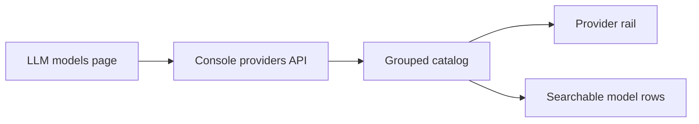

# LLM 模型页

## 页面模型

LLM 模型页是工作区的模型目录，而不是 Provider 卡片墙。

工作区页面请求 `GET /api/console/organizations/{orgUuid}/workspaces/{workspaceId}/llm_providers` 和组织共享 `GET /api/console/organizations/{orgUuid}/llm_providers`。Provider 配置及其 `models` 是目录的唯一数据源，页面不再额外请求 `/v1/models`，避免同一页面出现两份模型集合和无法归属 Provider 的模型。

填写 Provider 的 Base URL 和 API Key 后，可在表单里点「获取模型列表」，请求 `POST .../llm_providers/preview_models`，用上游 `{base_url}/v1/models` 获取候选模型。确认选择后与表单内已有的非空模型 ID 合并、去重，不覆盖手工输入；上游返回空数组时只提示，不清空表单。编辑 Provider 时，读取接口不会返回旧 Key，编辑时可直接使用已保存的凭证获取可用模型。

保存提交表单中的模型 ID 和逐模型参数；点击页面刷新时才请求 `POST .../llm_providers/{id}/models/sync`，把上游模型合并进该 Provider 的 `models`，随后重拉 Provider 列表。不同 Provider 可以配置同名模型，同步不会跳过其他 Provider 已有的模型。模型 ID 可以为空：Provider 仍保留在轨道和目录中，`/v1/models` 返回空数组，页面显示明确的“尚未配置模型”状态。获取上游列表或刷新失败时，用可关闭、数秒后自动消失的 toast 提示，不挡住目录和表单。

toast 由 App 根部唯一的共享 Toaster 承载，各功能页面只调用全局 `toast` API，不再重复挂载通知宿主。Toaster 通过 Portal 直接挂到 `body` 并统一显示在右下角，使通知脱离 `#root` 的隔离层叠上下文；Dialog 遮罩打开时，toast 仍位于遮罩和弹窗之上，不会被 backdrop blur 模糊。



## 布局

- 左侧是 Provider 轨道：`全部 Provider` 加上每个网关。默认选择全部 Provider，各模型目录收起；点某个网关后显示其详情和编辑/删除。只有当前选中的网关被删除时，才回退到仅剩的那一个或全部。
- 右侧是模型目录：搜索框占位为「添加或搜索模型」；刷新会向每个可见 Provider 同步上游 `/v1/models`，再重拉本地目录。
- 「全部 Provider」和单个 Provider 使用同一套 Provider 标头：弱化背景上展示名称、完整 Base URL、脱敏 Key 和模型数量；单个 Provider 只额外显示编辑/删除操作。全部视图和单个 Provider 详情统一使用 shadcn Accordion（Base UI、`multiple`），模型目录默认收起，可独立展开/收起。名称、完整地址、脱敏 Key、总模型数量及组织只读提示始终可见，单个 Provider 的管理按钮不放在折叠触发按钮内。展开状态仅保留在当前页面内，切换 Provider、刷新目录或保存编辑后保留；不写入服务端配置。搜索时自动展开结果，清空搜索恢复之前的展开状态；搜索不改变折叠偏好。空目录同样可展开查看未配置模型提示；Provider 分组之间仅保留低对比度的语义边框，避免出现继承文字颜色的粗重实线。
- Provider 标头在名称旁用等宽 outline Badge 展示 `slug`。
- 模型行是嵌套在 Provider 标头下的独立列表项：相对标头向右缩进，使用最小行高、行间分割线、可换行的等宽完整模型 ID `{slug}/{model_id}` 和复制按钮；复制内容即完整 ID，可直接用于 Agent、Workbench 或 Messages API。搜索同时匹配完整 ID 与 Provider 名称。Provider 名称和完整 URL 在目录标头中允许换行，左侧轨道继续截断以保持紧凑。右侧目录不设置与内容无关的固定高度，少量或零个模型时随内容自然收拢；主机名仍同时出现在左侧轨道，便于快速区分同名 Provider。

## 交互

- 模型配置只允许当前组织的 `admin` 管理。工作区用户可从侧栏进入并查看当前工作区全部模型、搜索及筛选供应商；只读用户不显示新增、编辑、删除及添加模型入口，刷新仅重新读取目录，不调用上游同步。Provider 列表读取校验当前工作区访问权限，新增、更新、删除、预览与同步仍要求组织管理员。目录读取返回 403（无权访问、手改工作区地址或空间已归档）时展示无权限空状态，说明工作区成员可以只读查看、只有组织管理员可以管理供应商；其他读取失败仍使用本地化错误提示。管理写入被拒绝时继续提示需要组织管理员。Workbench、Quickstart 和 Agent 创建页缺少模型时，管理员看到「配置模型」，非管理员只看到「请联系组织管理员配置模型」。前端判断只用于避免无效入口，后端 RBAC 仍是最终权限边界。
- 搜索没有精确模型 ID 命中且已选中 Provider 时，可以把当前输入作为新的上游模型 ID 追加到该 Provider；精确命中只在当前选中 Provider 内判断，因此其他 Provider 已有同名模型时仍显示添加入口。即使已有模糊匹配也仍显示添加入口。
- 创建 Provider 时先展示「Provider ID」，再展示「显示名称」。Provider ID 须手动填写，不随显示名称生成，提交前按 `^[a-z0-9][a-z0-9._-]{0,31}$` 本地校验；编辑时隐藏并保持原值，显示名称可独立修改。Provider ID 对应 API 的 `slug`，局部更新仍回传原值。
- 添加模型的请求进行中时禁用添加按钮，防止重复提交。
- 添加、编辑、删除 Provider 仍走原有 Dialog；编辑时留空 API Key 表示保留原密钥，未修改地址或协议时可使用已保存凭证获取可用模型；修改地址或协议后须填写对应的新 Key。
- 删除确认在退出期间保留原 Provider 的组织/工作区提示及错误，避免清空选择后闪现其他作用域的文案。删除处理中禁用取消并拒绝 Escape 关闭；请求失败后恢复取消，保留错误。下一次打开按当前 Provider 和错误状态更新内容。
- Provider API 的稳定校验错误在前端映射为中英文文案，动态模型 ID 作为插值保留；未知或网络错误使用本地化的通用失败提示，不直接展示后端英文原文。
- 未填写 ID 且保持默认参数的空白模型行可以忽略。填写 context window、output tokens 或修改输入类型后，必须填写非空模型 ID；提交前显示本地化错误并保留草稿，不静默丢弃该行。
- 模型 ID 是可选配置；从 Provider 移除全部模型后，Provider 和加密 Key 仍保留，可通过获取列表、搜索添加或再次编辑恢复模型。
- 没有 Provider 时展示精简空状态：隐藏无意义的模型数 `0` 和顶部重复操作，只保留中央的「添加 Provider」入口。

## 不变边界

- Provider 的 `models[].id` 保存并编辑上游真实 ID；页面只在展示与复制时拼接 `{slug}/`，提交时不带前缀。
- 明文 Key 不进入前端存储；读取接口只展示 `api_key_last4`。
- 不新增独立 Model 表；启用集合是 Provider 上的 `models`。

## API backend

Provider 表单使用共享 shadcn Select 选择 `messages` 或 `chat_completions`。已有配置默认为
Messages，编辑时保留当前值；Responses 暂不展示也不接受保存。选择 Chat Completions 时显示仅支持
Brain 模式，并显示服务端追加的 `/v1/chat/completions` 路径，Messages 显示 `/v1/messages`。
Base URL 仍填写 API 根地址，允许路径前缀，不重复填写 `/v1`。

创建、编辑和模型预览请求均携带 `api_backend`；模型同步由后端使用已保存的 backend。
模型增删等局部操作的完整 Provider 更新也必须保留该字段，避免将 Chat Completions 配置重置为 Messages。
组件测试覆盖选择 backend、模型发现、创建与编辑保留，并断言 Responses 选项不可用。

## 组织 LLM 配置

组织与工作区均可创建多个 Provider。组织设置 `/settings/llm` 管理组织共享连接，工作区页面管理当前工作区专用连接。组织页不依赖选中的工作区，始终允许有权限的管理员继续添加 Provider；每条连接独立保存密钥、协议、地址和模型目录。

Provider ID 对应 `slug`，在整个组织内唯一，包含组织连接和该组织下所有工作区连接；不同组织可以重名。显示名称不承担唯一性。创建时可从供应商预设填入 ID，创建前可编辑，创建后不可修改。模型引用统一为 `<provider-id>/<model-id>`，作用范围不再编码在新 Provider ID 中。

工作区目录合并读取组织共享连接与当前工作区连接。组织连接在所有工作区可见，工作区连接仅当前工作区可见。组织连接在工作区内只读，只能到组织设置修改；管理员管理权限与此前一致。跨工作区的更新、删除及模型发现必须按归属校验，知道 Provider ID 不会获得使用权限。密钥明文不返回浏览器。

组织 CRUD 使用集合 `/api/console/organizations/{orgUuid}/llm_providers` 和 `/{providerId}`；工作区仍使用原有 `/workspaces/{workspaceId}/llm_providers`。模型发现、已保存凭据预览、同步均作用于指定连接。工作区刷新不修改组织连接。组织列表为空返回 `[]`；读取失败显示降级提示，不能隐藏成正常空目录。

已有组织连接保留 ID `organization` 及其模型引用。旧单数 `/llm_provider` API 仅操作这个历史连接，不选择或覆盖新增连接；`organization` 对新集合创建仍为保留 ID。迁移 00105 在组织内确定性重命名历史重复工作区 ID，并同步更新 Agent、版本、多 Agent 配置、Session/线程/部署快照、Code Session 恢复元数据及待处理 Batch 的模型引用；Provider UUID 与密钥绑定不变。组织迁移和回滚要求见后端模型代理设计。新增同名模型后，已有完整引用继续指向原连接。

添加 Provider 继续使用供应商目录和自定义 API 两个入口，不内置公司专用逻辑。删除组织连接的确认说明它会影响所有工作区通过此连接引用的模型，不影响其他组织连接或工作区连接。

## 统一模型配置

数据库、Console API 和前端使用同一结构：Provider 上有序的 `models` 数组，每条模型包含 `id`、可选 `name`、`context_window`、`max_output_tokens`、`input_modalities`。ID 本身即表示启用，不另外维护模型 ID 列表或参数映射。不单独建 Model 表。

```json
{"models":[{"id":"model-a"},{"id":"model-b","context_window":1000000,"max_output_tokens":128000,"input_modalities":["text","image"]}]}
```

`models` 是完整替换语义：空数组清空模型，删除一项同时删除其参数，省略某项参数恢复默认行为。ID 须唯一、非空且不超过 255 字符，最多 100 项。容量须为正的 JavaScript 安全整数；输入类型只允许 text/image，不得重复或为空。旧 `model_ids` 只保留在 HTTP/config 边界：响应从模型数组派生 ID，旧写请求按 ID 保留仍在列表中的参数。请求同时提供 `models` 与 `model_ids` 时拒绝，防止双写冲突。

本 PR 仅新增迁移 00095：按原 ID 顺序将 `model_ids` 转为 `models`，保留组织/工作区归属与空目录，再删除旧列。新列保留 JSON 数组类型约束，Down 同样恢复原 `model_ids` 数组约束。容量与输入类型不写入默认值。Down 可恢复模型 ID 与顺序，但旧结构无法保存新增的模型参数，回滚前应备份。Mapper 仅绑定和读取 `models` JSONB，生成代码不手工维护。

## 模型编辑与默认值

每行模型提供折叠参数区：并排的上下文窗口、最大输出 token 数，下方是文本/图片选项。默认文本且至少保留一项。两个 token 字段支持十进制 K/M（256K=256000），空值仅显示 256K/32K 的近似占位，不自动保存数值。ID 修改时参数跟随该行。

普通 Provider 未配置时使用 DeepSeek Harness 兜底：上下文 262144、输出能力 32768、输入 text。显式模型参数覆盖兜底；调用方显式输出预算优先。`defaultMaxTokens` 只报告管理员显式配置的预算。模型发现只提供 ID 时不猜测容量或图像能力，不新增静态能力目录。

Brain 的 `session_context.models` 为派生的模型路由索引，值包含同一模型记录和 Provider 的 `api_backend`；完整 ID 与无歧义裸 ID 使用现有工作区优先规则。每轮请求前替换当前 Session 的整个索引，子线程沿用父 Session，避免同名模型串用参数。删除或清空参数后下一轮恢复默认行为。模型容量声明不会扩大上游实际能力。

## 获取模型与 Provider 身份

“获取模型列表”始终展示：新凭证使用 `preview_models`，已有凭证使用 `.../models/preview`。后端鉴权、解密，只查询上游；前端确认候选选择后按 ID 合并到草稿并保留已有参数，保存才提交，取消放弃。修改地址或协议后须填写对应 Key。页面同步则保留已有模型记录，只追加新 ID。

创建时显示 Provider ID 与显示名称，ID 对应既有 `slug`，显示名称对应 `name`。工作区创建必须填写 ID，不从名称生成；组织连接同样填写组织内唯一的 ID。编辑时隐藏 ID、保留原值，显示名称可独立修改，服务端继续拒绝变更 slug。既有模型引用不变。


### 编辑弹窗关闭

提供方编辑通过本地open状态完成180ms退出，再通知父页面清除编辑状态；保留原有focus-out保护。保存中禁用Cancel及Close，拒绝Escape/遮罩关闭；失败保留草稿，取消后重开恢复原值。模型发现、凭证使用和保存请求合同不变。减少动态效果时取消过渡并正常完成关闭。

## 请求地址预览

Provider 表单在 Base URL 下用简短的“请求地址：”展示当前 URL 与协议路径的组合预览，避免说明句挤压实际路径。Messages 与 Chat Completions 的路径仍分别为 `/v1/messages` 和 `/v1/chat/completions`，输入允许基础地址、以 `/v1` 结尾的地址或完整 `/v1/messages`、`/v1/chat/completions` 请求地址；预览、保存和模型发现去除这些标准后缀后再拼接目标路径，保留 `/anthropic` 等供应商前缀。空地址显示缺省符号。后端 URL 校验和 Endpoint 同样归一化，覆盖直接 API 写入及已有完整地址配置。DeepSeek 官方 `https://api.deepseek.com/anthropic` 是有效 Messages 基础地址；模型发现仅对该官方主机的 `/anthropic` 路径使用 `https://api.deepseek.com/models`，其他网关继续在保留前缀的地址下请求 `/v1/models`。窄屏检查短路径保持连续，长 URL 在表单宽度内换行。

## 供应商目录与添加入口

新增连接采用方案 A：`模型供应商` / `自定义模型 API` 两个入口。供应商选择从服务端目录读取，选择后填入 ID、显示名称、地址、协议和默认模型；通常只需填写 API 密钥。自定义设置展开后可调整连接与模型参数。编辑已有连接时直接展示已保存配置。

目录格式为版本 1 的 JSON：`{"version":1,"providers":[{"id":"gateway","name":"Gateway","api_backend":"chat_completions","base_url":"https://gateway.example.com","models":[]}]}`。目录供应商与已保存连接是不同对象；目录更新不修改已有连接。模型 `name` 是可选显示名称，路由、计费、复制和权限仍使用 ID。模型显示名称留空时显示模型 ID；编辑器可删除最后一行得到空列表，不提供模型行上下移动操作。供应商的 `order` 为非负安全整数，数值越小越靠前，未填写为 0，相同值保持文件中的先后顺序。内置供应商使用 10、20、30 等顺序值，公司网关可设为 0 排在最前。

“获取模型列表”仅请求上游列表，随后在当前编辑弹窗的模型目录区域展开可搜索、多选的选择列表；连接字段和弹窗标题始终可见，不切换整个表单或叠加第二个弹窗。选择期间禁用保存与重复获取；取消和 Escape 收起候选列表，保留连接草稿、模型参数与展开状态，并恢复到获取模型按钮的焦点。修改连接配置或切换供应商时放弃当前候选，避免将旧连接的模型加入新配置。确认后按上游顺序追加缺少的 ID，保留已有同 ID 的名称和参数；取消候选弹窗不修改草稿。空响应不清除模型，也不猜测上下文或图像能力。

供应商目录只读。控制台仅提供目录读取接口，不提供修改供应商默认模型的入口或写入 API。保存只影响当前工作区连接或当前组织默认连接，发现和编辑的模型不会写回部署级供应商 JSON。未配置文件路径时使用内置目录。目录读取要求组织管理员；目录没有凭据，也不应该放组织私有信息。

必填校验逐字段展示：Provider ID、API 地址和新增连接的 API 密钥缺失时，为对应输入框设置 `aria-invalid`、红色边框和关联的错误文字，聚焦第一个错误；隐藏字段出错时展开自定义设置。已有连接允许保留原密钥。供应商未选时错误显示在供应商选择器下。服务端错误保留在红色边框提示区。供应商模式下，API 密钥始终展示在折叠区域外。“自定义设置”采用共享 Collapsible：顶部细分隔线、左侧向右箭头（展开后向下），展开内容统一缩进，包含连接参数与模型目录。工作区连接仅作用于当前工作区，组织默认连接仅作用于当前组织。折叠再展开保留草稿，隐藏必填字段校验失败时自动展开并聚焦。自定义 API 和编辑连接保持完整表单。


## Provider 表单默认值与文案

供应商未选时仅展示选择器占位，不添加重复操作说明。自定义 API 中，Provider ID 使用 `deepseek` 示例，模型 ID 使用 `kimi-k3` 占位。显示名称可选：创建时尚未自定义的名称随 Provider ID 显示，手动填写后不再随 ID 改变；清空名称恢复使用 ID。编辑已有连接保留其名称，清空后使用该连接 ID。提交与 Console API 在名称为空或仅含空白时均使用最终 Provider ID，API 自动生成 ID 时也使用生成后的值。显示名称长度校验保留。

API 地址下仅保留实际请求地址预览，去除协议路径的说明段落；完整地址归一化和 DeepSeek 模型发现行为保持不变。中英文保持相同信息密度。
