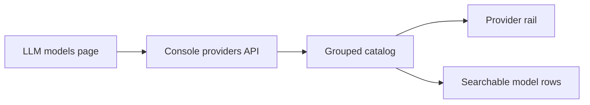

# LLM 模型页

## 页面模型

LLM 模型页是工作区的模型目录，而不是 Provider 卡片墙。

工作区页面请求 `GET /api/console/organizations/{orgUuid}/workspaces/{workspaceId}/llm_providers` 和组织默认 `GET /api/console/organizations/{orgUuid}/llm_provider`。Provider 配置及其 `model_ids` 是目录的唯一数据源，页面不再额外请求 `/v1/models`，避免同一页面出现两份模型集合和无法归属 Provider 的模型。

填写 Provider 的 Base URL 和 API Key 后，可在表单里点「获取模型列表」，请求 `POST .../llm_providers/preview_models`，用上游 `{base_url}/v1/models` 填入模型 ID。获取结果与表单内已有的非空模型 ID 合并、去重，不覆盖手工输入；上游返回空数组时只提示，不清空表单。编辑 Provider 时，读取接口不会返回旧 Key，因此只有用户输入新 Key 后才显示「获取模型列表」。

保存提交表单中的模型 ID 和逐模型参数；点击页面刷新时才请求 `POST .../llm_providers/{id}/models/sync`，把上游列表合并进该 Provider 的 `model_ids`，随后重拉 Provider 列表。不同 Provider 可以配置同名模型，同步不会跳过其他 Provider 已有的模型。模型 ID 可以为空：Provider 仍保留在轨道和目录中，`/v1/models` 返回空数组，页面显示明确的“尚未配置模型”状态。获取上游列表或刷新失败时，用可关闭、数秒后自动消失的 toast 提示，不挡住目录和表单。

toast 由 App 根部唯一的共享 Toaster 承载，各功能页面只调用全局 `toast` API，不再重复挂载通知宿主。Toaster 通过 Portal 直接挂到 `body` 并统一显示在右下角，使通知脱离 `#root` 的隔离层叠上下文；Dialog 遮罩打开时，toast 仍位于遮罩和弹窗之上，不会被 backdrop blur 模糊。

## 布局

- 左侧是 Provider 轨道：`全部 Provider` 加上每个网关。默认选择全部 Provider，各模型目录收起；点某个网关后显示其详情和编辑/删除。只有当前选中的网关被删除时，才回退到仅剩的那一个或全部。
- 右侧是模型目录：搜索框占位为「添加或搜索模型」；刷新会向每个可见 Provider 同步上游 `/v1/models`，再重拉本地目录。
- 「全部 Provider」和单个 Provider 使用同一套 Provider 标头：弱化背景上展示名称、完整 Base URL、脱敏 Key 和模型数量；单个 Provider 只额外显示编辑/删除操作。全部视图和单个 Provider 详情统一使用 shadcn Accordion（Base UI、`multiple`），模型目录默认收起，可独立展开/收起。名称、完整地址、脱敏 Key、总模型数量及组织只读提示始终可见，单个 Provider 的管理按钮不放在折叠触发按钮内。展开状态仅保留在当前页面内，切换 Provider、刷新目录或保存编辑后保留；不写入服务端配置。搜索时自动展开结果，清空搜索恢复之前的展开状态；搜索不改变折叠偏好。空目录同样可展开查看未配置模型提示；Provider 分组之间仅保留低对比度的语义边框，避免出现继承文字颜色的粗重实线。
- Provider 标头在名称旁用等宽 outline Badge 展示 `slug`。
- 模型行是嵌套在 Provider 标头下的独立列表项：相对标头向右缩进，使用最小行高、行间分割线、可换行的等宽完整模型 ID `{slug}/{model_id}` 和复制按钮；复制内容即完整 ID，可直接用于 Agent、Workbench 或 Messages API。搜索同时匹配完整 ID 与 Provider 名称。Provider 名称和完整 URL 在目录标头中允许换行，左侧轨道继续截断以保持紧凑。右侧目录不设置与内容无关的固定高度，少量或零个模型时随内容自然收拢；主机名仍同时出现在左侧轨道，便于快速区分同名 Provider。

## 交互

- 模型配置只允许当前组织的 `admin` 管理。工作区用户可从侧栏进入并查看当前工作区全部模型、搜索及筛选供应商；只读用户不显示新增、编辑、删除及添加模型入口，刷新仅重新读取目录，不调用上游同步。Provider 列表读取校验当前工作区访问权限，新增、更新、删除、预览与同步仍要求组织管理员。目录读取返回 403（无权访问、手改工作区地址或空间已归档）时展示无权限空状态，说明工作区成员可以只读查看、只有组织管理员可以管理供应商；其他读取失败仍使用本地化错误提示。管理写入被拒绝时继续提示需要组织管理员。Workbench、Quickstart 和 Agent 创建页缺少模型时，管理员看到「配置模型」，非管理员只看到「请联系组织管理员配置模型」。前端判断只用于避免无效入口，后端 RBAC 仍是最终权限边界。
- 搜索没有精确模型 ID 命中且已选中 Provider 时，可以把当前输入作为新的上游模型 ID 追加到该 Provider；精确命中只在当前选中 Provider 内判断，因此其他 Provider 已有同名模型时仍显示添加入口。即使已有模糊匹配也仍显示添加入口。
- Provider 表单在名称下方提供 `Slug` 字段。创建时在用户手动修改前随名称自动生成（小写，非法字符替换为 `-`，最长 32 字符；中文等无法转换的名称得到空值），留空时由服务端分配 `default`/`default-N`；提交前按 `^[a-z0-9][a-z0-9._-]{0,31}$` 本地校验。编辑时只读展示，局部更新仍回传原 slug。
- 添加模型的请求进行中时禁用添加按钮，防止重复提交。
- 添加、编辑、删除 Provider 仍走原有 Dialog；编辑时留空 API Key 表示保留原密钥，且不会使用不可见的旧 Key 发起模型发现。
- Provider API 的稳定校验错误在前端映射为中英文文案，动态模型 ID 作为插值保留；未知或网络错误使用本地化的通用失败提示，不直接展示后端英文原文。
- 模型 ID 是可选配置；从 Provider 移除全部模型后，Provider 和加密 Key 仍保留，可通过获取列表、搜索添加或再次编辑恢复模型。
- 没有 Provider 时展示精简空状态：隐藏无意义的模型数 `0` 和顶部重复操作，只保留中央的「添加 Provider」入口。

## 不变边界

- Provider 的 `model_ids` 仍保存并编辑上游真实 ID；页面只在展示与复制时拼接 `{slug}/`，提交时不带前缀。
- 明文 Key 不进入前端存储；读取接口只展示 `api_key_last4`。
- 不新增独立 Model 表；启用集合仍然是 Provider 上的 `model_ids`。

## API backend

Provider 表单使用共享 shadcn Select 选择 `messages` 或 `chat_completions`。已有配置默认为
Messages，编辑时保留当前值；Responses 暂不展示也不接受保存。选择 Chat Completions 时显示仅支持
Brain 模式，并显示服务端追加的 `/v1/chat/completions` 路径，Messages 显示 `/v1/messages`。
Base URL 仍填写 API 根地址，允许路径前缀，不重复填写 `/v1`。

创建、编辑和模型预览请求均携带 `api_backend`；模型同步由后端使用已保存的 backend。
模型增删等局部操作的完整 Provider 更新也必须保留该字段，避免将 Chat Completions 配置重置为 Messages。
组件测试覆盖选择 backend、模型发现、创建与编辑保留，并断言 Responses 选项不可用。

## 组织 LLM 配置

组织设置增加 `/settings/llm` 入口，复用 `LLMModelsPage` 的组织 scope。组织页只请求组织 Provider，不依赖选中的工作区；成员可只读查看，管理员可创建、编辑、删除、预览及同步。组织 Provider 的 slug 固定为 `organization`，表单只读展示，其他字段沿用通用 Provider 表单。

工作区目录合并展示组织默认模型，复制完整 `organization/{model}` 引用。全部 Provider 分组与单个 Provider 详情都显示组织模型只读提示。组织 Provider 在工作区页不可编辑、删除或追加模型，刷新只同步工作区 Provider；组织配置应在组织页修改。只读成员刷新只重新读取数据。组织读取返回 404 表示尚未配置，不视为失败；其他组织读取失败在已有工作区目录上提示降级，不能隐藏为正常成功。

添加 Provider 默认打开通用配置表单，不包含公司网关快捷预设。

工作区 Provider 表单在提交前拒绝保留 slug `organization`，并显示本地化提示；组织 Provider 表单固定且允许该值。删除组织默认的确认文案在默认消息与中英文翻译中保持同一语义：工作区 Provider 仍可使用，通过组织 Provider 引用的模型将不再可用。

## 逐模型上下文窗口

Provider 编辑表单每个模型行提供折叠参数区，支持上下文窗口、最大输出 token 数与输入类型；两个 token 字段接受正整数及十进制 K/M 单位（例如 256K = 256000，1M = 1000000）。留空不保存窗口，运行时使用 262144 的兜底容量。模型 ID 修改时参数跟随该行，删除模型时删除对应参数；从上游获取新模型保留已有模型的参数。

Console API 在 Provider 上增加可选 `model_context_windows`（上游模型 ID 到 token 数的映射），数据库以独立 JSONB 字段保存，模型启用范围继续以 `model_ids` 为唯一来源。写入只允许已配置的模型和正的 JavaScript 安全整数。旧客户端省略字段时保留仍在列表中的配置，显式空对象清空配置；同步上游模型列表保留管理员填写的窗口。

Brain 注册及每次请求前读取当前有效目录，按完整模型 ID 下发窗口；裸 ID 使用现有工作区优先及歧义校验规则。适配器通过当前 Agent 的 initiator 获取对应 Session 的配置，子线程绑定父 Session，避免跨组织同名模型串用参数。DSH 的模型元数据和持久化 `request/context` 使用该窗口；已有 Session 在下一轮请求更新。该字段声明模型上下文容量，不会扩大上游实际容量，也不改变请求输出上限或现有压缩策略。

回归覆盖模型行编辑、K/M 转换、非法输入、保存回读、旧客户端保留/显式清空、组织与工作区 PostgreSQL 持久化、同名模型路由隔离，以及真实 DSH 循环中的窗口更新。

### 输出预算与输入类型

模型参数折叠区并排显示上下文窗口、最大输出 token 数，均支持 K/M 后缀，留空沿用现有默认值。下方提供文本、图片复选框；默认只选文本，最后一项不可取消，可选择仅图片。

新增 `model_options`，按上游模型 ID 保存 `max_output_tokens` 和 `input_modalities`，不改变 `model_ids` 的启用语义。省略整个映射保留已有模型参数，空映射清空，移除模型时清理参数。数值须为正安全整数，输入类型只允许 text/image 且不得重复或为空。组织和工作区使用相同合同。

Brain 注册和每轮请求前更新参数，沿用目录的完整 ID、裸 ID 优先级和 Session 隔离规则。显式输出预算成为 DSH 的 `defaultMaxTokens` 及两种协议的路由默认值，调用方显式 `maxTokens` 优先，和 DeepSeek Harness 一致。未配置时两种协议都以 32768 的输出能力作为请求预算兜底，替换原 Messages 的 943718 特例。输入类型传入 Harness 的 `inputModalities`，默认 text；Harness 在不支持图片时执行原生文本投影，启用图片后保留图片内容。该配置声明能力，不会扩大上游模型的实际容量。

### 精简模型编辑与凭证复用

模型卡片仅显示 ID、两个 token 字段和文本/图片选项，移除重复说明，上下文和输出空值分别以 256K、32K 提示。模型目录右上角始终提供“获取可用模型”。新建 Provider 或填写新 API Key 时沿用 `preview_models`；编辑已有 Provider 且未填写新 Key 时，使用 `POST .../llm_provider/models/preview` 或 `POST .../llm_providers/{id}/models/preview`。后端鉴权并解密当前 Provider 凭证，只查询上游，不写入数据库或返回凭证。获取的 ID 去重合并到表单，保留已编辑参数，保存才提交；取消放弃草稿。修改地址或协议后须填写对应 Key 才能获取模型。

### 缺省容量

对齐 DeepSeek Harness `llm-pi-ai` 的普通 Provider 兜底：上下文 262144、输出能力 32768、输入 text。界面 256K/32K 仅为近似占位提示；输入 256K/32K 仍按十进制分别保存 256000/32000，不填写则不保存数值。显式配置覆盖兜底，清空后下一轮恢复兜底。

`defaultMaxTokens` 仍只报告管理员显式配置的输出预算。协议适配层在调用方和模型都未指定预算时使用 32768，保持输出能力与显式请求默认值的区别。不根据 Provider 名称、模型 ID 或自定义网关地址猜测官方适配器身份，不套用 DeepSeek 官方路由的 1000000/256000。当前模型发现接口仅返回 ID，没有容量声明，因此未配置模型使用普通 Provider 兜底；不新增或复制静态模型目录。

### Provider 身份与显示名称

表单依次显示 Provider ID、显示名称。Provider ID 对应既有 `slug`，用于模型引用；显示名称对应 `name`，只影响界面展示。新建工作区 Provider 必须显式填写 ID，不从显示名称生成或联动修改。组织默认 Provider ID 固定为 `organization`。Provider ID 仅在创建时展示，编辑表单隐藏该字段并保留原值，显示名称可以独立更新；服务端继续拒绝变更 slug。保留既有 API 字段及历史 ID，不迁移数据库或改变现有模型引用。中英文标签、提示和错误统一使用 Provider ID/显示名称，避免向用户暴露 slug 术语。
