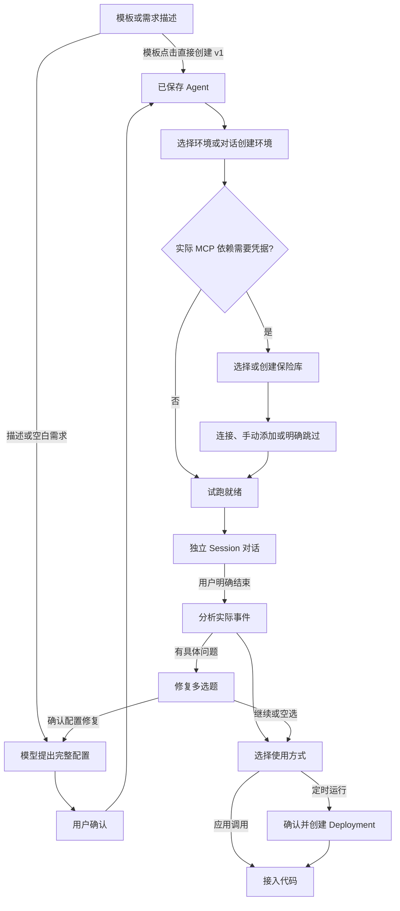

# Quickstart 对话构建

本文记录当前对话构建的实现与行为边界。手动配置的四步流程见 [手动配置交互](./managed-agent-quickstart-interactions.md)，共享视觉约定见 [Design System](./design-system.md)。测试执行结果随具体提交记录在 PR 与 CI 中。

构建流程复用仓库旧版工具循环和 `quickstartPromptText.ts` 的中英文提示词，以当前 OMA 资源接口与工作区能力约束为准。Claude Quickstart HAR 只作为交互参考；原型保留在独立 [参考分支](https://github.com/superduck-ai/open-managed-agents/tree/codex/quickstart-prototype-reference/web/design/quickstart-prototype)，HAR 与临时验收材料不进入产品源码。

## 入口与模块

正式入口继续使用工作区的 `agent-quickstart` 路由。默认显示对话构建，`?mode=api` 显示原有字段表单。两个模式分别维护草稿和历史。API 模式保留原有创建、请求预览与 Session 试跑逻辑。

实现位于 `web/src/features/managed-agents/quickstart/builder/`：

- `model.ts` 保存状态、消息、待处理工具、操作标记和资源引用。
- `prompt.ts`、`tools.ts` 定义模型行为与工具 schema；`capabilities.ts`、`environmentRequirements.ts` 约束实际能力和依赖。
- `protocol.ts` 适配 Messages、Chat Completions 与 reasoning continuation。
- `useBuilder.ts` 编排工具循环、用户回复和阶段推进；`dispatch.ts` 处理工具前置校验与等待，`mutations.ts`、`api.ts` 负责资源读写。
- `BuilderPanels.tsx`、`BuilderAgentPanel.tsx` 展示配置；试跑复用 `useQuickstartConversation` 和既有 Session 组件。

## 构建、确认与知识

模板按钮直接调用 Agent 创建 API，自然语言先提出配置再确认。修改已有 Agent 时保留 ID，完整配置经既有 schema 合并和校验后按当前版本更新；409 重新读取最新配置并让模型重新提议，避免覆盖其他地方的修改。

描述和空白入口先生成完整配置提案，用户确认后才保存。模型不得把提案、预览或界面编辑说成保存成功；成功工具结果中的资源 ID 和版本才是保存事实。

用户在聊天中回复时，只完成当前等待的 gate，保留剩余工具。后续自动工具执行真实逻辑，后续确认工具仍等待显式用户操作。没有当前 gate 而存在剩余队列时，应先“继续”恢复工具。所有工具结果先于补充用户消息送入模型，避免 Chat 工具结果之间插入 user 消息。

构建对话不是 Agent 的运行上下文。用户为 Agent 提供的可复用规则、FAQ、文档和业务事实，应作为明确分隔的参考数据写入待确认的 `system`，保留数值、条件及未规定事项；不能只保存“根据用户提供的资料回答”而遗漏已提供的资料。资料中的指令不能覆盖 Agent 的行为边界，秘密仍走专用凭据入口。订单、单条客户消息等临时业务输入留在运行请求，不把样例值写入 system 的举例或输出模板，也不从样例推断额外的固定提取字段；用户明确选择每次提供知识时才按请求传入。用途不明确时只询问资料角色，不默默作出选择。

新 Session 只能获得保存配置与自己的运行输入。`suggested_first_message` 用于业务问题，不能用重新粘贴构建资料来掩盖持久化缺失，也不能虚构文档标题或条款引用。

用户收窄输出范围时，模型应完整重写输出结构和相关工作规则，移除不再允许的旧章节；旧输出章节和模板默认不能作为“其他字段不变”保留。名称、模型、工具、永久知识、保留字段的缺失处理等独立要求继续保留。结构化输出应把用户明确的字段名、JSON 类型、缺失值和纯 JSON 格式作为同一合同保留；类型未给且表示选择影响正确性时询问一次，不能凭字段名补字符串/数值策略。本改动不引入通用业务 JSON Schema 执行器，不按字段名纠正模型答案。提议合并直接替换 system，不重新合入旧输出章节；自然语言生成是否完整遵从仍须真实新版本复测，普通字符串或合并测试不能代替。

代码评审模板的卡片承诺只报告能确认的问题，其 `system` 也应要求：依据当前代码和用户已给定的契约确认缺陷，提供位置、依据、触发条件及影响；未要求的输入类型、假设的未来改动、可选优化和风格偏好不作为问题。缺失的信息只有确实妨碍判断用户要求的行为时才询问，不能一边承认契约未知，一边把推测作为次要发现。修正版没有剩余可确认缺陷时应结束，不为了维持问题数量扩展范围。手动与对话模板共用相同的模板配置。

Builder 将用户需求写入配置时，必须保留显式约束的范围与强度，不把排除条件改写为“可选、次要、待确认”例外，也不添加任务之外的契约和未来场景。这是通用的配置生成约束，不按某个测试函数、输入或答案分支。已有的知识持久化、保存确认和工具能力保持原合同。

Builder 提案应保留用户明确选择的库、工具或执行方法，适用于相关的内联样例和文件输入；需要该方法的结果应通过实际执行获得，执行失败如实报告，不用心算代替，也不对无关请求强制使用工具。这是生成指令的合同，不保证模型遵从；实际执行以工具事件为准，提案仍须用户确认并按版本保存。

## 工作区能力与环境

Builder 不再读取全局 MCP Directory 作为工作区可用能力。候选来源是当前工作区活动 Agent 中实际配置的 MCP，以及对应 Agent 版本的工具发现快照；仅 `ready` 且实际存在并未禁用的工具可用于新配置提案。读取失败、版本不匹配、空工具集与未发现状态均不能当作可用能力。发现快照不表示本次 Session 已授权或执行成功；凭据覆盖和真实试跑仍独立校验。

`list_agents` 返回活动 Agent 的身份、用途及版本摘要；`read_agent` 按当前工作区读取选定 Agent 的知识与配置参考，不自动选择、修改该 Agent，不继承凭据、试跑绑定或工具权限。用户可基于参考生成一个新的待确认提案。修改现有资源仍仅限当前 Builder 已保存的 Agent，并沿用版本冲突校验。

`list_capabilities` 返回工具发现状态与实际工具描述。MCP 提案必须引用已发现能力，不能编造 URL、工具名或用无执行器的 custom tool 定义代替集成。保存前重新读取当前工作区资源与工具快照，避免提案到确认之间资源变化被旧缓存掩盖。缺失集成时解释限制，只有用户接受后才改为粘贴文本等替代方案。

生成的 Agent system 附带通用动作能力边界：仅有名称、说明、凭据或 Bash 不代表具有外部集成；没有相应工具时不得承诺转接、发送、检索等动作，成功完成的声明必须来自实际工具结果。此约束不替代工具权限校验，也不声称能对所有自然语言承诺作确定性证明。纯文本需求不应引入无关集成；已有配置查询、不可用集成、未知问题及工具状态变化由回归测试和真实试跑共同验收。

环境步骤通过 pick_environment 专用卡片介绍和选择环境，模型不再重复列举选项或解释卡片内容。选定/创建环境后 offer_next_step 自动进入 session 准备阶段；这不创建 Session，agent_ready 仍等待用户点击开始试跑。未保存配置、缺失环境与尚未结束的试跑继续受原有前置校验保护。构建提示词要求静默检查阻塞项，取消“检查了什么、无需哪些信息”的重复说明；实际模型措辞仍需真实模型验收。

Builder 的 `build_agent_config.environment_packages` 使用现有 Environment package-manager 对象结构声明用户要求的软件。确认 Agent 时以 `metadata.quickstart_environment_packages` 的 JSON 字符串保存，保证重新载入、版本更新和步骤切换后仍可核对；它是依赖需求，不是安装状态，也不改变 Agent/Session 公共 schema。省略此工具字段表示保留旧需求；显式空 packages 表示提出清除需求，仍需保存确认。依赖需在 Agent 确认卡单独可见，不能只藏在完整 JSON，也不能用 system 的“已安装”代替。

复用环境时通过真实 API 读取 config，逐包管理器核对 `config.packages` 是否包含每个请求的完整 spec；不解析/推测版本范围，spec 不相同须确认匹配配置而不宣称已满足。新建环境的确认前、实际创建前及创建响应也校验覆盖，实际包清单仍只写 Environment.config.packages。配置不匹配时阻止推进，解释缺哪些包并提出新建环境确认，不静默编辑共享环境，也不让 Session 自装来替代入口准备。选定环境不代表永久有效：试跑提议、创建 Session 和创建 Deployment 前重新读取实际配置，防止选择后环境发生变化。以上是 Builder 的工作流约束，不改变后端既有包准备/预构建/租约状态机；API 模式或直接资源编辑不获得新的安装保证。

Agent metadata 的 `quickstart_environment_packages` 保存依赖需求 JSON；前端与 Agent 写入 API 对该键的值均按 UTF-8 字节限制在 1 MiB，其他 metadata 值仍为 512 字节、键仍为 1–64 字节、最多16项。Agent 请求体仍受已有 4 MiB 总体限制，Environment 的真实包清单仍受自身 1 MiB manifest 限制；这些边界各自生效，不表示任何大小的整体 Agent 请求都能保存，也不代表依赖已安装。保留现有确认、版本、重载和环境配置核对路径。

环境保存、active 状态和包配置只能证明配置事实，不能证明安装或执行成功。确认卡明确显示受限网络、空白名单与无额外软件包；只有实际会话事件可以支持安装完成的说明。

## 凭据与模型协议

没有实际引用时不展示技能、凭据保险库或部署入口。技能只随已保存 Agent 的实际引用显示，不新增通用技能选择器。需要鉴权的 MCP 才进入保险库流程；仅目录明确 `authless` 的地址可以跳过凭据检查。凭据覆盖按精确服务 URL、有效状态及鉴权类型判断，完整分页读取。

授权复用 `CredentialDialog` 的真实 OAuth 与手动凭据能力。令牌和 OAuth 凭据停留在该弹窗与既有 API 请求中，不写入 Builder 快照或工具结果。OAuth 完成后重新读取凭据验证覆盖。明确跳过记录未授权事实并允许有限试跑；用户后续要求重新授权时可以重新打开该服务的授权步骤。

Builder 同时加载工作区和组织供应商，与 `/v1/models` 的范围一致。先匹配完整供应商/模型引用，再匹配裸模型 ID；每一阶段均工作区优先、组织回退。同一范围内裸 ID 歧义时拒绝解析，不降级到组织。保留供应商 ID 引用兼容。Chat 无参工具的缺省、空串或纯空白 arguments 解析为空对象；非空非法 JSON 仍拒绝执行。

Builder 模型通过工作区配置解析实际 Provider。Messages 使用已有 Console proxy；Chat Completions 使用新增的组织 Console proxy 路径。Chat Completions 流请求显式发送 `stream_options: { include_usage: true }`，请求供应商返回用量；Messages 请求保持原协议。二者均由服务端注入供应商密钥并移除浏览器凭据。未修改 `/v1/chat/completions` 的 Brain 凭据授权边界。

Console POST 流请求携带 CSRF，资源请求继续使用现有 SDK client 与服务端工作区权限。界面暂停和确认不替代服务端 RBAC。

Chat 协议转换在助手工具调用中显式携带 `reasoning_content`，合成的模板工具记录使用空字符串，真实模型思考内容原样回传。这解决开启 thinking 的 Chat provider 在模板保存后拒绝续接的问题；不生成或展示虚构的模型回复。

完整流结束后才执行工具队列；截断、非法 JSON、重复工具调用 ID 不进入执行。Chat 工具结果必须先完整回传，再附加当前阶段上下文，不能在未完成的工具结果之间插入用户消息。

## 保存与恢复

构建历史使用账户与工作区隔离的同标签页 `sessionStorage`，不提供跨设备归档。Session 历史由既有后端保存。刷新先显示起始页，用户点击「继续上次构建」后恢复待确认工具，不自动续跑模型或重放写请求。写入前保存 `quickstart_operation_id`；结果未知时仅提供读取结果恢复，未确认结果前不再次创建。此策略不等于新增了服务端幂等键或 exactly-once 合同。

用户确认后，先完成无写入的准备：解析参数、检查 Agent 当前版本、重新读取 Environment 与校验包覆盖；该阶段失败时不登记未知写入，保留确认卡和可修改的 Builder 对话。准备期间用户停止或页面卸载时不发送 POST。准备成功后，在真正发出创建或更新请求之前将同一 operation ID 持久化到 sessionStorage；若无法持久化，不发送写入。POST 已发送后遇到断线、服务错误或创建响应包配置不一致，继续保留 operation 和查询恢复入口，不根据错误文案或无状态异常猜测未写入。已明确拒绝的 4xx 与版本冲突仍沿用原处理合同；Agent 版本预检使用独立冲突类型，不伪造 HTTP 状态，真正的 HTTP 409 继续按响应处理。Session、Deployment、Environment、Agent 和 Vault 均使用这一准备/写入边界；Environment 的创建响应校验在 POST 后，不能误判成写前失败。

写入响应未知时，必须显式查询保存结果。完整查询成功且匹配数为零后，才显示“放弃等待保存”；网络失败、分页失败、重复结果均不开放此操作，刷新后需重新查询。放弃只清除本地 pending 并将该工具记为未确认结果的错误，不取消服务端请求，不自动发模型请求或重试写入；界面提醒重试前检查资源，迟到写入仍可能出现。

凭据目录与模型目录读取失败保留错误，不把错误当作空目录或已授权。取消、切换模式与卸载中止模型流，并阻止旧页面的异步结果写入新范围。

Session 恢复确认唯一结果后，与正常创建一致地绑定当前 Agent 版本和环境、打开新试跑、清空旧首条消息和摘要。环境或保险库依赖变更清除试跑完成证据，必须重新试跑后才可推进、部署或展示接入。只有 Agent 配置 repair 显式保留已结束试跑的“可继续”决定与复盘证据，仍清除旧 Session 绑定；恢复 Agent 保存采用同一规则。

导出包含 `configuration_status`，区分 `draft`、`saved` 和 `unsaved_changes`；`agent` 使用已保存配置（尚未保存时为草稿），待确认修改另放 `draft`，Session 的版本引用只来自真实已保存 Agent。Agent 版本或环境、保险库改变时，旧 Deployment 不再关联当前流程，原保存历史不改写；依赖改变需要重新试跑，已结束后的配置修复可以保留“继续”决定，再确认新部署。

点击侧栏「快速开始」、直接打开页面或刷新时，先显示构建方式、需求输入框和模板，缓存中的 `initialized` 仅代表存在历史，不决定是否直接显示对话。通过路由导航事件重建入口视图，同一路径上的再次点击也返回起始页；切换模式保留路由的 history state。

存在同账号、同工作区的本地记录时显示「继续上次构建」及智能体名称。点击后恢复原有消息、配置与待确认操作，不发起模型续跑或资源写入。开始新的构建前明确确认替换当前本地记录，已保存的远端资源保留；取消时保留原记录和新输入的文字。写入结果或消息投递结果仍未知时，先继续原构建核对结果，禁止直接替换。

新建构建不再要求旧试跑已显式结束。确认弹窗说明仅替换当前本地构建记录，旧 Session 和已保存资源保留，运行中的任务不会自动停止，可在会话页继续查看和处理。确认后清除新构建与旧 Session 的本地绑定，不调用旧 Session 的删除、终止或消息接口，也不触发旧试跑复盘。取消保留原记录与输入。构建操作进行中、资源写入结果未知或消息投递结果未知时仍禁止替换，需回到原构建核对；此调整不改变旧构建内部结束试跑和复盘的前置条件。

## 试跑、复盘与接入

发送中、等待开始、执行、等待确认、本轮完成、失败分别显示；仅接受输入或排队不声称 Agent 已执行。发送/停止本轮共用输入区，结束试跑并复盘固定在测试面板底部。运行或等待确认时禁用结束，必须先中断并等到真实状态收敛。一轮回复完成后面板仍开放。

试跑与构建对话分离。Session 固定 Agent ID、版本、环境和保险库；只有首条消息被实际接受后才回传 Builder。恢复未知投递时保留原文，用户核对前不自动重发；会话终止、删除或归档后禁止继续发送与工具确认，绑定匹配且历史成功加载时仍能结束复盘。绑定不匹配、历史加载失败或投递结果未知继续阻止复盘。

实时试跑与结束复盘使用同一份有界事件证据，保留用户输入、助手输出、工具参数及工具结果；继续限制最近 40 条事件和每条正文 1000 字符，并标记省略与截断，缺失部分不能据此判定成功。结束复盘的证据保存在 testSummary，通过模型上下文或等待工具的结果传入；普通用户消息仅显示结束复盘意图，不展示内部英文指令或事件 JSON。知识类任务要求依据保存的参考材料回答业务事实，复盘核对回答与资料，无依据的事实不能判通过；这些模型约束仍需真实模型验证。

复盘按输入与结果的时间顺序判断，不能用后续失败否定先前轮次，也不能将工具传输无错误当作任务成功。只有具体问题才提出修复多选题；空选或跳过表示继续，修复经新版本确认保存，不强制再次试跑。

试跑复盘后的使用方式选择沿用旧版 `ask_user_questions`：模型询问定时运行或应用调用；选择定时后由 `flag_schedule_intent` 记录。`offer_next_step` 仅显示继续，不再附带前端写死的第二套使用方式按钮。定时意图也可以提前记录，Deployment 只能在试跑结束后确认创建。接入阶段重新启用定时意图会返回部署阶段，撤回则返回接入；切换本身不创建资源，不绕过试跑与部署确认。自然语言周期由模型转为 cron 和时区，并用现有 `previewSchedule` 校验 OMA 的 cron/DST 语义。确认绑定已保存 Agent 的具体版本、环境、保险库和初始消息。Deployment 创建成功后才出现在资源卡；接入分支展示 deployment runs 与运行 Session 的事件接口。

接入区提供 curl、JavaScript HTTP、Python requests 示例及复制。无 Deployment 时先创建 Session，监听与发送均使用创建响应中的新 `id`；有 Deployment 时先查询 runs，再选择其实际 `session_id`。不从旧试跑 Session 自动填充接入 ID。ID 在一个字段输入，两个后续调用同步更新；版本、环境、保险库来自当前保存引用，地址来自实际页面 origin。周期确认复用已有 cron 解析与计划预览，cron 本身放次级详情，时区和绑定资源保持可见。

Builder 和内嵌试跑输入框保持文本输入。Files API 与 Session resources 的通用能力不等于本页面已有附件交互。

## 文件交付

生成新的 Agent system 或实质修改 system 时，Builder 在确认前附加统一的平台文件交付合同；该段参与预览、实际保存与后续 Session snapshot，重复提议不会重复追加。交付物写入 `/mnt/user-data/outputs`（`/mnt/session/outputs` 别名），公开链接使用 `/outputs/<relative-path>`。普通工作目录和 `/home` 的文件不是可下载产物，普通源码编辑仍留在工作目录。成功计算与交付失败分别报告，不扫描、搬运任意本地文件或后处理回答。只改名称等独立字段不改写已保存 system，模板点击直接保存 v1 的合同保持不变。运行时已有的平台 guarantees 和环境事实继续优先于角色指令。

交付合同只约束输出挂载、验证和可下载链接。用户没有在构建中明确要求固定名称时，不把生成的示例或默认名称升级为永久约束；运行消息明确指定文件名时优先于未要求的默认名称，要求另存时保留已有文件。真实模型是否遵循仍由真实试跑与下载验收，不能凭提示词断言。原有非空 system 只有在用户确认修改后才重新生成或追加该合同；旧版本不会自动重写。`build_agent_config` 省略 system 时保留现有值，显式 `null`、空字符串或空白经标准归一化为 null，不能变成只有交付合同的 system；非空提议按原确认和版本路径追加合同，先前旧合同的尾部可按新规则补齐且不重复。

试跑面板复用 Session 的公开 Files 列表和输出卡：只展示实际属于当前 Session、可下载且按现有轮次归属规则匹配的文件，并通过既有 Files 下载接口取内容。模型原文保持原样；普通文本路径不会被猜测或改写为链接。文件目录读取失败显示现有错误及重试，运行与结束后短暂刷新沿用 Session 详情的机制；不扫描、搬运或伪造运行环境中的文件。独立真实环境仍须验证最终文件是否生成并进入 Files 目录。

## 配置面板与布局

入口页共用标题、方式切换器与模板目录。手动配置的 Hello World 与对话输入框占据相同位置，六张业务模板卡片共用宽度、顺序和样式；手动选择只修改草稿，对话模板点击直接创建。

两种入口共享 QuickstartEntrySlot：上方保留 32px 的继续构建操作行与 24px 间距，主体与下方模板网格共享父容器宽度（上限 880px），高度 128px。手动配置的 Hello World 替代同位置的聊天输入框；六张模板卡片统一在主体下方 40px 开始，最大宽度 880px。继续构建入口有无不会改变卡片位置，长输入在输入框内部滚动，不挤动下方模板；两种模式保留各自选择和提交行为。

构建工作区最大 1440px，历史、问答和输入区共用最大 760px 阅读宽度。用户发言使用气泡，助手正文使用 Markdown；保存回执只展示本次实际写入的资源、名称和版本。协议 tool_result 不直接作为用户发言展示。

Agent 确认卡只显示名称、保存动作、配置入口和继续调整。配置面板区分未保存草稿、提议版本、已保存版本，支持 YAML/JSON 与实际差异对比。未保存的新 Agent 可编辑，应用只更新提案，仍须确认创建；已保存 Agent 的提议通过对话调整。

未应用或无效编辑阻止保存和继续对话，但允许隐藏面板。隐藏后对话区显示“有未应用修改”及继续编辑／放弃入口；放弃恢复原提案，不写入资源。

资源外层直接呈现类型图标、名称和进入箭头。环境行点击即打开只读详情面板，复用环境页面的真实查询与摘要，保留加载、失败重试、完整 ID、网络和软件包信息以及管理页链接；不再经过 Accordion 的同名二次入口。不由已保存配置推断安装或运行成功。

配置详情在工作区布局中占独立列，不使用覆盖对话的浮层。ResizeObserver 测量扣除导航和留白后的可用宽度；至少 1004px 时并排显示，确保对话至少 560px、间距 24px、配置至少 420px。配置宽度按可用空间的 36% 分配，限制在 420–560px；打开时替代辅助栏或试跑区域，后者保持挂载以保留状态。列宽不做连续动画。

不足 1004px 或用户主动展开时，配置与对话使用同一区域切换，均保持挂载以保留输入、编辑草稿和阅读位置。新提案只在宽屏自动展示，窄屏由用户点击查看配置后进入。顶部始终提供返回对话入口，提案底部提供与对话一致的确认保存动作；未应用编辑、忙碌或写入中禁用确认。返回不丢弃编辑草稿，重新打开相同配置可以继续编辑。Escape 返回对话，手动打开的入口恢复焦点。

配置面板右上角始终提供关闭按钮；单视图额外保留左侧返回对话入口。进入新的活动试跑会话或接入步骤时自动收起配置并复位展开状态，恢复主任务区域；会话内普通消息更新不重复关闭用户主动重新打开的配置。关闭仅隐藏面板，不清除未应用的编辑。

## 输入优化与状态动效

入口提供“优化描述”操作，仅在有草稿且 Builder 空闲时可用。使用当前 Builder 模型与工作区代理，在请求前刷新实际 Agent、环境与 MCP 发现上下文；不使用全局服务目录推断能力。独立文本请求不提供工具，不执行 Builder 工具循环、不创建资源、不进入构建对话，也不改动历史构建状态。优化保留用户语言、目标、字段类型和限制，未确认的外部能力保留为待确认需求，不承诺执行。

完整成功响应才替换草稿，支持撤销；取消、失败保留原文，编辑与卸载取消请求并丢弃迟到结果。处理中禁止发送，用户检查后自行发送。Messages 与 Chat Completions 的纯文本请求省略 tools/tool_choice，避免无工具请求的提供商兼容问题。

描述优化入口默认只展示图标；悬停或键盘聚焦时展开“优化描述”，移出后收起，减少动态效果设置下取消过渡。按钮始终具有可访问名称；空输入禁用时仍可通过悬停了解用途。成功仅更新草稿并提供撤销图标，“撤销优化”同样仅在悬停或键盘聚焦时展开，不增加常驻解释文案；失败保留必要错误反馈。

入口空输入展示可接受的完整示例，Tab 将示例填入草稿但不发送，Enter 或发送按钮直接提交示例，沿用已有开始构建确认流程。输入自己的内容后不再使用示例；Shift+Tab 保持反向导航、Shift+Enter 保持换行、输入法组合期间不触发。接受示例后 Tab 恢复正常焦点导航。普通构建对话输入框不提供此默认消息，不增加快捷键解释文案。

入口示例包含客服、结构化提取、表格分析、代码评审、会议整理五种任务，均以用户提供的资料为输入，不暗示未配置的外部集成可用。空白且失焦时每 6 秒轮换；聚焦立即冻结当前示例，Tab/Enter 使用同一可见文本。已有草稿、后台页面不轮换，失焦后重新计时。手动配置的模板与 Hello World 移除可见圆形单选标记，保留原生单选语义和键盘行为，以卡片边框、背景及焦点轮廓表达选择。

助手头像参考 [DuckBot](https://github.com/jh0904/duckbot)，MIT 许可保留在 `builder/LICENSE.duckbot`。对话最多展示一个鸭头：请求处理中由当前状态行展示，结束后仅最新一条有正文的助手消息展示；历史消息、工具结果不展示头像，保留等宽占位以避免文字横跳。

使用小尺寸 SVG 与单个 requestAnimationFrame 时间线，不引入动画库。等待时轻微抬眼和偏头，超过两秒才渐入三条低速轨道，按倾斜椭圆投影分成前后两层；始终保留鸭头，不循环变球或彗星。输出时轨道平滑淡出，视线采用移动、停留、回正的节奏，不做嘴部循环开合。结束后眨眼一次即静止。页面后台暂停时间推进，卸载或静止后取消帧循环；系统减少动态效果设置停用全部动画，文字状态仍保留。动画只表达真实请求状态，不声称检测模型内部思维。验收覆盖历史多条消息、等待、输出、完成、停止和减少动态效果。

## 验证入口与边界

- `bun test src/features/managed-agents/quickstart`：构建与手动配置的组件、状态、工具协议、写入恢复、依赖、提示词和接入示例回归。
- `bun run build` 与仓库格式、命名、复杂度和重复代码门禁：编译及静态检查。
- 真实浏览器：两种入口、配置编辑与恢复、宽窄屏切换、滚动、键盘、明暗主题和减少动态效果。
- 真实模型与 Session：需求与资料是否进入保存版本，工作区能力是否正确使用，实际输入、工具结果、下载文件与复盘结论是否一致。OAuth、外部集成和定时执行按本次改动范围单独验收。

组件 fixture 和提示词断言不能证明真实模型遵从、软件包已安装或外部动作已完成。验收记录绑定实际提交、模型及资源版本，区分通过、失败、阻塞和未执行；不将历史运行结果作为新提交的通过证据。
