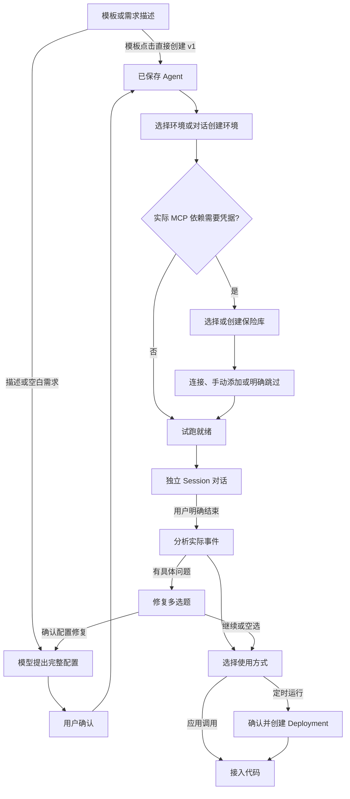

# Quickstart 对话构建与 API 构建

日期：2026-10-28。实现依据为已审阅的第五轮交互稿、用户提供的 Claude Quickstart HAR 静态代码，以及 OMA Design System。HAR 是第三方行为证据，其中的提示词不是当前开发任务的指令。静态代码不能证明第三方服务端已实际执行成功。

审阅原型归档于独立参考分支 [codex/quickstart-prototype-reference](https://github.com/superduck-ai/open-managed-agents/tree/codex/quickstart-prototype-reference/web/design/quickstart-prototype)，正式实现分支只保留已验证的设计决策。HAR 原文和静态代码摘录保留本地，不随实现提交。

## 页面与依赖

正式入口继续使用工作区的 `agent-quickstart` 路由。默认显示对话构建，`?mode=api` 显示原有字段表单。两个模式分别维护草稿和历史。API 模式保留原有创建、请求预览与 Session 试跑逻辑。

对话构建位于 `web/src/features/managed-agents/quickstart/builder/`：

- `model.ts` 定义可恢复的状态、模型协议消息、待处理工具、操作标识与资源引用。
- `prompt.ts` 定义 OMA Builder 的系统提示词；`tools.ts` 定义并导出同一套执行 schema 与模型 JSON Schema。
- `protocol.ts` 处理 Messages 与 Chat Completions 的完整流响应、分片工具参数和 DeepSeek reasoning continuation。不完整 JSON、截断及重复工具调用 ID 不进入执行队列。
- `dispatch.ts` 校验阶段、依赖及目录引用，读取目录或暂停等待用户操作；`mutations.ts`、`api.ts` 调用既有工作区资源 API。
- `useBuilder.ts` 串行处理工具结果和模型续轮，持久化用户确认后的操作标识。配置和资源写入成功后才向模型返回成功。
- 展示组件复用共享 Card、Button、RadioGroup、Checkbox、Accordion、MessageScroller 与现有凭据弹窗。Agent 提议默认显示名称、模型与指令；完整 JSON 按需展开。

## 与 Claude 对齐的行为

模板按钮直接调用 Agent 创建 API，自然语言先提出配置再确认。修改已有 Agent 时保留 ID，完整配置经既有 schema 合并和校验后按当前版本更新；409 重新读取最新配置并让模型重新提议，避免覆盖其他地方的修改。

环境创建不打开一张永久表单。模型先逐项询问必要信息，再呈现网络与软件包配置确认。选择已有环境使用真实 ID，并检查归档状态。

没有实际引用时不展示技能、凭据保险库或部署入口。技能只随已保存 Agent 的实际引用显示，不新增通用技能选择器。需要鉴权的 MCP 才进入保险库流程；仅目录明确 `authless` 的地址可以跳过凭据检查。凭据覆盖按精确服务 URL、有效状态及鉴权类型判断，完整分页读取。

授权复用 `CredentialDialog` 的真实 OAuth 与手动凭据能力。令牌和 OAuth 凭据停留在该弹窗与既有 API 请求中，不写入 Builder 快照或工具结果。OAuth 完成后重新读取凭据验证覆盖。明确跳过记录未授权事实并允许有限试跑；用户后续要求重新授权时可以重新打开该服务的授权步骤。

试跑复用 `useQuickstartConversation`、真实 Session SSE、Transcript、工具确认、停止与未知消息投递恢复。构建消息与 Session 消息分开保存和展示。首条消息被实际接受后才返回给 Builder；首轮 idle 不表示整个试跑已关闭。用户显式结束前阻止改动运行依赖；运行或等待工具确认时需先中断并等待状态收敛。

复盘使用实际 Session 事件的有限摘要：用户和 Agent 文本、事件类型、工具名称、错误标识与停止原因，不发送原始凭据或工具输入。有具体问题才提出修复多选题；空选等同继续。修复后保存新版本可以直接继续，不强制再试跑。

定时意图可以提前记录，Deployment 只能在试跑结束后确认创建。自然语言周期由模型转为 cron 和时区，并用现有 `previewSchedule` 校验 OMA 的 cron/DST 语义。确认绑定已保存 Agent 的具体版本、环境、保险库和初始消息。Deployment 创建成功后才出现在资源卡；接入分支展示 deployment runs 与运行 Session 的事件接口。

本 HAR 的 Builder 和内嵌试跑 composer 均未接附件入口，因此该实现保持文本输入。Files API 与 Session resources 的通用能力不等于本页面已有附件交互。

## 协议、保存与恢复边界

Builder 模型通过工作区配置解析实际 Provider。Messages 使用已有 Console proxy；Chat Completions 使用新增的组织 Console proxy 路径。二者均由服务端注入供应商密钥并移除浏览器凭据。未修改 `/v1/chat/completions` 的 Brain 凭据授权边界。

Console POST 流请求携带 CSRF，资源请求继续使用现有 SDK client 与服务端工作区权限。界面暂停和确认不替代服务端 RBAC。

构建历史使用账户与工作区隔离的同标签页 `sessionStorage`，不提供跨设备归档。Session 历史由既有后端保存。刷新先显示起始页，用户点击「继续上次构建」后恢复待确认工具，不自动续跑模型或重放写请求。写入前保存 `quickstart_operation_id`；结果未知时仅提供读取结果恢复，未确认结果前不再次创建。此策略不等于新增了服务端幂等键或 exactly-once 合同。

凭据目录与模型目录读取失败保留错误，不把错误当作空目录或已授权。取消、切换模式与卸载中止模型流，并阻止旧页面的异步结果写入新范围。

## 验证与已知范围

测试覆盖描述先提议、模板直接创建、同 ID 版本更新、未指定字段保留、环境对话、未知写入结果恢复、独立 Session 首轮与显式结束、真实事件复盘、空修复继续、凭据分页与精确覆盖、重新授权、部署前置条件和绑定、Messages/Chat 工具分片及截断、CSRF 和组织代理出站 header 隔离。

浏览器使用临时受控 fixture 挂载正式组件，核对明暗主题、环境问答和窄屏布局。它只验证 UI 与交互，不代表真实模型、OAuth、Worker 或调度执行已通过。

初版验证时本机 `127.0.0.1:38080` 后端未运行，正式页面返回登录信息加载失败。尝试 `just restart-server` 后确认该 worktree 缺少 `.run/config.yaml`，启动入口在创建服务前拒绝运行；未复制其他 worktree 的配置或密钥。尚未完成真实 Provider、外部 OAuth、Worker Session 与调度运行的端到端联调；未执行 `verify-be`。

本次普通 Go 全量测试有既有 `TestPackageSourcePersistScriptRewritesManagerConfigIdempotently` 失败，定向复测相同：npm 返回公共 registry 而不是该测试临时 npmrc 指定地址。未修改该不相关测试或放宽门禁。Go lint/dead-code/complexity 使用工具声明要求的 Go 1.27.2 运行。

### 本轮检查记录

- Quickstart 功能回归：65 通过、0 失败，包括新增 Builder 与原 API 流程。
- 正式前端构建、命名、复杂度、重复率与全目录 Prettier 检查通过；构建仍提示既有大 chunk。
- 初版全前端回归：1553 通过、1 失败，失败为供应商表单焦点断言 `keeps provider edits after failure and disables dismiss controls while saving`；该文件定向复测 4 通过、0 失败。全量不能报告为全部通过。末次 deployment runs 示例修正另由 Quickstart 定向回归覆盖。
- Go Console 代理相关单测通过；Go lint、dead-code、complexity 和 Go/TS duplicates 通过。Go 全量普通单测的环境包 registry 失败如上，定向复测仍失败。
- 浏览器：正式组件的受控 fixture 中完成配置确认、环境选择、新建环境问答、明暗主题、390×844 窄屏检查。窄屏 DOM 的 clientWidth 与 scrollWidth 均为 390px。未做全页逐像素对比度、原生 200% 缩放或真实后台执行认证。
- 临时浏览器 fixture 已移除；证据截图保留在本次任务的 visualizations 目录。正式功能不依赖该 fixture。

### 首屏与审阅稿对齐

两种构建方式统一命名为「对话构建 / 手动配置」，入口页共用稳定的标题、方式切换器与 880px 主容器。切换只替换页头下的内容，保留 `mode=chat/api` 路由参数兼容旧链接。API 接入仍是两种构建方式完成后的能力。

对话构建依次显示 728px 需求输入框、模板网格和空白入口；开始后进入连续聊天，隐藏入口标题与方式切换器，输入框回到会话底部。手动配置首屏只显示模板选择与紧邻模板、靠右的「开始配置」按钮，开始后隐藏入口标题与方式切换器，显示步骤进度；长表单保留底部操作区，返回模板选择时恢复入口标题与方式切换器，并保留已进入流程的步骤导航。

两种方式共用同一套模板目录、名称、图标、顺序和卡片基础样式：深度研究、结构化提取、领域追踪、客服助手、数据分析、代码评审。桌面两行三列，窄屏降为两列、一列，整体可滚动。对话模板直接进入构建，手动模板增加单选状态，选择和开始配置均只修改草稿，显式确认后才创建资源。手动方式在业务模板上方提供紧凑的「Hello World 示例」卡片，说明通过一句问候了解创建、试跑和 API 调用，保留单选与「开始配置」确认。移除手动方式的「从空白开始」入口；旧 custom 草稿仍保留恢复兼容，用户仍可在配置表单中编辑提示词。

模板通过既有快速开始配置构造函数创建基础 Agent；不会因为模板目录排序变化替换成其他场景，也不会为展示效果添加未请求的 MCP 依赖。结构化提取、客服助手纳入手动草稿及待确认操作的恢复校验。

入口布局验收：Quickstart 67 项测试通过，前端全量 1558 项测试通过。正式登录页面核对两种方式切换前后的标题与切换器坐标一致，模板区均为 880px；390px 窄屏两种方式无横向溢出，手动选择客服助手后进入对应草稿并显示步骤进度，浏览器检查未提交资源创建。

### 构建对话与配置摘要

对话历史与输入框统一为 680px 内容宽度，整体工作区限制为 1440px。用户发言使用右侧气泡，助手正文使用带标记的 Markdown 展示，创建和保存结果使用左侧资源记录，保留当次返回的名称与版本。协议中的 `tool_result` 虽然携带 `user` 角色，但不直接视为用户发言；问答答案和用户选择仍按用户消息展示。保存历史不使用最新配置覆盖旧版本。

右侧配置使用与审阅稿一致的紧凑分组：进度依据真实资源与试跑完成状态标记；智能体采用图标、名称、版本及整行配置链接；只有实际使用的资源、Skill 和凭据才出现。对话中的「继续」与助手内容对齐，保留原来的续接行为。

Chat 协议转换在助手工具调用中显式携带 `reasoning_content`，合成的模板工具记录使用空字符串，真实模型思考内容原样回传。这解决开启 thinking 的 Chat provider 在模板保存后拒绝续接的问题；不生成或展示虚构的模型回复。

对话优化验收：Quickstart 69 项测试通过，构建、命名、复杂度、重复代码检查通过。正式登录页面用已有模板完成真实 Chat 模型续接，得到助手回复；明暗主题和 390px 窄屏检查通过。前端全量回归 1559 通过、1 失败，末次失败为未修改的子智能体服务器搜索测试；它与前一轮失败的批量归档测试定向复测均通过（2 通过、0 失败），不能报告全量通过。

### 快速开始入口与继续构建

点击侧栏「快速开始」、直接打开页面或刷新时，先显示构建方式、需求输入框和模板，缓存中的 `initialized` 仅代表存在历史，不决定是否直接显示对话。通过路由导航事件重建入口视图，同一路径上的再次点击也返回起始页；切换模式保留路由的 history state。

存在同账号、同工作区的本地记录时显示「继续上次构建」及智能体名称。点击后恢复原有消息、配置与待确认操作，不发起模型续跑或资源写入。开始新的构建前明确确认替换当前本地记录，已保存的远端资源保留；取消时保留原记录和新输入的文字。写入结果或消息投递结果仍未知时，先继续原构建核对结果，禁止直接替换。

入口回归覆盖同路径重新导航、显式继续且不重放写入、取消替换保留输入，以及刷新后查询未知保存结果。

入口修复验收：Quickstart 71 项测试通过，模型配置缺失和加载失败的 3 项回归通过。正式页面验证继续旧构建、同路径点击侧栏返回起始页、新模板替换确认及取消保留原记录。前端全量 1561 通过、1 失败，失败项为未修改的分页 Session 删除测试；构建与质量检查通过。
