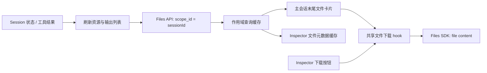
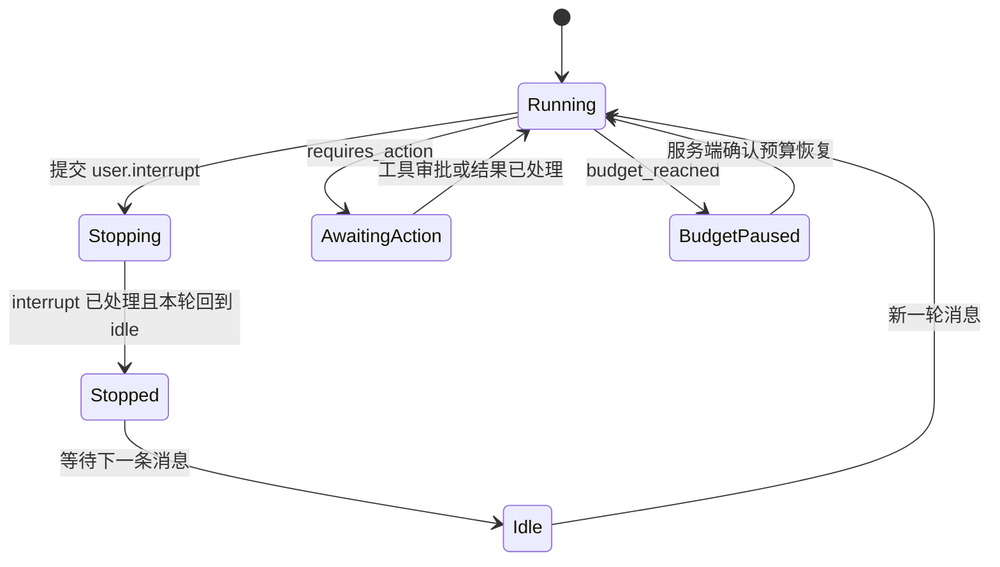

# Session 会话 Viewer 设计

## 目标

Session 详情页同时承担继续对话和检查运行上下文两个职责。页面以 Claude Platform 新版 Session Viewer 作为主从布局、信息密度和事件交互基准，同时保留 OMA 的业务语义、API 合同、shadcn/new-york 组件与明暗主题令牌。

本页面不再使用旧版 `Events / Resources / Agent / Environment / Credentials` 页面级页签。主界面固定由左侧会话转录和右侧 Session Inspector 组成，用户无需离开对话即可查看上下文。

Sessions 列表点击「创建会话」并提交成功后，直接进入刚创建的 Session 详情：`/workspaces/{workspaceId}/sessions/{sessionId}?interactive=true`，聚焦消息输入框。Session 列表创建和编辑、Agent 列表/快速查看/详情发起对话统一经 `ManagedEntityDialog` 分发到 `SessionCreateDialog`，由同一组件管理表单状态、校验与引用加载。弹窗使用 Session 专属 shadcn Dialog，桌面宽度 640px，以单列依次展示 Title、Agent、Environment、Vault 和 Resources；Header/Footer 固定，字段区在窄屏或内容增多时独立滚动。Footer 以留白衔接字段区，不添加横贯弹窗的分隔线；Session 创建弹窗内输入框/选择器统一为 40px、高度与圆角一致，采用 popover 背景和轻量焦点环，禁用态使用 muted 令牌。适配样式仅作用于 `.session-create-dialog`，不覆盖其他功能弹窗。Title 最长 500 字符，Agent/Environment 字段提供管理入口；从 Agent 发起时使用只读引用，凭据库统一采用添加按钮、搜索弹层和可移除标签，集合变化后重置授权确认；引用资源加载失败可重试。提交期间禁用字段、取消和关闭，in-flight ref 阻止同帧重复提交；创建 payload 合同不变。创建失败时留在列表和对话框里显示错误；编辑已有 Session 仍停在列表。不改变列表分页或侧边栏折叠。

## 创建、快速查看与标识符

- 2026-10-13 提供的 `session.har` 中，`2nzfpvkf-rq47.js` 的 `ClippedId` 使用 CSS 裁剪，`CopyableId` 的点击和键盘处理始终向剪贴板传入原始 ID，并通过 Tooltip 与勾选反馈复制结果。`4264g0ol0a34b.js` 使用 `RowEndQuickview` / `SessionSlideOverContent` 展示侧边预览；新建成功后导航到带 `interactive=true` 的 Session 页面。HAR 仅用于核对这些交互，不提交原文件或其中的请求、凭据和账户数据。
- OMA 使用 shadcn Button + Tooltip 实现 `ResourceIdButton`。面包屑、无标题 Session 的标题、摘要中的 Agent/Environment/Vault 和 Inspector 的 Session ID 都可直接复制完整原始值。文本以 CSS 裁剪而非把字符串改成含省略号的 ID；Inspector 和快速查看标题支持完整 ID 换行。点击或 Enter/空格复制，Tooltip 显示完整值，成功后显示勾选与 toast；失败不显示成功状态，传统剪贴板降级路径始终清理临时元素。
- Session 列表使用独立的 TanStack Table + shadcn Table，以 `ID / Name / Status / Agent / Cost / Tokens in-out / Created` 排列，行高 44px、表头 36px，采用细分隔线与 hover 反馈。Agent 优先展示快照或已加载 Agent 列表中的名称和版本，未知时使用真实 ID。ID/Name 链接打开完整会话，行内非交互区域打开快速查看。Cost 保留现有计算，并提示公开定价口径；未知用量和费用保持 `—`。加载使用同尺寸 Skeleton；无会话、无匹配结果和请求失败分别提供创建、重置筛选和重试入口。
- 搜索框移除重复的 ID 前缀；输入完整 `sesn_*` ID 且当前页没有该条目时，防抖 300ms 后按 Workspace 调用 retrieve，在原列表位置显示找到的会话，查询期间展示 Skeleton，找不到或失败时展示错误和重试。按 ID 获取的结果独立于列表分页，查询期间隐藏分页；清除搜索恢复原列表页和筛选。Created/Agent/Deployment/Status 继续使用现有筛选参数和状态预设。
- 列表行尾提供可见的「快速查看」按钮，菜单也提供「快速查看」和「进入对话」。预览使用 shadcn Sheet，读取当前 Workspace 下的 Session 元数据和最新 20 条事件，按后端返回顺序反向展示为正序，不导航、不重置列表筛选、选择或分页。提供加载、错误、空活动与刷新状态；关闭时中止事件请求并忽略迟到结果。切换 Workspace 时关闭预览，禁止将旧预览带入新作用域。
- 快速查看的「对话预览」复用 Session 转录模型的 `platformTranscriptFiltering`，在最新 20 条事件范围内展示消息正文、可展开的灰色思考和工具名称/路径/命令摘要；消息使用现有 Markdown 组件。用量、正常模型请求和线程状态等内部事件不逐条展示，执行错误仍可见。消息间使用留白，不添加逐条分隔线，Header/Footer 也不增加横线。窗口内只有内部事件时明确提示进入完整会话查看历史，与从未有活动的空状态区分；这不是完整轮次加载或 Claude 的轮次切换功能。
- 预览中可复制完整 ID、打开关联 Agent/Environment/Deployment，或进入完整对话。预览只展示近期活动，不在 Sheet 中发送消息或建立 SSE；完整历史、流式转录与审批仍由 Session Viewer 承担。已归档、terminated 或 deleted Session 的按钮使用「查看会话」。
- 可接收消息的空会话显示 shadcn Empty「开始对话」状态，「输入消息」聚焦该 Viewer 的 Composer。归档或终止会话保留只读空状态；发送、停止与工具审批的 API 合同不变。

行点击使用 `Element` 判断交互目标，覆盖 SVG 图标；来自菜单 Portal、实际不属于当前行 DOM 子树的点击不打开预览，避免菜单操作与快速查看同时执行。完整 ID 搜索缓存按 Workspace 和 Session ID 隔离。编辑和归档成功后，取消该 ID 未完成的查询并使用 mutation 返回的完整 Session 同步缓存；归档结果显示已归档状态和只读操作。删除成功后将该 ID 的缓存结果设为 `null`，即刻移除旧行；mutation 失败保留原结果。分页列表仍按原有逻辑刷新，不依赖刷新分页来更新 ID 查询。

验收覆盖完整 ID DOM/复制与失败反馈、列表预览不导航、SVG 和菜单操作不误开预览、跨页 ID 查找及编辑/归档/删除后的缓存同步、空结果重置、单次创建与提交期间关闭保护、标题长度限制和创建后进入交互页面，以及 Chromium 中的键盘复制、Escape 关闭与焦点恢复、明暗主题和 390px 窄屏布局。浏览器界面检查使用隔离的 API fixtures，不代表真实沙箱或模型调用的端到端验收。

## 页面结构

宽屏标题区将名称、状态、Agent、Environment、Vault、耗时、费用和更新时间放在同一摘要行；除状态外，摘要使用点分隔的轻量文本元信息，不使用连续描边 Badge。操作菜单位于右侧。较窄宽度按下述降级规则换成标题行与元信息行。摘要下方依次是转录搜索、线程时间轴和 Viewer；主栏固定展示转录，不提供事件类型筛选或 Debug 视图切换。

Session 画布占满 `SidebarInset` 的全部剩余宽度，不设置页面级 `max-width`，Shell 也不再额外占用横向 padding，避免超宽屏出现与 Viewer 无关的对称空白。Breadcrumb、标题摘要和筛选工具条共用由 Session 画布容器宽度驱动的响应式内部内容轨：窄屏 `16px`、中等宽度 `24px`、桌面 `32px`；Claude 的 Minimap 例外地固定使用 `32px` 外层 gutter。Viewer 与它们共享同一画布边界但不额外添加左右边框。Transcript 正文、Action Card 和 Composer 继续由各自的 `720px` 内容轨限制阅读宽度；Inspector 继续使用独立宽度规则。顶部 Header 按 Claude 的层级分成两行：Breadcrumb 与 Actions 共用第一条 utility row，标题、状态和摘要位于第二行；容器小于 `768px` 时 Actions 才移至 Breadcrumb 下方。`1280px` 后显示 Created/Tokens，`1536px` 后标题与摘要横排并显示 Environment/Resources/Vaults。标题与状态优先保持单行；空间不足时摘要元信息移至标题下方，并按语义优先保留 Agent、Cost 和 Duration。操作按钮保持独立，不得覆盖标题或元信息。

转录工具条保持单行，桌面高度约 `44px`。左侧只保留 Search，搜索框由 Viewer 容器宽度响应：容器小于 `640px` 时为 `176px`，达到 `640px` 后固定为 `224px`；右侧 Copy/Inspector 操作固定可见，单一搜索控件不创建横向滚动轨道。`Copy all` 始终复制当前 Lane 的完整转录，不受搜索结果过滤影响。原始事件浏览统一放在 Inspector 的 Events 页签；主 Transcript 不展示 `All events`、事件类型或 Debug 控件。Inspector Events 无条件挂载 Claude 的 FilterCombobox 触发器：初始显示 `All events` 且 popup 关闭，点击后提供搜索、`Transcript events` 和 wire event types 多选；没有 wire event type 时也不禁用入口。Minimap 内部使用 Claude 的 `8px` 顶部、约 `28px` 主/活动 Lane、`20px` 非活动 Lane、`6px` Lane 间距和 `4px` 底部节奏；多 Lane 布局始终预留一个展开子 Lane 的高度，切换活动 Lane 只能改变内部行高分配，不得改变 viewport 高度或向下挤压 Viewer。viewport 用 `-3px` inline margin 配合 `3px` padding 保护 tick outline，并在多 Lane 纵向滚动时使用 `16px` 底部渐隐。初次加载事件时先显示同尺寸的 shadcn Skeleton，加载完成后原位替换 Minimap；没有可展示事件时不保留空白轨道。`1×` 时只允许纵向滚动并隐藏横向 overflow，轨道使用默认光标；放大后才启用双向滚动，并以 grab/grabbing 光标提示可按住鼠标水平平移。拖动只改变 Minimap viewport 的 `scrollLeft`，不触发事件 seek；位移小于 `4px` 的 pointer 手势仍按点击事件处理。触控板/滚轮横向滚动与鼠标拖动必须共存，两种状态都隐藏原生 scrollbar。Minimap 支持 `1×–4×`、每步 `0.25×` 的缩放；内容足够高时可在 `100px` 最小高度与 `min(内容高度, 60vh)` 最大高度之间纵向调整，默认不超过 `280px`，键盘 ArrowUp/ArrowDown 每次调整 `16px`。所有 Lane 共用同一条时间映射，同一时间发生的跨 Lane 事件必须横向对齐；该几何映射不得改变后端事件数组或转录展示顺序。短事件绘制宽度至少为 `3px`。多 Lane 左侧使用可淡出的 sticky Lane 名称；sent/received 可以可靠配对时使用两端事件位置绘制贝塞尔连接线，尚未收到对应事件时只在已知目标 Lane 上绘制临时连接，目标 Lane 缺失时不猜测。连续至少 `30s` 的 idle 区间使用约 `11px` 固定宽度参与共享时间映射，并以 Lane 背景 window 表达，不再渲染斜纹 idle tick；长时间空闲不得挤压下一轮 turn 的可见宽度。时间线支持 Left/`k`、Right/`j`、Home、End 定位。Minimap hover 详情通过 `document.body` portal 使用 fixed 定位，避免被 viewport 的纵向 overflow 裁剪。进行中的 model bracket 从 `span.model_request_start` 起标记为 open tick，并按当前时间每 `250ms` 增长；时间轴至少保留 `10s` 的可视时间域。open tick 使用约 `2s` 周期的轻量透明度脉冲，并在 `prefers-reduced-motion: reduce` 下禁用。收到 `span.model_request_end` 后使用精确 inference duration，若结束 span 尚未进入 SSE 缓存，则先用紧邻的 idle/status 边界冻结临时时长，历史事件补齐后不得产生宽度跳变。

Viewer 包含两个区域：

1. **转录区**：按 speaker turn 和 model iteration 展示 User/Agent 消息、Thinking 摘要、紧凑工具调用行、线程 lane、minimap、消息输入框和待处理 Action Card。
2. **Session Inspector**：默认打开，提供 `Session / Events / Tools / Resources / Threads / Traces` 六个页签以及关闭按钮。Inspector 关闭后，转录区占满可用宽度，并在工具栏显示重新打开入口。

全局控制台侧边栏不属于 Viewer。进入 Session 时必须保持用户原有展开状态，不得因路由切换自动收起、展开或改成临时抽屉。

## 转录与对齐

- Session 与每条可见子 Thread 都先建立 SSE 订阅，再从第一页扫完事件历史；扫描期间继续接收实时帧。SSE 正常结束、报错、建连超时或流空闲超时后清理未完成预览，退避重连并重新扫全量历史。流已结束时取消尚未完成的本次历史请求，下一次订阅重新扫描；中断的扫描不能留下可用于跳页的游标或“历史已完整”标记。手动刷新实时 Session 也重新订阅并扫描历史。永久停流的子 Thread 结束加载状态。历史与 SSE 按 JSON 事件 ID 合并，重复事件只展示一次；持久事件与对应的 `event_start`、`event_delta` 帧都展示同一个 `id:`，但 `id:` 不用作 `Last-Event-ID` 回放游标。Thinking 与文本是两组独立的事件 ID。
- 同 ID 的最终 `agent.message` / `agent.thinking` 通过 SSE 或历史同步到达时，清除对应的临时 delta 帧；`agent.message` 由最终正文接管展示，`agent.thinking` 只保留状态摘要。已完成的事件不再接受迟到的预览开始。`span.model_request_end.event_ids` 仅清理所列 ID 的未完成预览。不同 ID 的 Worker echo 属于 #393，前端不猜测它与预览的对应关系。
- Transcript 内容列、待处理 Action Card 和消息输入框共享最大 `720px` 的居中内容轨道。
- 三者在窄容器中使用相同的 `16px` 水平留白；滚动条采用覆盖式自动隐藏样式，不允许通过 Composer 或 Action Card 的伪滚动容器预留 gutter。左右边界必须逐像素一致。
- 转录先按未过滤的事件流建立 speaker turn，再按 model request bracket 建立 iteration，最后应用搜索；搜索不得把原本由 User、idle、outcome、status 或 speaker 变化分开的 turn 重新合并。
- 前端缓存、Transcript、Inspector Events 和 minimap 以历史 `data[]` 顺序为准；扫描期间实时帧即时展示，后续历史分页到达时按历史顺序对账，仍未出现在历史中的实时事件留在末尾。不得按时间、speaker 或事件类型再次排序。同 ID 更新在原位置替换，不同 ID 的消息即使内容相同也各自保留；流式预览被正式消息替换时也必须保留预览原位置，即使 `status_idle` 先到也不能先删除预览再把正式消息追加到 turn 之后。Idle 去重和 Tool Batch 折叠只删除或压缩事件，并将聚合项放在第一条被折叠事件的位置，不能移动其他事件。`status_idle` 到达后保留短暂 grace period，再强制同步历史并清理仍未完成的流式预览；Idle 可以结束 UI 的生成状态，但不能提前销毁等待后续 Agent/message end 事件补齐的 model bracket。
- 对话使用仓库共享的 shadcn `Message` / `Bubble` 结构：User turn 是 OMA 明确保留的右对齐风格，桌面最大占内容轨 `80%`，窄屏放宽到 `92%`；Agent turn 按 Claude 逻辑占满 720px 内容轨，不再额外收窄到 `90%/94%`。
- User 使用 `session-speaker-user/10` 角色色背景和 `0.5px session-border` 的轻量 panel bubble，圆角 `10px`、水平内边距 `11px`、垂直内边距 `6px`；Bubble 高度由正文自然决定，不设置会在单行正文下方制造额外空白的固定最小高度。Agent 名称和时间在连续 turn 中只展示一次；每个 Agent iteration 使用 `10px` 圆角、`0.5px` 语义边框、`10px 4px` 内边距和 `5px` 间距，Agent text、Thinking 和 Tool Call 在 panel 内保持 `6px 2px` 行内节奏。idle、outcome 和 status 等系统边界保持全宽，不伪装成对话气泡。
- Agent 标签使用 `session-speaker-agent` 主题变量，User 标签使用 `session-speaker-user`；两个变量必须同时定义浅色和深色值，不使用 chart token 或硬编码颜色冒充领域语义。
- Agent 消息在流式增量到达时和完成后共用 `react-markdown` 与 `remark-gfm` 渲染 CommonMark/GFM；每次增量更新当前 Markdown，结束时由最终事件内容接管，不从纯文本切换渲染方式。支持标题、有序/无序/嵌套列表、引用、任务列表、删除线、表格、代码、链接和 Markdown 图片。原始 HTML 不解析；URL 只允许 HTTP(S)、邮件、页内锚点与站内根路径；代码块复用现有 Highlight.js 渲染。单条正文按生产 JS 的 UTF-16 `length/slice` 语义最多渲染前 `50,000` 个字符，超限时显示原始总字符数；普通 Markdown 与 fenced code 在流式和完成态均使用同一上限。
- Agent 正文与 Thinking 摘要都复用 shadcn `Bubble/BubbleContent`；iteration 内使用无额外卡片层级的 `ghost` variant，正文保持 Markdown 语义，Thinking 使用紧凑的 ghost Button。Thinking 保留单行斜体摘要 `Thought for {duration}` 或 `Thinking…`。新 thinking 块在开始时发布无正文状态，不传 thinking 内容 delta，结束由原 model request bracket 收敛；相同 ID 的 Worker 预览、回传与重试保持同一条记录。改动前存储的带正文 thinking 在读取时由后端隐藏正文，前端仍保留折叠和 Markdown 展示能力，正文在明暗主题下均使用灰色 muted-foreground，包括 Markdown 子元素。无正文或 redacted thinking 仅显示摘要，不展示签名或加密数据。
- Agent turn 挂载时只要仍是 open 状态，就播放一次 `180ms ease-out` 入场；首次加载和切换 Lane 后重新挂载的 open turn 也会播放，已经闭合的 turn 直接显示最终状态。`prefers-reduced-motion: reduce` 下不播放位移或缩放。
- 工具调用保持 `24–28px` 的单行结构，展示工具名、截断输入摘要、执行状态和耗时；点击后在 Inspector 的 Events 页签查看原始事件。
- Transcript 耗时统一优先使用对应语义的明确上报值（包括 `0`），仅在缺失时使用时间差计算。Thinking 优先使用事件上报耗时，缺失时使用请求开始至 Thinking 事件的时间差，与 `Thought for {duration}` 摘要共用取值；Agent 正文优先使用上报的模型请求耗时，其次使用事件上报耗时，均缺失时使用模型请求总时间差。没有模型请求记录的独立 Agent 消息仍在标题行展示已知耗时。事件执行耗时在解析时拒绝负数及非有限值，保留有效的零值。工具优先使用有效的结果事件上报耗时，其次使用有效的调用事件上报耗时，均缺失或无效时根据确认（若有）或调用事件至结果事件的 `processed_at` 时间差计算，不含确认前的等待时间。Inspector 工具调用表格与详情也区分明确的零值和未知值。并行工具分组展示已知执行耗时的最大值。缺失耗时保留为未知并隐藏标签，明确上报的 `0` 仍显示为零；进行中的模型内容不显示伪造的零耗时。耗时悬浮提示与可见数字使用同一数值。
- Markdown 的交互链接不能嵌套在事件选择按钮中；正文链接保持自身语义，事件选择使用独立可访问控件。
- 原始事件审计统一位于 Inspector Events，固定使用 `Event / Preview / Time` 三列，并对事件 namespace 做轻量着色。前端由 `event_start` 生成的未完成流式占位（`is_streaming: true` 且无 `processed_at`）只参与 Transcript 实时渲染，不列为独立审计事件；正式消息到达后按服务端事件展示，避免占位与正式消息同时出现为两条 `agent.message`。实际未处理的输入事件仍显示 `queued`。

## 滚动与高度

- Session Detail 是 Console Shell 内的 viewport workspace。`SidebarInset`、内容 wrapper、Session Detail、Viewer 和分栏均使用连续的 `flex/min-h-0/overflow-hidden` 高度链，不依赖 `xl:` 才生效的 `calc(100vh - ...)`。
- 常规双栏状态只有两个主要纵向 scrollport：Transcript 的 shadcn MessageScroller viewport，以及当前 Inspector panel 的 Base UI ScrollArea viewport。
- Composer、Action Card、Viewer、ResizablePanel 和 Inspector 外壳不得声明纵向滚动；textarea 只有超过 `160px` 后才局部滚动。
- Transcript 内容本身不追加底部 spacer；底部呼吸区只由 MessageScroller 内容列统一提供，避免短回复与 Composer 之间重复叠加空白。
- Events 页签可将列表和详情划分为两个独立 scrollport，但详情内部的 `pre/code` 不得再创建第三层纵向滚动。
- Inspector tabs、lane tabs 和 minimap 的横向滚动条默认隐藏；活动 Inspector 标签必须自动滚入可见范围，不使用 scroll-timeline 或自定义属性维护渐隐动画。

## Inspector

Inspector 的默认宽度为 `480px`，最小宽度为 `360px`，最大不超过容器宽度的 `70%`。容器达到 `1056px` 时使用可拖拽双栏，拖动宽度保留在当前 Viewer 实例中；小于阈值时 Inspector 覆盖 Viewer 内容，关闭后恢复原转录滚动位置。所有 Inspector 页签必须约束自身最小宽度和横向溢出，长事件预览不能反向撑宽控制台主区。

Inspector header 与 tab 控件共用 `32px` 总高度。外壳始终使用 panel surface 和 `overflow-hidden`；普通页签各自只使用一个 Base UI ScrollArea。Tab list 可以在极窄宽度下横向移动，隐藏原生 scrollbar，并将活动 tab 自动滚入视图。每个 tab 使用带 `inspector` query 的真实链接：普通点击只切换 Base UI tab，modifier click 保留浏览器新窗口/新标签行为，刷新后恢复合法页签。关闭 Inspector 时，若焦点原本位于 Inspector 内，则转移到重新打开入口；从该入口打开后焦点转移到关闭按钮。Inspector header 只保留页签和关闭按钮，不提供额外的 Full height/More 状态。

六个页签的职责如下：

1. **Session**：ID、状态、创建/更新时间、Agent、Environment、Vault、Deployment 和 Cost。关联实体名称可导航到 OMA 对应详情页；metadata 请求失败时继续用原始 ID 提供同一链接，不能降级成不可点击文本或数量。
2. **Events**：按后端返回顺序排列原始事件，直接使用 `Event / Preview / Time` 粘性表头、`192px` 事件列和 `24px` 紧凑行。FilterCombobox 的 `Transcript events` 与 wire type 使用交集语义；筛选只隐藏行，不重新排序，也不清除仍存在但暂时不可见的已选 detail。Time 列只展示时间，不影响顺序；持久事件的 `processed_at` 非空；尚未完成的实时预览可以没有处理时间，不回退到 `created_at`。选择事件后使用 Claude 的纵向 list/detail split：列表至少保留 `120px`，详情默认 `360px` 并可拖动；为满足 OMA 已确认的交互要求，详情在首次出现或切换事件时播放 `180ms ease-out` 的 `translateY(8px) + opacity` 上浮动画，并以顶部 hairline 和轻量向上阴影表达层级；它仍是 Inspector 内的普通分栏，不改成 drawer 或脱离滚动模型的 overlay。`prefers-reduced-motion` 下禁用动画。Agent message/thinking 详情默认展示 Raw JSON；当前浏览器标签页实时捕获到增量帧时可切换 Deltas 紧凑表格，历史事件不伪造增量，也不维护字符缺失/重复比对算法。详情由唯一的 viewport 统一滚动。
3. **Tools**：展示 Name、Permission、Calls、Failed、p50，并提供工具搜索和 `All threads / Current agent / Current thread` Scope；`Current agent` 只按 Lane 的既有 `group` 归属筛选，不按名称猜测。配置工具按 Built-in、Custom 和 MCP Server 分组，未出现在当前 Agent 配置中的实际调用单列为 `Called, not configured`；只有主 Agent 配置可用时才展示其 `Configured on`。默认 detail 是带 `64×64` CSS conic-gradient 结果环的 Overview；Failed 非零时同时展示失败率，Failed/Denied 为零时使用国际化 `none`，Completed 始终保留数字。选择工具后展示调用表，调用行与转录的选择和悬浮状态联动，清除选择后回到 Overview。调用表仅在存在审批时展示 Waited，仅在当前 Scope 跨多个线程时展示 Thread。p50 仅统计已完成或失败的调用，优先使用有效的执行耗时（包括明确的 `0`），缺失或无效时才使用确认（若有）或调用至结果事件的时间差，与调用表保持一致。Time in tools、Executing 和 Waiting 对同一线程内重叠的调用区间做并集合并，不重复累计同一 Tool Batch 中的并行墙钟时间；不同线程分别累计。
4. **Resources**：提供常驻资源筛选，按 Path/Size 展示 Session 挂载资源（File 用挂载路径与文件元数据；Memory Store 用快照 `name`/`memory_store_id`，Size 为 `—`）。可通过 `+ Resource → File` 挂载已有文件；Memory Store 在创建 Session/Deployment 表单中挂载，Inspector 只读展示。当前产品不展示 GitHub Repository 入口。
5. **Threads**：展示有真实数据来源的 Thread、Status、Context；在后端提供线程级费用前不展示 Cost 占位列。detail 始终绑定 active thread，不提供本地关闭态。detail 显示 Agent、Model、Effort 和 `140px`、step-after area 的 Context usage 图；图上 model-request point hover 与 Transcript/Events 使用同一个 event ID 联动。单时间点只显示一个 X 轴标签，短会话显示秒，避免重复时间标签叠加。
6. **Traces**：仅在 `observability.enabled=true` 时查询当前 Session 的 OpenObserve traces。选中 trace 后使用 `trace_id` 查询参数保存详情状态；返回列表或切换到其他 Inspector 页签时删除该参数。observability 路由返回 404 时展示 “Observability is not enabled”，不使用通用加载错误。

Events、Tools、Threads 共用 list 最小 `120px`、detail 默认 `360px` 的纵向 split。拖拽条使用 `7px` 命中带和居中的 `1px` hairline，并在 hover、键盘焦点和拖动时显示语义强调色。用户调整后的 detail 高度按页签在当前 Session Viewer 生命周期内分别记忆；不写入浏览器存储，也不跨 Session 恢复。三者关闭语义不同：Events 清除 event 选择；Tools 清除 tool 选择并回到 Overview；Threads 始终绑定 active thread。只有由消息/事件选择触发的 Events detail 播放上述轻量上浮动画；分栏尺寸、滚动所有权和关闭语义保持不变。

## 数据来源

| 区域          | 数据来源                                            | 说明                                                                                                |
| ------------- | --------------------------------------------------- | --------------------------------------------------------------------------------------------------- |
| 标题摘要      | Session retrieve + events                           | 状态、引用、用量、时间与实时状态                                                                    |
| 转录与 Events | Session/Thread events + SSE                         | 保留现有缓存、补帧、lane 和实时状态机                                                               |
| Session       | Session retrieve + Agent/Environment/Vault retrieve | 只读取关联实体名称和固定版本信息                                                                    |
| Tools         | 原始事件 + Agent retrieve                           | 聚合配置工具、权限、调用、失败和耗时                                                                |
| Resources     | Session retrieve + File metadata                    | 挂载关系来自 Session；File 名称/大小/下载权限按 `file_id` 获取；Memory Store 用快照 `name`/`memory_store_id` |
| Threads       | Session threads + thread events + Agent retrieve    | 聚合线程状态、模型用量和 context 阶梯点                                                             |

主会话的转录末尾显示「输出文件」卡片，文件名、类型和大小来自 Files API；整个卡片可点击下载，显示下载状态，并通过共享下载 hook 处理错误。输出区使用圆角容器、柔和底色、淡色轮廓和内边距与消息正文区分，内部下载卡片使用背景色形成层次，适配明暗主题。卡片位于消息滚动容器内，位于输入框上方；关闭 Inspector 后仍可见，窄屏自动变为单列。没有可下载输出时不渲染空占位。输出属于整个 Session，子线程和消息搜索视图不展示该汇总，避免把 Session 文件误认为某个子线程的产物或搜索命中。

输出列表直接调用 `GET /v1/files?scope_id={session_id}&beta=true`，同时携带 Files 与 `managed-agents-2026-04-01` beta 请求头，读取完整分页并只显示 `downloadable=true` 的文件；按 file ID 去重。Session `resources[]` 的输出摘要存在数量上限，因此卡片不依赖资源摘要是否包含某个输出文件。Files 列表和文件元数据缓存按 workspace/session 或 workspace/file ID/资源版本隔离；作用域切换取消旧请求，列表结果也会填充 Inspector 使用的元数据缓存。分页游标缺失或重复会终止读取并展示可重试错误。

运行中每 3 秒刷新输出列表，状态改变（含 idle）、工具结果、资源变更和手动刷新时及时同步；后台页签暂停轮询。列表刷新失败时保留已加载的卡片，展示错误与重试入口；下载失败提示错误并恢复下载动作。

进入 Resources 页签时重新请求 Session retrieve，以获取后端最新挂载关系；再次点击已激活的 Resources 页签也会刷新。资源缓存按 workspace/session 隔离，切换作用域后旧响应不得更新新页面。运行中的会话每 3 秒刷新资源，Resources 可见的非运行会话每 10 秒刷新，后台页签暂停轮询；恢复可见时由 TanStack Query 刷新。状态切换（含运行结束）和工具结果事件立即触发刷新。资源查询只订阅 `resources[]`，资源深度相等时保留当前 Session 对象；`usage`、`updated_at` 等非资源字段变化不会通过资源轮询更新 Session 状态。文件元数据按 workspace/file ID/资源更新时间缓存，各文件独立更新，避免一个慢请求阻塞整个列表。打开 File 表单时按需读取 Files list，提交后调用 Session resources add，并再次刷新 Session。Memory Store 资源直接使用 Session 快照里的 `name` 和 `memory_store_id`，不额外请求 Memory Store retrieve。资源表格下载按钮以 Files metadata 的 `downloadable` 为准：未加载或不可下载时禁用。生成的输出文件通过 SDK 的 Files download（`GET /v1/files/{file_id}/content?beta=true`）下载，并保留文件名、workspace/org 范围和 cookie 鉴权；失败展示错误，不生成空文件。Files 页面复用相同下载 helper。

## 对话与审批行为

- `Enter` 发送，`Shift+Enter` 换行；输入法合成中和键盘长按不得触发发送。
- Composer 使用 shadcn InputGroup 和语义化 form：空状态高 `56px`、圆角 `22px`、单行起步并按内容增长至 `160px`；Send 是 submit，Stop 是普通 button。输入框使用柔和的语义底色区分区域，移除常驻描边和聚焦投影，仅在聚焦时显示低对比度的 `1px` 焦点环。附件标签使用无描边的浅底色和 `8px` 圆角，文件图标与移除按钮弱化为次级文字色；浅色、深色和窄屏保持同样的轻量层级。
- 通过附件按钮选择多个本地文件，可移除待发送附件，也允许仅附件发送。发送时依次上传到 Files API，再调用 Session resources add 挂载到 `/attachments/{随机 ID}/{文件名}`；每个文件路径独立，同名文件不会相互覆盖。上传名与挂载名统一替换控制字符（Unicode Cc）、路径分隔符和上传接口禁止的文件名字符，空名及点路径使用 `file`；保留原始附件标签、文件内容、类型和修改时间。未挂载附件重试时重新计算合法挂载路径，也可修复已有上传 metadata 的非法路径，继续复用 file ID。消息文本附带 `/mnt/session/uploads/attachments/{随机 ID}/{文件名}`，让 Agent 通过工具读取文件，不改变 `user.message` 文本事件合同。挂载成功后刷新资源及 Files 选择缓存。上传、挂载或发送失败时保留文本与附件；重试复用已成功上传的 file ID 和已完成的挂载，避免重复操作。切换 workspace/session 后清空当前输入状态。
- 无文本且无附件、发送中、已归档、已终止或已删除的 Session 不能发送；只有 idle 或初始 queued Session 可提交新消息。运行期间保留输入框草稿，但 Send 和 Enter 不发请求；草稿只在当前页面内存中，刷新后丢失。本次不增加客户端待发队列或自动重发。
- running、queued 或 rescheduled Session 显示停止按钮，并通过既有 `user.interrupt` 合同停止。
- `user.interrupt` 是控制事件，在用户消息命名空间分类之前归为状态，不生成 User 气泡或原始 JSON 正文。对话中的中断提示在请求未处理或本轮尚未回到 idle 时显示「正在停止」，已处理且观察到同一执行范围的 idle 后显示中性的方形图标、「已停止」与「已由用户停止」。停止请求成功仅表示已提交中断，Composer 保持停止按钮禁用，直到服务端确认 Session 不再运行；请求失败恢复重试，草稿不清空。
- 模型请求取消与执行失败分开：以 `model_request_start_id` 关联请求，用同一轮、同一线程中已处理的 `user.interrupt` 确认 `cancelled`，转录展示「已中断」，不显示红色错误标记。全局中断覆盖当前各线程，指定线程中断只影响该线程。完整 Session 事件来自主线程和子线程缓存的分段合并；按事件时间排序并计算中断请求集合后，将同一只读集合传给各 lane，不能在 lane 局部数组中重新判定全局停止，也不向子 lane 复制全局停止展示行；未处理的停止请求、没有匹配请求、仅有 `end_turn`、其他线程或下一轮的中断不能消除错误。真实 `session.error` 和非取消的模型失败继续展示；模型失败不再标为「模型请求完成」。展示状态独立于原始事件，Debug/复制 JSON 保留 `is_error` 与 `error` 字段。
- 工具结果严格识别 Claude 的两种明确中断文案与 `is_error=true`，展示中性的「已中断」而非失败。普通错误仍为失败；权限拒绝为「已拒绝」，审批尚未处理时继续等待，普通工具显示「等待审批」，自定义工具显示「等待结果」。普通自定义工具的等待卡片仅提示等待结果，不提供错误的审批按钮；AskUserQuestion 继续使用问卷。转录、工具详情、Inspector 表格复用状态 Badge；Inspector 将中断计入独立结果类别，不计入失败或进行中，并保留其执行耗时。
- 普通消息 `processed_at` 为空时显示「排队中」，保留消息正文。`requires_action` 与 `budget_reached` 显示「等待操作」／「已达到预算」及对应状态行，不伪装成执行错误；这两种 idle 状态禁止发送普通消息并保留草稿，恢复 running 后清除旧的 idle 原因。重排队、运行、完成与终止均使用独立中英文状态。正常 `end_turn` 仍作为 idle 边界，不额外制造停止事件。
- 2026-10-14 提供的 `session.har` 包含 Claude 控制台脚本：`1eg5tx4iwbzta.js` 将 interrupt 操作映射为 `{type:"user.interrupt"}`，`0uh2z7eexsgkn.js` 的 `getEventContent` 对该类型返回 null，并通过 `isInterruptedResult` 识别两种明确的工具中断结果。这份 HAR 没有实际停止请求或本地 Session 的错误事件，不能据此确认截图中执行失败的后端原因；原 HAR 与解出的脚本不纳入仓库。
- Claude 官方 [事件与流式处理](https://platform.claude.com/docs/en/managed-agents/events-and-streaming) 明确区分中断排队、已处理与回到 idle，且 `end_turn` 同时表示自然结束与中断；[线程文档](https://platform.claude.com/docs/en/managed-agents/session-threads) 描述工具中断结果与线程作用域。HAR 的文案目录分别包含 Stopped、Failed、Denied、Needs approval；没有停止后的详情页，不能据此声称此处文案、图标或位置与 Claude 界面逐项一致。本实现复用可核实的状态语义和项目自身的 shadcn 组件。

- 已处理的 `user.interrupt` 关闭当前执行指示；随后落盘的部分消息仍通过显式 `model_request_start_id` 关联原请求。对已确认中断的请求，思考和部分正文使用同一模型请求分组。模型结束先于部分正文到达时，在本次只读构建内保留已结束请求的关联和结束元数据；迟到正文凭显式请求引用回到原分组，并保持已结束状态及用量、耗时，不重新开启执行指示。对话把停止提示放在该执行范围的收尾内容之后、下一条已处理用户消息／新请求／running／rescheduled 之前；idle 先于模型结束到达时也允许收尾事件归位。当前 lane 已有停止提示时，匹配的模型取消行不再重复展示；子 lane 没有全局停止展示行时继续保留其中的模型中断状态。原始事件数组、Debug、Inspector 与时间线的时间戳及顺序不变；真实错误继续保留。工具行和单条／批量详情的同一生命周期只显示一个状态标识。
- 验收使用 `sessionExecutionState.test.ts`、Session Transcript/Composer/Inspector 及详情页测试覆盖跨轮、跨线程、pending 中断；详情页测试通过分开的 Session/Thread 历史接口加载事件并切换实际 lane，验证全局／指定线程停止、pending 停止、非取消错误和停止后的新请求，避免仅使用扁平数组的误绿。另覆盖无 trailing idle 的停止括号关闭、工具状态去重、取消与真实失败、工具各终态和预算暂停。浏览器模拟 API 事件，点击实际 Stop 按钮，检查浅色／深色／窄屏、停止后继续发送和各状态展示；截图与脚本放在仓库外，不提交 Git。
- 最新 `session.status_idle.stop_reason` 为 `requires_action` 时，在转录与输入框之间展示 Action Card。普通工具审批发送 `user.tool_confirmation`，AskUserQuestion 答案发送 `user.custom_tool_result`；等待期间禁用普通消息输入框。
- 用户离开列表底部后停止自动跟随并显示“回到最新事件”；位于底部时继续跟随流式正文增长。发送新消息成功后重新跟随底部，即使随后重连补入更早的历史事件，也应保持最新回复可见；主动上滚阅读历史时不强制拉回底部。
- Session 最终状态以 SSE/后端响应为准；前端临时状态只用于交互反馈。

## 非目标

- 不重写事件归一化、thread lane 或 minimap 算法。
- 复用现有 Session resources add 挂载文件；不新增后端 API，也不开放关联实体编辑。
- 不伪造 Thread cost、等待时长或后端未返回的统计数据。
- 不展示 credential secret，也不恢复旧版关联实体完整配置卡片。

## 附件与资源验收

- `SessionMessageComposer.test.tsx` 覆盖上传/挂载/发送失败后的恢复、多附件、同名文件隔离、仅附件发送、移除附件和重复提交保护。
- `sessionAttachments.test.ts` 覆盖 C0/C1/DEL 控制字符、空名与点路径、上传名和挂载名一致、原始附件与内容保留，以及已有上传 metadata 的非法挂载路径恢复；资源刷新测试验证非资源字段变化保留 Session 对象、资源内容变化仍能同步。
- `useSessionResourceRefresh.test.tsx` 覆盖运行期发现输出文件、idle 时立即刷新、刷新失败保留旧列表、重试和 workspace 切换的旧响应隔离。
- `SessionInspector.test.tsx` 覆盖慢元数据请求不会阻塞其他文件的下载入口，以及上传文件不可下载。
- `file-download.test.ts` 覆盖 Files beta、workspace/org、cookie、文件名和鉴权失败处理；浏览器验收检查文件选择、资源刷新和实际下载事件。
- 模拟浏览器流程覆盖上传失败后保留草稿、重试、两个同名文件独立挂载、资源自动刷新、输出文件下载及 390px 窄屏无横向溢出；下载文件名与内容逐字节校验通过。

## Claude HAR 参考与聊天输出验收

用户提供的 `platform.claude.com.har` 中，`0hb36q-3rvz8d.js` 与 `1vfc34t0k8rxd.js` 包含 `useListSessionFiles`、`sessionFilesQueryKey` 和 `useDownloadFileForWorkspace`：通过 `scope_id` 查询文件、按组织/工作区/会话缓存、传入 abort signal，并使用 Files SDK 下载 Blob、保留文件名和延后回收对象 URL。本实现参考这些数据流与交互行为，使用项目自身的 shadcn 组件和语义令牌。HAR 未包含完整的聊天末尾文件卡片组件，不能据此声称与 Claude 的该组件逐像素一致；HAR、原始 JS 和请求凭据不纳入仓库。

- `api.test.ts` 覆盖带 session scope 的全分页请求、beta/workspace/cookie/abort signal，以及循环游标终止。
- `SessionOutputFiles.test.tsx` 覆盖上传文件排除、输出 ID 去重、无输出占位、错误重试与旧卡片保留、作用域切换取消、运行期与 idle 刷新、下载失败恢复及重复点击保护。
- `SessionDetailPage.scroll.test.tsx` 覆盖文件卡片独立位于所属回复下方、关闭 Inspector 后可下载，以及搜索/子线程作用域切换。
- 对 React Query 轮询与组件验证，先通过 `bun test --preload ./src/test/setup.ts ...` 初始化 DOM，避免 Query Core 在其他纯工具测试先加载时被缓存为 server mode。

### 按回复展示输出文件

聊天区不再在事件列表末尾追加 Session 文件合集。Session 文件查询仍按 workspace/session 缓存、分页、轮询与取消；文件查询失败的重试提示放在消息列表前面，已加载的卡片继续保留。

- 以用户消息划分轮次，将文件 `created_at` 落在本轮起点与下一轮起点之间的输出文件放在本轮最后一条 Agent 消息下，以独立文件框展示，保持间距，不嵌入消息正文或 iteration 的边框内；消息明确引用已有文件的 Markdown 路径链接或代码路径时，该回复也可再次展示该文件。
- 本轮存在流式消息、未结束的模型请求或正在运行/等待批准的工具时，不展示本轮文件。Session 仍在运行或存在 pending model request 时，最新轮次也不展示文件；历史已结束轮次保持展示。
- 文件列表和资源路径使用相同的刷新窗口：运行时每 3 秒刷新，运行结束后继续每 1 秒刷新、持续 30 秒，捕获晚于 idle 事件入库的文件。刚结束的 Session 在重新打开页面时也启用该窗口；旧的空闲 Session 不持续轮询，打开资源检查器时保留原有 10 秒刷新。窗口定时器在切换 Session/Workspace、归档和卸载时清理。资源页签不是发现输出文件的必要条件。
- 文件按 `created_at` 降序，默认展示最新两个；超过两个时使用共享 shadcn Collapsible 展开全部或收起。搜索结果和子线程不投影 Session 主线程的文件合集。
- 卡片显示文件名、真实 `resources.mount_path`、类型和大小。路径缺失时不从 basename 猜测，避免不同目录的同名文件误关联。
- Markdown 文件链接按完整路径匹配当前 Session 的可下载文件，支持百分号编码、`sandbox:` 和 `/mnt/user-data/outputs/` 到公开 `/outputs/` 的别名；命中后通过 Files API 下载并保留文件名，继续发送 workspace/beta/cookie 上下文。普通网站链接保持原行为。

现有 Files API 没有 message/turn 归属字段，以上时间区间归属是控制台推断，不是服务端持久化关系；删除或覆盖文件后不能通过该投影还原历史版本。Session resources 的输出投影存在数量上限，超出投影的文件仍按时间展示，但没有真实路径时不提供正文路径映射。后续如需永久、精确的消息附件及版本快照，需要服务端显式的消息与文件版本关系。

`SessionTranscriptView.test.tsx` 验证两轮之间文件留存、流式时隐藏以及结束后归位；`SessionOutputFiles.test.tsx` 验证最新优先与展开/收起；`sessionOutputModel.test.ts` 和 `SessionTranscriptContent.test.tsx` 验证同名路径隔离、编码路径、别名及正文链接下载。
