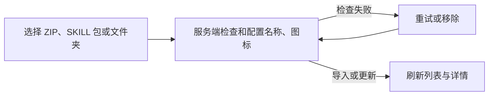

# 技能页面

## 页面与权限

工作区与超管技能页采用同一套紧凑卡片、图标选择器和两步导入组件，位于 `web/src/features/skills`。页面不显示场景分类、产出、复制 ID 或版本管理快捷按钮。名称与描述来自服务端，不依赖硬编码技能目录。

| 页面 | 卡片操作 | 详情 |
| --- | --- | --- |
| 工作区系统内置技能 | 无操作菜单 | 名称、图标、描述、文件目录、SKILL.md 正文、ID、时间与版本，只读 |
| 工作区自定义技能 | 更新技能、下载技能、更换图标、删除技能 | 保留已有信息、文件目录和 SKILL.md 正文，图标可改，技能可删除；版本记录只读 |
| 超管项目预置技能 | 更新技能、下载技能、更换图标、上架或下架；有覆盖时可恢复预置版本 | 默认展示包内容，保留版本与操作记录，技能不可删除 |
| 超管手动上传技能 | 更新技能、下载技能、更换图标、上架或下架、删除 | 默认展示包内容，保留版本与操作记录 |

卡片主体和右上角操作按钮为同级元素，打开菜单不打开详情。已有操作菜单提供下载技能，可直接下载当前可用版本 ZIP，复用详情下载接口；没有可用版本时不显示下载项。下载不打开详情、不更改技能，失败显示错误。鼠标点击与关闭详情后的指针焦点不添加黑框；卡片仅在 focus-visible 时使用共享 ring 令牌的 0.5px 内侧轮廓和轻底色，文件树按钮沿用共享按钮的键盘焦点样式。两端使用同一内容区容器：页头、来源页签、筛选栏与卡片共同限制在最多 1600px 并居中，避免仅卡片区域变窄。栅格按扣除导航与页面边距后的容器宽度分档：不足 600px 为一列、600px 起两列、960px 起三列、1320px 起四列；同档卡片均分可用空间，最大四列，间距为 16px。跨档换列允许合理宽度变化，不再要求固定 360px；名称和描述字号不随屏幕缩小。搜索与排序在窄屏同行收缩；来源页签允许较长文案在按钮内换行，所有页签保持同一行和一致高度，计数不挤出可用宽度。最后一行或单项筛选仍保留当前列结构。卡片保持 16px 内边距与至少 136px 高度。官方依据、CSS 视口与验收矩阵见 [响应式布局研究](skills-responsive-layout-research.md)。工作区卡片将来源作为名称下方的轻量文字，不单设底部标签行；描述保留两行，筛选栏已有来源计数，不重复展示总数。超管卡片展示名称、ID、状态和更新时间，沿用同一紧凑卡片。卡片图标为 28px 底座内的 16px Lucide 图形；选择面板为 8 列、3 行，点选后提交，成功后收起，不添加保存或取消行。失败显示服务端错误，不能声称已保存。已有技能变更后使相关列表和详情查询失效，工作区切换后重置分页及弹窗。

图标采用固定的 24 个 Lucide key。`icon_key` 存在技能记录中，与 ZIP 内容、版本内容分离；默认值为 `blocks`。不使用 localStorage 保存正式技能元数据。不允许普通用户修改系统技能图标；手动上传的系统图标由超管维护，项目预置图标来自源码清单，工作区读取同一字段。

## 列表

工作区保留全部技能、系统内置、自定义三个来源页签，提供名称、用途或 ID 搜索和默认、名称、最近更新排序。Console catalog 接口在服务端组合可用系统技能与当前工作区自定义技能，返回描述、图标、筛选计数和总数；每页 12 条，按稳定次序分页。来源筛选不影响其他页签的查询计数。系统目录只包含已上架且具有有效默认版本的技能。搜索、筛选、排序与翻页加载期间保留同一工作区的上一批结果，并标记网格忙碌；旧请求通过 AbortSignal 取消。切换工作区时不使用上一工作区的占位结果。

超管仅有全部状态、已上架、已下架三个页签，使用已有名称/ID 搜索、offset 分页和 revision 并发检查。列表保留名称、ID、状态与更新时间，不展示内部版本标识，不设置草稿页签或草稿状态。

超管详情的版本列表由服务端先过滤已发布版本再分页，has_more 与展示范围一致；前端直接展示返回结果，仅在结果为空时显示暂无可用版本，不再客户端过滤草稿。

超管列表与详情不显示“项目预置 / 手动上传”来源标签；操作权限继续依据服务端 bundled 标志，不根据技能名称猜测来源。预置技能可更新、选择图标和切换版本，但不提供删除技能入口；default_version 与 bundled_version 不同时在外层菜单显示“恢复预置版本”，确认后切回当前项目底本。重启和项目升级保留上传覆盖。后端保护预置记录不可删除。上传技能的删除位于外层更多菜单，确认时提交被确认记录的 revision，失败保留错误和原修订号；成功刷新两端技能目录并关闭对应详情。

保留当前页面的 `?skill={id}` 详情入口及旧 `/skills/{id}` 兼容入口。详情选中状态与前进、后退统一由 TanStack Router 管理，保留其余查询参数，不再维护独立的 history/popstate 状态。加载、失败、无结果和重试复用共享控件；页面不展示演示数据或虚构计数。浅色、深色及窄屏使用同一语义颜色和组件。

## 详情内容

两端详情采用与 Agent 快速查看一致的右侧浮动卡片：四周至少 8px 留白、最大宽度 480px、圆角和四边细边框，不使用贴边的全高侧栏。小屏保留左右间距，标题和底部操作固定，正文在卡片内滚动。沿用 Base UI 的非模态查看、Escape、焦点恢复和退出生命周期，退出完成后才清除选中技能。

工作区详情默认读取当前版本的文件目录与 SKILL.md；超管内容页复用相同展示组件。目录保留技能包路径层级，可整体折叠。初始展开最外层根文件夹，显示根目录文件（含 SKILL.md）与子文件夹；子文件夹默认收起，点击后逐层展开或收起。目录折叠不改变已选文件的预览内容。目录滚动复用共享 4px 细滚动条，使用透明轨道与中性浅色滑块，悬停时轻微加深。默认选中根目录 SKILL.md，点击文件后在下方切换为对应文件的原文预览，选中项使用中性底色标识，不提供编辑或执行。文本按内容检测，不依赖扩展名；支持 UTF-8 文本（含 Python、Java 等代码），二进制和非 UTF-8 文件提示无法预览，超过 256 KiB 的文件单独提示大小限制。请求失败可重试，切换文件不保留上一文件的正文。文件预览使用独立的 0.5px 细边框代码块，紧凑文件栏显示相对路径与语言名称，正文使用浅色画布和等宽字体。Markdown、Python、Java、JavaScript、TypeScript、JSON、YAML 与 Shell 复用 Highlight.js 和共享明暗语法色令牌，未知类型退回纯文本。高亮只生成转义后的语法标记，不执行用户内容，完整原文的 textContent 不变；保留 YAML frontmatter、标题符号、列表标记和原始换行，禁用字体连字以保证连续符号按原字符显示；长行自动折行，不渲染 Markdown、HTML、图片或链接。预览正文最高 480px，且不超过当前视口高度的 55%；长内容在正文内独立滚动，复用 4px 轻量滚动条，文件栏保留在正文上方；短内容按实际高度展示，不裁剪原文。简介仍来自技能元数据。两端详情标题栏均提供下载 ZIP 图标按钮，下载与关闭按钮放在同一水平操作行并使用相同尺寸，下载当前技能版本的完整原包，目录结构与二进制文件均保留；超管内容页切换到历史版本不改变标题栏下载默认版本的语义。预览限制不裁剪下载内容。内容加载失败单独显示错误并支持重试，不以空内容代替失败。

## 两步导入

两端直接共用 `SkillImportDialog`，由轻量适配器调用各自接口：

1. 选择技能包或文件夹；支持拖入及目录相对路径，最多 20 个独立包，单个包或文件夹最大 8 MiB。更新只选择一个技能。
2. 后端检查技能包后，第一行显示文件名、检查状态和移除，第二行配置图标和名称。没有步骤说明、第三次确认、手填版本或发布勾选。已存在技能不重命名。

前端只做格式、大小和目录根 SKILL.md 检查，真正的解包、安全路径、元数据及更新名称一致性由后端执行。同名自定义技能导入失败时提示修改名称或使用更新技能，不向用户展示 display_title 等内部字段名。检查不写入对象或技能记录；提交再次验证包，不信任前一步响应。工作区创建与更新和超管导入均再次检查 SKILL.md 的 256 KiB 预览上限，超出时在写入对象和元数据前返回 413；SDK 原有包大小合同不变。目录中的空参考文件合法，空 archive 不允许。

导入配置中的图标与技能创建或版本更新在同一持久化事务内保存。工作区创建与更新沿用现有技能存储能力，版本由后端生成；超管自动生成内部版本并直接成为可用版本，新技能默认下架，更新保留当前默认版本和上架状态。

批量包分别提交。成功项标记完成，失败项保留错误，重试不重新提交已完成项。同一系统技能的批量导入使用前一次成功响应中的 revision；重新检查取得的新 revision 优先。不自动重试冲突写入。退出组件后不继续提交后续包。提交或检查期间禁止关闭，成功退出完成后才打开详情。

## Console 接口

工作区路径为 `/api/console/organizations/{orgUuid}/workspaces/{workspaceId}/skills`，挂在平台登录与 CSRF 中间件下，解析目标工作区并检查资源使用权限。

- `GET /`：query、source、sort、limit、offset；返回 data、total_count、counts。
- `GET /{id}/versions/{version}/preview`：只读文件目录与 SKILL.md，沿用系统技能读取和自定义技能工作区隔离；校验对象 SHA256，正文预览最大 256 KiB，保留既有技能包 30 MiB 兼容上限。
- 预览接口增加 `?path={完整包内路径}`：返回 path、content、previewable、reason，只允许读取包内已有文件；文本最大 256 KiB，二进制返回 binary、超限返回 too_large，不存在的路径返回 404。`?download=1` 返回完整 ZIP 附件；两种读取均验证对象 SHA256，禁止缓存。超管 `/{id}/versions/{version}/content` 支持相同参数，并沿用超管权限。SDK `/v1` 合同不变。
- `POST /inspect`：检查包，更新时附目标 skill_id。
- `POST /`：创建，multipart files[]、display_name、icon_key。
- `POST /{id}/versions`：更新包与图标，multipart files[]、icon_key。
- `PATCH /{id}/icon`：更新自定义技能图标。
- `DELETE /{id}`：原子删除技能与版本，保留对象生命周期原有回收策略。

原有 `/v1/skills` 的 SDK 兼容行为不迁移至 Console；详情仍可读取既有 beta API。Console 上传保持 8 MiB 限制，不借用稳定 SDK 接口的 30 MiB 限额。系统技能不能通过工作区写入口修改。

## 删除与验证

删除技能必须确认目标和后果。处理期间阻止重复提交和 Escape；失败保留目标和错误并聚焦错误，取消不删除。不要求用户逐个删除版本。

验证覆盖组件行为、两步 multipart、图标选择、部分失败与 revision、只读内置、删除错误恢复、来源和搜索；数据库验证覆盖迁移、图标读写、版本与图标原子保存、目录可见性及租户范围。浏览器另外检查菜单/弹层、明暗主题、窄屏、键盘与长名称。结构测试不替代真实运行 Skill 的验收。

## Agent 详情

Agent 详情保留原有技能引用展示，不因管理页改版改变引用、执行或版本绑定。原始 skill_id、来源、Agent 引用版本与 latest 元数据沿用现有查询和降级规则；本次不调整 Agent 页面中的复制功能。

超管详情移除只展示默认版本的概览，默认打开“包内容”，直接展示目录与 SKILL.md 原文，顶部不重复显示内部版本标识；版本信息统一在版本页签查看，保留操作记录。普通技能详情没有概览页签。操作记录优先显示账号名称，名称为空时显示真实用户 ID；账号记录缺失时回退历史 actor_uuid，鼠标提示保留可识别账号 ID。

超管详情查看非默认版本时，在包内容上方显示简短的当前版本提示；查看默认版本时隐藏提示。顶部 ZIP 下载始终使用当前选定的预览版本，与包内容保持一致。重复导入使用对应界面语言提示已有版本，保持原有幂等行为。
