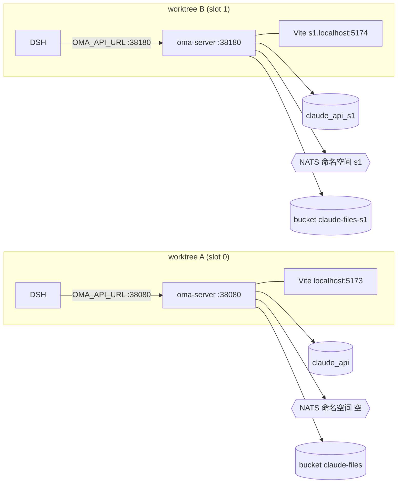
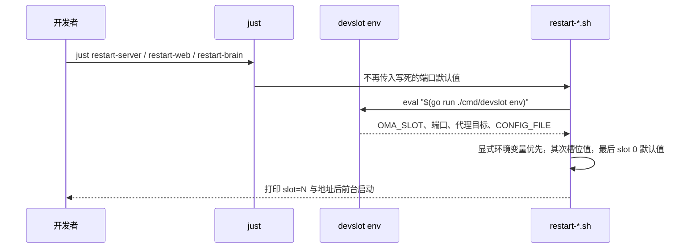

# 本地多 Worktree 并行开发：环境槽位（Dev Slot）

状态：方案，未实现。相关设计见 `be/brain-worker-claim.md`（Brain 领取）、`be/nats-messaging-foundation.md`（NATS）。

## 背景与问题

同一台机器上用多个 git worktree 并行开发时，每个 worktree 都会启动自己的 oma-server、前端 Vite 与 oma-brain-dsh。默认配置下它们共用一套基础设施，造成互相领取任务与状态串扰：

| 共享点 | 现状 | 串扰后果 |
| --- | --- | --- |
| DSH 领取 | `LockNextClaimable` 只按 `worker_transport = 'claim'` 过滤 | DSH-A 经后端 A 查询共享库，领走 B 创建的 Code Session，用 A 分支代码执行 |
| Runner 领取 | `environment_work_mapper.xml` 的 `ClaimNext` 全局 `SKIP LOCKED` | 后端 B 的 Runner 接走 A 的 Session，并按 B 的配置写入 `worker_transport` 等元数据 |
| 数据库迁移 | goose 版本表只有一份 | 分支间 migration 不同（例如一边有 00083 另一边没有）时，共享库本身即不一致 |
| NATS | `OMA_WORKER_INBOUND`、`OMA_WEBHOOK_DELIVERY` 与 `oma.brain.work.available`、`oma.s.`、`oma.tunnel.*` 硬编码 | worker 事件、webhook 投递、会话 fanout、tunnel 命令与 Brain 唤醒跨 worktree 传播 |
| 端口 | `justfile` 把 `PORT=38080`、`API_PORT=38080` 写死为默认值 | 第二个 worktree 的 `just restart-server` 会杀掉第一个的后端；前端代理指向别人的后端 |
| 浏览器 Cookie | `sessionKey` 未设 Domain，Cookie 不区分端口 | 在一个 worktree 的页面登录会顶掉另一个的登录态 |

只在 DSH 领取上加过滤不能解决问题，因为 Runner、迁移与 NATS 同样共享。

## 目标与非目标

目标：

- 每个 worktree 绑定一个整数槽位 `N`，由 `N` 确定性地推导出端口、数据库、对象存储、NATS 命名空间与 fleet token，worktree 之间互不领取、互不投递。
- `just restart-server`、`just restart-web`、`just restart-brain` 无需额外参数即使用当前槽位。
- 槽位 0 与现状完全一致，未初始化槽位的 worktree 行为不变。
- 生产行为不变：唯一的后端代码改动是默认为空的 `nats.namespace`。

非目标：

- 不在共享数据库内做多租户式的“领取池”隔离（见“备选方案”）。
- 不隔离 Docker 沙箱镜像、E2B 账号与模型供应商配置；它们按请求区分，不存在领取竞争。
- 不改变 `verify-be` 的独立配置生成流程。

## 方案概述

PostgreSQL、NATS、Redis、MinIO 进程仍然各只有一套，隔离通过库名、命名空间、Redis db 与 bucket 实现，不需要为每个槽位起一组容器。

## 槽位推导规则

| 资源 | slot 0 | slot N（1 ≤ N ≤ 9） | 使用方 |
| --- | --- | --- | --- |
| `server.addr` | `127.0.0.1:38080` | `127.0.0.1:$((38080 + 100N))` | oma-server、`restart-server.sh` 的 `PORT` |
| `tunnel.public_base_url` | `http://127.0.0.1:38080` | 与后端端口一致 | MCP URL 生成 |
| 前端端口 | `5173` | `5173 + N` | `restart-web.sh` 起始端口（占用时仍向后扫描） |
| 前端访问地址 | `http://localhost:5173` | `http://sN.localhost:<前端端口>` | 浏览器、SuperDuck |
| `VITE_API_PROXY_TARGET` | `http://127.0.0.1:38080` | `http://127.0.0.1:<后端端口>` | `web/vite.config.ts` 代理 |
| `database.url` 库名 | `claude_api` | `claude_api_sN` | oma-server |
| `redis.url` | 原值 | 路径改为 db 索引 `/N`（tunnel presence、worker 事件 ACK、平台会话、邮件登录、vault 刷新租约均经 `internal/redisclient` 使用同一连接，无跨 db 假设） | oma-server |
| `storage.s3.bucket` | 原值 | `<原值>-sN` | oma-server |
| `nats.namespace` | 空 | `sN` | oma-server |
| `code_session.brain_claim_token_file` | 原值 | `tmp/slot/brain-claim-token` | oma-server |
| `OMA_API_URL` | `http://127.0.0.1:38080` | `http://127.0.0.1:<后端端口>` | oma-brain-dsh |
| `OMA_BRAIN_CLAIM_TOKEN` | `.env` 原值 | 读取槽位 token 文件 | oma-brain-dsh |

上限 9 由 Redis 默认 16 个 db 与端口段决定，足够本地并行使用。

### Cookie 与主机名

浏览器 Cookie 按主机名隔离、不按端口隔离。`platform_auth_routes.go` 写入的 `sessionKey` 不带 Domain，如果所有槽位都用 `127.0.0.1`，不同槽位（不同数据库）的登录会互相覆盖。因此 slot N 的前端统一通过 `sN.localhost` 访问：Chrome 与 Firefox 将 `*.localhost` 直接解析到回环地址，无需修改 hosts。Vite `server.allowedHosts` 需追加 `.localhost`。后端无需改动，因为浏览器只访问 Vite，`/api`、`/v1`、`/auth`、`/oauth`、`/web-api` 由 Vite 代理转发。

## 组件设计

### `cmd/devslot`（新增，本地开发 CLI）

用 Go 实现，避免依赖 `yq`；它只服务本地开发，不进入服务镜像。

| 子命令 | 行为 |
| --- | --- |
| `devslot init [N]` | 未给 N 时在注册目录中选最小未占用槽位；写入 `tmp/slot/slot`；生成 `tmp/slot/config.yaml`、`tmp/slot/brain-claim-token`（权限 0600）；创建数据库 `claude_api_sN`（`CREATE DATABASE`，属于启动期维护操作，可用 `database/sql`）与 bucket；重复执行幂等 |
| `devslot env` | 输出 `export OMA_SLOT=… API_PORT=… WEB_PORT=… WEB_HOST=… VITE_API_PROXY_TARGET=… OMA_API_URL=… CONFIG_FILE=…`，供脚本 `eval` |
| `devslot info` | 打印当前槽位的全部地址与资源，便于确认没有连错 |
| `devslot release` | 删除注册记录与 `tmp/slot/`；数据库与 bucket 默认保留，`--drop` 时删除 |

槽位注册目录为 `${XDG_STATE_HOME:-~/.local/state}/oma/slots/<N>`，内容为 worktree 绝对路径，用 `mkdir` 原子占位。同一槽位已被另一个仍存在的路径占用时 `init N` 拒绝；路径已不存在时视为可回收。

`tmp/slot/config.yaml` 每次 `env` 调用时以 `config/config.yaml` 为基底重新生成：以 `yaml.Node` 读取基底，只覆盖上表中的字段，保留其余配置与注释顺序，因此修改基底配置后无需重新 init。slot 0 不生成覆盖文件，`CONFIG_FILE` 直接指向 `config/config.yaml`。

### 脚本与 `justfile`

- `justfile`：`server`、`restart-server`、`web`、`restart-web` 删除 `PORT="${PORT:-38080}"` 等默认值，默认值改由脚本在加载槽位后决定；手动传入的 `PORT`、`API_PORT`、`VITE_API_PROXY_TARGET` 仍然优先。新增 `slot-init`、`slot-info`、`slot-release` 与 `restart-brain`（调用 `oma-brain-dsh/scripts/restart.sh`）。
- `scripts/restart-server.sh`：加载槽位后使用其 `CONFIG_FILE` 与端口；`go run .` 前的生成检查顺序不变。
- `scripts/restart-web.sh`：起始端口取 `WEB_PORT`，代理目标取槽位值，提示信息打印 `http://<WEB_HOST>:<PORT>`；“只停止本 checkout 的监听进程”逻辑保留。
- `oma-brain-dsh/scripts/restart.sh`：加载仓库根目录的槽位，导出 `OMA_API_URL` 与 `OMA_BRAIN_CLAIM_TOKEN` 后启动；`.env` 中显式设置的值优先。进程识别本就按 checkout 路径区分，不需要改。

`devslot env` 失败（例如 `tmp/slot/slot` 损坏）时脚本直接退出，不回退到 slot 0，避免误连其他 worktree 的资源。

### 后端改动：`nats.namespace`

- `config.NATSConfig` 新增 `Namespace string`（yaml `namespace`），只允许 `[a-z0-9]{1,16}`，配置加载时校验。
- 命名规则：stream 名 `OMA_<NS大写>_<原名去掉 OMA_>`，subject 前缀 `oma.<ns>.<原后缀>`；namespace 为空时与现有常量完全一致。
- 覆盖范围：`workerevents`（`OMA_WORKER_INBOUND`、`oma.worker.inbound.v2.`、`oma.brain.work.available`）、`webhooks`（`OMA_WEBHOOK_DELIVERY`、`oma.webhook.delivery.v1`）、`sessionfanout`（`oma.s.`）、`tunnels`（`oma.tunnel.command.v1.`、`oma.tunnel.response.v1.`）。durable consumer 名随 stream 隔离，无需单独加前缀。
- 由组装层把 namespace 传入各 broker 构造函数，替代包级常量；不读取全局状态。

## 测试与验证

- `internal/config`：namespace 非法字符、超长被拒绝；为空时默认值不变。
- 各 broker：namespace 为空时 stream 与 subject 名与现有常量一致；非空时带前缀，且两个不同 namespace 的订阅互不收到消息（使用内存或测试 NATS）。
- `cmd/devslot`：推导规则表驱动测试；基底 YAML 覆盖保留未覆盖字段；注册目录占用、回收与并发 init 只成功一个；slot 0 不生成覆盖文件。
- 脚本：在两个 worktree 分别 `just slot-init` 后同时启动三项服务，确认端口、`devslot info` 与浏览器登录互不影响；在 slot 1 创建 Brain 会话，确认只有 slot 1 的 DSH 领取。
- 按 `CLAUDE.md` 执行 `just lint`、`just dead-code`、`just duplicates`、`just complexity`、`just test` 与 `just web-format-check`；不自动运行 `verify-be`。

## 需同步的文档

- `CLAUDE.md`“本地重启脚本”：端口改为由槽位推导，slot 0 保持 38080 / 5173，并说明 `just slot-init`。
- `oma-brain-dsh/README.md`：`OMA_API_URL`、`OMA_BRAIN_CLAIM_TOKEN` 可由槽位提供。
- `docs/configuration-reference.yaml`：新增 `nats.namespace`。
- `be/nats-messaging-foundation.md`：记录命名空间规则。

## 备选方案：共享数据库内的领取池

在 `environment_work` 增加 `pool` 列、Runner 把池写入 `metadata.config.worker_pool`，两处领取 SQL 各加 `pool = #{pool}` 条件，池由后端配置决定而不信任 DSH 请求头。该方案无法解决分支间迁移冲突，webhook 与 worker 事件仍共享 stream，因此不用于本地并行开发；若生产需要按 environment 隔离 Brain 集群（`be/brain-worker-claim.md`“权限边界”），再单独设计。

## 实施顺序

1. 后端 `nats.namespace` 与各 broker 改造及测试（独立可合并，生产无行为变化）。
2. `cmd/devslot` 与测试。
3. 三个重启脚本、`justfile` 与 `vite.config.ts` 的 `allowedHosts`。
4. 文档同步。

## 待定问题

1. 是否允许 `devslot init` 不带 N 自动分配；方案默认允许，并在输出中打印分配结果。
