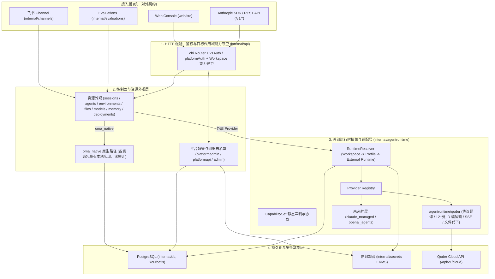

# OMA 多厂商 Managed Agents 统一控制面架构设计（v2.1 实测锁定版）

> 本版基于首期业务拍板（仅平台共享池、工作空间创建时固化运行时、无原地 Cutover）、`/interrogate` 实证的 11 项代码库硬伤，以及 **2026-11-25 对 Qoder CN 官方文档与 Live API 的全链路实测**完成定稿。所有实测均已脱敏并自动清理临时资源。后续进入实施时将同步落盘至仓库 `docs/design/multi-provider-runtime.md`。

## 1. 首期范围与修订摘要

### 1.1 首期锁定边界

1. **账号供给模式**：仅开放平台统一采购共享池（`scope = 'platform'`、`isolation_mode = 'shared_upstream'`），由平台超管配置并按组织白名单授权试用；首期不做组织级 BYOC 页面 `/settings/runtimes`。
2. **工作空间绑定策略**：工作空间在创建时从组织已授权的 Profile 中选定运行时并永久固化，禁止原地修改；首期不做原地 Cutover 状态机与 Dry-Run 预检。单个 Workspace 内全部资源 100% 归属同一 `runtime_profile_uuid`。
3. **安全红线**：多组织共享同一个 Qoder 上游账号，所有外部单对象访问必须先命中 `runtime_resource_bindings(organization_uuid, workspace_uuid, resource_type, oma_external_id)`，未命中直接返回 404。

### 1.2 2026-11-25 Qoder Live API 实测刷新（推翻多条旧假设）

| 验证项 | 旧假设（基于 2026-08 调研） | 2026-11-25 线上实测与最新官方文档 | 对架构设计的直接优化 |
| --- | --- | --- | --- |
| `POST /sessions` 传 `initial_events` | 400 拒绝，需两步合成与孤儿补偿 | **HTTP 200 原生支持** | 彻底删除高风险的两步合成与补偿代码，直接透传 |
| `POST /sessions` 传 `budget` | 完全不支持 | **原生支持 Credits 预算**：`{"type":"limit","max_credit_cost":"100.00"}`（传 `max_cost_usd` 报 400） | `CapabilitySet` 改为 `BudgetMode`（`usd` vs `credits`），支持 Qoder 原生 Credits 预算上限 |
| `POST /agents` 的 `tools` | 仅支持 `enabled_tools`，无 `default_config`/`permission_policy` | **原生接受 `default_config`、`configs[].permission_policy`（`always_allow`/`always_ask`/`always_deny`）并自动将小写工具名规范为 PascalCase**；内置 12 工具含 `DeliverArtifacts` | `ToolsTranslator` 仅需做大小写归一化、剔除 OMA 独有工具并默认开启 `DeliverArtifacts`，无需阉割权限策略 |
| `POST /files` 二进制上传 | 文档写仅接受文本（5MB 上限） | **线上实测 `pixel.png`（`image/png`）返回 HTTP 200 接受**，文档存在滞后 | `FileConstraints` 改为可由 `runtime_profiles.config` 覆写（默认 5MB，允许文本与图片），不误伤飞书发截图 |
| `GET /files/{id}/content` 下载域名 | 未知真实对象存储域名 | 实测 200 返回临时 URL，`scheme=https`，**真实域名为 `cloud-agents-storage-cn.oss-cn-beijing.aliyuncs.com`**，字节 100% 匹配 | SSRF 白名单默认锁定该精确域名并支持在 `runtime_profiles.config` 追加 `*.oss-cn-*.aliyuncs.com` 区域域名 |
| `DELETE /files/{output_id}` | 预期 409 | 实测稳定返回 **409**（附 `referenced_session_ids`），先 `DELETE /resources/{id}`（200）再 `DELETE /files/{id}`（200） | 两步删除对齐逻辑已实测确认有效 |
| `session.usage` 事件与用量结构 | 无 `session.usage` 事件，仅单字段 `total_credits` | **SSE 实测在 `session.status_idle` 前发出 `session.usage` 事件**，含 `model_credits`、`sandbox_runtime_credits`、`total_credits`；`span.model_request_end.model_usage` 为 `{"credits": ...}` | `provider_usage_records` 可直接从 `session.usage` 事件实时拆分落账，免额外 `GET /sessions` 轮询 |
| `agent.tool_use` / `agent.tool_result` | 待确认字段名 | 实测 `agent.tool_result.tool_use_id` 精确引用 `agent.tool_use.id`（均为 `evt_` 前缀） | 100% 证实 `idcodec` 必须编码 `tool_use_id`，否则前端工具卡永久 `running` 并阻塞产物展示 |
| `POST /agents/search`（Beta） | 需纯本地搜索 | 带 `x-qoder-beta: search-2026-08-31` 实测返回 200，可按 `metadata` 过滤 | 控制面仍以 `runtime_resource_bindings` 为多租户防 IDOR 真相源，上游水印用于对账审计 |
| `Last-Event-ID` 无效游标 | 预期 404 | 实测精准返回 **404 `not_found_error`** | 证实带 `Last-Event-ID` 必须独立直连透传，不可合入 tail 扇出 Hub |

### 1.2 对 11 项 `/interrogate` 硬伤的架构根治对照

| 编号 | 实证硬伤 | v2 根治方案 |
| --- | --- | --- |
| F1 | `NOT NULL` 外键无表级默认值击穿 8 处生产 `INSERT` 与 13+ 存量 Postgres 测试 | 为平台内置 `rprof_oma_native_default` 分配固定常量 UUID `00000000-0000-4000-8000-000000000001` 并设为两列表级 `DEFAULT` |
| F2 | `agentruntime/native` 包装现有 `*Handler` 私有方法触发 Go import cycle 或大规模拆迁 | 删除空壳 `agentruntime/native`，资源 Handler 对 `oma_native` 走原生 fast path，仅对外部运行时委托 `agentruntime.Runtime` |
| F3 | Deployments 表 `NOT NULL`、9 处直查本地表且定时 Worker 自动归档 Qoder 任务 | 建议首期在 `qoder_cloud` 显式置 `Capabilities.Deployments = false`（需确认）；二期按两阶段提交 + 独立目录解析开放 |
| F4 | 飞书 Channel 事务行锁 `agents`、管理面全链 404、`omaClient` 缺 `Role`、原生输出路径实为 `/mnt/user-data/outputs` | 抽离 `channels.ResourceDirectory` 端口、按运行时锁本地 `agents` 或 `runtime_resource_bindings`、产物发现改走公开 `GET /v1/files?scope_id=`、修正 `sandboxmount` 路径兼容与常量引用 |
| F5 | Evaluations 创建/详情/Trace/Rubric/SQL 用量全直查本地表，评测不建 SSE 且现有 sweep 为 1m cron + 2m `staleItemAge` | 升级整个 `evaluations`（Handler + Runner）走 `EvaluationResourcePort`，Qoder 用量改聚合 `provider_usage_records`，新增外部活跃评测项 15s 轻量轮询器 |
| F6 | `qoder/idcodec.go` 漏编解码工具结果 ID 导致前端工具卡永久 `running` 并阻塞整轮产物展示 | 扩充至完整 12+ 处双向编解码清单（含 `agent.tool_result.tool_use_id`、`agent.mcp_tool_result.mcp_tool_use_id`、`user.tool_result.tool_use_id`、事件顶层 `id`、分页游标） |
| F7 | `/v1/agents` 强绑本地 `CanonicalModelID`、缺 `agent_toolset_20260401` 与 `enabled_tools` 双向翻译、未过滤 `is_enabled:false`、漏 `/v1/agents:search` | 仅原生路径执行 `CanonicalModelID`；Qoder 显式过滤 `is_enabled == true`；新增 `ToolsTranslator` 双向映射；`AgentRuntime` 补齐 `Search` |
| F8 | 单连接 SSE 扇出 Hub 破坏 `Last-Event-ID` 续传与 404 校验、吞掉异构 `event_deltas[]`、漏 `thread_id` | 带 `Last-Event-ID` 一律独立直连上游透传；无游标实时订阅才进 Hub，Key 为 `(profile_uuid, remote_session_id, thread_id)` 且上游固定以全量 delta 超集建连 |
| F9 | Console `/workspaces/{workspaceId}/mcp_tunnels` 可绕过基于 `principal.WorkspaceUUID` 的守卫；误杀组织级 `/settings/telemetry`；漏裁两处内嵌观测组件 | URL 含 `{workspaceId}` 的 Console 路由先解析路径目标 Workspace 再校验能力；保留组织级 `/settings/telemetry`；补裁 `agents/detail.tsx` 与 `SessionInspector.tsx` |
| F10 | Overview 首页恒零、Console/Platform 文件直通路由与 Admin API 建工作空间绕过边界、全局搜索未按能力裁剪 | Qoder Overview 改聚合 `runtime_resource_bindings` 且不弹 `LLMProviderRequired`；收口 `RegisterConsoleRoutes`/`RegisterPlatformRoutes` 与 `admin.CreateWorkspace`；按能力过滤 `resource-search.ts` |
| F11 | Session Webhooks 依赖本地写库回调与 `session_threads` 表，在按需 15s 断流 Hub 下静默漏发 | 建议首期在 `qoder_cloud` 显式置 `Capabilities.SessionWebhooks = false`（需确认），杜绝假支持与静默漏发 |

---

## 2. 系统分层与 Go 包边界

取消空壳 `agentruntime/native` 包，消除 Go 循环依赖并保证 `oma_native` 零代码搬迁回归。



### 包边界与依赖不变量

- `internal/agentruntime` 仅依赖标准库及基础包（`apperr`、`auth`、`db`、`ids`、`logging`、`secrets`），不导入 `internal/api`、`internal/httpapi` 或任何资源 Handler 包。
- `internal/sessions`、`internal/agents`、`internal/environments`、`internal/files`、`internal/models`、`internal/memory`、`internal/deployments` 依赖 `internal/agentruntime`；当 `principal.RuntimeProvider == ProviderOMANative` 时直接执行既有原生路径，否则通过 `Resolver` 委托外部 `Runtime`（其中 `internal/memory` 委托 `MemoryRuntime`，`internal/deployments` 委托 `DeploymentRuntime`）。
- `internal/agentruntime/qoder` 依赖 `internal/agentruntime`，仅在 `internal/api/server.go` 启动组装阶段注册进 `Registry`。
- `internal/db` 不导入 `internal/agentruntime`、`internal/api` 或任何业务包，所有新增表严格遵循 Yourbatis 三文件拆分（`xxx.go` / `xxx_mapper.go` / `xxx_mapper.xml`），UUID 参数直接以 `string` 绑定。

---

## 3. 数据库 Schema 与状态所有权

### 3.1 确定性内置档案与零回归迁移（Migration `00166`）

```sql
-- 固定常量 UUID，供 organizations/workspaces 列级 DEFAULT 使用，避免击穿存量 INSERT 与集成测试
-- DEFAULT_OMA_NATIVE_PROFILE_UUID = '00000000-0000-4000-8000-000000000001'

CREATE TABLE runtime_profiles (
    id                     bigint GENERATED ALWAYS AS IDENTITY PRIMARY KEY,
    uuid                   uuid NOT NULL DEFAULT gen_random_uuid() UNIQUE,
    external_id            text NOT NULL UNIQUE, -- rprof_...
    scope                  text NOT NULL CHECK (scope IN ('platform', 'organization')),
    organization_uuid      uuid REFERENCES organizations(uuid),
    name                   text NOT NULL,
    provider_kind          text NOT NULL,        -- 由 agentruntime.Registry 校验，免改 DDL 扩展新厂商
    endpoint_url           text NOT NULL DEFAULT '',
    isolation_mode         text NOT NULL DEFAULT 'shared_upstream'
        CHECK (isolation_mode IN ('isolated', 'shared_upstream')),
    config                 jsonb NOT NULL DEFAULT '{}'::jsonb,
    capability_overrides   jsonb NOT NULL DEFAULT '{}'::jsonb,
    secret_envelope        jsonb,
    credential_hint        text NOT NULL DEFAULT '',
    credential_revision    bigint NOT NULL DEFAULT 1,
    status                 text NOT NULL DEFAULT 'active' CHECK (status IN ('active', 'disabled', 'archived')),
    last_health_status     text NOT NULL DEFAULT 'unknown',
    last_health_checked_at timestamptz,
    last_health_error      text NOT NULL DEFAULT '',
    version                bigint NOT NULL DEFAULT 1,
    created_at             timestamptz NOT NULL DEFAULT now(),
    updated_at             timestamptz NOT NULL DEFAULT now(),
    CONSTRAINT runtime_profiles_scope_org_check CHECK (
        (scope = 'platform' AND organization_uuid IS NULL) OR
        (scope = 'organization' AND organization_uuid IS NOT NULL)
    )
);

CREATE UNIQUE INDEX runtime_profiles_platform_name_idx
    ON runtime_profiles (name) WHERE scope = 'platform';
CREATE UNIQUE INDEX runtime_profiles_org_name_idx
    ON runtime_profiles (organization_uuid, name) WHERE scope = 'organization';

INSERT INTO runtime_profiles (uuid, external_id, scope, name, provider_kind, isolation_mode, status)
VALUES (
    '00000000-0000-4000-8000-000000000001',
    'rprof_oma_native_default',
    'platform',
    'OMA Native',
    'oma_native',
    'isolated',
    'active'
) ON CONFLICT (uuid) DO NOTHING;

-- 组织允许使用的平台运行时档案白名单（首期默认仅包含 oma_native）
ALTER TABLE organizations
    ADD COLUMN default_runtime_profile_uuid uuid NOT NULL
        DEFAULT '00000000-0000-4000-8000-000000000001'
        REFERENCES runtime_profiles(uuid),
    ADD COLUMN allowed_runtime_profile_uuids uuid[] NOT NULL
        DEFAULT ARRAY['00000000-0000-4000-8000-000000000001'::uuid];

-- 工作空间创建时固化运行时，SQL UPDATE 不包含此列，永久不可变
ALTER TABLE workspaces
    ADD COLUMN runtime_profile_uuid uuid NOT NULL
        DEFAULT '00000000-0000-4000-8000-000000000001'
        REFERENCES runtime_profiles(uuid);

-- 外部资源归属目录与防 IDOR 白名单（仅存储非 oma_native 外部 Provider 资源）
CREATE TABLE runtime_resource_bindings (
    id                     bigint GENERATED ALWAYS AS IDENTITY PRIMARY KEY,
    organization_uuid      uuid NOT NULL,
    workspace_uuid         uuid NOT NULL,
    runtime_profile_uuid   uuid NOT NULL REFERENCES runtime_profiles(uuid),
    provider_kind          text NOT NULL,
    resource_type          text NOT NULL CHECK (resource_type IN (
        'agent', 'environment', 'session', 'file', 'skill', 'vault', 'memory_store'
    )),
    oma_external_id        text NOT NULL,
    remote_id              text NOT NULL,
    parent_oma_external_id text NOT NULL DEFAULT '',
    resource_role          text NOT NULL DEFAULT '', -- upload | session_output
    state                  text NOT NULL DEFAULT 'active' CHECK (state IN ('active', 'archived', 'deleted')),
    summary                jsonb NOT NULL DEFAULT '{}'::jsonb, -- 存 name/title/status/agent_id/failed 标记，支撑 Search 与 Overview
    created_at             timestamptz NOT NULL DEFAULT now(),
    updated_at             timestamptz NOT NULL DEFAULT now(),
    UNIQUE (organization_uuid, workspace_uuid, resource_type, oma_external_id),
    UNIQUE (runtime_profile_uuid, resource_type, remote_id)
);

CREATE INDEX runtime_resource_bindings_ws_type_idx
    ON runtime_resource_bindings (organization_uuid, workspace_uuid, resource_type, state, created_at DESC);

-- 多厂商异构用量账本（不污染 oma_native 的 usage_records）
CREATE TABLE provider_usage_records (
    id                   bigint GENERATED ALWAYS AS IDENTITY PRIMARY KEY,
    organization_uuid    uuid NOT NULL,
    workspace_uuid       uuid NOT NULL,
    runtime_profile_uuid uuid NOT NULL REFERENCES runtime_profiles(uuid),
    provider_kind        text NOT NULL,
    session_external_id  text NOT NULL,
    remote_session_id    text NOT NULL,
    metric_unit          text NOT NULL CHECK (metric_unit IN ('credits', 'usd_cents', 'tokens')),
    cumulative_amount    numeric(20,6) NOT NULL DEFAULT 0,
    delta_amount         numeric(20,6) NOT NULL DEFAULT 0,
    raw_usage            jsonb NOT NULL DEFAULT '{}'::jsonb,
    sampled_at           timestamptz NOT NULL DEFAULT now(),
    UNIQUE (workspace_uuid, session_external_id, metric_unit, sampled_at)
);

CREATE INDEX provider_usage_scope_time_idx
    ON provider_usage_records (organization_uuid, workspace_uuid, sampled_at DESC);
```

### 3.2 凭据安全与共享池硬隔离

- **信封加密独立 AAD**：在 `internal/secrets` 新增 `RuntimeProfileBinding{Scope, OrganizationUUID, RuntimeProfileUUID, CredentialRevision}`，固定域前缀 `"oma.runtime-profile.v1"`，与现有 Vault/Tunnel 密文隔离。
- **单工作空间单真相源**：工作空间创建后 `runtime_profile_uuid` 不可修改。鉴权阶段在 `auth.Principal` 中一次性填充 `RuntimeProvider` 与 `RuntimeProfileUUID`。
- **共享池防跨组织/跨空间 IDOR 铁律**：
  1. 任何对外部单资源的 `GET/POST/DELETE/Stream/SendEvent/Download` 必须先在 `runtime_resource_bindings` 按 `(organization_uuid, workspace_uuid, resource_type, oma_external_id)` 命中，未命中直接返回 404，严禁透传任意客户端 ID 给 Qoder。
  2. 所有外部 `List` 与 `Search` 均以本地 `runtime_resource_bindings` 为租户可见边界过滤分页，再按当前页 `remote_id` 补齐动态字段。
  3. 远端 `DeliverArtifacts` 异步产出的 `file_id` 在读取已鉴权归属本 Workspace 的 Session Scoped Files 时自动按该 Session 归属幂等认领（`ON CONFLICT DO NOTHING`, `resource_role = 'session_output'`）。

---

## 4. 能力矩阵、协议翻译与关键边界修复

### 4.1 能力矩阵（单一真相源）

| 能力字段 | `oma_native` | `qoder_cloud`（首期） | 说明 |
| --- | :---: | :---: | --- |
| `mcp_tunnels` | `true` | `false` | 隐藏菜单、守卫拦截（含 URL `{workspaceId}` 校验） |
| `port_preview` | `true` | `false` | 隐藏端口预览按钮并拦截 `/ports/{port}` |
| `otlp_traces` / `observability_dashboard` | 按配置 | `false` | 隐藏工作空间级 Observability、Agent 详情 `<ObservabilityPage>` 与 `SessionInspector` `<SessionTrajectory>`；**保留组织级 `/settings/telemetry`** |
| `byok_llm_providers` | `true` | `false` | Qoder 空间跳过 `CanonicalModelID`、不弹 `LLMProviderRequired`；**保留组织级 `/settings/llm`** |
| `deployments` | `true` | `true` | 路线 A 接入 Qoder `/deployments` 与 `/deployment_runs`，以 `runtime_resource_bindings`（`00167` 扩展 `deployment` / `deployment_run`）隔离并自动认领产出 `session_id` |
| `session_webhooks` | `true` | `false`（建议首期关闭，待拍板） | 避免按需 SSE 下 11 类 Session Webhook 静默漏发 |
| `session_budget` / `session_agent_overrides` | `usd` / `true` | `credits` / `false` | `budget` 升级为 `BudgetMode`（OMA 用 USD，Qoder 原生支持 `max_credit_cost`）；`agent_with_overrides` 实测 400 拒绝，入口拦截 |
| `channels` / `evaluations` | `true` | `false`（首期关闭，PR-5/PR-6 解耦后开启） | 避免首期在 Qoder 空间误操作未解耦的原生 Channel 与 Evaluation 表 |
| `memory_stores` | `true` | `true` | 接入 Qoder Memory Stores API（Store / Memory / Version 全量接口与 Session `memory_store` 挂载），以 `runtime_resource_bindings` 做多租户防 IDOR 隔离 |
| `skills` / `credential_vaults` / `mcp_servers` | `true` | `false`（首期关闭） | 首期 Qoder 空间聚焦核心 Models/Agents/Environments/Files/Memory Stores/Sessions，导航、路由守卫、全局搜索、Builder 与后端路由同步裁减 |
| `usage_metering` | `token_and_cost` | `provider_credits` | 正交双口径账本；Qoder 实测支持 `model_credits`、`sandbox_runtime_credits`、`total_credits` 与 `session.usage` 事件 |
| `artifact_discovery` | `filesystem_outputs_dir` | `explicit_deliver_tool` | 原生路径为 `sandboxmount.SandboxOutputsMount`（`/mnt/user-data/outputs`）；Qoder 实测为 `/data/...` |
| `file_constraints` | 不限 MIME | 默认 5MB、文本+图片（可由 Profile 配置覆写） | 文档写仅文本，但 2026-11-25 线上实测 `image/png` 返回 200；配置化避免误杀飞书发截图 |

### 4.2 Agent 模型与工具双向翻译（修复 F7 + 2026-11-25 实测简化）

- **模型校验与过滤**：
  - `internal/agents/handler.go` 仅在 `oma_native` 路径执行 `llmproviders.CanonicalModelID`。
  - `qoder/resources.go` 的 `ListModels` 保留防御性过滤 `is_enabled == true`（本次实测 14/14 启用，含 `auto`、`fast`、`qmodel_latest`、`qfmodel`、`dmodel`、`gmodel_latest` 等），并映射 `display_name`、`default_context_window`、`is_vl`。
- **Tools 双向翻译（`qoder/tools.go`）**：
  - Qoder 线上实测已原生支持 `agent_toolset_20260401` 的 `default_config` 与 `configs[].permission_policy`（`always_allow` / `always_ask` / `always_deny`），12 个内置工具名为 `Bash`、`DeliverArtifacts`、`Edit`、`Glob`、`Grep`、`ImageGen`、`ImageSearch`、`Read`、`VideoGen`、`WebFetch`、`WebSearch`、`Write`。
  - 写入 Qoder：将小写内置工具名映射为 Qoder PascalCase，过滤掉 Qoder 不支持的 OMA 专属工具（如 `ask_user_question`），并默认确保开启 `DeliverArtifacts`（无工具配置时补齐默认 toolset，避免创建出无工具空 Agent）。
  - 读取回显：兼容 Qoder 返回的 `configs[]` 与 `enabled_tools[]` 两种形态，将 PascalCase 工具名反向归一化为前端与 Anthropic SDK 期望的小写工具名。
- **补齐 `/v1/agents:search`**：`AgentRuntime` 新增 `Search` 方法，对 `qoder_cloud` 基于 `runtime_resource_bindings.summary->>'name'` 在控制面执行前缀/模糊检索与分页。

### 4.3 完整 Event ID 双向编解码清单与 SSE 路由策略（修复 F6、F8）

- **完整 Event ID 编解码（`qoder/idcodec.go`）**：
  - 编码格式：`sevt_qdr_<raw>` 与 `evt_<raw>` 双向确定性可逆；Session Resource 为 `sesrsc_qdr_<raw>` 与 `sesr_<raw>`。
  - 强制覆盖全部 12 类位置：
    1. 持久化事件顶层 `event.id`
    2. SSE `id:` 行与请求头 `Last-Event-ID`
    3. `event_start.event.id` 与 `event_delta.event_id`
    4. `session.status_idle.stop_reason.event_ids[]`
    5. `agent.tool_result.tool_use_id`
    6. `agent.mcp_tool_result.mcp_tool_use_id`
    7. `user.tool_confirmation.tool_use_id`
    8. `user.tool_result.tool_use_id`
    9. `user.custom_tool_result.custom_tool_use_id`
    10. `span.model_request_end.model_request_start_id`
    11. `ListEvents` 请求参数 `before_id` / `after_id`
    12. `ListEvents` 响应信封 `first_id` / `last_id`
- **SSE 路由与扇出策略（`qoder/stream.go`）**：
  - **带 `Last-Event-ID` 的连接**：不进入共享扇出 Hub，直接向 Qoder 建立独立上游 SSE 并透传解码后的 `Last-Event-ID`，完整保留断线重放、在途 delta 重放以及无效游标返回 HTTP 404 `Event not found` 的官方合同。
  - **无 `Last-Event-ID` 的实时连接**：进入进程内扇出 Hub，Key 固定为 `(profile_uuid, remote_session_id, thread_id)`（主会话 `thread_id = ""`，子线程流填具体 `sthr_...`）。Hub 建连时始终携带最大超集 `event_deltas[]=agent.message&event_deltas[]=agent.thinking`，向各下游订阅者按其 `StreamOptions.DeltaTypes` 过滤分发；无订阅者 15 秒后关闭上游流。
  - **协议不变量**：前端与代理层严格坚持先建流缓冲再按 `processed_at ASC` 拉历史合并去重，且 `requires_action` 时绝不关闭 SSE；`internal/sessions` 入口层统一承接 `Idempotency-Key` 缓存。

### 4.4 Memory Stores 外部运行时适配与 Session 挂载

- **统一运行时接口（`agentruntime.MemoryRuntime`）**：
  - 定义 Memory Store（Create/Get/List/Update/Archive/Delete）、Memory（Create/Get/List/Update/Delete）与 Memory Version（List/Get/Redact）三类操作；`internal/memory/handler.go` 对 `oma_native` 保持原生路径，对外部运行时在 `internal/memory/runtime_dispatch.go` 经 `Resolver` 分发。
- **Qoder 适配与多租户隔离（`internal/agentruntime/qoder/memory.go`）**：
  - 所有 Store 创建时写入 `runtime_resource_bindings`（`resource_type = 'memory_store'`），后续 Store / Memory / Version 的全部单对象操作与列表检索均先校验 `(organization_uuid, workspace_uuid, 'memory_store', oma_external_id)` 归属，未命中直接返回 404。
  - 支持 `ListMemories` 的 `depth` 目录扫描与分页，并按 `view=full` 并发补齐 Memory 及 Version 的正文内容。
- **Session 资源挂载双向映射（`internal/sessions/runtime_dispatch.go`、`internal/agentruntime/qoder/sessions.go`）**：
  - 创建 Session 与 `AddResource` 时解析 `memory_store_id`，在进入 Qoder 前经 `runtime_resource_bindings` 重写为远端 Store ID；回显 Session Resource 时再反向映射为 OMA 外部 `memory_store_id`。
- **Deployments 外部运行时适配（路线 A，`internal/deployments/runtime_dispatch.go`、`internal/agentruntime/qoder/deployments.go`）**：
  - Migration `00167_add_deployment_binding_types.sql` 扩展 `runtime_resource_bindings.resource_type` 支持 `'deployment'` 与 `'deployment_run'`。
  - `agentruntime.DeploymentRuntime` 覆盖 Deployment 全生命周期（Create/Get/List/Update/Archive/Pause/Unpause/Run）与 Deployment Runs（Get/List）；`Handler` 与 `RunsHandler` 均在 `oma_native` 保持原路径、在外部运行时按 `runtime_resource_bindings` 强制租户归属隔离并完成 Agent/Environment/File/MemoryStore/Vault ID 双向映射。
  - `RunDeployment` 与 `ListDeploymentRuns` 幂等认领远端生成的 `drun_...` 与 `session_id` 到当前 Workspace，确保手动运行和 Qoder 定时调度产生的会话可直接被 `/v1/sessions/{id}` 与前端详情页访问；前端 `DeploymentFormFields` 与 `budget.ts` 同步支持 Credits 预算的创建、编辑与回显，并按 `credential_vaults` 能力控制 Vault 选择器展示。

### 4.5 能力守卫、Overview、Quickstart/Builder、文件旁路与 Admin API 收口（修复 F9、F10）

- **Console URL 工作空间能力守卫**：凡路径含 `{workspaceId}` 的 Console 路由（如 `/workspaces/{workspaceId}/mcp_tunnels`、`/workspaces/{workspaceId}/mcp_servers`、`/workspaces/{workspaceId}/evaluations`），不在外层仅凭 `principal.WorkspaceUUID` 拦截，而是在解析并鉴权路径目标 Workspace 之后（`requireConsoleWorkspaceCapability` / `resolveTunnelConsoleScope`）立即校验目标工作空间的 `CapabilitySet`，堵死通过省略或伪造 `X-Workspace-ID` 绕过的安全漏洞。
- **Workspace Overview 兼容**：`internal/platformapi/workspace_overview.go` 针对非原生工作空间从 `runtime_resource_bindings` 聚合 `agent_count`、`session_count`、每日活跃曲线与失败统计（Qoder 会话终态/错误状态同步写入 `summary` 字段）。
- **Console 与 Platform 文件路由收口**：`internal/files/handler.go` 的 `RegisterConsoleRoutes`（`/api/console/.../files/{fileId}(/content)`，供 `caseMedia.tsx` 预览）与 `internal/files/platform.go` 的 `RegisterPlatformRoutes`（`/upload_b64`、`/thumbnail`、`/preview`）全部按目标 Workspace 的运行时分流，Qoder 空间经 `FileRuntime` 安全流式代理下载与校验上传。
- **Admin API 建工作空间收口**：`internal/admin/service.go:CreateWorkspace` 接入与 Console 一致的 `runtime_profile_uuid` 白名单校验与组织默认继承逻辑。
- **前端裁剪与 Quickstart/Builder 适配**：
  - 保留组织级 `/settings/llm` 与 `/settings/telemetry`（页面注明仅作用于组织内原生工作空间及评测裁判）。
  - 补齐 `agents/detail.tsx` 的 `<ObservabilityPage>` 与 `SessionInspector.tsx` 的 `<SessionTrajectory>` 能力门控。
  - `overview.tsx` 仅在 `caps.byok_llm_providers === true` 时展示 `<LLMProviderRequired>`；`AgentQuickstartPage.tsx` 在外部运行时无可用模型时展示外部运行时空态与重试按钮，不误弹 `LLMProviderRequired`。
  - `quickstart/builder/*` 在 `byok_llm_providers === false` 的工作空间中，对话构建与 Prompt 优化选用组织级 BYOK 对话模型，Agent 配置仍使用当前工作区运行时模型；当组织未配置可用对话模型时提供切换到手动配置的引导，并按 `skills` / `mcp_servers` / `credential_vaults` / `deployments` 能力裁剪目录查询、系统提示词、工具列表与分发逻辑。
  - `console-search/resource-search.ts` 与 `useManagedReferenceOptions.ts` 按 `useWorkspaceCapabilities()` 过滤检索源与引用下拉选项（Qoder 开启 `memory_stores` 后保留 Memory Stores 加载并跳过未开启的 Credential Vaults）。

### 4.6 飞书 Channel 与 Evaluations 的完整解耦方案（修复 F4、F5）

- **飞书 Channel（`internal/channels`）**：
  1. 抽离 `channels.ResourceDirectory` 接口，替换 `local.go`、`agent_version.go`、`resources.go`、`channel_mounts.go`、`vault_ids.go`、`oauth.go`、`oauth_context.go` 对本地表的直接查询。
  2. 修改 [internal/db/channel_records.go](file:///Users/it00013153/IdeaProjects/open-managed-agents/internal/db/channel_records.go#L13) 的 `CreateChannelRecord`：原生工作空间继续锁本地 `agents` 表，外部工作空间改锁 `runtime_resource_bindings` 中对应的 `agent` 绑定行（`FOR UPDATE`）。
  3. 改造 `SubscribeEvents`、`PutAttachment` 经统一运行时路由。
  4. 改造 [internal/channels/artifact_delivery.go](file:///Users/it00013153/IdeaProjects/open-managed-agents/internal/channels/artifact_delivery.go#L91-L94) 通过公开 `GET /v1/files?scope_id={session_id}` 过滤 `downloadable=true` 且排除入站附件发现产物（兼容原生 `/mnt/user-data/outputs` 与 Qoder `/data/...`）。
  5. 改造 `attachment_preparation.go` 与 `resource_compatibility.go`，对外部运行时按 `file_id` 与逻辑挂载路径比对兼容性，避免因 `sandboxmount` 前缀差异导致每条消息重建会话。
- **Evaluations（`internal/evaluations`）**：
  1. 统一抽离 `EvaluationResourcePort`，覆盖 `Handler.store`（`task_handler.go`、`task_detail.go`、`rubric_handler.go`、`handler.go`）与 `RunnerStore`（`runner.go`、`task_sweep.go`、`judge.go`）全部本地资源直读点。
  2. 评测用量聚合 `SumTaskUsage` 对原生工作空间继续走 SQL 聚合 `session_events`，对外部工作空间从 `provider_usage_records` 按任务下 `session_external_id` 汇总 `credits`。
  3. 在 `TaskRunner` 新增外部运行时活跃评测项的轻量 15 秒轮询器（仅查当前存在未终态外部评测项的会话，不受原生 `staleItemAge = 2m` 限制），保留现有 1 分钟 River `sweepCron` 作为进程重启兜底。
