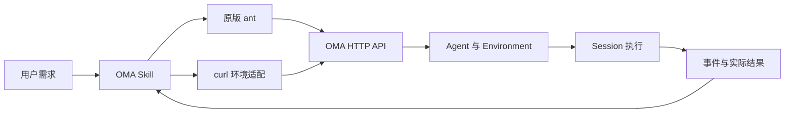

# OMA onboarding Skill 与 ant CLI

## 交付与使用

客户端 Skill 位于 `.agents/skills/oma/`，名字为 `oma`。在支持仓库 Skill 的宿主中调用 `$oma`，或在支持相应命令形式的 Claude Code 中调用 `/oma`，附加“onboard，帮我创建一个……Agent”。宿主调用语法以实际支持为准。

独立安装时把整个 `oma` 文件夹复制到 `~/.codex/skills/oma`；Claude Code 可放到项目 `.claude/skills/oma`。使用前按 Skill 的 `references/cli.md` 安装原版 ant，并在本地输入 API key。Skill 不上传到 OMA 的运行时 Skills API。

功能覆盖连接检查、需求澄清、Agent 配置提案、声明式 Agent 创建与更新、环境选择/创建、Session 试跑、结果检查和应用接入指导。不会默认配置未验证的第三方集成或高级编排。

## API 与 CLI 边界

复用原版 ant 2.5.0，不修改服务端或引入 fork。地址为 `ANTHROPIC_BASE_URL=https://oma.gz.cvte.cn`，API key 通过 `ANTHROPIC_API_KEY` 提供。不要使用官方 Console 登录来代替 OMA key。

Agent 使用 Markdown YAML frontmatter 与 `ant apply`，资源身份保存在 `claude-lock.json`。每个实例/作用域使用独立的配置目录；运行代码只引用已保存 ID。Environment API 当前要求 `?beta=true`，ant 不提供这个查询参数，所以通过 curl 创建与查询。Environment 文件暂不加入 ant apply。

Session 创建不代表运行成功，消息投递的 processed_at 可能为 null；以实际模型回复、请求结束事件和 stop_reason 验收。本轮 end_turn 不代表 Session 永久终止。预算、待确认工具、失败和超时分别处理。原始 HTTP SSE 可获得事件，但 ant 流消费没有输出；当前以有界历史查询作为可靠入口。

未来若要求所有命令全部由 ant 完成，需在服务端兼容其环境 beta 合同，并定位 SSE envelope/SDK 解码差异；本次只记录已观察结果，不推断根因，不修改远端服务。

## 2026-11-04 实际验证

目标 `https://oma.gz.cvte.cn`，CLI `ant version 2.5.0`，模型 `deepseek/deepseek-flash`。真实测试直接使用 ant 和最小 HTTP 请求，未运行 verify-be。密钥不进入交付文件。

| 验证 | 结果 |
| --- | --- |
| 无认证模型请求 | HTTP 401，认证拒绝符合预期 |
| 有认证 ant models list | 通过 |
| ant Agent 创建、列表、Session 内配置快照 | 通过 |
| ant Environment list，无 beta/header beta | 均 HTTP 400，要求 beta=true |
| HTTP Environment 列表与创建 | 通过 |
| ant apply dry-run、创建、无改动重放、修改 system 更新 | 通过 |
| 复用环境的 Session 创建、消息投递、真实模型回复 | OMA_ONBOARD_OK，idle/end_turn |
| 新环境的独立 Session 创建、消息投递、真实模型回复 | OMA_ONBOARD_OK，idle/end_turn |
| ant 事件历史 jsonl | 通过 |
| 原始 HTTP SSE | 收到事件；8 秒主动超时结束观测，不将超时称为完整流验收 |
| ant events stream | 连接期间无输出，未通过；已停止观察进程 |

保留以下专用测试资源供用户检查，不修改复用环境：

- 直接创建 Agent：`agent_kuM5uUOVITWPlsbPWy4X13r0`
- apply 创建 Agent：`agent_fp3ZFdjHlBAdKfabYWc7rfJG`，随后已更新 system
- 新环境：`env_b7Cj0rwJDcg7CS2Q0UASTQyI`
- 首次 Session：`sesn_WWnxp7st8u36ori4N2dwJx8R`
- 独立环境 Session：`sesn_PbEOlacQX9GfrNNa0BrEKTLt`

两次执行均已结束本轮，无持续本地服务。未覆盖工具执行与确认、文件交付、MCP、Vault、Memory、Deployment、受限网络、并发恢复、SDK 与完整集成回归。Skill 文件结构校验单独执行，不代替行为验收。仅新增 Skill 和设计文档，无应用代码修改，因此不运行 Go/前端构建门禁。

## 来源与维护

基于 Claude onboarding 的任务、Agent、Environment、Session、接入顺序独立编写 OMA 指令；不复制其中默认模型、Outcome、workflow、凭据机制等未经 OMA 验证的合同。

- https://github.com/anthropics/skills/blob/main/skills/claude-api/shared/managed-agents-onboarding.md
- https://github.com/anthropics/skills/blob/main/skills/claude-api/shared/anthropic-cli.md

服务或 ant 版本升级后复跑上述最小链路，兼容差异修复后再更新 Skill。接口、状态与能力以当前实例为准。

## URL 与 key 设计

连接合同位于 Skill 的 `references/connection.md`。URL 按本次用户指定、OMA_BASE_URL、默认实例排序；key 必须绑定当前 origin，不从官方 Anthropic 配置自动继承。OMA 变量显式映射给原版 ant，不修改 ant 本身。公网 HTTPS、拒绝路径和 URL 内嵌凭据、实例切换重新选择 key，子 shell 临时配置不持久化秘密。

本次只交付客户端 Skill 与文档，不新增平台 API key 服务或 Console 页面。key 的创建和权限仍由现有 OMA 管理入口负责；轮换、错误诊断和退出清理均在连接合同中说明。

## 中文验收补充（2026-11-05）

最终用户材料统一中文输出，命令和协议字段保留原名。新增 `.agents/skills/oma/references/validation.md` 记录失败路径、中文双轮上下文、limited 环境运行、事件分页、版本冲突和 Session 配置快照的真实结果。文件上传/删除通过，下载返回 400，保持明确限制。测试不等同于独立模型执行 Skill，也不覆盖未列出的高级功能。

多轮验收按本次输入事件与历史游标定位，不用上一轮 end_turn 误判本轮完成。配置解析仍为 Skill 合同而非新 CLI 的自动执行器；未将指令校验声称为可执行配置安全测试。
