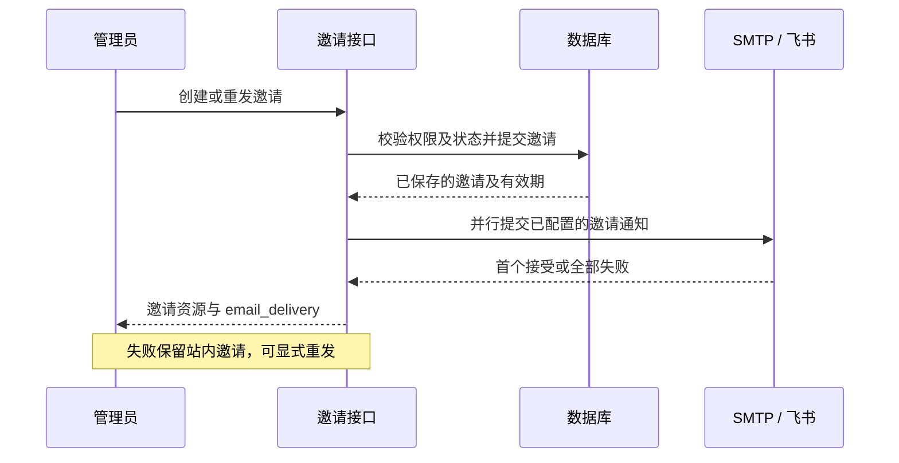

# 组织邀请邮件

创建及重发邀请在数据库操作成功后向所有已配置的发送方式并行提交通知，任一种接受后即可返回。SMTP 复用登录验证码的 TLS、认证和 15 秒超时。Console 创建、重发及 Admin API 创建均接入；终态邀请仍不能重发，通知操作不改变成员资格。没有引入新的队列或自动重试。

## 配置与内容

复用 `auth.smtp`，或配置同级的 `auth.feishu.app_id` / `auth.feishu.app_secret`，邀请链接使用 `auth.console_url`，例如 `https://oma.example.com`。该地址必须为 HTTPS origin，不允许用户信息、子路径、查询或片段；不读取请求 Host 或转发头生成邮件链接。控制台地址未配置或两种发送方式都未启用时仍可创建站内邀请，但明确返回邮件未配置。

邀请邮件同样遵守 `auth.allowed_email_domains`，与登录共用完整域名匹配规则。Console 新建、重发、Admin API 新建和平台后台邀请均在邮件发送器读取组织信息及调用 SMTP 前检查收件域名；未允许的子域名和伪装后缀被拒绝。域名比较不区分大小写，空白名单不限制。任一种发送方式已启用时，拒绝返回 `email_delivery: failed`，保留已创建的站内邀请；未启用发送时仍返回 `not_configured`。修改白名单并重启后，既有邀请的重发也受新配置限制。

参考 CMA 截图的居中布局、品牌、信封、标题和主按钮，使用 OMA 品牌。正文包含实际组织名、当前操作人的邮箱以及数据库邀请有效期（UTC）；API Key 没有对应用户身份时显示“Organization administrator”，不伪造邀请人。当前没有组织或收件人 locale 数据，邮件主题、正文和默认邀请人统一使用英文。HTML 模板自动转义动态内容，邮件不包含验证码、会话凭据或自动加入令牌。

按钮打开 `/invites`。用户必须用收件邮箱登录，再显式接受；邮件转发不授予他人权限。此次不改变既有首次注册自己的组织和不自动接受邀请的行为。

## 发送结果

创建、重发响应新增 `email_delivery`：`sent` 表示至少一种已配置的发送方式接受通知，不能保证用户实际收到；`failed` 表示提交失败；`not_configured` 表示发送配置未启用。邀请已保存但发送失败仍返回成功的邀请资源，界面明确提示邀请成功，在说明中显示发送失败数量、允许重发，避免客户端误以为邀请没有创建而重复提交。列表不声称提供历史投递状态。

创建及重发的投递提示复用现有 i18n `msg` 与中英文词条，标题统一确认邀请成功，说明按实际投递状态分别展示：未配置邮件时提示可登录接受站内邀请，使用成功提示；邮件发送失败或缺失状态时使用警告，但不否定邀请已创建，也不把未知状态归因为配置错误。混合批次分别统计发送失败与未知状态的数量，英文区分单复数；空批次不提示。测试分别验证中英文的未配置、失败、缺失状态、混合批次与 SMTP 接受提示。

同步发送存在数据库提交后进程退出导致漏发的窗口，也可能出现 SMTP 已接受但响应丢失后重发造成重复邮件；本期不承诺恰好一次投递。后续确需自动可靠投递时再引入事务 outbox。失败日志不记录收件人、邮件内容或可能携带地址的 SMTP 原始错误。

验证覆盖未配置、SMTP 失败/成功/重试、组织名 HTML 转义、组织/邀请人/有效期/按钮内容，以及公开地址校验；真实邮箱投递需在部署配置 SMTP 和公开地址后单独验收，不能把模板测试当成投递成功。

2026-09-10 验证：使用隔离 PostgreSQL 和 MinIO 配置执行 `just test` 全量 Go 测试通过；成员管理与邮件提示前端定向测试 9 项通过，生产构建、格式、命名、lint、死代码、复杂度、重复代码及全仓 hook 检查通过。全量 Bun 测试在 ConsoleShell 套件退出 133，未计为通过。测试邮件发送器为替身，未向真实收件箱发送；验证结束停止临时数据库和对象存储。

## 平台管理员目标组织访问（2026-10-28）

Console 邀请由平台来源 Principal 创建时复用 NotifyPlatform，以 Platform administrator 文案投递，不查询不存在的成员邀请者。同步投递与响应合同不变，不增加成员、邀请 schema 或新队列。

完整权限及进入/退出合同见 [平台超级管理员设计](platform-super-admin.md)。

## 飞书与邮件同时发送

配置 `auth.feishu` 后按受邀邮箱私聊发送飞书消息卡片，包含真实组织名、邀请者、过期时间和指向相同 `/invites` 链接的“查看邀请”按钮；沿用邮箱白名单与显式接受流程。SMTP 和飞书可各自单独使用，也可同时配置并行发送，任一种接受即为 `sent`，全部失败才为 `failed`，不在本次请求中重试失败方。保留 `email_delivery` 与现有数据库状态字段作为兼容合同，不新增字段或迁移；这些历史名称现在表示聚合通知结果。页面使用“邀请通知”“已提交发送”等渠道无关文案，避免误称飞书成功为 SMTP 接受。

平台邀请继续使用已有 River 任务，整体失败才触发原有重试，部分成功不重试另一方。普通邀请接口等待任一种发送方式接受后即可返回，剩余发送在独立且有超时的上下文中继续，不增加队列。进程退出可能中断尚未完成的发送；响应丢失及整体重试仍可能导致重复通知，不承诺恰好一次。飞书请求结构、令牌刷新和错误行为见 [认证边界](be/db-platform-auth-boundaries.md#飞书通知)。

飞书邀请按消息卡片协议发送 `interactive` 内容，邮件继续使用 HTML 模板，两者表达同一邀请。卡片的组织和邀请人等动态文本使用 `plain_text`，避免将组织名中的 Markdown 或 `@` 内容解释为格式与提及；按钮只打开配置的控制台邀请页，不配置回传值或新增回调，不在飞书中直接接受邀请。控制台新建和重发、Admin API、平台后台的发送与已有 River 重试都复用同一模板。验证码也使用卡片，以大号加粗居中的六位数字作为主要内容，和邮件使用同一个值与有效期。

消息格式依据飞书官方的[发送消息内容结构](https://open.feishu.cn/document/server-docs/im-v1/message-content-description/create_json?lang=zh-CN)和[卡片按钮协议](https://open.feishu.cn/document/feishu-cards/card-json-v2-components/interactive-components/button)。

验证码与邀请统一使用 JSON 2.0 卡片，`FeishuCard` DTO 仅在渲染与飞书发送边界共享。验证码标题缩短为“登录验证码”，取消长双语正文；组织邀请使用“组织邀请”短标题、较大组织名、整行主按钮和小号辅助说明。邀请卡片把内置管理员称谓显示为中文，有效期明确按北京时间（UTC+08:00）展示；邮件保持现有 UTC 文案。邀请按钮通过 `open_url` 行为打开现有页面，点击后仍需登录确认，不新增卡片回调。

卡片统一设置 `config.width_mode: compact`，使用飞书约 400px 的紧凑宽度，最终由客户端适配窗口和设备。验证码保留一处大号数字，使用选中数字复制；不添加复制按钮、代码块或复制网页。飞书公开卡片交互只提供打开链接和请求回调，无法直接写入用户剪贴板；真实客户端试验也确认该卡片内代码块不提供复制入口。该限制与选择不影响验证码值和校验流程。[宽度协议](https://open.feishu.cn/document/feishu-cards/card-json-v2-structure)与[交互协议](https://open.feishu.cn/document/feishu-cards/configuring-card-interactions)为对应能力依据。
