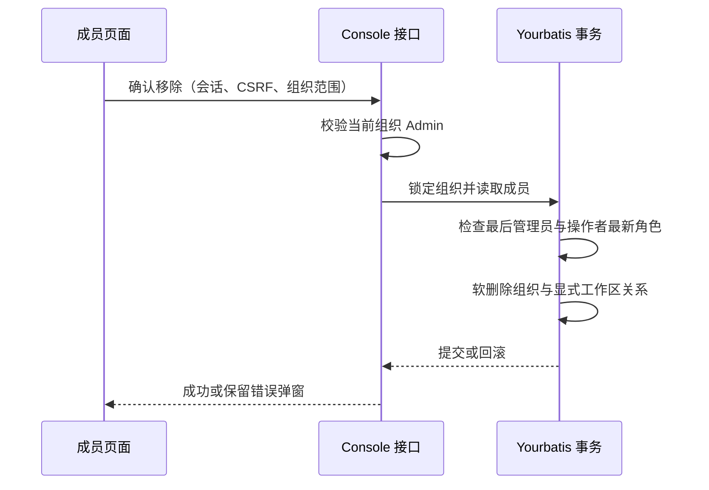

# 组织与工作区成员管理（#336）

本功能基于 main，复用已合并的 #339（PR #346）通用权限及成员事务、#338（PR #347）组织加入与切换上下文。组织角色为 User/Admin，工作区角色为 Workspace User/Workspace Admin，与 main 的角色简化合同一致。

## 产品与权限边界

组织成员是加入组织的人；工作区成员表示这些人在某个空间的有效访问权限。Console API 是网页使用的会话认证接口，不是一种成员身份。对外 Admin API 与 Console API 应共享领域规则。

组织和工作区用户均可只读查看所在组织及可访问工作区的成员目录；普通用户不请求邀请及候选目录，不显示角色编辑、添加或移除入口。Default 保留跳转组织成员目录的入口。组织 Admin 管理组织邀请、角色和移除操作。前端只根据当前组织的角色显示入口，其他组织的 Admin 身份不能提供权限。后端重新查询操作者的有效组织成员关系；成员修改事务内再次校验角色，不能仅依赖会话中的历史角色。

组织必须保留至少一名有效 Admin。Console 和 Admin API 的删除、降级共用组织行锁和管理员计数，最后一名管理员变更返回 409。移除组织成员时，在同一事务中软删除组织关系和该组织下的显式工作区关系；其他组织关系、工作区团队资源和 Key 保留。重复移除返回 404。

普通工作区按拆分后的 #346 基线执行：组织 Admin 继承 Workspace Admin，不能编辑或移除；组织 User 通过显式工作区角色加入，可以修改角色或移除显式成员。Default 的权限全部来自组织角色，历史显式关系不参与计算，不提供独立成员管理操作。

## 工作区 Console 合同

`/api/console/organizations/{organizationUuid}` 路由组统一执行会话 CSRF 校验。POST、PATCH、DELETE 等变更请求必须携带当前会话的 `X-CSRF-Token`；缺失、无效或其他会话的 token 返回 403，GET、HEAD、OPTIONS 不要求 token。成员授权与事务内角色复查仍独立执行。

全局会话中间件不对工作区成员路由要求组织管理权限；目录、候选和写入接口在资源层解析 URL 中的目标工作区；目录校验工作区访问权限，候选与写入校验成员管理权限，写入接口在查询目标组织成员前完成该校验，并在事务内再次复查权限。无成员管理权限时，无论目标成员是否存在，写入统一返回 403 `workspace_access_denied`，不泄露组织成员身份。组织普通成员获授 Workspace Admin 后可以管理该空间成员，但不能管理组织或未授权的其他空间，且不能依赖会话当前工作区的角色替代目标空间校验。

路径前缀为 `/api/console/organizations/{organizationUuid}/workspaces/{workspaceId}`。

| 方法与路径 | 合同 |
| --- | --- |
| GET `/members` | 返回 `workspace_id`、`is_default`、`can_manage_members`、`members` |
| GET `/member-candidates` | 返回同组织内尚可添加的成员，字段为 `user_id`、`name`、`email` |
| POST `/members` | 以 `user_id`、`workspace_role` 添加显式成员 |
| POST `/members/{userId}` | 更新显式 `workspace_role` |
| DELETE `/members/{userId}` | 移除显式成员 |

每个成员返回身份、姓名、邮箱、组织角色、有效工作区角色、角色来源及 `can_edit`、`can_remove`。界面消费服务端权限，不自行复制继承算法。目录与候选查询复用 `ListWorkspaceMemberFacts`；添加、改角色和移除统一走 `workspaceaccess.ChangeMember`（组织成员行锁 → 工作区锁 → 操作者授权 → Default 保护 → 显式角色规则）。组织 Admin 的继承访问不可编辑或移除；User 显式成员可编辑和移除；候选列表排除 Admin 与已有显式成员。添加与更新仅提供 Workspace User、Workspace Admin。

组织 Admin 查询 Default 成员目录时，`can_manage_members` 和所有成员的 `can_edit`、`can_remove` 均为 false。Default 的候选查询与成员写操作统一返回 409 `default_workspace_protected`，成员管理应转到组织设置。

## 组织成员 Console 合同

组织成员写路径（改角色、移除）挂 `requireConsoleOrganizationAdmin` 中间件，任何登录成员包括其他组织管理员都不可操作。DB 层 `withOrganizationMemberChange` 在组织行锁事务内校验操作者最新角色与最后管理员计数；Admin API 的 `UpdateAdminUserRole`/`DeleteAdminUser` 与 Console 共用同一保护。移除最后管理员返回 409 `last_organization_admin`，重复移除返回 404，非管理员返回 403。

## 页面与 CMA 对照

组织成员页提供计数、权限说明、搜索、角色筛选、行内角色选择和更多操作菜单；普通工作区成员页额外支持姓名/邮箱/角色排序。没有查看权限时显示明确提示：成员可以只读查看目录，管理操作仍限管理员，且不请求成员目录；服务器返回 403 或当前权限撤销时隐藏缓存目录。组织右上入口为 Invite，工作区为 Add to Workspace。移除使用确认弹窗，提交期间禁用操作，后端失败保留弹窗和原因。切换组织或工作区后重置弹窗状态。

组织成员页首次加载期间，只要成员或管理员的待处理邀请查询仍在等待结果，就显示骨架并隐藏人数计数；因离线暂停的查询也属于等待结果。只有所需目录均已成功返回且筛选结果为空时才显示空列表，不能把未加载的数据当成零成员。恢复网络后继续查询并展示真实目录；已有完整缓存时仍可展示缓存内容。

工作区成员移除确认显示当前工作区名称，明确只移除该空间的显式成员关系。工作区设置的归档筛选单独请求 `include_archived=true`，导航选择器仍只使用活动工作区；归档记录不提供编辑或再次归档入口。

归档弹窗打开和关闭时清空上次操作错误；失败后重新打开同一工作区或其他工作区时，不显示先前的错误。

移除成员、归档工作区和撤销邀请的确认弹窗在退出过渡中保留原目标及错误展示，避免父页面清空选择后出现空邮箱或空工作区名称。下一次打开使用新目标和当前错误状态。取消通过 Base UI Close 处理，撤销邀请不得重复绑定清空回调；处理中禁用操作并拒绝 Escape 关闭。

邀请表单取消和成功退出时，邮箱、角色与校验状态在 Base UI 退出完成后重置，成功回调及目录更新立即执行。提交中关闭和取消禁用，Escape 不关闭；失败保留草稿。工作区添加成员保留受控 open 合同，用户关闭时等待退出完成再通知父页面卸载；提交中禁用关闭，重新打开仍可正常选择候选。

已观察 `platform.claude.com` 组织成员和普通工作区成员页的布局、权限说明与操作入口。真实 CMA 的移除操作未执行；添加弹窗因无可添加成员未能观察。本地验收需要逐项对照布局、筛选、表格、角色变更、添加和移除流程，不能将页面观察视为写操作验收。

## 验证状态

- 组织角色授权、跨组织拒绝、最后管理员删除/降级、并发管理员变更、级联移除和重复移除由独立 PostgreSQL 事务测试覆盖（`TestOrganizationMemberChangesPostgreSQL`）。
- Console 组织管理员中间件与错误合同由 `internal/platformapi/console_member_authorization_test.go` 覆盖。
- 组织移除取消、CSRF、后端 409 保持弹窗由 `OrganizationMemberRemoval.test.tsx` 覆盖；工作区只读、Default 提示、继承角色、搜索和空候选状态由工作区成员页测试覆盖。
- 组织成员首次离线加载、仅成员或邀请一侧有缓存、联网恢复及成功返回空目录由 `OrganizationMembersPage.test.tsx` 使用真实 TanStack Query 状态转换覆盖。
- `TestConsoleMembersAPI` 覆盖组织成员列表、改角色、移除；工作区成员 Console 合同由`TestConsoleWorkspaceMemberTargetAuthorization` 的真实 HTTP/PostgreSQL 测试覆盖，包含跨空间拒绝和管理员降级后目录只读、候选与写入拒绝，以及新增、改角色、移除对存在和不存在的成员均返回相同 403 错误。
- 历史全量测试结果及截图按对应提交保留在 PR 验收评论；本轮同步后的验证结果单独记录，不沿用历史结果声明当前提交全绿。
- 本阶段不处理长连接撤权、运行中任务迁移或凭据归属模型变更。

成员资料与权限事实由一次带组织和工作区范围的查询返回，不再拼接截断为 1000 人的组织资料列表；候选成员复用同一查询。工作区页面只保留路由实际使用的 `settings/WorkspaceMembersPage.tsx`。

审查回归覆盖：User 显式成员的编辑/移除能力、Admin API 最后管理员冲突映射、1002 人目录的真实 PostgreSQL 资料扫描与跨组织拒绝。

添加成员弹窗标题包含当前工作区名称，成员和角色选择器占满表单宽度，默认角色为 Workspace User。候选与角色均复用共享可搜索 Select，不增加独立搜索框或说明段落。保留右上角关闭，并在底部提供取消和添加入口；取消与关闭均保留退出过渡，焦点返回页头添加按钮。候选加载、错误及空态保护保持。

## 2026-10-26 前端布局复核

- 非空工作区成员表最小宽度 `760px`，窄屏在共享 Table 容器内滚动；姓名、邮箱和角色各占稳定列宽，角色控件限制在单元格内。表头文字与正文左边缘光学对齐，排序通过 `aria-sort` 表达当前方向。加载、空数据及无匹配状态不展示空表头，不继承非空表格最小宽度。
- 添加弹窗约束视口高度，标题与操作固定，中间字段和错误可内部滚动。长工作区名称最多显示两行并允许断词，完整标题保留在 DOM、可访问名称及 `title` 属性中，不能把字段或按钮撑出边界。取消按钮复用 Base UI Close；处理中禁用关闭和新增操作入口。
- 未选成员使用空值 `null` 显示明确占位符。候选菜单分行显示姓名与邮箱，按姓名、邮箱或原始 ID 搜索，提交仍使用原始 `user_id` 和角色值。无候选或查询失败时禁用无可选值的字段，提交保持禁用。
- 组织和工作区共用的成员移除确认完整换行显示目标邮箱和工作区名称，不截断移除对象信息。正文和错误在内部滚动，标题与底部操作保持可见；原有退出期间目标保留、错误保留和 pending 关闭保护不变。
- 本轮视觉证据来自隔离的实际组件与静态非默认工作区数据，所有成员写请求被阻止；没有添加、移除或改变真实权限。受控弹窗、候选搜索、同名成员原始 ID、角色选择、禁用与取消焦点通过组件测试验证。不能据这些证据声称真实成员变更或后端事务已验收。

## 2026-10-11 主干适配

#346、#347 已合并，#350 直接基于 main 提供成员管理的完整前后端实现，不重复引入旧依赖提交或迁移。保留 main 的两角色合同、邀请投递提示、无权限视图、组织与工作区切换隔离。账号菜单和组织设置页沿用 main 已更新的实现。

本轮验证结果记录于 PR 描述；历史截图和测试结果仍按原提交保留，不能作为本轮验收证据。

### 2026-10-26 组织成员目录与邀请布局

- 非空组织成员表最小宽度720px，滚动仅由共享Table容器承担；长姓名和邮箱在各自列内截断，完整文本保留在DOM和title属性中。角色选择器限制在单元格内，操作列固定宽度；移除冗余滚动外壳。
- 加载、错误和空状态不展示无内容表头，不继承非空表格宽度；骨架宽度受单元格约束。筛选无结果显示“没有匹配的成员”，不再误导为组织没有成员，也不提示重新邀请；清空搜索恢复目录。只读空态不提示用户执行无权限的邀请。
- 邀请弹窗保持标题与底部操作可见，字段和校验信息在中间区域滚动。撤销邀请确认完整换行显示邮箱，限制视口高度并保留固定操作区；待提交保护、邀请上限、权限、CSRF与退出完成后重置合同保持。
- 为保持页面复杂度预算，将组织成员表格及空状态展示收拢到同文件的OrganizationMemberDirectory组件，页面继续持有查询、筛选与操作状态。
- 本轮保存11组实际组件隔离前后截图，含桌面、窄屏、明暗、只读、空数据、加载、无匹配、短屏邀请、长校验信息和撤销确认；另有2张真实产品当前观察、角色搜索和移除确认补充图。原始截图与最终源码、测量、哈希保存在organization-members-review-2026-10-26。所有隔离样本阻止成员和邀请写请求，未修改真实成员、角色或邀请。

### 2026-10-26 组织入口语言一致性

组织邀请页、入口门控、账号菜单、组织选择器及未保存切换确认使用当前界面语言，覆盖可见文案、ARIA名称、角色、加载错误和搜索结果计数。组织名称、完整路径及原始ID保留用户数据；搜索、排序、权限和组织切换语义保持。邀请到期时间复用当前语言格式化器，采用medium日期、short时间及当前本地时区，不修改服务端时间。

组织错误按已知状态映射为本地化友好提示，不直接展示服务端原始错误。公共格式辅助函数保留无格式化器时的既有中文回退，生产UI调用均传入当前语言格式化器。

验收归档organization-locale-review-2026-10-26含40组实际组件隔离前后对照，合成组织及邀请数据，阻止真实写请求。定向75/0，全量1406/0，格式、构建、命名、重复与复杂度门禁通过。邀请关闭和未保存取消焦点正常；组织选择器退出焦点回到body，仍需单独修复，不能把本轮语言修复视为完整交互验收。没有处理真实邀请或变更权限。

组织选择器的焦点缺口已在同日后续修复：输入框通过Base UI `initialFocus`指定搜索ref，取消原生`autoFocus`，让弹窗先记录原菜单焦点。Escape退出返回“切换组织”菜单项，重新打开清空搜索，原样式与动效不变。organization-focus-review-2026-10-26保留4组桌面浅色/短屏深色的打开与关闭前后截图及activeElement记录。新增回归修复前失败、修复后通过；定向30/0，全量复跑1407/0。首轮全量环境草稿保存用例曾失败，定向及全量复跑通过，保留原日志，未更改环境代码或放宽断言。
