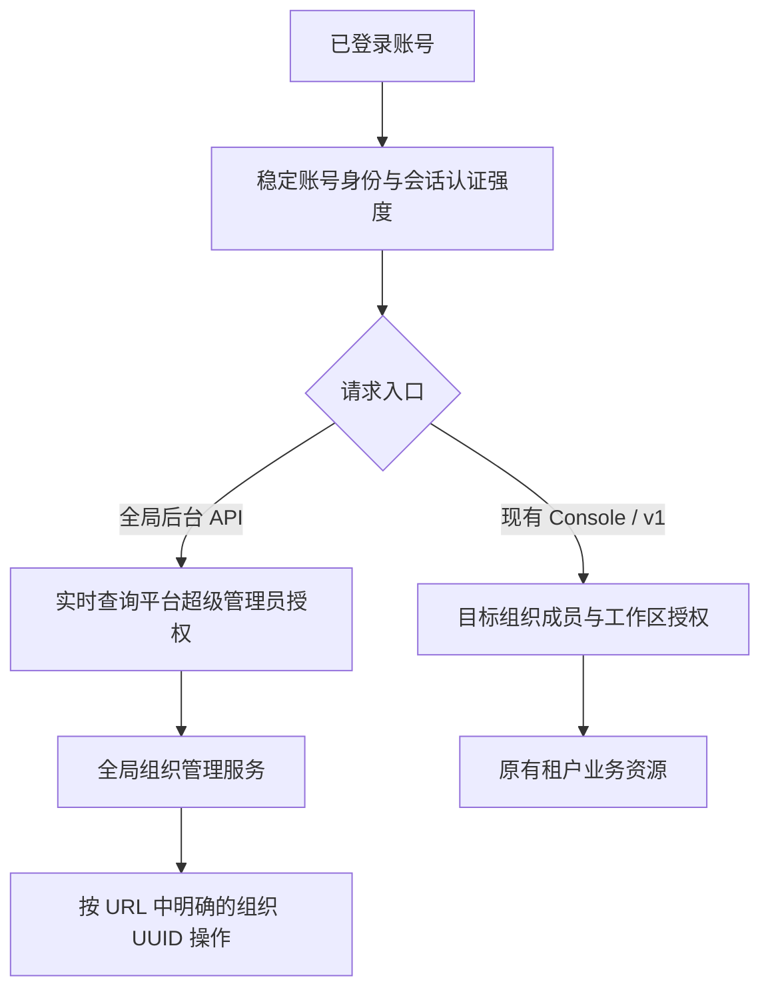
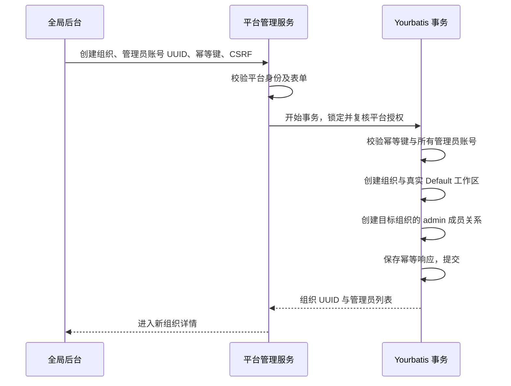

# 超级管理员与全局组织管理后台

状态：2026-10-16。审计独立保存在 `codex/platform-admin-audit`；当前版本不提供审计与操作原因表单。外部 SMTP 收件验收按用户要求跳过。

设计起点为 [PR #350](https://github.com/superduck-ai/open-managed-agents/pull/350)。该 PR 及其依赖已合并；当前交付基于主线 `e914f566`，直接复用主线 User/Admin 两种组织角色和现有组织加入流程。

## 1. 目标与范围

增加独立的平台级超级管理员身份。超级管理员通过 `/platform-admin` 管理全部组织，无须先成为目标组织成员；普通组织管理员只能管理自己的组织，不能进入全局后台，也不能调用后台接口。

一期包含：

- 全部组织的分页列表、名称/UUID 搜索、详情及成员/工作区数量。
- 创建组织，同时指定一名或多名已注册账号作为组织管理员。
- 编辑组织名称及白名单基础资料；查看组织成员和工作区目录。
- 添加组织管理员、提升已有成员为管理员、修改管理员角色、原子交接管理员，以及邀请 User 或 Admin。
- 超级管理员的初始授予、撤销和应急恢复。

全局审计页面、查询接口、审计权限和事务内事件写入均移至 `codex/platform-admin-audit`，不在本版本启用。

“管理全部组织”指所有组织的管理面，不自动授予会话、文件、密钥、Vault 或模型资源的读取权限。普通资源仍使用 #350 的组织和工作区授权规则。一期不提供冒充用户、租户数据浏览、组织硬删除、批量导出或全局 API Key。

组织停用/恢复放在后续独立阶段：它需要同时定义 Console、API Key、定时部署、运行中任务、长连接和 worker 的阻断语义。仅增加一个状态按钮不能视为完整的组织停用能力。

保留现有首次登录创建个人注册组织的行为；本需求增加超级管理员创建和管理组织的能力，不把组织创建改为全局独占，也不让注册组织的 Admin 自动成为超级管理员。

## 2. 基线事实与关键决策

| PR #350 及依赖中的事实                                                                          | 本方案的处理                                                              |
| ----------------------------------------------------------------------------------------------- | ------------------------------------------------------------------------- |
| `admin` 是组织角色；组织 Admin 继承该组织的 Workspace Admin                                     | 保留该语义，不往组织角色枚举中加入 `super_admin`                          |
| `account.uuid` 来自登录会话的稳定 `UserUUID`，业务 Principal 的 `UserUUID` 会映射为目标组织成员 | 全局授权绑定账号 UUID，不能绑定请求级组织成员 UUID                        |
| 尚无独立的全局 accounts 表，注册身份由 `users.registration_identity` 标记并兼容历史来源身份     | 一期复用稳定登录身份，不假定已有全局账号表，不重新生成账号 UUID           |
| `platformIdentityMiddleware` 只验证登录身份并检查写请求 CSRF                                    | 全局后台复用此入口，另加超级管理员授权；不挂依赖 workspace 的通用业务鉴权 |
| 组织成员变更通过组织行锁保护最后一名管理员                                                      | 后台操作共用相同锁和不变量，只增加显式的平台操作者授权分支                |
| 邀请接受不覆盖已有成员角色                                                                      | 已有成员提权必须走显式管理员操作，不能靠邀请覆盖角色                      |
| SMTP 未配置时允许任意非空验证码登录                                                             | 全局后台要求真实认证会话；配置切换前的开发会话不能获得后台权限            |

代码依据（均指上述 PR 提交）：`internal/api/platform_identity.go`、`internal/platformsession/session.go`、`internal/platformapi/platform_bootstrap.go`、`internal/platformapi/platform_bootstrap_builders.go`、`internal/db/platform_auth_user_mapper.xml`、`internal/db/organization_members.go`、`internal/platformauth/service.go`。

### 官方公开资料核对（2026-10-07）

已核对 Anthropic 官方平台文档、帮助中心和 TypeScript SDK；SDK 固定到提交 `d49bdab458000bcdffe77bd84b03293f31824fb3`。公开资料可以证明组织内管理合同，但本轮未找到跨所有租户的超级管理员后台设计、公开 API 或 SDK。未找到公开资料不代表 Anthropic 内部没有对应系统。

| 官方证据                                                                                                                                                                 | 能确认的合同                                                                                             | 对本方案的影响                                                               |
| ------------------------------------------------------------------------------------------------------------------------------------------------------------------------ | -------------------------------------------------------------------------------------------------------- | ---------------------------------------------------------------------------- |
| [Admin API 指南](https://platform.claude.com/docs/en/manage-claude/admin-api)                                                                                            | 管理凭证所属组织的成员、邀请、工作区和 Key；`org:admin` 是整个当前组织的权限范围                         | 组织级管理凭证不能被当作跨组织的平台授权                                     |
| [SDK Organization 资源](https://github.com/anthropics/anthropic-sdk-typescript/blob/d49bdab458000bcdffe77bd84b03293f31824fb3/src/resources/organization/organization.ts) | 根资源提供 `retrieve()` → `GET /v1/organizations/me`；此资源中没有组织创建或全组织列表方法               | “后台创建组织、枚举所有组织”是本项目扩展，应保留独立命名空间                 |
| [SDK 成员更新参数](https://github.com/anthropics/anthropic-sdk-typescript/blob/d49bdab458000bcdffe77bd84b03293f31824fb3/src/resources/organization/users.ts)             | Console/API 组织的角色更新接受 user、developer、billing、claude_code_user，明确不能通过此 API 授予 admin | 读取角色枚举与可写角色集合不同；后台提权不能冒充官方 Admin API 的既有能力    |
| [SDK 邀请创建参数](https://github.com/anthropics/anthropic-sdk-typescript/blob/d49bdab458000bcdffe77bd84b03293f31824fb3/src/resources/organization/invites.ts)           | 官方公开邀请创建接口同样不能指定 admin；共享类型中 managed 用于 Enterprise                               | 本方案的成员邀请属于本项目受控后台/Console 能力，不能扩散到兼容 `/v1` 接口   |
| [Console 组织创建与工作区说明](https://support.claude.com/en/articles/9796807-creating-and-managing-workspaces-in-the-claude-console)                                    | 一个邮箱只能自行创建一个 Console 组织，可以受邀加入其他组织并切换；注册完成自动创建组织和 Default        | 支持保留注册组织与多组织成员关系；不支持据此推导同一客户账号能创建任意多组织 |
| [Console 角色说明](https://support.claude.com/en/articles/10186004-claude-console-roles-and-permissions)                                                                 | 组织 Admin 继承所有工作区 Admin；工作区可单独授权                                                        | 支持维持 #350 的组织与工作区边界，不证明平台级超级管理员存在                 |
| [Enterprise 用户管理说明](https://platform.claude.com/docs/en/manage-claude/user-management)                                                                             | Console 与 Enterprise 共用部分端点，但角色及可用能力不同；组和自定义角色属于 Enterprise                  | 不能照抄 SDK 的所有角色枚举到 CMA Console                                    |
| [CMA 官方架构文章](https://www.anthropic.com/engineering/managed-agents)                                                                                                 | 介绍 session、harness、sandbox 的解耦及凭据隔离                                                          | 有运行时架构设计，但没有披露组织创建或全局后台的实现                         |

需要特别区分 `owner` / `primary_owner` 与平台超级管理员：SDK 的共享 `OrganizationRole` 包含这两种值，Admin API 指南也提到组织所有者可管理管理员，但它们仍然是组织内角色，不意味着可以查看或管理其他客户组织。SDK 的筛选参数还明确区分 Console/API 与 Enterprise 的适用角色。

官方资料之间存在口径差异：Console 角色帮助页列出六种角色并包含 Limited Developer，SDK 的 Console 成员筛选集合仍是五种；组织创建帮助页称创建者为 Primary Owner，而 SDK 将 primary_owner 列在 Enterprise 角色筛选集合中。应记录这些差异，不能仅凭某个返回类型认定 Console 已开放完整 Owner 层级或推导其授权算法。若未来要求严格对齐最新 CMA Console，需要单独验证对应产品、接口和实际 UI；本方案继续使用 #350 已确定的组织角色，不借此追加角色迁移。

据此对方案作如下界定：

1. **官方明确支持的部分**：组织内管理员、工作区权限、成员和邀请管理、注册组织及 Default、受邀加入多组织。
2. **本项目的合理扩展**：稳定账号上的平台授权、独立全局后台、后台创建组织、设置初始管理员与跨组织管理。这些设计不能标注为“复刻官方超级管理员”。
3. **公开资料无法验证的部分**：Anthropic 内部后台路由、数据库表、平台人员角色、超级管理员初始化、事务锁、撤权时效，以及“最后管理员”的具体实现。本文对这些问题的选择来自本项目需求与 #350 基线。

实现时继续保持 `/v1/organizations` 的官方兼容边界：后台授予 admin 或发送 admin 邀请走 `/api/platform-admin`，可复用领域和事务机制，但不放宽公开 Admin API 的可写角色集合。复用 #347 邀请流程不等于调用官方 SDK 创建 admin 邀请。

### Enterprise 的开通与父组织补充

进一步核对发现，官方 Enterprise 存在父组织及关联组织治理能力。前述“Organization 根资源没有全组织列表”只描述该 SDK Admin 资源，不能推广为所有官方 API 都没有多组织目录。

- **组织开通**：Enterprise 支持在线自助购买及销售协助开通，也支持将既有 Team 组织升级并保留成员、角色和内容。销售开通场景有“Anthropic 创建 Enterprise 组织并邀请 Primary Owner”的明确说明；初始邀请有效期为 21 天。这能证明产品开通流程，不能推断 Anthropic 内部采用何种后台接口。[Enterprise 开通](https://support.claude.com/en/articles/9797531-what-is-the-enterprise-plan)、[Team 升级](https://support.claude.com/en/articles/13779868-migrate-your-organization-from-team-to-enterprise)、[初始邀请与所有权交接](https://support.claude.com/en/articles/13133750-manage-members-on-team-and-enterprise-plans)
- **组织内管理**：每个组织只有一个 Primary Owner，可在成员设置中交接；Owner 管理管理员，Admin 管理一般成员。自动化可使用邀请、JIT 或 SCIM；Enterprise 成员 API 只允许写 user/managed，不能授予管理角色或修改/移除持有管理角色的成员。[角色权限](https://support.claude.com/en/articles/9267276-roles-and-permissions)、[Enterprise API 合同](https://platform.claude.com/docs/en/manage-claude/user-management)
- **父组织关联**：Enterprise 建立时自动创建父组织；它承载域名、SSO 和用户开通策略，可以关联多个 Claude/Console 组织。Merge Organizations 关联的是已有组织，需满足域名与审批条件；不表示新建组织或合并账单。各组织的账单和使用量仍独立。[父组织与关联流程](https://support.claude.com/en/articles/10276682-important-considerations-before-enabling-single-sign-on-sso-and-jit-scim-provisioning)
- **跨关联组织读取**：`GET /v1/compliance/organizations` 可列出凭证所属父组织下的组织。Primary Owner 可创建覆盖关联组织的合规密钥，Owner 的密钥限于自身组织；它不是全平台目录，也不提供通过该接口创建组织或设置管理员的能力。[组织目录 API](https://platform.claude.com/docs/en/manage-claude/compliance-org-data)、[密钥权限边界](https://support.claude.com/en/articles/15167101-get-started-with-claude-compliance-api-integrations)

对 OMA 的推导：需要区分平台运营的全局管理、企业父组织的身份治理、单组织的日常管理。本次需求是第一层；若未来需要同一企业管理多个组织，再单独引入父组织范围，不能将企业 Primary Owner 自动提升为平台超级管理员。本文仍不把父组织、SSO 或 Enterprise 计费体系加入一期范围。

## 3. 权限模型

超级管理员是独立授权关系 `platform_admins`，一个账号可以同时是超级管理员和某些组织的成员。全局权限只在全局后台资源中生效。

| 操作                               | 超级管理员              | 组织 Admin   | 工作区 Admin / 普通成员 |
| ---------------------------------- | ----------------------- | ------------ | ----------------------- |
| 进入全局后台、枚举所有组织         | 允许                    | 拒绝         | 拒绝                    |
| 从后台创建组织、配置初始管理员     | 允许                    | 拒绝         | 拒绝                    |
| 从后台修改任意组织基础资料及管理员 | 允许                    | 拒绝         | 拒绝                    |
| 在现有控制台管理所属组织           | 按该组织成员权限        | 允许         | 按 #350 规则            |
| 查看组织内会话、文件及其他业务资源 | 按该组织/工作区成员权限 | 按 #350 规则 | 按 #350 规则            |
| 使用 Admin API Key 进入全局后台    | 拒绝                    | 拒绝         | 拒绝                    |

平台权限以 `platform:access`、`platform:organizations:read`、`platform:organizations:write`、`platform:organization-admins:manage` 表达。一期统一由超级管理员角色拥有这些权限，不引入可编辑 RBAC 引擎。

`GET /api/bootstrap` 增加独立的 `platform_access` 字段，包含 `role` 和 `permissions`；普通账号为 `role: null`、空权限数组。它用于显示账号菜单里的“管理后台”，不并入当前组织的 `account.permissions` 或 `WorkspaceAccess`。

不能给通用 `platformActionAllowed` 增加“超级管理员全部放行”，不能将超级管理员隐式插入全部组织，也不能用目标组织管理员身份代替真实操作者。

## 4. 登录、授权与撤权

全局 API 路由组使用“有效登录会话 → 实时平台授权 → 写请求 CSRF → 资源处理”。读取请求也检查平台授权。新请求在角色撤销提交后立即被拒绝；不把角色副本长期放入 cookie、Redis session 或浏览器缓存作为授权依据。

- 路由只接受平台会话，不接受组织 Admin Key、workspace API Key、OAuth token 或 worker 凭证替代登录。存在 API Key/Bearer 头的后台请求明确拒绝，避免混合凭证歧义。
- 全局操作者仅从会话的稳定账号 UUID 解析，拒绝客户端提交的角色、操作者 ID 或目标账号冒充字段。
- 后台请求不发送 `X-Organization-UUID`、`X-Workspace-ID`；后端不以这些头或同名查询参数确定后台目标。单组织操作必须取 URL 中的 UUID，并显式传给所有查询和写入。
- 后台鉴权和 bootstrap 不要求当前组织、Default 工作区或工作区 Key 可用。被移出某个组织不能丢失独立的平台授权；全局账号停用/删除则必须撤销平台授权。
- 授权查询失败返回 503 并拒绝操作；不把故障降级为允许，也不返回误导性的“没有组织”。
- 写事务内复核操作者平台授权并持有授权记录锁直至提交；撤权取得冲突锁。写操作先获得锁则先完成，撤权先提交则该写操作被拒绝，避免只在 HTTP 中间件检查造成竞态。

认证强度必须来自成功认证路径的服务端记录。会话增加认证方式/版本标记；仅真实邮箱验证码验证成功的会话可进入后台。任意验证码开发模式、缺少可信标记的旧会话均需要重新认证，不得因为当前 SMTP 已配置就追认旧会话。生产会话使用 HTTPS 和 Secure cookie：API 组装层在 `env=prod` 或配置 HTTPS 的 `auth.console_url` 时启用 Secure，并显式传给两个邮箱登录入口；不使用请求的代理头决定此属性。会话 Cookie 保持 HttpOnly、SameSite=Lax 和根路径，本地 HTTP 开发环境仍可登录。全局后台的开启条件应包含真实认证配置；不满足时关闭后台能力，普通开发控制台保留现有行为。

`GET /api/platform-admin/bootstrap` 返回后台所需的账号摘要、平台权限和 CSRF，不依赖完整组织 bootstrap。这也避免注册组织关系失效导致后台无法进入。身份资料读取应按稳定账号 UUID 获取，不能因组织成员软删除而误判全局账号删除；当前 `users.deleted_at` 表示成员移除，不能直接当作全局账号停用状态。

## 5. 超级管理员初始化与身份生命周期

一期通过受控部署端 CLI 管理超级管理员授权，不在组织设置或普通角色下拉框提供授予入口。命令入口位于 `cmd/platform-admin`：`platform-admin grant --account-uuid ... --operator ...`、`revoke`、`list`；授权变更必须提供运维操作者；不收集操作原因。

1. 首位管理员先完成真实登录，部署运维核对账号 UUID 和邮箱，再显式授予。
2. CLI 调用同一授权服务与 Yourbatis 事务，记录运维操作者标识和目标账号；不要求直接修改 SQL。
3. 授权只接受可确定的稳定登录身份；若输入的是某组织成员 UUID，应拒绝并提示先解析账号身份。历史身份有歧义时先人工核对，不自动选择“最早的管理员”。
4. 不使用“第一个注册用户自动成为超级管理员”、固定默认邮箱、前端白名单或每次启动重放的环境变量授予。
5. 重复授予/撤销保持幂等；撤销最后一位有效超级管理员返回 409。所有授权变更在同一事务内使用固定的平台管理员管理锁，串行检查计数；锁先于目标授权行锁，保证并发撤销不会清空管理员。
6. 账号无法登录时，由部署运维先授予另一个已验证账号，再撤销旧账号。应急变更继续共用授权行锁与最后超级管理员保护。

平台授权绑定 UUID，邮箱只用于展示、查询和已验证身份匹配，不作为角色授权主键。组织切换、邀请接受、角色变更均不得更新平台授权的账号 UUID。未来若引入独立 accounts 表，须迁移同一身份映射并保持对外账号 UUID 稳定。

## 6. 全局组织管理流程

### 创建组织

创建表单包含组织名称、初始管理员（至少一名）及操作原因。名称在 HTTP 边界修剪并限制长度，允许同名组织；UUID 是唯一身份。管理员从已经完成注册的账号中选择，按邮箱或姓名搜索，结果只返回 UUID、姓名和邮箱，服务端分页并限制查询长度及频率。

一期初始管理员必须已注册。未知邮箱提示“请先完成注册，或组织创建后发送成员邀请”，不创建冒充已验证账号的占位用户，也不把尚未接受的邀请计入有效管理员。

组织、Default、初始管理员、幂等结果必须原子提交。失败不留下空组织；重复提交返回原创建结果，不复制组织。后台创建不复用会创建个人身份和默认 Key 的整个邮箱注册流程；复用底层数据访问原语。初始管理员的组织成员 `registration_identity=false`，不覆盖其原注册身份。Default 使用 #346 的真实 `is_default` 标记，无须生成显式 Default 成员关系或自动创建 API Key。

### 设置与交接管理员

- 目标账号已是有效成员：将该成员角色设为 `admin`，保留其 UUID 和其他组织身份。
- 已注册但未加入目标组织：显式创建该组织的 admin 成员；若存在软删除历史关系，按明确的重新加入规则恢复/新建组织成员，不恢复历史显式工作区关系。组织 Admin 的访问按 #350 继承计算。
- 尚未注册或希望本人接受后加入：复用 #347 的 `role=admin` 邀请、有效期、接受与邮件投递流程。邀请未接受前不降级旧管理员。已有成员收到邀请时不被自动提权，转为后台显式提权操作。
- 降级：选择现有的非 Admin 组织角色，并执行最后管理员保护。它不等于移除组织成员；普通成员移除继续由 #350 的组织管理界面处理。
- 交接：在同一组织锁事务中先授予新管理员，再将旧管理员改为选定的非 Admin 角色。允许原管理员是唯一管理员，但提交后的有效管理员数必须至少为一。任一步失败全部回滚。
- 管理员降级可能失去继承的工作区权限，确认弹窗展示此影响。不能为了“恢复访问”自动补建工作区成员关系。
- 超级管理员可以修复历史零管理员组织；添加管理员不要求操作者本身是目标组织成员。超级管理员仍受“最终至少一位管理员”约束，不能无条件绕过它。

所有组织管理员写操作复用 #350 的组织锁；事务锁顺序为操作者平台授权 → 目标组织 → 目标成员（多成员按 UUID 排序）。组织 Console/Admin API 保持原权限入口，但在相同组织锁下共同保护管理员计数。领域层判断“平台操作者或目标组织管理员”，DB 只返回授权事实并执行持锁写入；禁止向 DB 传一个来自客户端的 `bypass_auth`。

成员邀请创建由平台服务显式授权，不能把超级管理员伪装为组织 Admin 来调用旧接口。原邀请记录若要求组织内邀请者，应新增可空的平台操作者引用，并约束两类创建来源；业务写入与邮件 outbox 在同一事务提交。邮件发送失败显示投递失败并可重试，不回滚已创建组织，也不把“已发送”当作“已接受”。

### 组织资料与目录

一期编辑只开放组织名称、网站、行业等基础资料，使用明确 DTO 白名单，不开放任意 settings JSON、SSO、账单或安全策略透传。列表和详情可查看全部组织；成员与工作区目录只返回管理所需元数据，不返回 Key 明文、文件或会话内容。

编辑与管理员调整使用 `expected_version` 检测后台并发编辑；冲突返回 409 并要求刷新。#350 原入口的相关资料和成员变更也要递增该管理版本，否则不能声称它覆盖跨入口并发。最后管理员保护仍依赖行锁而非前端版本号。

## 7. 页面与交互

后台与现有 Console 共享登录、主题和基础组件，采用独立布局，不挂在组织设置下面。账号菜单根据 `platform_access` 显示“管理后台”；后台固定展示“平台管理”标识和“返回工作台”。采用与 Console 相同的 Sidebar 组件、主题令牌和内容间距；左侧菜单提供全局组织管理；进入组织后增加基础资料、组织成员、工作区和成员邀请菜单，只高亮当前页面。窄屏使用顶部菜单按钮展开侧栏，选择菜单后关闭。

| 页面                                              | 主要内容                                                                     |
| ------------------------------------------------- | ---------------------------------------------------------------------------- |
| `/platform-admin/organizations`                   | 搜索、分页、创建按钮；组织名称、UUID、管理员摘要、成员数、工作区数、创建时间 |
| `/platform-admin/organizations/new`               | 组织名称、已注册管理员选择、创建结果与可重试错误                             |
| `/platform-admin/organizations/$organizationUuid` | 基础资料、管理员、成员目录、工作区目录                                       |

进入后台先完成专用 bootstrap 和路由权限守卫，再请求组织数据。没有权限时不闪现表格；已登录非超级管理员直达 URL 显示 403，未登录跳转登录并保留站内返回地址。

`/platform-admin` 位于身份层级，与 Console 的组织/工作区布局平级；#347 根级 `InvitationEntryGate` 对此后台分支不强制跳转邀请页，账号菜单仍保留邀请入口。后台不提供“切入任意组织工作台”；返回工作台恢复之前真正有权限的组织上下文。

后台 API client 复用 cookie、CSRF 和错误处理，避免自动附加组织/工作区头。TanStack Query 为每个登录账号创建独立 QueryClient，并使用 `platform-admin` 查询前缀；切换账号、退出或平台权限撤销时取消请求并清除后台缓存，忽略旧请求延迟响应。403 保留登录态，停止后台数据加载并显示无权限；401 清理认证并登录。读响应统一 `Cache-Control: no-store`。

页面使用既有 shadcn/ui 表格、Dialog、Alert Dialog、字段和分页组件，保持明暗主题、键盘操作与移动端基本可用。提交时禁用重复操作，失败保留表单；管理员行操作统一称为“修改角色”，复用组织管理的角色名称与权限说明，默认显示当前角色，选择其他角色后即可提交，最后一位管理员仍禁止改为非管理员。修改角色和交接弹窗展示目标组织、目标账号和权限影响。

## 8. API 草案

全局 API 独立挂载在 `/api/platform-admin`，不复用已有 `/v1/organizations` 的组织内 Admin API。下表路径均相对此前缀，除 bootstrap 同样要求超级管理员外，没有公开的目录接口。

| 方法与路径                                                                   | 语义                                                  |
| ---------------------------------------------------------------------------- | ----------------------------------------------------- |
| GET `/bootstrap`                                                             | 全局身份、权限、CSRF                                  |
| GET `/accounts?query=&cursor=&limit=`                                        | 选择已注册管理员的最小账号目录                        |
| GET `/organizations?query=&cursor=&limit=`                                   | 全部组织分页列表                                      |
| POST `/organizations`                                                        | `{name, admin_account_uuids}`，要求 `Idempotency-Key` |
| GET `/organizations/{organizationUuid}`                                      | 基础资料、管理员摘要、统计、管理版本                  |
| PATCH `/organizations/{organizationUuid}`                                    | 白名单资料、`expected_version`                        |
| GET `/organizations/{organizationUuid}/members`                              | 分页成员目录及角色                                    |
| GET `/organizations/{organizationUuid}/workspaces`                           | 分页工作区目录，标识 Default/归档                     |
| POST `/organizations/{organizationUuid}/administrators`                      | 按 `account_uuid` 添加/提升管理员                     |
| PATCH `/organizations/{organizationUuid}/administrators/{memberUuid}`        | 降为指定非 Admin 角色，含版本                         |
| POST `/organizations/{organizationUuid}/administrator-transfers`             | 新账号、原成员、原成员新角色、版本，原子交接          |
| POST `/organizations/{organizationUuid}/invitations`                         | 为邮箱创建指定 User 或 Admin 角色的邀请               |
| GET `/organizations/{organizationUuid}/invitations`                          | 待处理邀请及投递结果                                  |
| POST `/organizations/{organizationUuid}/invitations/{invitationUuid}/resend` | 复用邀请重发限制与投递机制                            |
| POST `/organizations/{organizationUuid}/invitations/{invitationUuid}/revoke` | 撤销尚未接受的邀请                                    |

未单列的写入也需要 `expected_version` ；管理员授权请求以目标账号 UUID 定位，修改既有成员以组织 UUID + 成员 UUID 定位，两种身份不能混用。路径中邀请 ID 同样必须校验所属组织。

列表返回 `{data, next_cursor}`，默认每页 20、最大 100，使用稳定排序和游标，不加载全部组织再由前端筛选。创建成功为 201，重放成功返回原结果；相同幂等键不同请求体返回 409。幂等键按账号 UUID + 动作隔离，保存请求摘要和响应最少 24 小时，过期后按新请求处理。

错误使用一致的 Console JSON 结构 `{error:{code,message},request_id}`，不扩散到 Anthropic `/v1` 合同：400 参数错误，401 会话无效，403 权限/CSRF/认证强度不足，404 已授权请求的目标不存在，409 最后管理员/版本/状态/幂等冲突，503 依赖不可用。非超级管理员必须先收到 403，不能通过任意目标 ID 的不同响应枚举组织存在性。

## 9. 数据与模块边界

| 数据              | 设计                                                                                 |
| ----------------- | ------------------------------------------------------------------------------------ |
| `platform_admins` | `uuid`、`account_uuid` 唯一、授予时间/操作者、撤销时间/操作者；重新授予复用授权行    |
| 创建幂等记录      | 账号 UUID + 动作 + 幂等键唯一、请求摘要、组织 UUID、响应、过期时间；与业务创建同事务 |
| `organizations`   | 增加管理版本用于资料与成员管理并发控制；不为一期增加未落地的停用状态                 |
| 邀请创建来源      | 兼容原组织邀请者，补充平台操作者 UUID；使用已有邀请表和邮件投递机制                  |
| 会话认证标记      | 记录真实验证来源及版本，旧会话不能默认认定满足后台认证强度                           |

新增核心表遵守 identity 内部主键、稳定 UUID 和适用的 external ID 约定；跨表引用统一 UUID，不创建外键。新 goose migration 编号在实际实现分支上分配，不预占或重写 #350 已有迁移。迁移不自动提升现有 Admin、seed 用户或任何邮箱。

建议新增 `internal/platformadmin`，集中 Handler、Service、命名 DTO、授权策略和 `errors.go`。`internal/api` 仅负责路由组装及身份中间件；`internal/db/platform_admin_*.go`、Mapper 声明、XML 和生成文件按项目职责分开。Yourbatis 事务串联授权事实、组织、成员和幂等；不新建连接池，不在 DB 层判断 HTTP 权限。

前端新增 `web/src/features/platform-admin/`，按组织列表、详情、创建和管理员拆分模块。路由入口只做布局与守卫，独立后台 client 使用共享 HTTP 基础能力。

组织与管理员变更保持事务原子性；幂等重放返回已保存的创建结果。拒绝请求记录带 request ID 的结构化安全日志，禁止记录 cookie、CSRF、验证码、Key、邀请 token 或完整请求体。

## 10. 实施顺序与验收

1. 在已合并 #350 的当前主线上实现平台授权、真实认证会话标记、CLI 和后台 bootstrap；先验证无组织上下文也可鉴权，普通 Admin/Key 均被拒绝。
2. 实现全组织目录、原子创建和资料更新；实现初始管理员解析、真实 Default、幂等和失败回滚。
3. 接入管理员添加、降级、交接、邀请；与 #350 的 Console/Admin API 共用组织锁和最后管理员不变量。
4. 实现独立后台页面、账号菜单入口、路由守卫、缓存隔离和权限撤销反馈；完成跨端验收后再启用后台。

测试先覆盖失败场景：

- 未登录、普通成员、组织 Admin、工作区 Admin、Admin/API Key、伪造平台角色、无/错误 CSRF、开发登录及旧会话全部不能读写后台。
- 篡改 URL、组织头、工作区头、成员 UUID、邀请 ID 不能造成跨组织错误写入；未授权响应不泄露组织是否存在。
- 平台撤权与写入并发、最后超级管理员并发撤销、跨 Console/Admin API/全局后台并发降级，均满足事务顺序及至少一名管理员约束。
- 初始管理员不存在、组织创建中途失败、同幂等键不同请求体、版本冲突、重复点击均无部分写入。
- 待接受/过期/撤销的邀请不能计入有效 Admin；接受邀请不覆盖已有成员角色；管理员交接失败不能先撤销原管理员。
- 超级管理员只在其他组织是普通成员时，原 `/api` 和 `/v1` 业务资源仍按普通成员权限执行；全局权限不能读取租户秘密。

再覆盖成功流程：全局列表包含本人未加入的组织；创建后管理员登录可见并管理新组织，原账号 UUID 不变；新组织恰有一个真实 Default 且不生成 Key；提升、降级、交接和邀请可回读；当前组织失效、组织成员移除后仍可按独立平台授权进入后台；清空 memberships 不导致路由循环。

数据库验收使用真实 PostgreSQL 验证事务、锁、唯一性、nullable、JSON、UUID 绑定与生成 SQL。前端验收覆盖直达链接、权限加载空态、403/401 区别、切换账号清缓存、慢请求回写、表单错误保留及明暗主题。真实邮箱投递和浏览器多账号流程单列证据，不能以 mock 通过替代。

实现时按实际变更执行项目对应 Go、前端及质量门禁，并同步 #350 的成员设计文档和 #347 的组织加入文档。

## 11. 当前实现与交付边界

- 新增迁移 `00083_platform_administration.sql`，包含独立平台授权、创建幂等记录、邀请投递队列及组织管理版本。新迁移不创建审计表，不回写已合并的历史迁移。
- 组织角色只提供 `user` 与 `admin`；超级管理员身份独立存储，不增加组织角色枚举。邀请需显式选择角色，重发及撤销不改写原角色。
- `/platform-admin` 使用现有侧边栏组件。组织内按基础资料、成员、工作区、邀请四个菜单分别展示。返回组织列表位于侧栏全局导航；创建组织和编辑资料位于页面标题区右上角。
- 后台通过现有国际化体系提供英文和简体中文，覆盖菜单、状态、表单、错误、无障碍标签、日期和计数；侧栏提供语言切换并保存偏好。
- 原因字段不在表单中展示，后端允许旧客户端传入但不持久化。当前版本没有审计入口、查询路由、审计权限及事件写入。
- 原始功能证据记录在 [PR 验收评论](https://github.com/superduck-ai/open-managed-agents/pull/450#issuecomment-6207321058)，本轮简化调整的结果与角色控件截图见同一 PR 的补充验收评论；历史分支截图不作为当前版本的通过证据。

### 简化调整

组织详情由处理器读取一次；目录仅检查组织是否存在，写操作仍在事务内锁定组织并校验版本。后台与组织设置共用角色选项、说明、翻译和角色选择器。

邀请创建、重发时，业务投递记录与 River 任务在同一 Yourbatis 事务内提交。River 负责并发执行、30 秒超时、最多 5 次尝试和崩溃恢复，不再维护独立轮询、租约和重试计数。未启用真实邮箱认证时不注册邀请队列消费，保留待处理任务。投递业务表保存结果；发送前校验邀请的组织、状态、过期时间与当前投递快照，失效任务不发送，列表显示取消状态。SMTP 接受不等于收件或接受邀请。

旧 `reason` 字段仅兼容接收，不校验、不持久化；CLI `--reason` 可省略。撤销邀请使用 POST `.../{invitationUuid}/revoke`。
