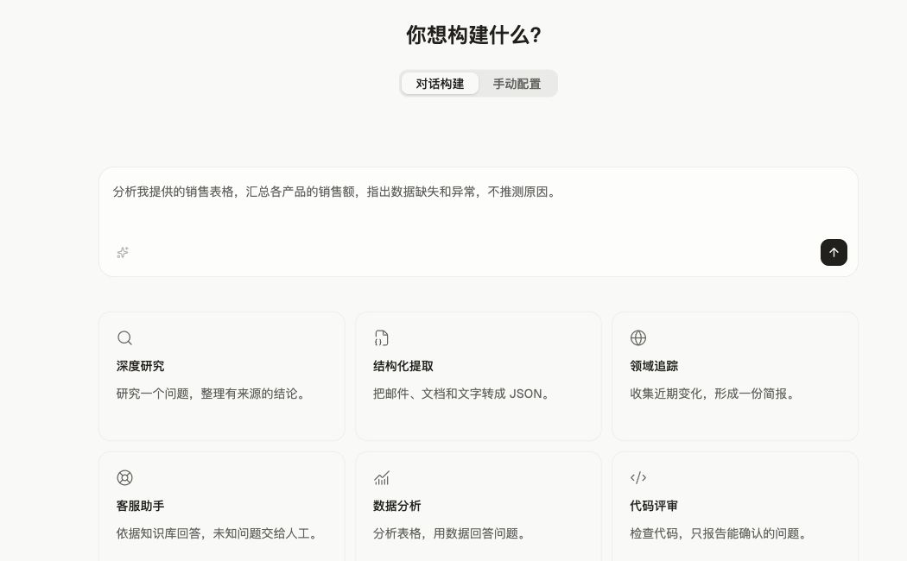
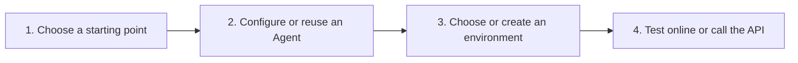
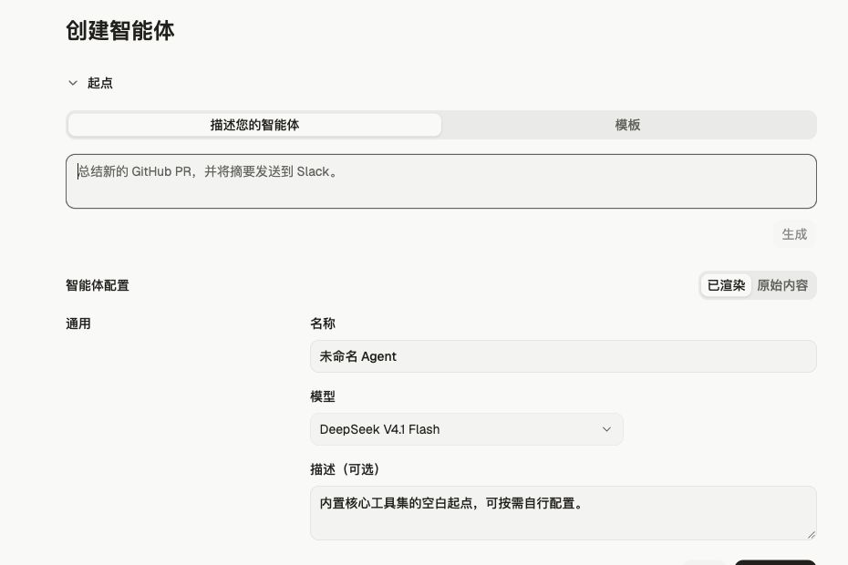

Console provides a visual interface for creating and configuring agents. It lets you iterate on configuration interactively before writing code.

<Note>
  Beta requirements differ by resource. See [Versioning and beta features](/docs/en/api/versioning-beta), and verify that your SDK sends the parameters required by OMA.
</Note>

## From Quickstart to your first conversation

In the console sidebar, select **Managed Agents → Quickstart**. Choose **Build with chat** to describe your goal, or **Manual setup** to configure it step by step. The screenshot shows the Chinese interface.



The diagram shows the manual setup path:



Choose a starting point and configure the Agent's name, model, and system prompt. Then select an existing environment or create one. In the last step, send a test message using your signed-in account, or prepare a workspace API key and follow the request examples to create a session, connect to the event stream, and send a message. Online testing creates its own session and does not require an API key in the page.

## How to build an agent

Start with a description or a template, then configure the name, model, and system prompt. The screenshot shows the Chinese interface; the model shown is an example and options depend on your workspace.



The visual interface walks you through each field of an agent definition:

* **Model and system prompt:** Pick a model and write the system prompt in a full-width editor.
* **MCP servers:** Add remote MCP servers by URL and authenticate your agent to take action on your behalf.
* **Tools:** Extend your agent's capabilities using a pre-built agent toolset and MCP tools.
* **Skills:** Attach OMA or custom skills from your organization's library.

The manual Quickstart flow shows corresponding API request examples, with application integration requests available to copy in the last step.

## Testing an agent

In the manual Quickstart flow, choose an Agent and environment, then start an online test in the last step to see replies and tool activity. You can also create a session from the Sessions page and continue the conversation there.

## From Console to your codebase

Once your agent works as expected:

1. Copy the agent ID and [environment ID](/docs/en/environments) from Console.
2. Reference them in your code when [creating sessions](/docs/en/sessions):

<CodeGroup defaultLanguage="CLI">
  ```bash cURL
  session=$(curl -fsSL http://localhost:38080/v1/sessions \
    -H "x-api-key: $OMA_API_KEY" \
    -H "anthropic-version: 2023-06-01" \
    -H "anthropic-beta: managed-agents-2026-04-01" \
    -H "content-type: application/json" \
    -d '{
      "agent": "agent_01J8XkN5uT3vHpLqRfWdY2",
      "environment_id": "env_01K2mPsT7hNwR4jXuLvCqD8",
      "title": "My first session"
    }')
  ```

  ```bash CLI
  ant beta:sessions create \
    --agent agent_01J8XkN5uT3vHpLqRfWdY2 \
    --environment-id env_01K2mPsT7hNwR4jXuLvCqD8 \
    --title "My first session"
  ```

  ```python Python
  session = client.beta.sessions.create(
      agent="agent_01J8XkN5uT3vHpLqRfWdY2",
      environment_id="env_01K2mPsT7hNwR4jXuLvCqD8",
      title="My first session",
  )
  ```

  ```typescript TypeScript
  const session = await client.beta.sessions.create({
    agent: "agent_01J8XkN5uT3vHpLqRfWdY2",
    environment_id: "env_01K2mPsT7hNwR4jXuLvCqD8",
    title: "My first session"
  });
  ```

  ```csharp C#
  var session = await client.Beta.Sessions.Create(new()
  {
      Agent = "agent_01J8XkN5uT3vHpLqRfWdY2",
      EnvironmentID = "env_01K2mPsT7hNwR4jXuLvCqD8",
      Title = "My first session",
  });
  ```

  ```go Go
  session, err := client.Beta.Sessions.New(ctx, anthropic.BetaSessionNewParams{
      Agent: anthropic.BetaSessionNewParamsAgentUnion{
          OfString: anthropic.String("agent_01J8XkN5uT3vHpLqRfWdY2"),
      },
      EnvironmentID: "env_01K2mPsT7hNwR4jXuLvCqD8",
      Title:         anthropic.String("My first session"),
  })
  if err != nil {
      panic(err)
  }
  ```

  ```java Java
  var session = client.beta().sessions().create(
      SessionCreateParams.builder()
          .agent("agent_01J8XkN5uT3vHpLqRfWdY2")
          .environmentId("env_01K2mPsT7hNwR4jXuLvCqD8")
          .title("My first session")
          .build()
  );
  ```

  ```php PHP
  $session = $client->beta->sessions->create(
      agent: 'agent_01J8XkN5uT3vHpLqRfWdY2',
      environmentID: 'env_01K2mPsT7hNwR4jXuLvCqD8',
      title: 'My first session',
  );
  ```

  ```ruby Ruby
  session = client.beta.sessions.create(
    agent: "agent_01J8XkN5uT3vHpLqRfWdY2",
    environment_id: "env_01K2mPsT7hNwR4jXuLvCqD8",
    title: "My first session"
  )
  ```
</CodeGroup>
