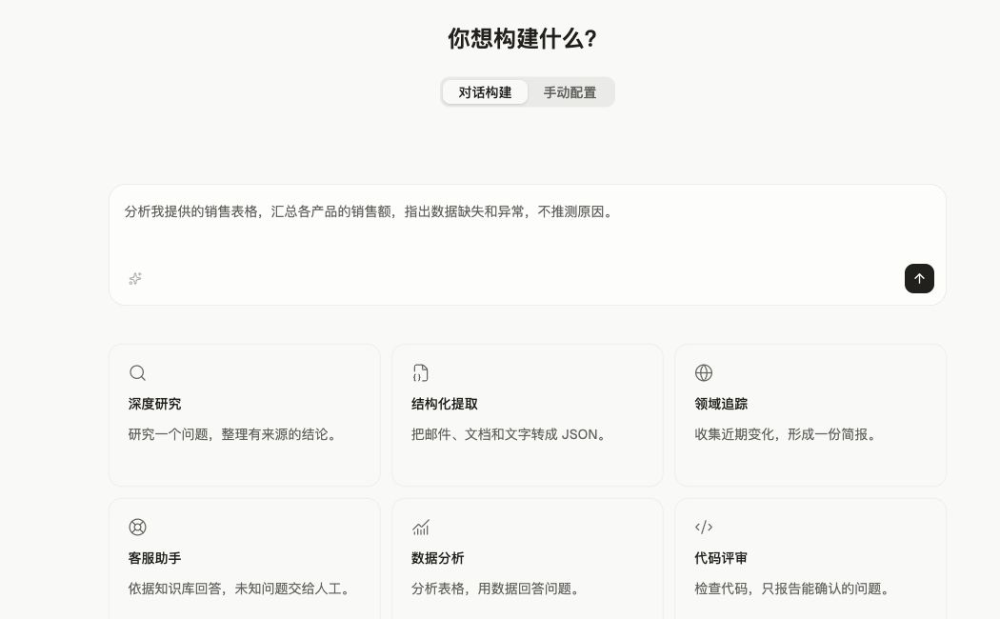

Open Managed Agents offers two ways to build, each suited to different use cases:

| | Messages API | Open Managed Agents |
| --- | --- | --- |
| **What it is** | Direct access to model prompting | A prebuilt, configurable agent harness running on infrastructure you control |
| **Best for** | Custom agent loops and fine-grained control | Long-running tasks and asynchronous work |

Open Managed Agents provides the harness and infrastructure for running agents. An agent can read files, run commands, use configured web tools, and run code in an environment you manage. Tool availability, model caching, and network access depend on the deployment, model provider, and environment configuration.

<Note>
  OMA is open source and self-hosted. The operator manages databases, object storage, model credentials, and Environment Runners. “Cloud environment” in these docs means an E2B or compatible runner configured by your OMA deployment.
</Note>

In the console Quickstart, create an agent through chat or manual setup, or start from a task template. The screenshot shows the Chinese interface.

[See the console guide](/docs/en/onboarding).

<CardGroup cols={3}>
  <Card title="Quickstart" href="/docs/en/quickstart">
    Create your first agent session
  </Card>
  <Card title="Start a session" href="/docs/en/sessions">
    Create a session and send your first event
  </Card>
  <Card title="Reference" href="/docs/en/reference">
    Event types, rate limits, CLI flags, and other lookup tables
  </Card>
</CardGroup>

## Core concepts

Open Managed Agents is built around four concepts:

| Concept | Description |
| --- | --- |
| **Agent** | The model, system prompt, tools, MCP servers, and skills |
| **Environment** | Configuration for where sessions run: a cloud sandbox configured by your OMA deployment, or a self-hosted sandbox on your own infrastructure |
| **Session** | A running agent instance within an environment, performing a specific task and generating outputs |
| **Events** | Messages exchanged between your application and the agent (user turns, tool results, status updates) |

## How it works

<Steps>
  <Step title="Create an agent">
    Define the model, system prompt, tools, MCP servers, and skills. Create the agent once and reference it by ID across sessions.
  </Step>
  <Step title="Create an environment">
    Configure where the agent runs: a cloud sandbox supplied by an Environment Runner, or a [self-hosted sandbox](/docs/en/self-hosted-sandboxes) on your own infrastructure.
  </Step>
  <Step title="Start a session">
    Launch a session that references your agent and environment configuration.
  </Step>
  <Step title="Send events and stream responses">
    Send user messages as events. The agent uses configured tools and streams results through server-sent events (SSE). Public persisted events can be retrieved from history; transient stream deltas are not part of that history.
  </Step>
  <Step title="Steer or interrupt">
    Send additional user events to guide the agent mid-execution, or interrupt it to change direction.
  </Step>
</Steps>

## When to use Open Managed Agents

Open Managed Agents is best for workloads that need:

- **Long-running execution:** Tasks that run for minutes or hours with multiple tool calls
- **Cloud infrastructure:** Sandboxes configured by your deployment, with packages and network access determined by the environment
- **Self-hosted execution:** Sandboxes on infrastructure you control, with data flow and compliance evaluated for your deployment
- **Minimal infrastructure:** No need to build your own agent loop, sandbox, or tool execution layer
- **Stateful sessions:** Conversation history and persisted files across multiple interactions
- **Scheduled execution:** Recurring agent runs on a cron schedule through [scheduled deployments](/docs/en/scheduled-deployments)

## Supported tools

Open Managed Agents provides a set of built-in tools:

- **Bash:** Run shell commands in the sandbox
- **File operations:** Read, write, edit, glob, and grep files in the sandbox
- **Web search and fetch:** Search the web and retrieve content from URLs
- **MCP servers:** Connect to external tool providers; available tools depend on the configured server

See [Tools](/docs/en/tools) for the full list and configuration options.

## Beta access

<Note>
  Open Managed Agents is in beta. Query and header requirements differ by resource; see [Versioning and beta features](/docs/en/api/versioning-beta).
</Note>

To get started, you need:

1. A reachable OMA deployment and workspace API key
2. The beta parameters or headers required by the resources you use
3. A configured environment that can start sessions

[MCP tunnels](/docs/en/mcp-connector) are available for connecting private MCP servers through an outbound-only connector. The current release does not yet expose the complete Dreams API; see the implementation-status warning at the top of [Dreams](/docs/en/dreams).

OMA stores session history and persisted outputs in your deployment. An idle sandbox can be reclaimed and rebuilt; local temporary files and process state are not guaranteed to persist. Retention, encryption, and compliance boundaries are controlled by the operator. Depending on its state, you can [delete a session](/docs/en/session-operations#deleting-a-session) and separately delete uploaded [files](/docs/en/files) through the API.
