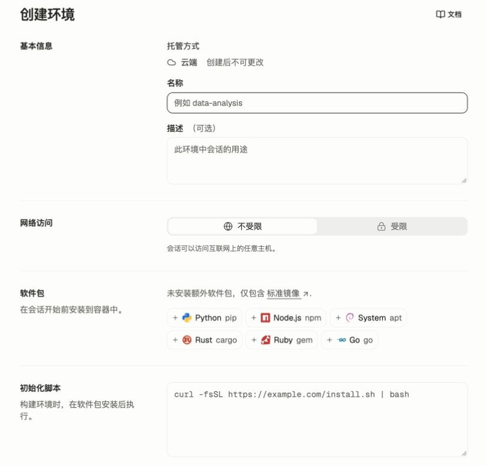
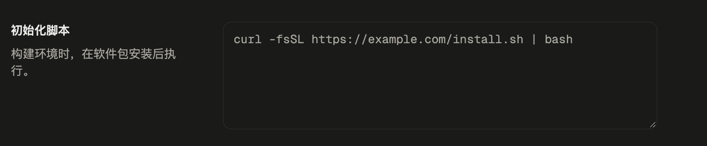

环境定义了您的智能体运行所在的沙盒配置。您只需创建一次环境，然后在每次启动会话时引用其 ID。多个会话可以共享同一个环境，但每个会话都会获得自己独立的沙盒（一个全新的 Linux 容器）。

本页介绍 `type: cloud` 环境。要在您自己的基础设施上运行沙盒，请参阅[自托管沙盒](/docs/zh/self-hosted-sandboxes)。

<Note>
  环境 API 要求查询参数 `?beta=true`。其他资源的要求请参阅[版本与 Beta 功能](/docs/zh/api/versioning-beta)。
</Note>

## 创建环境

在控制台的「环境」页面选择「创建环境」，可填写名称并配置网络、软件包和初始化脚本。下图展示空白配置表单；实际选项可能随部署版本变化。

<Frame>
  
</Frame>

<CodeGroup defaultLanguage="CLI">
  ```bash cURL
  environment=$(curl -fsS "http://localhost:38080/v1/environments?beta=true" \
    -H "x-api-key: $OMA_API_KEY" \
    -H "anthropic-version: 2023-06-01" \
    -H "anthropic-beta: managed-agents-2026-04-01" \
    -H "content-type: application/json" \
    --data @- <<'EOF'
  {
    "name": "python-dev",
    "config": {
      "type": "cloud",
      "networking": {"type": "unrestricted"}
    }
  }
  EOF
  )
  environment_id=$(jq -r '.id' <<< "$environment")

  echo "Environment ID: $environment_id"
  ```

  ```bash CLI
  ant beta:environments create \
    --name "python-dev" \
    --config '{type: cloud, networking: {type: unrestricted}}'
  ```

  ```python Python
  environment = client.beta.environments.create(
      name="python-dev",
      config={
          "type": "cloud",
          "networking": {"type": "unrestricted"},
      },
  )

  print(f"Environment ID: {environment.id}")
  ```

  ```typescript TypeScript
  const environment = await client.beta.environments.create({
    name: "python-dev",
    config: {
      type: "cloud",
      networking: { type: "unrestricted" },
    },
  });

  console.log(`Environment ID: ${environment.id}`);
  ```

  ```csharp C#
  var environment = await client.Beta.Environments.Create(new()
  {
      Name = "python-dev",
      Config = new BetaCloudConfigParams
      {
          Networking = new BetaUnrestrictedNetwork(),
      },
  });

  Console.WriteLine($"Environment ID: {environment.ID}");
  ```

  ```go Go
  environment, err := client.Beta.Environments.New(ctx, anthropic.BetaEnvironmentNewParams{
      Name: "python-dev",
      Config: anthropic.BetaEnvironmentNewParamsConfigUnion{
          OfCloud: &anthropic.BetaCloudConfigParams{
              Networking: anthropic.BetaCloudConfigParamsNetworkingUnion{
                  OfUnrestricted: &anthropic.BetaUnrestrictedNetworkParam{},
              },
          },
      },
  })
  if err != nil {
      panic(err)
  }

  fmt.Printf("Environment ID: %s\n", environment.ID)
  ```

  ```java Java
  var environment = client.beta().environments().create(EnvironmentCreateParams.builder()
      .name("python-dev")
      .config(BetaCloudConfigParams.builder()
          .networking(BetaUnrestrictedNetwork.builder().build())
          .build())
      .build());
  IO.println("Environment ID: " + environment.id());
  ```

  ```php PHP
  $environment = $client->beta->environments->create(
      name: 'python-dev',
      config: ['type' => 'cloud', 'networking' => ['type' => 'unrestricted']],
  );
  echo "Environment ID: {$environment->id}\n";
  ```

  ```ruby Ruby
  environment = client.beta.environments.create(
    name: "python-dev",
    config: {
      type: "cloud",
      networking: {type: "unrestricted"}
    }
  )

  puts "Environment ID: #{environment.id}"
  ```
</CodeGroup>

请使用唯一且具有描述性的 `name`，以便您区分不同的环境。

## 在会话中使用环境

在[创建会话](/docs/zh/sessions)时，将环境 ID 作为字符串传递。

<CodeGroup defaultLanguage="CLI">
  ```bash cURL
  session=$(curl -fsS http://localhost:38080/v1/sessions \
    -H "x-api-key: $OMA_API_KEY" \
    -H "anthropic-version: 2023-06-01" \
    -H "anthropic-beta: managed-agents-2026-04-01" \
    -H "content-type: application/json" \
    --data @- <<EOF
  {
    "agent": "$agent_id",
    "environment_id": "$environment_id"
  }
  EOF
  )
  ```

  ```bash CLI
  ant beta:sessions create \
    --agent "$AGENT_ID" \
    --environment-id "$ENVIRONMENT_ID"
  ```

  ```python Python
  session = client.beta.sessions.create(
      agent=agent.id,
      environment_id=environment.id,
  )
  ```

  ```typescript TypeScript
  const session = await client.beta.sessions.create({
    agent: agent.id,
    environment_id: environment.id,
  });
  ```

  ```csharp C#
  var session = await client.Beta.Sessions.Create(new()
  {
      Agent = agent.ID,
      EnvironmentID = environment.ID,
  });
  ```

  ```go Go
  session, err := client.Beta.Sessions.New(ctx, anthropic.BetaSessionNewParams{
      Agent: anthropic.BetaSessionNewParamsAgentUnion{
          OfString: anthropic.String(agent.ID),
      },
      EnvironmentID: environment.ID,
  })
  if err != nil {
      panic(err)
  }
  ```

  ```java Java
  var session = client.beta().sessions().create(SessionCreateParams.builder()
      .agent(agent.id())
      .environmentId(environment.id())
      .build());
  ```

  ```php PHP
  $session = $client->beta->sessions->create(
      agent: $agent->id,
      environmentID: $environment->id,
  );
  ```

  ```ruby Ruby
  session = client.beta.sessions.create(
    agent: agent.id,
    environment_id: environment.id
  )
  ```
</CodeGroup>

## 配置选项

### 软件包

`packages` 字段会在智能体启动之前将软件包预安装到沙盒中。软件包由各自的包管理器安装；启用预构建时可通过构建好的模板复用，仅配置软件包的环境在模板未就绪时可在沙盒启动时安装。当指定了多个包管理器时，它们会按字母顺序运行（apt、cargo、gem、go、npm、pip）。您可以选择固定特定版本。未固定版本的软件包将安装最新版本。

<CodeGroup defaultLanguage="CLI">
  ```bash cURL
  environment=$(curl -fsS "http://localhost:38080/v1/environments?beta=true" \
    -H "x-api-key: $OMA_API_KEY" \
    -H "anthropic-version: 2023-06-01" \
    -H "anthropic-beta: managed-agents-2026-04-01" \
    -H "content-type: application/json" \
    --data @- <<'EOF'
  {
    "name": "data-analysis",
    "config": {
      "type": "cloud",
      "packages": {
        "pip": ["pandas", "numpy", "scikit-learn"],
        "npm": ["express"]
      },
      "networking": {"type": "unrestricted"}
    }
  }
  EOF
  )
  ```

  ```bash CLI
  ant beta:environments create <<'YAML'
  name: data-analysis
  config:
    type: cloud
    packages:
      pip:
        - pandas
        - numpy
        - scikit-learn
      npm:
        - express
    networking:
      type: unrestricted
  YAML
  ```

  ```python Python
  environment = client.beta.environments.create(
      name="data-analysis",
      config={
          "type": "cloud",
          "packages": {
              "pip": ["pandas", "numpy", "scikit-learn"],
              "npm": ["express"],
          },
          "networking": {"type": "unrestricted"},
      },
  )
  ```

  ```typescript TypeScript
  const environment = await client.beta.environments.create({
    name: "data-analysis",
    config: {
      type: "cloud",
      packages: {
        pip: ["pandas", "numpy", "scikit-learn"],
        npm: ["express"]
      },
      networking: { type: "unrestricted" }
    }
  });
  ```

  ```csharp C#
  using Anthropic.Models.Beta.Environments;

  var environment = await client.Beta.Environments.Create(new()
  {
      Name = "data-analysis",
      Config = new BetaCloudConfigParams
      {
          Packages = new()
          {
              Pip = ["pandas", "numpy", "scikit-learn"],
              Npm = ["express"],
          },
          Networking = new BetaUnrestrictedNetwork(),
      },
  });
  ```

  ```go Go
  environment, err := client.Beta.Environments.New(ctx, anthropic.BetaEnvironmentNewParams{
      Name: "data-analysis",
      Config: anthropic.BetaEnvironmentNewParamsConfigUnion{
          OfCloud: &anthropic.BetaCloudConfigParams{
              Packages: anthropic.BetaPackagesParams{
                  Pip: []string{"pandas", "numpy", "scikit-learn"},
                  Npm: []string{"express"},
              },
              Networking: anthropic.BetaCloudConfigParamsNetworkingUnion{
                  OfUnrestricted: &anthropic.BetaUnrestrictedNetworkParam{},
              },
          },
      },
  })
  if err != nil {
      panic(err)
  }
  _ = environment
  ```

  ```java Java
  import com.anthropic.models.beta.environments.*;
  import java.util.List;

  var environment = client.beta().environments().create(EnvironmentCreateParams.builder()
      .name("data-analysis")
      .config(BetaCloudConfigParams.builder()
          .packages(BetaPackagesParams.builder()
              .pip(List.of("pandas", "numpy", "scikit-learn"))
              .npm(List.of("express"))
              .build())
          .networking(BetaUnrestrictedNetwork.builder().build())
          .build())
      .build());
  ```

  ```php PHP
  $environment = $client->beta->environments->create(
      name: 'data-analysis',
      config: [
          'type' => 'cloud',
          'packages' => [
              'pip' => ['pandas', 'numpy', 'scikit-learn'],
              'npm' => ['express'],
          ],
          'networking' => ['type' => 'unrestricted'],
      ],
  );
  ```

  ```ruby Ruby
  environment = client.beta.environments.create(
    name: "data-analysis",
    config: {
      type: "cloud",
      packages: {
        pip: %w[pandas numpy scikit-learn],
        npm: %w[express]
      },
      networking: {type: "unrestricted"}
    }
  )
  ```
</CodeGroup>

支持的包管理器：

| 字段      | 包管理器           | 示例                                          |
| ------- | -------------- | ------------------------------------------- |
| `apt`   | 系统软件包（apt-get） | `"ffmpeg"`                                  |
| `cargo` | Rust（cargo）    | `"ripgrep@14.0.0"`                          |
| `gem`   | Ruby（gem）      | `"rails:7.1.0"`                             |
| `go`    | Go 模块          | `"golang.org/x/tools/cmd/goimports@latest"` |
| `npm`   | Node.js（npm）   | `"express@4.18.0"`                          |
| `pip`   | Python（pip）    | `"pandas==2.2.0"`                           |

### 初始化脚本、资源与环境变量

控制台「创建环境」中的初始化脚本输入框（图中命令为占位示例）：



Cloud 环境的 `config` 还支持以下字段：

```json
{
  "type": "cloud",
  "init_script": "mkdir -p /home/user/project",
  "resources": {"cpu": 2000, "memory": 4096, "disk": 20},
  "environment": {"MODE": "development"}
}
```

- `init_script` 在预构建时的软件包安装之后，以 root 在 `/home/user` 中通过 Bash 执行。脚本最大 64 KiB，不能包含 NUL 或 URL 中的凭据。脚本会出现在 API 响应、构建日志和镜像层中，请勿放入密钥。
- `resources` 指定模板的 CPU（毫核）、内存（MiB）和可写磁盘（GiB）。每项须为正整数，可用性及上限由部署配置决定。
- `environment` 是沙盒创建时注入的字符串变量，最多 64 项，名称和值合计最多 64 KiB；名称须符合 `[A-Za-z_][A-Za-z0-9_]*`，值不能含 NUL。平台注入的同名变量优先。变量会在 API 响应中返回，请勿用于存放密钥。

非空的 `init_script` 或 `resources` 要求部署启用环境预构建，否则创建或更新返回 400。修改软件包、脚本或资源会触发重建；只修改环境变量不会。需要模板的环境在模板未就绪时无法启动沙盒。更新时，上述字段按字段整体替换；省略保留原值，`null`、空字符串（脚本）或空对象（资源、变量）可清除相应字段。

### 网络

`networking` 字段控制沙盒的出站网络访问。使用 `limited` 时，`web_search` 的结果和 `web_fetch` 的请求及重定向也受环境允许主机限制；工具自身的域名配置还会进一步限制访问。创建会话时，已启用 Web 工具的 `allowed_domains` 必须在环境的 `allowed_hosts` 范围内。

| 模式             | 描述                                                                                                    |
| -------------- | ----------------------------------------------------------------------------------------------------- |
| `unrestricted` | 完全的出站网络访问，但受通用安全黑名单限制。这是默认值。                                                                          |
| `limited`      | 将沙盒网络访问限制为 `allowed_hosts` 中的主机。将 `allow_package_managers` 和 `allow_mcp_servers` 设置为 `true` 以允许额外的访问。 |

以下示例创建了一个使用 `limited` 网络的环境：

<CodeGroup defaultLanguage="CLI">
  ```bash cURL
  curl -fsS "http://localhost:38080/v1/environments?beta=true" \
    -H "x-api-key: $OMA_API_KEY" \
    -H "anthropic-version: 2023-06-01" \
    -H "anthropic-beta: managed-agents-2026-04-01" \
    -H "content-type: application/json" \
    -d '{
      "name": "api-access",
      "config": {
        "type": "cloud",
        "networking": {
          "type": "limited",
          "allowed_hosts": ["api.example.com"],
          "allow_mcp_servers": true,
          "allow_package_managers": true
        }
      }
    }'
  ```

  ```bash CLI
  ant beta:environments create <<'YAML'
  name: api-access
  config:
    type: cloud
    networking:
      type: limited
      allowed_hosts:
        - api.example.com
      allow_mcp_servers: true
      allow_package_managers: true
  YAML
  ```

  ```python Python
  environment = client.beta.environments.create(
      name="api-access",
      config={
          "type": "cloud",
          "networking": {
              "type": "limited",
              "allowed_hosts": ["api.example.com"],
              "allow_mcp_servers": True,
              "allow_package_managers": True,
          },
      },
  )
  ```

  ```typescript TypeScript
  const environment = await client.beta.environments.create({
    name: "api-access",
    config: {
      type: "cloud",
      networking: {
        type: "limited",
        allowed_hosts: ["api.example.com"],
        allow_mcp_servers: true,
        allow_package_managers: true
      }
    }
  });
  ```

  ```csharp C#
  using Anthropic.Models.Beta.Environments;

  var environment = await client.Beta.Environments.Create(new()
  {
      Name = "api-access",
      Config = new BetaCloudConfigParams
      {
          Networking = new BetaLimitedNetworkParams
          {
              AllowedHosts = ["api.example.com"],
              AllowMcpServers = true,
              AllowPackageManagers = true,
          },
      },
  });
  ```

  ```go Go
  environment, err := client.Beta.Environments.New(ctx, anthropic.BetaEnvironmentNewParams{
      Name: "api-access",
      Config: anthropic.BetaEnvironmentNewParamsConfigUnion{
          OfCloud: &anthropic.BetaCloudConfigParams{
              Networking: anthropic.BetaCloudConfigParamsNetworkingUnion{
                  OfLimited: &anthropic.BetaLimitedNetworkParams{
                      AllowedHosts:         []string{"api.example.com"},
                      AllowMCPServers:      anthropic.Bool(true),
                      AllowPackageManagers: anthropic.Bool(true),
                  },
              },
          },
      },
  })
  if err != nil {
      panic(err)
  }
  _ = environment
  ```

  ```java Java
  import com.anthropic.models.beta.environments.*;
  import java.util.List;

  var environment = client.beta().environments().create(EnvironmentCreateParams.builder()
      .name("api-access")
      .config(BetaCloudConfigParams.builder()
          .networking(BetaLimitedNetworkParams.builder()
              .allowedHosts(List.of("api.example.com"))
              .allowMcpServers(true)
              .allowPackageManagers(true)
              .build())
          .build())
      .build());
  ```

  ```php PHP
  $environment = $client->beta->environments->create(
      name: 'api-access',
      config: [
          'type' => 'cloud',
          'networking' => [
              'type' => 'limited',
              'allowed_hosts' => ['api.example.com'],
              'allow_mcp_servers' => true,
              'allow_package_managers' => true,
          ],
      ],
  );
  ```

  ```ruby Ruby
  environment = client.beta.environments.create(
    name: "api-access",
    config: {
      type: "cloud",
      networking: {
        type: "limited",
        allowed_hosts: %w[api.example.com],
        allow_mcp_servers: true,
        allow_package_managers: true
      }
    }
  )
  ```
</CodeGroup>

<Info>
  对于生产部署，请使用 `limited` 网络并配合明确的 `allowed_hosts` 列表。遵循最小权限原则，仅授予智能体所需的最低网络访问权限，并定期审核您允许的域名。
</Info>

使用 `limited` 网络时：

* `allowed_hosts` 指定沙盒可以访问的主机，支持主机名、IP 地址和通配符模式（例如 `*.example.com`），也可以指定端口（例如 `api.example.com:443`）。不要包含 URL 协议或路径。通配符不匹配根域名本身。
* `allow_mcp_servers` 允许出站访问智能体上配置的 MCP 服务器端点，超出 `allowed_hosts` 数组中列出的范围。默认为 `false`；此时如果 MCP 服务器不在允许列表内，会话创建会失败。
* `allow_package_managers` 允许出站访问公共软件包注册表（例如 PyPI 和 npm），超出 `allowed_hosts` 数组中列出的范围。默认为 `false`。

## 环境生命周期

* 环境会一直存在，直到被显式归档或删除。
* 即使多个会话引用同一个环境，每个会话也会获得自己的沙盒实例。会话之间不共享文件系统状态。
* 环境没有版本控制。如果您频繁更新环境，请自行记录变更，以便了解每个会话使用的是哪个配置。

## 管理环境

<CodeGroup defaultLanguage="CLI">
  ```bash cURL
  # 列出环境
  environments=$(curl -fsS "http://localhost:38080/v1/environments?beta=true" \
    -H "x-api-key: $OMA_API_KEY" \
    -H "anthropic-version: 2023-06-01" \
    -H "anthropic-beta: managed-agents-2026-04-01")

  # 检索特定环境
  env=$(curl -fsS "http://localhost:38080/v1/environments/$environment_id?beta=true" \
    -H "x-api-key: $OMA_API_KEY" \
    -H "anthropic-version: 2023-06-01" \
    -H "anthropic-beta: managed-agents-2026-04-01")

  # 归档环境（只读，现有会话继续运行）
  curl -fsS -X POST "http://localhost:38080/v1/environments/$environment_id/archive?beta=true" \
    -H "x-api-key: $OMA_API_KEY" \
    -H "anthropic-version: 2023-06-01" \
    -H "anthropic-beta: managed-agents-2026-04-01"

  # 删除环境（仅当没有会话引用它时）
  curl -fsS -X DELETE "http://localhost:38080/v1/environments/$environment_id?beta=true" \
    -H "x-api-key: $OMA_API_KEY" \
    -H "anthropic-version: 2023-06-01" \
    -H "anthropic-beta: managed-agents-2026-04-01"
  ```

  ```bash CLI
  # 列出环境
  ant beta:environments list

  # 检索特定环境
  ant beta:environments retrieve --environment-id "$ENVIRONMENT_ID"

  # 归档环境（只读，现有会话继续运行）
  ant beta:environments archive --environment-id "$ENVIRONMENT_ID"

  # 删除环境（仅当没有会话引用它时）
  ant beta:environments delete --environment-id "$ENVIRONMENT_ID"
  ```

  ```python Python
  # 列出环境
  environments = client.beta.environments.list()

  # 检索特定环境
  env = client.beta.environments.retrieve(environment.id)

  # 归档环境（只读，现有会话继续运行）
  client.beta.environments.archive(environment.id)

  # 删除环境（仅当没有会话引用它时）
  client.beta.environments.delete(environment.id)
  ```

  ```typescript TypeScript
  // 列出环境
  const environments = await client.beta.environments.list();

  // 检索特定环境
  const env = await client.beta.environments.retrieve(environment.id);

  // 归档环境（只读，现有会话继续运行）
  await client.beta.environments.archive(environment.id);

  // 删除环境（仅当没有会话引用它时）
  await client.beta.environments.delete(environment.id);
  ```

  ```csharp C#
  // 列出环境
  var environments = await client.Beta.Environments.List();

  // 检索特定环境
  var env = await client.Beta.Environments.Retrieve(environment.ID);

  // 归档环境（只读，现有会话继续运行）
  await client.Beta.Environments.Archive(environment.ID);

  // 删除环境（仅当没有会话引用它时）
  await client.Beta.Environments.Delete(environment.ID);
  ```

  ```go Go
  // 列出环境
  environments, err := client.Beta.Environments.List(ctx, anthropic.BetaEnvironmentListParams{})
  // ...

  // 检索特定环境
  env, err := client.Beta.Environments.Get(ctx, environment.ID, anthropic.BetaEnvironmentGetParams{})
  // ...

  // 归档环境（只读，现有会话继续运行）
  _, err = client.Beta.Environments.Archive(ctx, environment.ID, anthropic.BetaEnvironmentArchiveParams{})
  // ...

  // 删除环境（仅当没有会话引用它时）
  _, err = client.Beta.Environments.Delete(ctx, environment.ID, anthropic.BetaEnvironmentDeleteParams{})
  ```

  ```java Java
  // 列出环境
  var environments = client.beta().environments().list();
  // 检索特定环境
  var env = client.beta().environments().retrieve(environment.id());
  // 归档环境（只读，现有会话继续运行）
  client.beta().environments().archive(environment.id());
  // 删除环境（仅当没有会话引用它时）
  client.beta().environments().delete(environment.id());
  ```

  ```php PHP
  // 列出环境
  $environments = $client->beta->environments->list();
  // 检索特定环境
  $env = $client->beta->environments->retrieve($environment->id);
  // 归档环境（只读，现有会话继续运行）
  $client->beta->environments->archive($environment->id);
  // 删除环境（仅当没有会话引用它时）
  $client->beta->environments->delete($environment->id);
  ```

  ```ruby Ruby
  # 列出环境
  environments = client.beta.environments.list

  # 检索特定环境
  env = client.beta.environments.retrieve(environment.id)

  # 归档环境（只读，现有会话继续运行）
  client.beta.environments.archive(environment.id)

  # 删除环境（仅当没有会话引用它时）
  client.beta.environments.delete(environment.id)
  ```
</CodeGroup>

## 预安装的运行时

云沙盒开箱即用地包含常见的运行时。请参阅[云沙盒参考](/docs/zh/cloud-sandboxes-reference)，了解预安装的语言、数据库和实用工具的完整列表。

## 后续步骤

<CardGroup cols={2}>
  <Card title="云沙盒参考" href="/docs/zh/cloud-sandboxes-reference">
    云沙盒中可用的预安装软件包、数据库和实用工具。
  </Card>

  <Card title="启动会话" href="/docs/zh/sessions">
    创建会话以运行您的智能体并开始执行任务。
  </Card>
</CardGroup>
