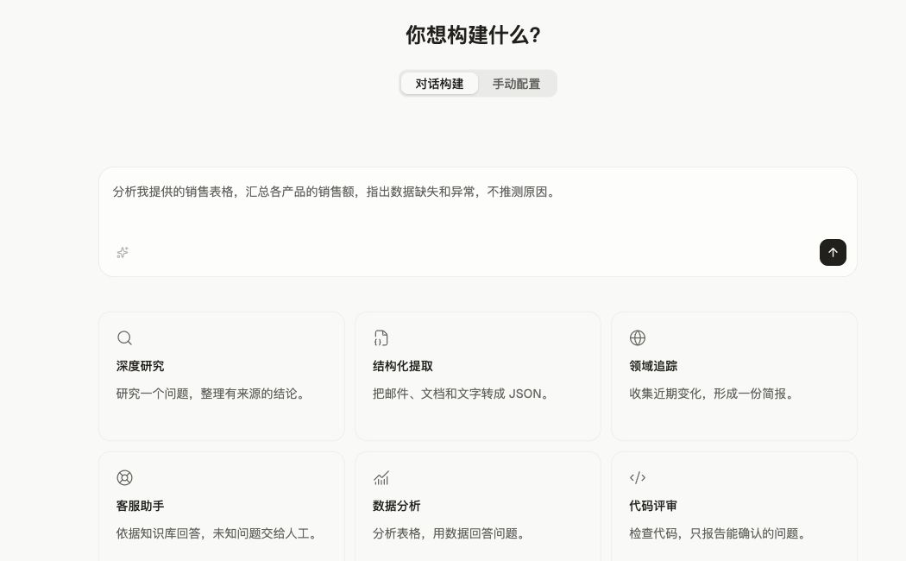
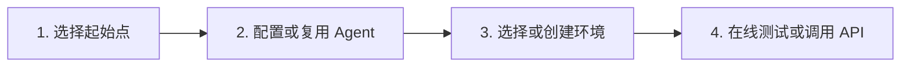
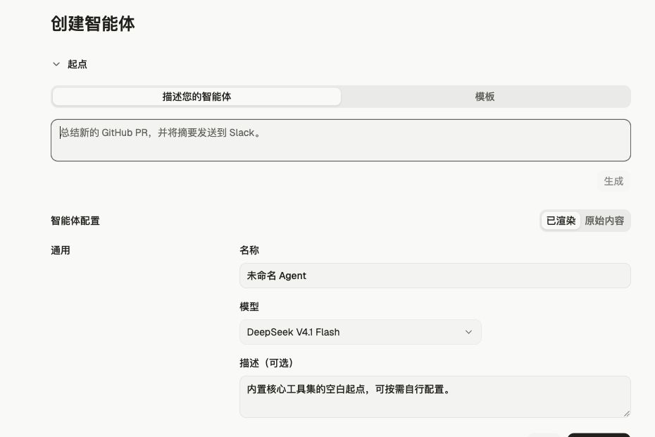

OMA 控制台 提供了一个用于创建和配置智能体的可视化界面。它让您可以在编写代码之前以交互方式迭代配置。

<Note>
  各资源的 Beta 要求不同，请参阅[版本与 Beta 功能](/docs/zh/api/versioning-beta)，并确认 SDK 向 OMA 发送了所需参数。
</Note>

## 从快速开始到第一次对话

在控制台侧栏选择 **托管智能体 → 快速开始**。选择「对话构建」描述目标，或选择「手动配置」逐步设置。



下图展示手动配置的路径：



先选择起始点，再配置 Agent 的名称、模型和系统提示词；然后选择已有环境或创建环境。在最后一步，可以用当前登录账号在线发送测试消息，也可以准备工作区 API 密钥，按照页面上的请求示例创建会话、连接事件流并发送消息。在线测试使用自己的会话，无需在页面中输入 API 密钥。

## 如何构建智能体

创建智能体时可以从描述或模板开始，然后配置名称、模型和系统提示词。下图中的模型仅为示例，具体选项取决于工作区配置。



可视化界面会引导您完成智能体定义的每个字段：

* **模型和系统提示：** 选择一个模型，并在全宽编辑器中编写系统提示。
* **MCP 服务器：** 通过 URL 添加远程 MCP 服务器，并对您的智能体进行身份验证，以便其代表您执行操作。
* **工具：** 使用预构建的智能体工具集和 MCP 工具扩展您的智能体能力。
* **技能：** 从您组织的库中附加 OMA 技能或自定义技能。

在「快速开始」的手动配置流程中，您可以查看对应的 API 请求示例，并在最后一步复制应用接入所需的请求。

## 测试智能体

在「快速开始」的手动配置流程中，选择 Agent 和环境后可在最后一步发起在线测试，查看回复和工具活动。您也可以从「会话」页面创建会话并继续对话。

## 从 OMA 控制台 到您的代码库

一旦您的智能体按预期工作：

1. 从 OMA 控制台 复制智能体 ID 和[环境 ID](/docs/zh/environments)。
2. 在[创建会话](/docs/zh/sessions)时在代码中引用它们：

<CodeGroup defaultLanguage="CLI">
  ```bash cURL
  session=$(curl -fsSL http://localhost:38080/v1/sessions \
    -H "x-api-key: $OMA_API_KEY" \
    -H "anthropic-version: 2023-06-01" \
    -H "anthropic-beta: managed-agents-2026-04-01" \
    -H "content-type: application/json" \
    -d '{
      "agent": "agent_01J8XkN5uT3vHpLqRfWdY2",
      "environment_id": "env_01K2mPsT7hNwR4jXuLvCqD8",
      "title": "My first session"
    }')
  ```

  ```bash CLI
  ant beta:sessions create \
    --agent agent_01J8XkN5uT3vHpLqRfWdY2 \
    --environment-id env_01K2mPsT7hNwR4jXuLvCqD8 \
    --title "My first session"
  ```

  ```python Python
  session = client.beta.sessions.create(
      agent="agent_01J8XkN5uT3vHpLqRfWdY2",
      environment_id="env_01K2mPsT7hNwR4jXuLvCqD8",
      title="My first session",
  )
  ```

  ```typescript TypeScript
  const session = await client.beta.sessions.create({
    agent: "agent_01J8XkN5uT3vHpLqRfWdY2",
    environment_id: "env_01K2mPsT7hNwR4jXuLvCqD8",
    title: "My first session"
  });
  ```

  ```csharp C#
  var session = await client.Beta.Sessions.Create(new()
  {
      Agent = "agent_01J8XkN5uT3vHpLqRfWdY2",
      EnvironmentID = "env_01K2mPsT7hNwR4jXuLvCqD8",
      Title = "My first session",
  });
  ```

  ```go Go
  session, err := client.Beta.Sessions.New(ctx, anthropic.BetaSessionNewParams{
      Agent: anthropic.BetaSessionNewParamsAgentUnion{
          OfString: anthropic.String("agent_01J8XkN5uT3vHpLqRfWdY2"),
      },
      EnvironmentID: "env_01K2mPsT7hNwR4jXuLvCqD8",
      Title:         anthropic.String("My first session"),
  })
  if err != nil {
      panic(err)
  }
  ```

  ```java Java
  var session = client.beta().sessions().create(
      SessionCreateParams.builder()
          .agent("agent_01J8XkN5uT3vHpLqRfWdY2")
          .environmentId("env_01K2mPsT7hNwR4jXuLvCqD8")
          .title("My first session")
          .build()
  );
  ```

  ```php PHP
  $session = $client->beta->sessions->create(
      agent: 'agent_01J8XkN5uT3vHpLqRfWdY2',
      environmentID: 'env_01K2mPsT7hNwR4jXuLvCqD8',
      title: 'My first session',
  );
  ```

  ```ruby Ruby
  session = client.beta.sessions.create(
    agent: "agent_01J8XkN5uT3vHpLqRfWdY2",
    environment_id: "env_01K2mPsT7hNwR4jXuLvCqD8",
    title: "My first session"
  )
  ```
</CodeGroup>
