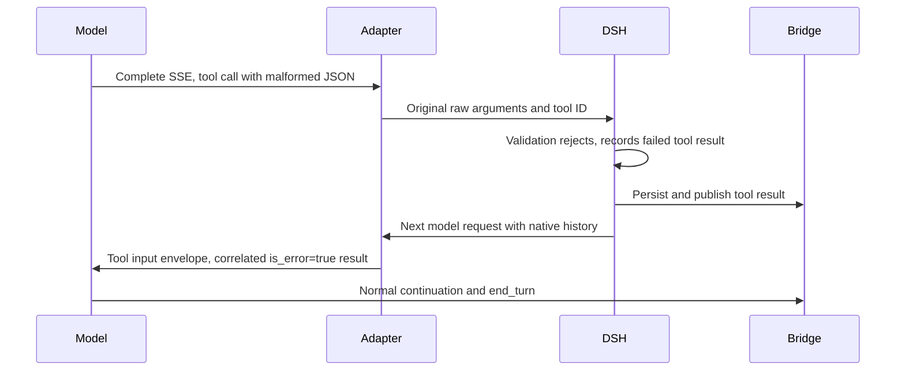

# Tool result recovery

The Messages adapter preserves malformed argument text in dsh's native log.
DSH parses it as text and the sandbox tool registration rejects the non-object
input before approval or dispatch. Its native tool result records `isError`.
Replaying that assistant call must not parse the invalid JSON again without a
fallback. The Messages boundary represents it with `__unparsedToolInput.raw`
and `.len`, retaining its original tool-use ID. The following tool result uses
the native failure flag and nonempty error text. No error status is derived from
error wording or scenario identity. The model can continue to a normal terminal
response. Valid JSON passes through unchanged.

A sandbox gateway response marked `X-Oma-Sandbox-Not-Forwarded: true` proves
the call never reached the sandbox. DSH records it as a failed tool result with
the gateway's error message instead of an unknown outcome. A completed call
whose content cannot be converted to text is also a failed result, not an
unknown outcome. Only calls whose sandbox outcome is genuinely unknown block
the session.

Sandbox initialization is shared by the root and its children. Each caller can
cancel its own wait without cancelling the handshake. The provider lifetime and
an independent 185-second timeout govern the handshake. Failed initialization
releases its client and transport instead of caching a rejected Promise. A later
call creates a fresh connection. Closing the provider cancels initialization and
prevents reconnecting. Ordinary tool HTTP failures leave sibling calls and the
connection intact; an SDK connection-close event invalidates only that connection.
A tool call uses the connection its own handshake wait returned. If the call
fails before its request is sent, for example because that connection closed,
it is a not-forwarded failed result rather than an unknown outcome.

An initialization failure or cancellation before dispatch settles through
`recordNotDispatched`, which records a failed result directly from `approved`.
It ends activity and waits for the result checkpoint without inventing a remote
dispatch or unknown outcome. Initialization errors report that the tool was not
executed, with the HTTP status when available. User interruption retains the
existing interruption semantics.

Unmarked tool HTTP failures carry a typed, body-free diagnostic. Read-only tools
retain the HTTP status after their single retry. A trusted not-forwarded response
is not retried. Its JSON message is read with a 2 KiB bound and limited to 500
characters; control characters are removed and messages containing credential
markers or URLs are omitted. Other response bodies are not exposed. Write tools
with an unknown outcome remain blocked and are never automatically replayed.
The bridge persists a safe `system.message` alongside the blocked transition and
logs only the phase, status and correlation IDs. HTTP status alone never proves
non-execution. Existing blocked journals are not automatically unlocked.

`tests/sandbox-recovery.test.ts` exercises these paths over a local HTTP backend
using the real MCP SDK and DSH model loop. `tests/runtime.test.ts` checks the
pre-dispatch checkpoint and cancellation barriers. These mocks do not establish
real Sandbox or model-provider behavior.

MCP text conversion belongs to the neutral tool execution boundary. For Bash,
a structured completed execution with zero exit code, empty stderr, false timeout,
cancellation and truncation flags and no collection errors can expose exact
stdout. Its first text block must equal stdout, except that empty stdout accepts
`(no output)`. A second block is accepted only when its parsed JSON equals the
structured result. Otherwise all diagnostic text is retained. Other tools do not
use Bash normalization. Conversion does not alter the result's failure flag.
The confirmed journal, model feedback and public CCRv2 event receive the same
text, including empty strings and trailing newlines.

`tests/session.test.ts` checks malformed JSON recovery, correlation, public
publication and successful stdout replay through the real dsh loop.
`tests/tool-output.test.ts` checks metadata mismatch, failure and diagnostic
preservation, other tools and exact empty/nonempty stdout. These tests use a
controlled HTTP backend and require no shared NATS resources.
