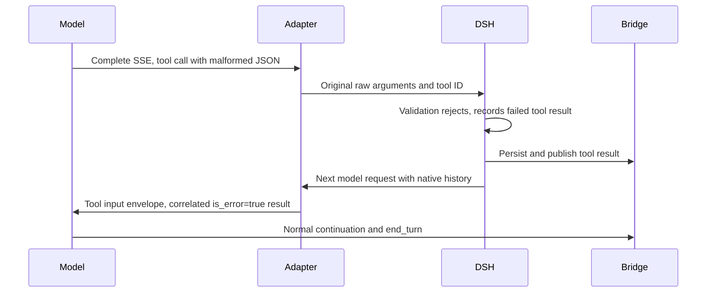

# Tool result recovery

The Messages adapter preserves malformed argument text in dsh's native log.
DSH parses it as text and the sandbox tool registration rejects the non-object
input before approval or dispatch. Its native tool result records `isError`.
Replaying that assistant call must not parse the invalid JSON again without a
fallback. The Messages boundary represents it with `__unparsedToolInput.raw`
and `.len`, retaining its original tool-use ID. The following tool result uses
the native failure flag and nonempty error text. No error status is derived from
error wording or scenario identity. The model can continue to a normal terminal
response. Valid JSON passes through unchanged.

A sandbox gateway response marked `X-Oma-Sandbox-Not-Forwarded: true` proves
the call never reached the sandbox. DSH records it as a failed tool result with
the gateway's error message instead of an unknown outcome. A completed call
whose content cannot be converted to text is also a failed result, not an
unknown outcome. Only calls whose sandbox outcome is genuinely unknown block
the session.

MCP text conversion belongs to the neutral tool execution boundary. For Bash,
a structured completed execution with zero exit code, empty stderr, false timeout,
cancellation and truncation flags and no collection errors can expose exact
stdout. Its first text block must equal stdout, except that empty stdout accepts
`(no output)`. A second block is accepted only when its parsed JSON equals the
structured result. Otherwise all diagnostic text is retained. Other tools do not
use Bash normalization. Conversion does not alter the result's failure flag.
The confirmed journal, model feedback and public CCRv2 event receive the same
text, including empty strings and trailing newlines.

`tests/session.test.ts` checks malformed JSON recovery, correlation, public
publication and successful stdout replay through the real dsh loop.
`tests/tool-output.test.ts` checks metadata mismatch, failure and diagnostic
preservation, other tools and exact empty/nonempty stdout. These tests use a
controlled HTTP backend and require no shared NATS resources.
